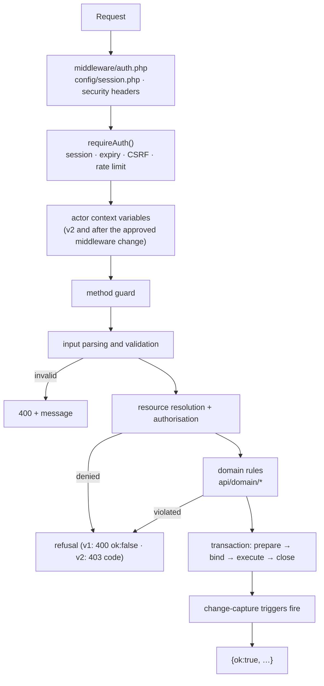
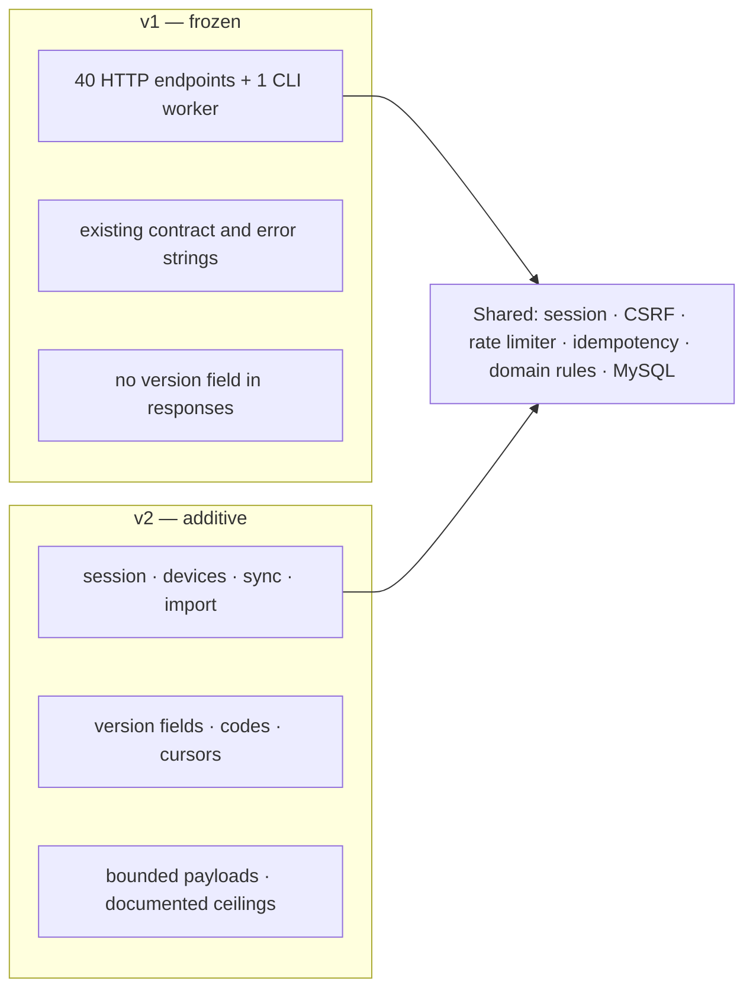

# API Architecture

| Field | Value |
|---|---|
| Status | Specification — Phase 2 |
| Date | 2026-11-15 |
| Purpose | Define how the API is structured as a whole: file layout, routing model, the request lifecycle every endpoint follows, shared conventions, pagination, rate limiting, and the split between the v1 and v2 surfaces |
| Requirements | AP-01…AP-12, SE-05, SE-08 |
| Decisions | D-10 (v2 surface), D-28 (sync rate-limit bucket), D-30 (shared domain rules), D-32 (session owner) |
| Rule | One convention, implemented once. An endpoint that re-implements a shared behaviour is a defect |

---

## 1. Scope

| Topic | Section |
|---|---|
| File layout and routing | §2 |
| The request lifecycle | §3 |
| Shared conventions | §4 |
| Response shapes | §5 |
| Idempotency | §6 |
| Pagination | §7 |
| Rate limiting | §8 |
| The v1/v2 split | §9 |

Detail lives elsewhere: the frozen v1 contract in [`API_CONTRACT.md`](../API_CONTRACT.md); the v1
inventory and preservation rules in
[`API_CONTRACT_SPECIFICATION.md`](API_CONTRACT_SPECIFICATION.md); the new surface in
[`SYNC_API_SPECIFICATION.md`](SYNC_API_SPECIFICATION.md); errors in
[`API_ERROR_HANDLING.md`](API_ERROR_HANDLING.md); versioning in
[`API_VERSIONING.md`](API_VERSIONING.md).

---

## 2. File layout and routing

### 2.1 The model

| Property | Statement |
|---|---|
| Routing | **No router.** The path maps to a file: `/api/expenses/create.php` is `api/expenses/create.php` |
| Why | It is the existing model, works on any Apache/PHP host, needs no rewrite rules, and makes a route's code findable from its URL |
| Cost | URL structure and directory structure are coupled; a mechanical rename moves a route |
| Versioning | Path-based (`/api/` = v1, `/api/v2/` = v2), so no pipeline is needed to read a version header (D-10) |

### 2.2 The tree

```
api/
├── login.php · signup.php · logout.php          # public
├── middleware/auth.php                          # requireAuth(), CSRF wrapper, actor context
├── helpers/                                     # csrf · validator · logger · response
│                                                #   rate_limiter · outbox · notification_*
├── domain/                                      # PROPOSED — extracted shared rules (D-30)
├── services/                                    # dormant infrastructure (KD-11)
├── expenses/ · groups/ · lists/ · settlements/ · budgets/ · notifications/
├── system/health.php
├── workers/process_outbox.php                   # CLI only
└── v2/                                          # PROPOSED — new capabilities
    ├── auth/session.php
    ├── devices/{register,list,revoke}.php
    ├── sync/{bootstrap,pull,push,state}.php
    └── import/{guest,status}.php
```

| Rule | Statement |
|---|---|
| v2 mirrors v1's shape | Standalone files with explicit `require_once` chains (`../architecture/BACKEND_COEXISTENCE.md` §2.4) |
| A v2 file never includes a v1 endpoint | Shared behaviour is extracted to `api/domain/` (D-30) |
| `api/v2/` does not exist yet | Creating it is part of the approved backend phase, not Phase 2 |

### 2.3 Method guards

| Pattern | Where |
|---|---|
| `requirePostMethod()` / `requireGetMethod()` | Available in `helpers/response.php`; returns 405 with an `Allow` header where used |
| Inline `if ($_SERVER['REQUEST_METHOD'] !== 'POST')` | The older pattern, still present in endpoints |
| **Mixed state** | `API_CONTRACT.md` §9.1 records which endpoints use which. Normalising it is Section 30 work, deliberately deferred |

**Rule for v2:** every v2 endpoint uses `requirePostMethod()` / `requireGetMethod()`, so the new
surface is consistent even while v1 is mixed.

---

## 3. The request lifecycle



| Stage | Owner | Notes |
|---|---|---|
| Session and headers | `config/session.php` via the middleware | Single owner (D-32) |
| Authentication | `api/middleware/auth.php` | Never duplicated |
| CSRF | `api/helpers/csrf.php` | One implementation, two entry points |
| Method guard | The endpoint | v2 uses the helpers |
| Validation | `helpers/validator.php` + the endpoint | v2 reuses the same validators (AP-11) |
| Authorisation | The endpoint or `api/domain/` | Same code for v1 and v2 |
| Domain rules | `api/domain/` | Extracted once (D-30) |
| Persistence | The endpoint, with prepared statements | Always inside a transaction for multi-step writes |
| Change capture | Triggers | Invisible to the endpoint |

---

## 4. Shared conventions

| Convention | Rule | Authority |
|---|---|---|
| Response envelope | `{ok: bool, …}` — never a bare array, never `{success}` alone | `API_CONTRACT.md` §3 |
| Error shape | `{ok:false, error:"…"}`; v2 adds `code` | `API_ERROR_HANDLING.md` §2 |
| Content type | `application/json` on every API response, set before any output | `API_CONTRACT.md` §1 |
| Money | Two decimals; v1 emits mixed string/number (finding F-06), v2 emits a string | D-21 |
| Dates | `Y-m-d`; validated with `validateDate()`, never a bare regex | `AGENTS.md` |
| Pagination | `parsePagination()` + `paginationMeta()` with per-endpoint ceilings | §7 |
| Rate limiting | The middleware, with per-purpose buckets | §8 |
| Idempotency | `config/idempotency.php` on POSTs that create or change state | §6 |
| Logging | `logMessage(level, message, context)`; never log a password, secret, or token | `SECURITY_ARCHITECTURE.md` §7 |
| SQL | `prepare` → `bind_param` → `execute`; always `close()`; never interpolate | `AGENTS.md` |
| Transactions | `begin_transaction()` / `commit()` / `rollback()` for multi-step writes | `AGENTS.md` |
| Session access | Never read `$_SESSION` directly in v2 — it is set by the middleware | §3 |
| Unknown fields | Ignored, not rejected (forward compatibility) | `ACCESS_CONTROL.md` §7.2 |
| Enum values on input | Validated against the exact allowed set | `API_CONTRACT.md` §8 |

### 4.1 The "one implementation" rule

| Behaviour | Single location | A second implementation is… |
|---|---|---|
| Session start and cookie flags | `config/session.php` | a header-ordering bug |
| Authentication | `api/middleware/auth.php` | a bypass |
| CSRF | `api/helpers/csrf.php::verifyCsrf()` | a bypass |
| Rate limiting | `api/helpers/rate_limiter.php` | an inconsistency |
| Idempotency | `config/idempotency.php` | a double-write |
| Pagination parsing | `api/helpers/validator.php` | a ceiling change |
| Money validation | `api/domain/money.php` (proposed) | a rounding difference |
| Settlement lock | `api/domain/settlement_lock.php` (proposed) | **a wrong balance** |
| Membership and roles | `api/domain/membership.php` (proposed) | a permission gap |

**Verification:** a review grep for the rule's SQL predicate or its numeric limit must find exactly
one definition outside the read-only queries that legitimately contain the filter.

---

## 5. Response shapes

### 5.1 v1 (frozen)

| Case | Shape |
|---|---|
| Success | `{ok:true, success:true, code:200, …}` for endpoints using `apiSuccess()`; endpoints using raw `json_encode` emit `{ok:true, …}` without `success`/`code` |
| Business failure | `{ok:false, success:false, code:400, error:"…"}` (via `apiResponse`) or `{ok:false, error:"…"}` (raw) |
| Rate limited | `{ok:false, error:"Too many requests. Rate limited.", retry_after, limited_by}` |
| CSRF failure | `{ok:false, error:"…"}` at 403 |
| Server error | `{ok:false, success:false, error:"Internal server error.", code:500}` (installed handler) |

**The mixed state is real and documented** (`API_CONTRACT.md` §3, §9.1). Section 30's rollout onto
`response.php` is deferred by policy, not rejected.

### 5.2 v2 (proposed)

| Property | Rule |
|---|---|
| Always includes `ok` | Required |
| Always includes `code` on failure | Machine-readable, stable per `API_ERROR_HANDLING.md` §3 |
| Always includes `error` on failure | Human-readable, for logs and support |
| Success payload under a named key | For example `{ok:true, changes:[…], next_cursor, has_more, digests}` |
| Never a bare array at the top level | Same as v1 |
| Never omits `ok` | A client that must infer success from a status code is a client that will mis-handle v1 refusals (PR-21) |

---

## 6. Idempotency

| Surface | Mechanism |
|---|---|
| v1 | `config/idempotency.php`, wired to 11 POST endpoints; `helpers.js` sends a per-intent key |
| v2 | The HTTP layer (same helper) **plus** a logical layer: `sync_batches.batch_key` for a push, `guest_import_batches.batch_key` for an import, the record `uuid` for a record create |
| Retries | The same key is reused for the same logical work; a different body under the same key is a `409` |

| Rule | Statement |
|---|---|
| Every v2 write is idempotent at the record level | A create is guarded by `uuid`; an update/delete by `uuid` + `base_version` |
| A batch key is never regenerated for a retry | Doing so would re-apply the batch |
| Idempotency does not replace authorisation | A replayed request is re-authorised (`ACCESS_CONTROL.md` A6) |
| TTL | Per the existing implementation; a replay beyond the TTL unguarded by the HTTP layer is still guarded by `uuid`/`batch_key` at the logical layer |

Declared per endpoint in [`SYNC_API_SPECIFICATION.md`](SYNC_API_SPECIFICATION.md) §4.

---

## 7. Pagination (AP-05)

**Requirement:** AP-05 "pagination ceilings are preserved and sync uses cursors".

### 7.1 v1 — the frozen ceilings

| Endpoint(s) | Call | Why |
|---|---|---|
| `expenses/list.php` | `parsePagination(20, 50)` (date mode), 500/1000 (month mode) | Tests `32l`–`32o` assert defaults 20/1 and cap 50 |
| `notifications/list.php` | `parsePagination(30, 50)` | Test `32s` asserts `pagination.limit === 30` |
| `lists/user_lists.php`, `groups/user_groups.php`, `groups/details.php`, `lists/details.php`, `settlements/history.php`, `settlements/details.php`, `expenses/unpriced.php`, `notifications/history.php` | `parsePagination(500, 1000)` | These feeds never send `?limit=`; a 20-row default would silently truncate dropdowns and rosters |

| Rule | Statement |
|---|---|
| **No ceiling is normalised** | Each value is load-bearing for a test or a UI requirement. Changing one requires an approved contract change |
| `paginationMeta()` accompanies every paged response | `{page, limit, total, pages, has_more}` |
| `groups/details.php` paginates expenses but never members (≤ 10) | Members are returned whole |
| `lists/details.php` returns all items while still reporting `pagination` | The UI sums every row |

### 7.2 v2 — cursors, not pages for change streams

| Endpoint | Mechanism |
|---|---|
| `sync/pull.php` | `since` cursor + `page_size`; returns `next_cursor`, `has_more` |
| `sync/bootstrap.php` | Paged by entity with a bounded page size; resumable |
| `devices/list.php` | Ordinary pagination (small, user-scoped) |
| `import/status.php` | Per-entity counts, no pagination |

| Rule | Statement |
|---|---|
| A change stream is never paginated by offset | Offset paging over an append-only log can skip or duplicate rows when new rows arrive |
| A cursor is opaque to the client | It is compared and echoed, never parsed |
| A bounded page size is mandatory | An unbounded bootstrap response would be limited only by PHP's memory limit |
| Pagination ceilings do not apply to v2 | v2 uses cursors and explicit page sizes |
| `parsePagination()` is still used for v2 non-stream lists | So the helper has one behaviour |

---

## 8. Rate limiting (AP-08, SE-08, D-28)

**Requirements:** AP-08 "rate limiting is defined per surface"; SE-08 "rate limiting covers every
surface including sync".

### 8.1 Existing buckets (verified)

| Bucket | Key | Limit | Window | Applied by |
|---|---|---|---|---|
| `api_user` | `user:<id>` | 120 | 60 s | `requireAuth()` on every authenticated request |
| `api_ip` | `ip:<addr>` | 240 | 60 s | `requireAuth()` |
| `api_heartbeat` | `user:<id>` | 30 | 60 s | `requireAuth(false)` — the notification poll |
| `login` | `ip:<addr>` | 5 | 900 s | `login.php` |
| `signup` | `ip:<addr>` | 3 | 3600 s | `signup.php` |
| `csrf_fail` | `ip:<addr>` | 50 | 600 s | `verifyCsrf()` (an IP gate, not a request limiter) |

### 8.2 The sync bucket (D-28 — `PROPOSED`)

| Property | Value |
|---|---|
| Name | `api_sync` |
| Scope | The v2 sync, device, and import endpoints |
| Limits | 120 / minute per user **and** per device, burst 240 |
| Why a separate bucket | A first sync or a retry storm would otherwise trip `api_user` during normal operation (finding F-08) |
| Does `api_user` still apply? | **Yes.** Both buckets apply; the sync bucket is additive, not an exemption |
| Cleanup | `cleanupRateLimits()` must include the new bucket in its action-aware retention |
| Values | `NEEDS APPROVAL` — UQ-05 |

### 8.3 Behaviour on exceeding a limit

| Aspect | Rule |
|---|---|
| Status | `429` |
| Body | `{ok:false, error:"Too many requests. Rate limited.", retry_after, limited_by}` (+ `code:"RATE_LIMITED"` in v2) |
| Header | `Retry-After` (seconds) |
| Client obligation | Wait at least `Retry-After`; the sync engine's backoff honours it (`SYNC_WORKFLOWS.md` §9.2) |
| Never | Silently drop the request or return 200 |

### 8.4 Design rules

| Rule | Statement |
|---|---|
| A limit is per purpose, not per URL | Buckets are action names, so a rename does not reset a limit |
| A new endpoint must name its bucket | An endpoint with no bucket is an unthrottled surface |
| Counters live in `rate_limits` (DB) or Redis, never in the session | Redis is optional; the DB path is always available (`architecture/SYSTEM_COMPONENTS.md` §5) |
| A rate limit is never the only protection for an expensive operation | Bounded payload sizes are enforced too (§7.2, batch ceilings) |
| A limit value is documentation | Every value in §8.1 and §8.2 appears in a table somewhere; an undocumented limit is a defect |

---

## 9. The v1/v2 split (D-10)



| Aspect | v1 | v2 |
|---|---|---|
| Path | `/api/…` | `/api/v2/…` |
| Contract | Frozen (`API_CONTRACT.md` §14) | Versioned (`API_VERSIONING.md`) |
| Auth | Session cookie + CSRF | Identical |
| Version fields | None, ever | `version` on syncable records |
| Errors | Frozen strings, mixed status conventions | Stable `code` + `error` |
| Pagination | Page/limit with fixed ceilings | Cursors for streams |
| Removed endpoints | None | n/a |
| Retired | Only at the Phase 6 cutover | n/a |

| Rule | Statement |
|---|---|
| v1 never calls v2 over HTTP | Both are reached by clients |
| v2 never calls v1 over HTTP | It calls the same domain helpers (`BACKEND_COEXISTENCE.md` §6) |
| A v1 write and a v2 write to the same row produce the same business outcome | They differ only in the version precondition and device attribution |
| Adding a field to a v1 response is a contract change | Forbidden |
| Adding an endpoint to v2 is normal evolution | It is still listed in the inventory before it ships |

---

## 10. Unresolved questions

| UQ | Status | Effect |
|---|---|---|
| UQ-05 — sync rate-limit values | `OPEN` (a default is specified) | §8.2 |
| UQ-06 — Laravel coexistence | `BLOCKING` | Whether a gateway route joins the inventory |
| UQ-10 — settlement admin actions in Flutter | `OPEN` | Whether `settle*` is exposed in the new UI (API-complete either way) |

---

## 11. Verification

| Requirement | Method | Pass condition |
|---|---|---|
| AP-01 v1 contracts unchanged | `CONTRACT-TEST` | Every frozen behaviour in `API_CONTRACT.md` still holds |
| AP-02 versioned v2 surface | `DOC-REVIEW` | §2.2 and §9 place new capabilities only under `/api/v2/` |
| AP-05 pagination preserved, cursors for sync | `CONTRACT-TEST` | The ceilings in §7.1 are unchanged; pull uses `since`/`next_cursor` |
| AP-08 / SE-08 rate limiting per surface | `CONTRACT-TEST` | Every bucket in §8.1/§8.2 is enforced; sync traffic does not trip `api_user` at normal volume |
| AP-11 validation shared | `UNIT-TEST` | A v2 write and a v1 write reject the same invalid input with the same rule |
| SE-05 server-side validation | `PENTEST` | Client-side validation bypass does not reach the database |
| §4.1 one-implementation rule | `STATIC-CHECK` | Grep finds one definition per shared behaviour |
| §5 response shapes | `CONTRACT-TEST` | v1 shapes unchanged; v2 always includes `ok` and, on failure, `code` |
| §6 idempotency | `CONTRACT-TEST` | A replayed v1 POST and a replayed v2 batch each apply once |
