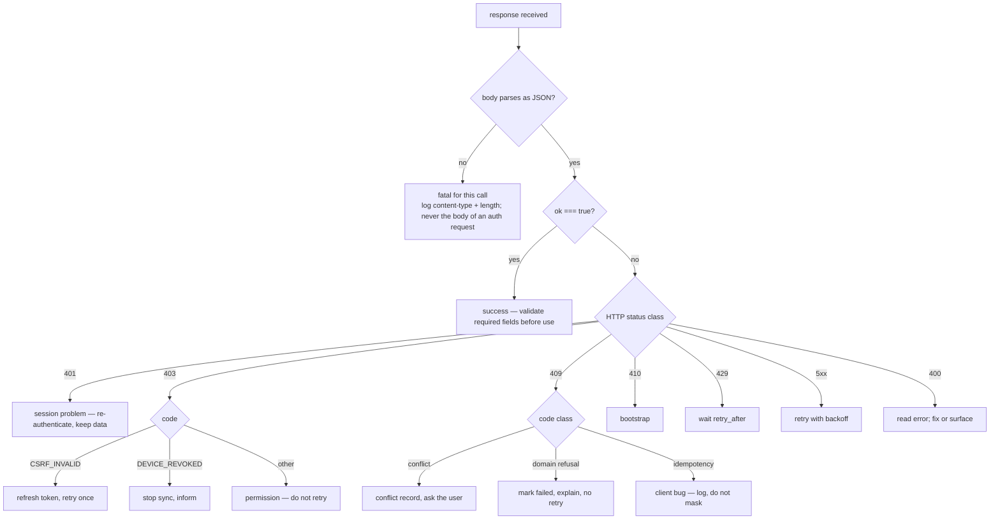

# API Error Handling

| Field | Value |
|---|---|
| Status | Specification — Phase 2 |
| Date | 2026-11-15 |
| Purpose | Define the response envelope for both generations, the machine-readable error codes v2 introduces, and exactly how a client must decode a failure |
| Requirements | AP-03, AP-07, PR-21 |
| Decisions | D-10 |
| Rule | The `ok` flag is authoritative for business outcomes; the HTTP status is authoritative for transport classes. A client that reads only the status will mis-handle v1 |

---

## 1. Scope

| Topic | Section |
|---|---|
| The response envelope, both generations | §2 |
| The error catalogue and the `ok` rule | §3 |
| Client handling rules | §4 |
| Logging and correlation | §5 |

The CSRF-specific strings live in [`API_CONTRACT.md`](../API_CONTRACT.md) §4.3; the authorisation
status-code divergence is stated in [`../security/ACCESS_CONTROL.md`](../security/ACCESS_CONTROL.md)
§9.

---

## 2. The response envelope (AP-03)

**Requirement:** AP-03 "response envelope rules are documented for both generations".

### 2.1 Success

| Generation | Shape |
|---|---|
| v1 via `apiSuccess()` | `{"ok":true, "success":true, "code":200, …}` |
| v1 via raw `json_encode` | `{"ok":true, …}` — no `success`, no `code` |
| v2 | `{"ok":true, …}` plus, where relevant, `server_time` and `server_build` |

### 2.2 Failure

| Generation | Shape |
|---|---|
| v1 via `apiResponse(['ok'=>false, …])` | `{"ok":false, "success":false, "code":400, "error":"…"}` — **HTTP 400** whatever the cause |
| v1 via `apiError($msg, $status)` | `{"ok":false, "success":false, "error":"…", "code":$status}` — the explicit status |
| v1 unhandled exception | HTTP 500 `{"ok":false,"success":false,"error":"Internal server error.","code":500}` |
| v1 CSRF | HTTP 403 `{"ok":false,"error":"…"}` |
| v1 rate limit | HTTP 429 `{"ok":false,"error":"Too many requests. Rate limited.","retry_after":N,"limited_by":"user|ip"}` |
| v1 authentication | HTTP 401 `{"ok":false,"error":"Authentication required"|"Session expired"}` |
| v2 | `{"ok":false, "code":"STABLE_CODE", "error":"Human-readable message", …}` |

### 2.3 The rules

| # | Rule |
|---|---|
| 1 | `ok` is always present, on both surfaces |
| 2 | The top level is always an object, never an array |
| 3 | `Content-Type: application/json` is set before any output |
| 4 | A failure never returns HTTP 200 on either surface |
| 5 | v2 always adds a stable `code`; v1 has only the legacy `code` (an integer status echo) |
| 6 | The human-readable `error` is present on every failure, on both surfaces |
| 7 | A stack trace, file path, SQL fragment, or secret never appears in a response |
| 8 | An optional failure may carry structured context (`retry_after`, `server`, `period`) beside the message |
| 9 | Unknown fields in a response are ignored by clients |
| 10 | A client must not infer success from a status code alone (PR-21, §3.1) |

### 2.4 The v1 mixed state, recorded

`API_CONTRACT.md` §9.1 and the Section 30 note record that some v1 endpoints emit raw
`json_encode` responses and some return 200 with a business failure. **This is deliberate and
deferred, not a defect to fix in passing.** The Flutter client parses defensively:

| Situation | Client behaviour |
|---|---|
| `ok === false` with HTTP 200 | Treat as a business failure; read `error` |
| `ok === false` with HTTP 400 | Treat as a business failure; read `error` |
| `ok === true` with HTTP 200 | Success — but the caller still validates required fields |
| HTTP 5xx | Transport-class failure; retry with backoff |
| A body that is not JSON | Fatal for that call; log the raw body length and content type, never the body of an auth request |

---

## 3. The error catalogue and the `ok` rule (PR-21)

**Requirement:** PR-21 "success is determined by `ok`, not HTTP 200".

### 3.1 The rule

| Direction | Authority |
|---|---|
| v1 (both the legacy UI's `fetch` wrapper and the Flutter client) | **`ok`**, always |
| v2 | **`ok`**, always |
| Transport retry decisions | The HTTP status **and** the `code` |
| Session decisions | `401` plus the v2 `code` (`UNAUTHENTICATED` / `SESSION_EXPIRED`) |

**Why the status alone is insufficient:** 187 `apiResponse(...)` call sites in the 40 v1 endpoint
files default to HTTP 400 when `ok` is false, and a handful of endpoints return 200 with a business
failure. A client that branches on
the status will treat a permission refusal as a malformed request, and a business failure as success.

### 3.2 v2 error codes (proposed — the stable catalogue)

| `code` | HTTP | Meaning | Client action |
|---|---|---|---|
| `UNAUTHENTICATED` | 401 | No session | Route to login; keep local data |
| `SESSION_EXPIRED` | 401 | 24-hour expiry reached | Route to login; keep local data |
| `CSRF_INVALID` | 403 | Missing/invalid token | Refresh the token from `auth/session.php`, retry once |
| `PERMISSION_DENIED` | 403 | Authenticated, not permitted for this record | Do not retry; explain |
| `DEVICE_REVOKED` | 403 | The device cannot sync | Stop syncing; inform the user |
| `DEVICE_NOT_REGISTERED` | 409 | A sync request from an unknown device | Register, then retry |
| `DEVICE_REGISTERED_TO_ANOTHER_USER` | 409 | The UUID belongs to another account | Generate a new device UUID |
| `RATE_LIMITED` | 429 | A bucket is exhausted | Wait `retry_after` |
| `VALIDATION_FAILED` | 400 | A field is invalid | Show the field error; do not retry unchanged |
| `MISSING_BASE_VERSION` | 400 | An update/delete without a precondition | Client bug; log it |
| `INVALID_CURSOR` | 400 | Malformed or unparseable cursor | Bootstrap |
| `BATCH_KEY_REUSED` | 409 | The same batch key with a different body | Client bug; log it; do not silently accept |
| `BATCH_TOO_LARGE` / `TOO_MANY_RECORDS` | 413 | Over the batch/record ceiling | Split and retry |
| `DUPLICATE_ID` | 409 | The `uuid` already exists | Adopt the server's record |
| `VERSION_CONFLICT` | 409 | Stale `base_version` | Create a conflict; ask the user |
| `RECORD_DELETED` | 409 | The record was deleted elsewhere | Ask the user |
| `PERIOD_SETTLED` | 409 | The date is inside a settled period | Retarget or discard |
| `PERIOD_CHANGED` | 409 | `expected_period_end`/`expected_total` mismatched | Refresh and re-present |
| `CURSOR_TOO_OLD` | 410 | The cursor is well-formed but outside the placeable range — below the retained floor **or above the server watermark** | Full bootstrap |
| `RECORD_NOT_FOUND` | 404 | The addressed record does not exist (or is not visible) | Do not enumerate; treat as gone |
| `BATCH_NOT_FOUND` | 404 | Unknown import batch | — |
| `UNSUPPORTED_ENTITY` | 400 | An import record names an unknown entity | Skip it; report |
| `INTERNAL_ERROR` | 500 | Server failure | Retry with backoff |

| Rule | Statement |
|---|---|
| A `code` is permanent | Its meaning never changes |
| A new condition gets a new `code` | Never a new meaning on an old code |
| A code is UPPER_SNAKE_CASE ASCII | Easy to log, grep, and test |
| The catalogue is the test matrix | Every row has at least one contract test |
| v1 does **not** gain codes | Contract freeze |

### 3.3 v1 error strings (frozen — never changed)

| Condition | Frozen string |
|---|---|
| No session | `Authentication required` |
| Expired session | `Session expired` |
| Rate limited | `Too many requests. Rate limited.` |
| Group expense edit by a non-admin | `Only the group admin can edit group expenses.` |
| Group expense delete by a non-admin | `Only the group admin can delete group expenses.` |
| Settle by a non-admin | `Only the group admin can record settlements.` |
| Settle-all by a non-admin | `Only the group admin can settle expenses.` |
| Member removal by a non-admin | `Only the group admin can remove members.` |
| Removing an admin | `Admin cannot be removed from the group.` |
| CLI-only file over HTTP | `Forbidden: CLI execution only.` |
| Unhandled exception | `Internal server error.` |

The complete list is `API_CONTRACT.md` §12. **Any implementation that changes one of these strings is a
regression**, regardless of how much clearer the new message would be.

---

## 4. Client handling rules (AP-07)

**Requirement:** AP-07 "error codes are stable and machine-readable in v2".

### 4.1 The decision procedure

| # | Rule |
|---|---|
| 1 | Branch on `ok`, then on the status, then on the `code` |
| 2 | Never retry a `400`, `403` (except `CSRF_INVALID` once), `404`, or a domain-refusal `409` |
| 3 | A single `401` does **not** log the user out unless the code is `UNAUTHENTICATED`/`SESSION_EXPIRED` — a transient failure must not be treated as expiry |
| 4 | `Retry-After` and `retry_after` override any computed backoff |
| 5 | A response body is never logged if the request contained credentials |
| 6 | A conflict `409` is never auto-retried; it becomes a conflict record |
| 7 | A domain-refusal `409` becomes a visible "not saved" state, never a silent drop |
| 8 | The user always sees a plain-language reason, not a code |

### 4.2 v1/v2 mapping

| Condition | v1 | v2 | Same semantic? |
|---|---|---|---|
| No session / expired | 401 + frozen string | 401 `UNAUTHENTICATED`/`SESSION_EXPIRED` | Yes |
| CSRF | 403 + frozen string | 403 `CSRF_INVALID` | Yes |
| **Permission denied** | **400** + frozen string | **403** `PERMISSION_DENIED` | Yes (the status differs by design — see below) |
| Validation | 400 + message | 400 `VALIDATION_FAILED` | Yes |
| Rate limited | 429 + `retry_after` | 429 `RATE_LIMITED` | Yes |
| CLI-only | 403 `Forbidden: CLI execution only.` | n/a | — |
| Server error | 500 + generic | 500 `INTERNAL_ERROR` | Yes |

**The permission-status divergence is deliberate, verified, and documented, not a defect.**
Verified: `apiResponse()` in `api/helpers/response.php` defaults to HTTP 400; 187 v1 call sites use it
for business failures, and no v1 endpoint passes 403 for an authorisation refusal. `AGENTS.md` states
403; the code returns 400. **The frozen contract wins and v1 is not changed.** v2 uses 403, which is
correct, and does not retro-fit v1.

**Consequence for the shared Flutter API client:** it must treat "authorised request refused with a
business error" as one class, regardless of the status, because the same user action can produce 400
through v1 and 403 through v2 (`AUTHENTICATION_AND_AUTHORIZATION.md` §9).

### 4.3 Retry matrix

| Status / code | Retry? | Backoff |
|---|---|---|
| 401 `UNAUTHENTICATED`/`SESSION_EXPIRED` | After re-login | n/a |
| 403 `CSRF_INVALID` | Once, after a token refresh | immediate |
| 403 others | No | — |
| 400 | No | — |
| 404 | No | — |
| 409 conflict / domain / idempotency | No | — |
| 410 | No (bootstrap instead) | — |
| 413 | After splitting | immediate |
| 429 | Yes | `retry_after` |
| 5xx | Yes | 1 s → 60 s with jitter, bounded attempts, then surface |
| Transport failure | Yes | same as 5xx |

### 4.4 Error presentation rules

| Rule | Statement |
|---|---|
| A field-level validation error names the field | The form highlights it |
| A permission refusal explains the remedy | "Only a group admin can edit this expense." |
| A conflict is not an error toast | It opens the resolution surface |
| A rate limit is not a scary dialog | "Too many requests — retrying in N seconds" |
| A server error is honest | "Something went wrong on the server. Your changes are saved on this device." |
| No raw code is shown to a user | Codes are for logs and tests |

---

## 5. Logging and correlation

| Aspect | Rule |
|---|---|
| Server | `logMessage(level, message, context)`; the context includes endpoint, method, user id, and IP — never a password, token, secret, or full payload |
| v2 failures | Log the `code` and the endpoint; the message may contain a human-readable reason |
| Log level | A permission refusal is not an ERROR; a `500`, a failed trigger, or a batch failure is |
| Correlation | `server_time` and `server_build` in v2 responses let support correlate a client report with the server |
| Client | Log counts, codes, and batch keys; never payload contents |

---

## 6. Unresolved questions

| UQ | Status | Effect |
|---|---|---|
| UQ-18 — permanently rejected writes | `OPEN` | §4.1's "mark failed, explain" presentation |
| UQ-12 — conflict UX | `OPEN` | The conflict surface a `409` opens |

---

## 7. Verification

| Requirement | Method | Pass condition |
|---|---|---|
| AP-03 envelope rules | `CONTRACT-TEST` | Success and failure shapes match §2 for both generations |
| AP-07 stable machine-readable codes | `CONTRACT-TEST` | Every code in §3.2 is produced at least once and no unknown code appears |
| PR-21 success from `ok` | `CONTRACT-TEST` | A 200-with-`ok:false` response is handled as a failure by the client |
| Frozen v1 strings | `CONTRACT-TEST` | The §3.3 strings are unchanged; `API_CONTRACT.md` §12's full list matches |
| §4.1 decision procedure | `UNIT-TEST` | Each branch is exercised with a synthetic response |
| §4.3 retry matrix | `UNIT-TEST` | No retry occurs for a non-retryable class; `retry_after` is honoured |
| §4.2 divergence documented | `DOC-REVIEW` | The 400-vs-403 difference is stated and explained; neither surface changes |
| No secret in a response | `PENTEST` | Fuzzing error paths never returns a stack trace, path, SQL, or token |
