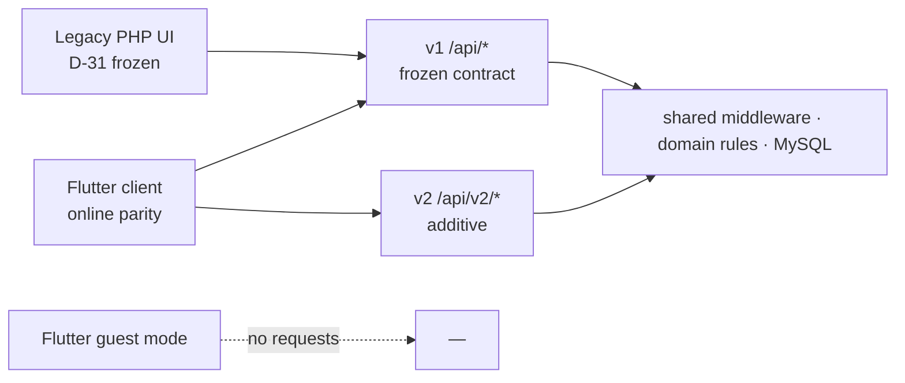

# API Versioning

| Field | Value |
|---|---|
| Status | Specification — Phase 2 |
| Date | 2026-11-15 |
| Purpose | Define how the two API generations coexist: what each may change, how a client detects capabilities, and how anything is ever retired |
| Requirements | AP-02, AP-12 |
| Decisions | D-10 (v2 surface), D-31 (legacy UI frozen) |
| Rule | v1 is frozen. v2 is additive. Nothing is removed before the Phase 6 cutover |

---

## 1. Scope

| Topic | Section |
|---|---|
| The versioning model | §2 |
| Coexistence and compatibility rules | §3 |
| What may change on each surface | §4 |
| Capability detection | §5 |
| Deprecation, retirement, and version reporting | §6 |

The endpoint inventory is in [`API_CONTRACT_SPECIFICATION.md`](API_CONTRACT_SPECIFICATION.md) §2; the
new contracts are in [`SYNC_API_SPECIFICATION.md`](SYNC_API_SPECIFICATION.md).

---

## 2. The versioning model

| Property | Value |
|---|---|
| Mechanism | **Path-based**: `/api/…` is v1, `/api/v2/…` is v2 |
| Why not a header | There is no request pipeline to read a version header centrally; every endpoint would have to parse it (D-10) |
| Why not a query parameter | It leaks into logs, caches, and shared URLs, and a missing parameter silently means "v1" |
| Granularity | A generation, not a minor/patch scheme. Adding a v2 endpoint does not create v3 |
| Client awareness | The client knows the base path it is calling; it does not negotiate |
| Media types | One JSON media type; no custom `Accept` semantics |

| Rule | Statement |
|---|---|
| A path is a contract, not a convenience | Renaming a v1 path breaks the frozen contract |
| v2 lives in the same webroot and the same Apache configuration | No rewriting, no second vhost |
| Both generations authenticate identically | The same session and CSRF (D-09) |

---

## 3. Coexistence and compatibility rules (AP-02)

**Requirement:** AP-02 "new capabilities live on a versioned v2 surface".

| # | Rule |
|---|---|
| 1 | A new capability goes to v2. It never appends to a v1 endpoint |
| 2 | A v1 endpoint never calls a v2 endpoint, and vice versa |
| 3 | Both call the same domain helpers, so a v1 write and a v2 write to the same row have identical business outcomes (`BACKEND_COEXISTENCE.md` §6) |
| 4 | An existing client (the legacy UI, or an earlier Flutter build) is never required to change because v2 shipped |
| 5 | A v2 response may contain fields a v1 client has never seen; a v1 response never contains a v2 field |
| 6 | The session, CSRF, rate-limit, and error-status conventions are identical where the semantics are identical (`API_ERROR_HANDLING.md` §4.2 for the documented divergence) |
| 7 | A change to shared middleware must be behaviour-preserving for v1 (`BACKEND_COEXISTENCE.md` §3.4, §3.5) |
| 8 | The test baseline is the arbiter: it stays `433 passed / 105 failed / 538 tests` after every coexistence step |

---

## 4. What may change on each surface

### 4.1 v1 — frozen

| Change | Allowed? | Condition |
|---|---|---|
| Adding a response field | **No** | Even an additive field is a contract change for a frozen client |
| Removing or renaming a field | **No** | — |
| Changing a status code | **No** | Including "correcting" a 400 to a 403 (`ACCESS_CONTROL.md` §9) |
| Changing an error string | **No** | `API_CONTRACT.md` §12 freezes them |
| Changing pagination defaults or ceilings | **No** | Each value is asserted (`API_ARCHITECTURE.md` §7) |
| Adding an index | Yes | With `EXPLAIN` parity verification |
| Internal refactoring that preserves behaviour | Yes | The full suite must still pass with the same counts |
| Adding a `uuid` bind to an `INSERT` | Yes | Required by the schema migration; no readable field changes (`DATABASE_MIGRATION_STRATEGY.md` §5.2) |
| Adding logging | Yes | No secret is logged; no response changes |
| Retiring an endpoint | Only at Phase 6 | `MIGRATION_PRESERVATION_PLAN.md` §7 |

**"v1 responses do not gain fields" is the load-bearing rule.** The Flutter client must not depend on
a field that only exists after an approved change; if it needs more data, that need belongs to v2.

### 4.2 v2 — additive within a generation

| Change | Allowed? | Condition |
|---|---|---|
| A new endpoint | Yes | Documented in the inventory with all 15 attributes before implementation |
| A new response field | Yes | The client ignores unknown fields |
| A new optional request field | Yes | The server's default preserves the previous behaviour |
| A new `code` value | Yes | Added to the catalogue in `API_ERROR_HANDLING.md` §3 |
| A new `status` value in a push result | Yes | Existing values keep their meaning |
| Removing a field | **No** within v2 | Requires a new generation or an approved breaking change |
| Changing a field's meaning or type | **No** | The same |
| Changing a `code` string's meaning | **No** | Codes are stable identifiers |
| Changing the cursor's internal format | **Only** in a way that forces a documented bootstrap | A cursor is opaque; a format change must not be silently misinterpreted |
| Changing a rate-limit bucket's name | **No** | A rename would reset every user's counter |

### 4.3 What "breaking" means here

| Breaking | Not breaking |
|---|---|
| A client that worked yesterday behaves differently today without a code change | A client that ignores an added field keeps working |
| A field disappears, changes type, or changes meaning | A new endpoint appears |
| An error's `code` changes for the same condition | The human-readable `error` text improves |
| A previously accepted input is refused | A previously refused input becomes accepted (a relaxation) |
| A status code changes for the same condition | The same status code for a new, similar condition |

---

## 5. Capability detection

| Question | Mechanism |
|---|---|
| "Does this server have v2?" | `GET /api/v2/auth/session.php` — a `404` means no v2 |
| "Does it have a specific v2 endpoint?" | The endpoint's own `404`. The client treats a missing endpoint as "capability unavailable" and degrades |
| "What build is deployed?" | The server build identifier in v2 responses (§6.4) |
| "Is the database migrated?" | Implied: without the migration, sync endpoints fail; `sync/state.php` reports `cursor_valid:false` rather than a partial success |
| "Which entities are synchronised?" | `sync/state.php` returns a `digests` object keyed by entity; unknown keys are ignored, missing keys mean the entity is not synchronised |

| Rule | Statement |
|---|---|
| The client never assumes v2 exists | It probes once at start-up and caches the answer for the session |
| Degradation is explicit | "Offline mode is unavailable on this server" — not a queue that silently never sends |
| The probe is cheap and unauthenticated-safe | It answers `authenticated:false` without a session |
| A capability probe is not a version negotiation | There is no negotiation; the client adapts to what exists |

### 5.1 Degradation matrix

| Server state | Client behaviour |
|---|---|
| v1 only | Online-only mode; every registered feature works; offline writes disabled with an explanation |
| v1 + v2, database not migrated | Same as above; the sync probe fails and the client reports it |
| v1 + v2, fully migrated | Full mode |
| v2 present, device revoked | Online-only mode with a "this device cannot sync" notice |

---

## 6. Deprecation, retirement, and version reporting (AP-12)

**Requirement:** AP-12 "API versioning and deprecation policy is stated".

### 6.1 Deprecation

| Rule | Statement |
|---|---|
| Nothing is deprecated during the migration | v1 remains fully supported until the cutover; the legacy UI depends on it (D-31) |
| A future deprecation requires | A written notice in the docs, a replacement path, a stated window, and owner approval |
| A deprecated endpoint keeps working until the window ends | No silent degradation, no intermittent failure |
| Deprecation is announced in the docs, not only in a response | The legacy UI does not read advisories |

### 6.2 Retirement

| Step | Detail |
|---|---|
| 1 | The replacement exists and is in production |
| 2 | The consumers are identified (which client, which version) |
| 3 | A window passes with the consumers migrated |
| 4 | The endpoint is removed in a single, announced change |
| 5 | The test baseline is recaptured |

| Rule | Statement |
|---|---|
| v1 is retired only at Phase 6, together with the legacy PHP UI | `MIGRATION_PRESERVATION_PLAN.md` §7 |
| No v2 endpoint is retired before v1 | The new surface must outlive the old one |
| Removal is a decision, never a cleanup | An approved change with a stated reason |

### 6.3 v2 version bumps

There is **no** plan for `/api/v3/`. If a breaking change becomes necessary:

| Option | When it applies |
|---|---|
| A new endpoint path within v2 | The change is a new capability, not a change to an existing one |
| An optional field with a default | The change is additive |
| `/api/v3/` | **Only** if a v2 contract must break for every client. It requires: a decision, a parallel run, a migration guide, and a retirement plan for v2 |

**Preference order:** additive → optional → new endpoint → new generation. The last is a last resort.

### 6.4 Server version reporting

| Aspect | Rule |
|---|---|
| Every v2 response includes a build identifier | `server_build` (a short version string), so support can confirm what is deployed from a single response |
| The identifier is not a version-negotiation input | The client does not branch on it |
| It reveals no secret | A version string only; no commit hash of a private repository, no environment name that aids an attacker |
| It appears in `sync/state.php` and `auth/session.php` always, and in other v2 responses where a `server_time` is present | One consistent field |
| v1 responses **do not** gain it | Contract freeze |
| The identifier is also written to the application log at start-up | So logs and responses can be correlated |

### 6.5 Documentation as the source of truth

| Rule | Statement |
|---|---|
| An endpoint that is not documented is not supported | Even if it works |
| The inventory in `API_CONTRACT_SPECIFICATION.md` §2 is updated **before** an endpoint ships | Prevents undocumented surface area (CO-I-5) |
| A divergence between the docs and the implementation is an implementation defect | D-07 |

---

## 7. Unresolved questions

| UQ | Status | Effect |
|---|---|---|
| UQ-15 — cross-origin API access | `OPEN` | A different origin would not change versioning, but would add a CORS layer |
| UQ-06 — Laravel coexistence | `BLOCKING` | If a Laravel module ships, its routes are documented in the same inventory and versioned the same way |

---

## 8. Verification

| Requirement | Method | Pass condition |
|---|---|---|
| AP-02 versioned surface | `DOC-REVIEW` | §3's eight rules hold; every new capability appears only under `/api/v2/` |
| AP-12 deprecation policy | `DOC-REVIEW` | §6 states deprecation, retirement, and the bump preference order |
| v1 never gains fields | `CONTRACT-TEST` | A response-shape diff between releases shows no added v1 fields |
| v2 additive compatibility | `CONTRACT-TEST` | An older v2 client continues to work against a newer server for the §4.2 allowed changes |
| Capability detection | `MANUAL-SCENARIO` | Against a v1-only server the client degrades explicitly rather than queueing |
| Server version reporting | `CONTRACT-TEST` | `server_build` is present in v2 responses and absent from v1 responses |
| Inventory completeness | `DOC-REVIEW` | No implemented endpoint is missing from `API_CONTRACT_SPECIFICATION.md` §2 |
