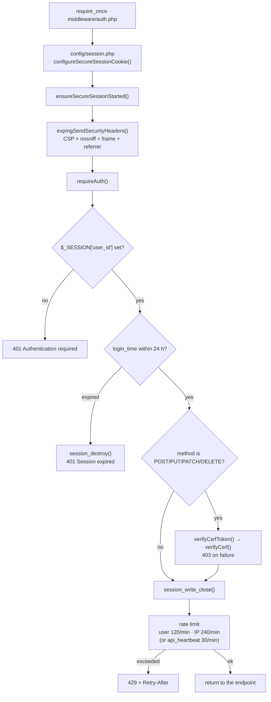
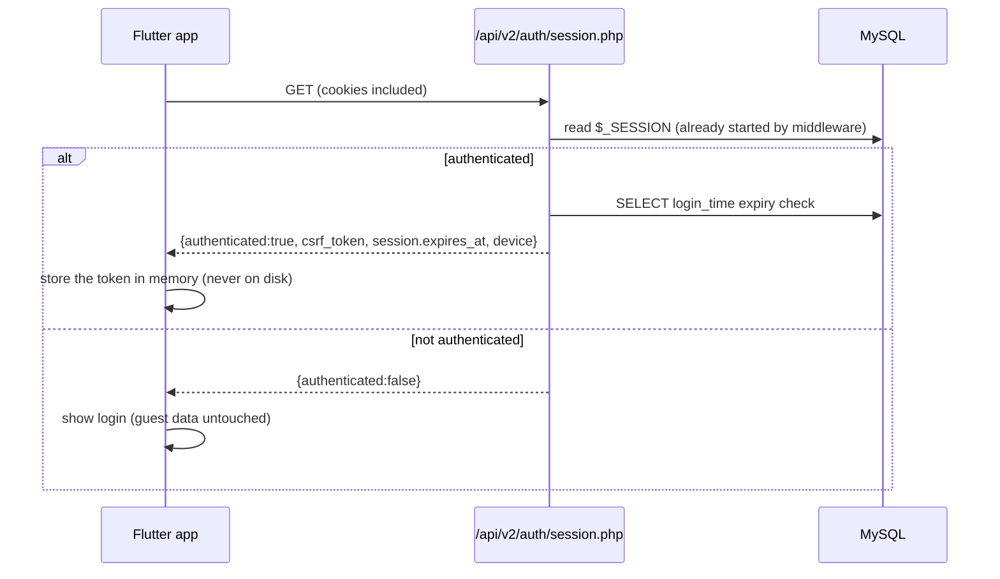

# Authentication and Authorisation

| Field | Value |
|---|---|
| Status | Specification — Phase 2 |
| Date | 2026-11-15 |
| Purpose | Define how a request proves who the caller is (authentication) and how the server decides what the caller may do (authorisation), on both the v1 and v2 surfaces |
| Requirements | AA-01…AA-07, AP-09, SE-06, SY-15 (`WORK/REQUIREMENTS_TRACEABILITY.md`) |
| Decisions | D-09 (cookie session, no JWT), D-10 (v2 surface), D-25 (`NEEDS APPROVAL`), D-32 (session owner) |
| Rule | v1 behaviour is frozen (`API_CONTRACT.md` §14). Everything added here is additive and applies to `/api/v2/` only, unless it is explicitly a v1 behaviour being documented |

---

## 1. Scope and authority

| Topic | Section | Authority |
|---|---|---|
| The authentication model | §2 | D-09 |
| The authentication gate | §3 | `api/middleware/auth.php` (verified) |
| The two authorisation layers | §4 | `security/ACCESS_CONTROL.md` |
| CSRF on both surfaces | §5 | `api/helpers/csrf.php` (verified) |
| The session bootstrap endpoint (new) | §6 | Finding F-01 |
| Device identity | §7 | D-25 |
| Login, signup, logout | §8 | `api/login.php`, `api/signup.php`, `api/logout.php` (verified) |
| Failure codes | §9 | v1 strings frozen; v2 codes proposed |
| Open questions | §10 | UQ-03, UQ-04 |

**Verified baseline.** Every statement marked *(verified)* was read from the repository at HEAD
`ec0e692`. Statements about `/api/v2/*` are **`PROPOSED` and not implemented**.

---

## 2. The authentication model (D-09)

### 2.1 One model, all platforms

| Property | Value |
|---|---|
| Mechanism | A PHP session cookie, issued by `api/login.php`, stored in the platform's cookie jar |
| Platforms | Web (same-origin, D-08), Android, iOS, Windows, macOS, Linux — all use the same cookie |
| Token schemes | **None.** No JWT, no OAuth, no API key, no bearer token |
| CSRF | Still required, because the credential is a cookie. Sent as `X-CSRF-Token` |
| Revocation | Destroying the session (logout) or its expiry — see §6 of `SESSION_MANAGEMENT.md` |

### 2.2 Why not a token (recorded so it is not re-litigated)

| Consideration | Assessment |
|---|---|
| Existing controls preserved | Session rotation on login, 24-hour absolute expiry, `HttpOnly`, `SameSite=Lax`, server-side destruction, CSRF — a token scheme would need equivalents for all five |
| New surface area | Issuance, rotation, revocation, and a CSRF replacement — four new attack surfaces |
| Product requirement | None. No third-party client, no machine-to-machine consumer exists |
| Native clients | Persist cookies perfectly well; `SameSite` is a browser concept |
| Web | `SameSite=Lax` + same-origin + `connect-src 'self'` already forbid a cross-site client |

**Consequence that must be stated plainly:** the absence of a machine-readable CSRF bootstrap is a
real gap (finding F-01) and is closed by §6, not by introducing tokens.

### 2.3 Session content (verified)

| Key | Set by | Meaning |
|---|---|---|
| `user_id` | `api/login.php` after a successful credential check | The authenticated identity; its absence is the 401 condition |
| `login_time` | `api/login.php` | Unix seconds; the 24-hour absolute expiry anchor |
| `csrf_token` | `generateCsrfToken()` at login and on demand | The CSRF secret |

Nothing else is stored in the session. Notably: **no role, no group membership, and no device
identity** are cached there. Every authorisation decision re-reads the database, so a role change or
a removal takes effect on the next request.

### 2.4 What the session is not used for

| Not in the session | Why |
|---|---|
| Roles / admin flags | A cached role is a stale-authorisation bug; `group_members.role` is read per request |
| Device identity | Registered and checked against `sync_devices` (§7) |
| Permissions per group | The membership row is the source of truth (`DATA_OWNERSHIP.md` §5.2) |
| Pending sync state | Server-side in `sync_batches` / `sync_devices` |

---

## 3. The authentication gate (AA-01)

**Requirement:** AA-01 "every protected endpoint requires an authenticated session".

### 3.1 The call

```php
require_once __DIR__ . '/../../api/middleware/auth.php';
requireAuth();   // exits 401/403/429 on failure
```

`api/middleware/auth.php` is included by every protected endpoint and performs, in this order
(verified):



### 3.2 The ordering contract (verified, performance-critical)

| Step | Reason |
|---|---|
| All session-dependent checks first | They read `$_SESSION`, which requires the session lock |
| `session_write_close()` before rate limiting | Releases PHP's exclusive file lock so a user's concurrent requests run in parallel; `$_SESSION` stays readable in memory |
| Rate limiting last | It touches only the database |

**This ordering must not be rearranged.** Moving the rate-limit check above the session checks would
re-serialise every concurrent request (`api/middleware/auth.php:47-59`).

### 3.3 Rules for endpoints

| Rule | Statement |
|---|---|
| Never call `session_start()` in an endpoint | The middleware owns session start; test 27b fails the build otherwise. The one exception is `api/logout.php` (KD-31, §8.3) |
| Never re-implement the checks | A second `isset($_SESSION['user_id'])` test is a defect |
| `requireAuth(false)` only for the heartbeat | It selects the 30/min heartbeat bucket; using it elsewhere weakens the limit |
| Public endpoints are an explicit list | `api/login.php`, `api/signup.php`, `api/logout.php`. Nothing else is public |
| A new v2 endpoint requires `requireAuth()` unless this document says otherwise | §6 is the only v2 endpoint that answers *without* a session, and it is deliberately designed for that |

### 3.4 No anonymous access, ever (AA-02)

Guest mode is **local-only** (D-04): it makes no API request at all
(`synchronization/GUEST_DATA_MIGRATION.md` §3.1). There is therefore no anonymous v2 endpoint,
no public read, and no "try before signup" server path. `security/ACCESS_CONTROL.md` §6 states the
rule and its enforcement.

### 3.5 Actor context for change capture

After the existing checks, the middleware sets the session variables that the change-capture
triggers read (`DATABASE_SCHEMA_SPECIFICATION.md` §5.6.6):

```sql
SET @expmg_actor_user_id = ?;   -- the authenticated user_id
SET @expmg_device_uuid   = ?;   -- X-Device-Id, validated against sync_devices, or NULL
```

| Rule | Statement |
|---|---|
| Additive only | The existing 401/403/429 paths are untouched (`BACKEND_COEXISTENCE.md` §3.5) |
| After `session_write_close()` | The values come from `$_SESSION` / the request header, both already read |
| `X-Device-Id` is validated, not trusted | It must match an active `sync_devices` row for the authenticated user, otherwise it is treated as absent (a wrong device id must never fail the request — it only loses attribution) |
| Failure to set the variables is not an error | CLI and migration writes legitimately have no actor |
| The variables are set with a prepared statement | No interpolation of a header value into SQL |

---

## 4. The two authorisation layers

**Authentication** answers *who is calling*. **Authorisation** answers *may this caller do this to
this row*. Both are mandatory.

| Layer | Enforced by | Scope | Section of authority |
|---|---|---|---|
| Authentication | `requireAuth()` | The whole request | §3 |
| Endpoint/method guard | Each endpoint | The operation | `AGENTS.md`, `API_CONTRACT.md` |
| Record authorisation | The endpoint or an `api/domain/` helper | The specific row | `security/ACCESS_CONTROL.md` §4 |
| Visibility scoping | Queries and the change log's scope columns | Which rows are visible at all | `security/ACCESS_CONTROL.md` §7 |

### 4.1 The non-negotiable rules

| # | Rule |
|---|---|
| A1 | A client-supplied `user_id` is **never** trusted. The server uses `$_SESSION['user_id']` |
| A2 | A client-supplied `group_id`, `paid_by`, or `role` is always re-validated against the database |
| A3 | A client-supplied cursor, `uuid`, or `version` is a *claim*, validated before use |
| A4 | **Status-code convention differs by surface and is deliberately not unified.** v1 returns **HTTP 400** with `ok:false` and a frozen error string for a permission denial (verified: `apiResponse()` defaults to 400 — 187 call sites in the 40 endpoint files; the four explicit statuses are three redundant `400`s and one `200` in `health.php`; no v1 endpoint passes 401/403 to `apiResponse()` for an authorisation denial). v2 returns **403** with `code:"PERMISSION_DENIED"`. A 401 is never used for a permission denial on either surface. Changing v1's status code would break the frozen contract (`API_CONTRACT.md` §14) |
| A5 | A row that the caller may not see is indistinguishable from a row that does not exist, where enumeration would otherwise be possible |
| A6 | Authorisation is re-evaluated on the sync path exactly as on the v1 path (`BACKEND_COEXISTENCE.md` §6.1) |
| A7 | The sync path never grants access based on a change-log row's presence: the scope columns decide *delivery*, not *permission* (`DATA_OWNERSHIP.md` §2) |

### 4.2 Where record authorisation lives

| Operation class | Enforced by |
|---|---|
| Personal expense edit/delete | Owner check (`user_id = :me`) |
| Group expense create | Membership check; payer membership check |
| Group expense edit/delete | Admin check (`group_members.role = 'admin'`) |
| Group expense inside a settled period | Settlement-lock check (§`DATA_OWNERSHIP.md` §4.4) |
| List operations | List ownership (personal) or admin (group) |
| Settlement calculate/confirm | Membership; admin only for `settle.php` / `settle_all.php` [SUPERSEDED by UQ-10 Option B: deprecated with HTTP 410 Gone] (PR-07) |
| Notification read | Recipient match |
| Sync push | The applicable rule above, per operation, inside one transaction |

The v2 sync endpoint does not have its own permission model. It resolves each operation to the same
rule and calls the same helper (`BACKEND_COEXISTENCE.md` §7).

---

## 5. CSRF on both surfaces (AA-03, AP-09)

**Requirements:** AA-03 "CSRF is required on every write except `logout.php`"; AP-09 "CSRF
requirements are identical on both surfaces".

### 5.1 The contract (verified)

| Aspect | Rule |
|---|---|
| Canonical implementation | `api/helpers/csrf.php::verifyCsrf()` |
| Wrapper | `api/middleware/auth.php::verifyCsrfToken()` delegates to it |
| When | Every `POST`, `PUT`, `PATCH`, `DELETE` to an authenticated endpoint |
| Token source | `X-CSRF-Token` header; fallback `$_SERVER['HTTP_X_CSRF_TOKEN']`; fallback POST-body `csrf_token` |
| The `csrf_token` **cookie** | An optional consistency check only — **never** a token source |
| Failure | `403` + a recorded failure |
| Failure gate | 50 failures / 10 minutes per IP → `429` |
| Exemptions | `api/logout.php` only (KD-31, §8.3) |

### 5.2 Identical on v1 and v2 (AP-09)

| Surface | CSRF required | Same helper | Same failure behaviour |
|---|---|---|---|
| v1 (existing 40 endpoints) | Yes | Yes | Yes |
| v2 sync endpoints | Yes | Yes | Yes |
| v2 `/api/v2/auth/session.php` | **No** — it is a `GET` and explicitly read-only | n/a | n/a |
| v2 device registration | Yes (a `POST` that writes a row) | Yes | Yes |

**Rule:** no v2 endpoint may implement its own CSRF check, accept a token from a new location, or
exempt itself. A v2 endpoint that needs an exemption needs a decision, not a code comment.

### 5.3 Why a native client can satisfy this

`X-CSRF-Token` is a header. A native HTTP client sets headers trivially; it does not need a
double-submit cookie flow. The only thing it lacked was a way to *obtain* the token without loading
HTML — finding F-01, closed by §6.

### 5.4 Token lifetime

The token is generated at login (`generateCsrfToken()`) and rotated by `session_regenerate_id(true)`
at login. It lives as long as the session. The client refreshes it from the session endpoint when it
receives a `403` CSRF failure, retries once, and treats a second failure as a real problem
(`API_ERROR_HANDLING.md` §4).

---

## 6. The session bootstrap endpoint (PROPOSED — closes F-01)

### 6.1 The gap

**Verified:** no endpoint returns the CSRF token or the session identity as JSON. Only
`pages/login.php` and `public/index.php` call `getCsrfToken()`, and both render HTML. A native
client therefore cannot start an authenticated session without loading an HTML page and reading a
cookie — a documented interim workaround, not a design (D-09).

### 6.2 The endpoint

| Attribute | Value |
|---|---|
| Method | `GET` |
| Path | `/api/v2/auth/session.php` |
| Authentication | **Not required** — it is the endpoint that tells the caller whether they are authenticated |
| Authorisation | None beyond the session itself |
| CSRF | Not applicable (safe method, no state change) |
| Idempotency | Naturally idempotent; no key required |
| Rate limit | `api_sync` bucket when authenticated; IP-only bucket when not (`API_ARCHITECTURE.md` §8) |
| Response shape | `{ok, authenticated, user?, csrf_token?, session?, device?, server_time}` |
| Sets cookies | **No.** It must not create a session for an unauthenticated caller beyond what `ensureSecureSessionStarted()` already does |
| Calls `session_start()` itself | **No** — the middleware owns it (test 27b) |

### 6.3 Response states

**Authenticated:**

```json
{
  "ok": true,
  "authenticated": true,
  "user": { "id": 7, "username": "ana", "email": "ana@example.com" },
  "csrf_token": "…",
  "session": { "expires_at": "2026-11-16T09:14:22Z", "issued_at": "2026-11-15T09:14:22Z" },
  "device": { "uuid": "01931f6e-…", "registered": true, "revoked": false },
  "server_time": "2026-11-15T09:20:03Z"
}
```

| Field | Purpose | Rule |
|---|---|---|
| `authenticated` | Explicit, so the client never infers state from a status code alone | Always present |
| `user` | Identity for display | **Never** includes `password`; the email is the caller's own |
| `csrf_token` | The token to send on writes | Same value `verifyCsrf()` accepts |
| `session.expires_at` | Lets the client schedule a re-login prompt before the server 401s | Derived from `login_time + 86400` (D-24) |
| `session.issued_at` | From `login_time` | Diagnostics and the expiry countdown |
| `device` | Whether the presented `X-Device-Id` is registered/revoked | `null` when no `X-Device-Id` was sent |
| `server_time` | The authoritative clock, so the client can display skew | Never used for ordering (SY-20) |

**Unauthenticated:**

```json
{ "ok": true, "authenticated": false, "csrf_token": null, "server_time": "2026-11-15T09:20:03Z" }
```

| Rule | Statement |
|---|---|
| HTTP status is **200**, not 401 | The question "am I authenticated?" was answered successfully. A 401 would conflate a transport failure with a legitimate answer |
| This is the **only** v2 endpoint that answers with `authenticated: false` | Every other endpoint returns 401 through `requireAuth()` |
| No session-fixation exposure | It never issues a session id; that is `login.php`'s job |

### 6.4 Why this does not contradict AA-02 (no anonymous access)

| Objection | Answer |
|---|---|
| "It answers without a session" | It exposes **nothing** about any user. Its unauthenticated response contains a null token and the server time |
| "It is an anonymous endpoint" | It is a *session-status* endpoint. It performs no read of business data and no write |
| Does it replace `requireAuth()` anywhere? | No. Every other endpoint keeps `requireAuth()` first |
| Could it be used to enumerate users? | No — it reports only the caller's own session state |

### 6.5 Client usage



| Rule | Statement |
|---|---|
| The token is kept in memory only | `FLUTTER_ARCHITECTURE.md` §6; never written to the local database or secure storage |
| The client re-fetches on start-up and after a re-login | Cheap and always correct |
| The client never parses an HTML page | The interim workaround ends when this endpoint ships |

---

## 7. Device identity

### 7.1 What a device is

| Property | Value |
|---|---|
| Identity | A client-generated UUID, persisted in secure storage, sent as `X-Device-Id` |
| Secret | A server-issued `device_secret`, returned once, sent as `X-Device-Secret` |
| Storage | `sync_devices` (`DATABASE_SCHEMA_SPECIFICATION.md` §5.1) |
| Lifetime | Until revoked or the account ends |

### 7.2 Authentication versus device context

| Aspect | Authentication (the session) | Device context (the header) |
|---|---|---|
| Proves | Who the user is | Which installation is calling |
| Required? | Yes, always | Only for sync, attribution, and device listing |
| Missing header | n/a | Request proceeds; attribution and per-device cursor are absent |
| Wrong/unknown device | n/a | Treated as absent for attribution; a **sync** request with an unregistered device is `409 DEVICE_NOT_REGISTERED` |
| Revoked device | Session immediately destroyed in `app_sessions` | **`403 DEVICE_REVOKED`** on sync endpoints; **`401 Session revoked`** on all other v1/v2 endpoints (D-25) |
| Does it grant access? | Yes — the session is the credential | **No.** A device id is never a permission; it narrows, never widens |

### 7.3 Rules

| Rule | Statement |
|---|---|
| A device id never substitutes for a session | Every request still needs a valid session |
| Mandatory device registration | A device must complete registration (`POST /api/v2/devices/register.php`) before it can issue sync push or pull requests (D-34, UQ-17). Unregistered devices receive `409 DEVICE_NOT_REGISTERED` |
| A device is scoped to one user | `uq_device_uuid`; a device registered to user A cannot be used by user B (the lookup is `WHERE device_uuid = ? AND user_id = :me`) |
| The `device_secret` protects continuity, not authorisation | It prevents a client from escaping revocation by inventing a new id; it does not grant any additional data access |
| The secret is never logged | `logger.php` must not receive it (`SECURITY_ARCHITECTURE.md` §7) |
| Devices are inspectable | The device list endpoint returns the caller's own devices only |
| Revocation scope | **ACCEPTED** — D-25 / UQ-04: Full revocation via `app_sessions` table immediately terminates sync and authenticated sessions |

---

## 8. Login, signup, and logout (v1 behaviour preserved)

### 8.1 Login (verified)

| Aspect | Behaviour |
|---|---|
| Method | `POST /api/login.php` |
| CSRF | **Required** — `verifyCsrf()` runs before the credential check |
| Rate limit | 5 attempts / 15 minutes, keyed by IP; over the limit → `429` JSON with `Retry-After` |
| On success | `session_regenerate_id(true)`, `$_SESSION['user_id']`, `$_SESSION['login_time'] = time()`, `generateCsrfToken()`, then `302 Location: ../public/index.php` |
| On failure | `302 Location: ../pages/login.php` — a **generic** redirect, identical for an unknown email and a wrong password |
| Unknown-email accounting | Login attempts against unknown emails are recorded (v2.17), so timing/behaviour does not disclose account existence |
| Response format | HTML redirects for the browser flow; JSON only for the `429` |

**Consequence for the Flutter client (must be specified, because it is surprising):**

| Observation | Required client behaviour |
|---|---|
| Success is a `302` to the SPA shell | Do **not** follow the redirect. Treat `302` + `Location` containing `public/index.php` as success |
| Failure is a `302` to the login page | Treat `302` + `Location` containing `pages/login.php` as "credentials rejected" |
| The failure reason is deliberately not disclosed | The UI says "email or password is incorrect" — never "no such account" |
| `429` is JSON | Parse `retry_after` and present the wait; do not retry before it |
| Cookies | The cookie jar must be enabled and persisted for the session |

**Why not add a JSON login variant:** it would be a second authentication path with a second failure
surface. The `302` contract is machine-detectable, and D-09 keeps one path.

### 8.2 Signup (verified)

| Aspect | Behaviour |
|---|---|
| Method | `POST /api/signup.php` |
| CSRF | Required, with the same failure gate |
| Rate limit | 3 attempts / hour, keyed by IP; over the limit → `429` JSON with `Retry-After` |
| On success | `302 Location: ../pages/login.php` (signup does not create a session) |
| On failure | `302 Location: ../pages/signup.php` |
| Client obligation | After a successful signup, perform a separate login; the guest-migration flow expects this (`synchronization/GUEST_DATA_MIGRATION.md` §4) |

### 8.3 Logout (verified, KD-31, PR-22)

**Requirement:** PR-22 "`logout.php` keeps current unguarded behaviour until an approved change".

| Aspect | Current behaviour |
|---|---|
| Method guard | **None** — any method reaches the body |
| Auth | **None** — `requireAuth()` is not called |
| CSRF | **None** — deliberately skipped (this is why a cross-site logout is possible but harmless in a `SameSite=Lax` browser) |
| Session start | Calls `config/session.php` + `session_start()` directly; this is the one endpoint allowed to |
| Effect | Empties `$_SESSION`, expires the cookie, `session_destroy()`, `302 Location: ../pages/login.php` |

| Rule | Statement |
|---|---|
| This is **preserved** | PR-22. Changing it is an approved change, not a cleanup |
| The Flutter client uses it as-is | `GET /api/logout.php`; expect a `302`; clear the cookie jar and all in-memory tokens |
| CSRF is not required to log out | A forced logout is a nuisance, not a compromise; the current model (a cross-site `GET` with `SameSite=Lax`) is documented in `API_CONTRACT.md` §2.3 |
| After logout | The client keeps **local data** (registered-user offline data stays on the device per D-16) and clears credentials only. Guest data, if any, is unaffected |

---

## 9. Failure codes

### 9.1 v1 (frozen strings)

| Status | Body `error` | Cause | Retry? |
|---|---|---|---|
| 401 | `Authentication required` | No `user_id` in the session | After login |
| 401 | `Session expired` | `login_time` older than 24 hours | After login |
| 403 | *(CSRF failure message)* | Missing/invalid token | After refreshing the token, once |
| **400** | *(a frozen permission string, e.g. `Only the group admin can edit group expenses.` or `Only the group admin can record settlements.`)* | **Authorised session, not permitted for the record** — v1's actual, verified behaviour | No |
| 429 | `Too many requests. Rate limited.` + `retry_after`, `limited_by` | Rate limit | After `Retry-After` |

**These strings are frozen** (`API_CONTRACT.md` §12). v2 must not reuse them with a different
meaning, and must not change them.

### 9.2 v2 (proposed codes, additive)

| Status | `code` | Meaning |
|---|---|---|
| 401 | `UNAUTHENTICATED` | No session |
| 401 | `SESSION_EXPIRED` | 24-hour expiry reached |
| 403 | `CSRF_INVALID` | Token missing or invalid |
| 403 | `PERMISSION_DENIED` | Authenticated but not permitted for this record. **v1 returns 400 with a frozen string for the same condition** (`API_ERROR_HANDLING.md` §4.2) — the divergence is documented, not a defect to fix |
| 403 | `DEVICE_REVOKED` | The presented device is revoked |
| 409 | `DEVICE_NOT_REGISTERED` | A sync request from an unknown device |
| 429 | `RATE_LIMITED` | With `retry_after` |

| Rule | Statement |
|---|---|
| v2 adds a `code` field; it does not remove `error` | The human-readable message stays, so logging and support remain consistent |
| v1 never gains a `code` field | Contract freeze |
| The HTTP status is the same on both surfaces for the same condition | So a client can handle the class generically |
| The full catalogue | `API_ERROR_HANDLING.md` §3 |

---

## 10. Status of architectural questions

| UQ | Status | Decision & Policy |
|---|---|---|
| UQ-03 — session lifetime for native clients (D-24, D-33) | `APPROVED` | Option C: 7-day inactivity web sessions; 30-day inactivity remember credentials in native secure storage |
| UQ-04 — device revocation model (D-25) | `APPROVED` | Option B: Full revocation via `app_sessions` table; terminates sync and session immediately |
| UQ-17 — device registration requirement (D-34) | `APPROVED` | Mandatory registration before sync push/pull; records hardware platform, client version, and push token |

---

## 11. Verification

| Requirement | Method | Pass condition |
|---|---|---|
| AA-01 every protected endpoint requires a session | `CONTRACT-TEST` | Every endpoint except login/signup/logout returns 401 without a session |
| AA-02 no anonymous access | `PENTEST` | No v2 endpoint except `/api/v2/auth/session.php` answers without a session; that one leaks nothing |
| AA-03 CSRF on every write except logout | `CONTRACT-TEST` | A write without a token gets 403 on both surfaces |
| AA-04 cookie session on all six platforms | `PLATFORM-SMOKE` | Login, a write, and logout succeed on each target platform |
| AA-05 expiry defined | `CONTRACT-TEST` | A 24-hour-old session gets 401 `Session expired` |
| AA-06 multi-device without a second auth system | `DOC-REVIEW` | Two devices hold independent sessions; no token scheme appears anywhere |
| AA-07 device registration/revocation specified | `DOC-REVIEW` (blocked by UQ-04) | §7 and `SESSION_MANAGEMENT.md` §6 describe the flow and mark the open policy |
| AP-09 identical CSRF requirements | `CONTRACT-TEST` | v1 and v2 writes are tested with the same token matrix |
| SE-06 sync never trusts client ownership | `PENTEST` | A push claiming another `user_id`, `group_id`, or `paid_by` is rejected or overridden |
| SY-15 no cross-user sync | `PENTEST` | Manipulating a `uuid`, cursor, or device id cannot return another user's data |
| F-01 closed | `CONTRACT-TEST` | A client can obtain a CSRF token and confirm its session without loading HTML |
| PR-22 logout unchanged | `DOC-REVIEW` | `api/logout.php` is byte-identical to the frozen behaviour |
