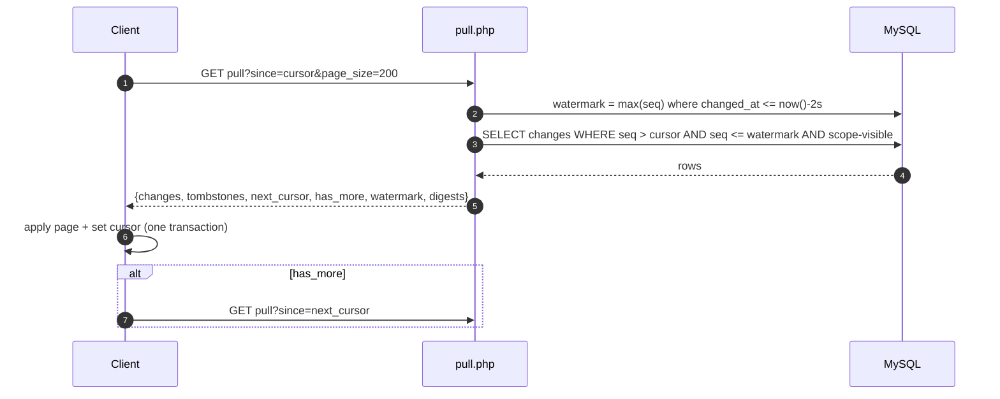

# Sync API Specification

| Field | Value |
|---|---|
| Status | Specification — Phase 2. **None of these endpoints exists.** |
| Date | 2026-11-15 |
| Purpose | The complete contract for every proposed `/api/v2/` endpoint: session bootstrap, devices, sync, and guest import |
| Requirements | AP-04 (all 15 attributes), AP-06, AP-10, SY-07, SY-16, SY-18, VC-03, VC-04, VC-08, VC-10, DB-13, PR-05 |
| Decisions | D-10, D-17, D-25, D-27, D-28 |
| Rule | Every endpoint below must satisfy all fifteen required attributes before implementation begins |

---

## 1. Scope

| Topic | Section |
|---|---|
| The surface and endpoint index | §2 |
| Conventions common to every v2 endpoint | §3 |
| The fifteen required attributes, per endpoint | §4 |
| Settlement protection for confirmations | §5 |
| Read endpoints: bootstrap, pull, state | §6 |
| The write endpoint: push | §7 |
| Idempotency and the guest import | §8 |
| Transaction boundaries | §9 |

Companions: [`API_ARCHITECTURE.md`](API_ARCHITECTURE.md) (structure, rate limiting, pagination),
[`API_ERROR_HANDLING.md`](API_ERROR_HANDLING.md) (codes),
[`API_VERSIONING.md`](API_VERSIONING.md) (compatibility),
[`../synchronization/SYNC_WORKFLOWS.md`](../synchronization/SYNC_WORKFLOWS.md) (procedures),
[`../synchronization/GUEST_DATA_MIGRATION.md`](../synchronization/GUEST_DATA_MIGRATION.md) (import).

---

## 2. The surface and endpoint index

```
/api/v2/
├── auth/session.php          GET
├── devices/register.php      POST
├── devices/list.php          GET
├── devices/revoke.php        POST
├── sync/bootstrap.php        GET
├── sync/pull.php             GET
├── sync/push.php             POST
├── sync/state.php            GET
├── reminders/ack.php         POST
├── groups/
│   ├── archive.php           POST
│   ├── restore.php           POST
│   └── permanent_delete.php  POST
└── import/
    ├── guest.php             POST
    └── status.php            GET
```

| # | Endpoint | Method | Class | Authentication |
|---|---|---|---|---|
| 1 | `auth/session.php` | GET | Read | Optional (it reports whether one exists) |
| 2 | `devices/register.php` | POST | Write | Required |
| 3 | `devices/list.php` | GET | Read | Required |
| 4 | `devices/revoke.php` | POST | Write | Required |
| 5 | `sync/bootstrap.php` | GET | Read | Required + registered device |
| 6 | `sync/pull.php` | GET | Read | Required + registered device |
| 7 | `sync/push.php` | POST | Write | Required + registered device |
| 8 | `sync/state.php` | GET | Read | Required + registered device |
| 9 | `reminders/ack.php` | POST | Write | Required |
| 10 | `groups/archive.php` | POST | Write | Required + Group Admin |
| 11 | `groups/restore.php` | POST | Write | Required + Group Admin |
| 12 | `groups/permanent_delete.php` | POST | Write | Required + Group Admin |
| 13 | `import/guest.php` | POST | Write | Required |
| 14 | `import/status.php` | GET | Read | Required |

| Rule | Statement |
|---|---|
| Every endpoint is a standalone PHP file with an explicit `require_once` chain | `BACKEND_COEXISTENCE.md` §2.4 |
| Every endpoint except #1 calls `requireAuth()` first | AA-01 |
| Every write uses `verifyCsrf()` through the middleware | AP-09 |
| No endpoint is public | AA-02; #1 answers without a session but exposes no user data |

---

## 3. Conventions common to every v2 endpoint

| Aspect | Rule |
|---|---|
| Envelope | `{ok:true, …}` / `{ok:false, code:"…", error:"…"}` |
| Content type | `application/json` |
| Request encoding | JSON body for `POST`; query string for `GET` |
| Money | A decimal string with exactly two decimals |
| Dates | `YYYY-MM-DD`; timestamps ISO-8601 UTC with milliseconds |
| Session | The same cookie as v1 (D-09) |
| CSRF | `X-CSRF-Token` on every `POST` |
| Device | `X-Device-Id` + `X-Device-Secret` on sync endpoints; mandatory device registration prior to sync (D-34, UQ-17) |
| Rate limit | Dedicated `api_sync` bucket: 120 req/min per user, 240 req/min burst per device, additive to v1 limits (D-28, UQ-05; owner-approved) |
| Batch limits | Proposed initial defaults: Max 100 records or 1MB payload per push/pull batch (`413 Payload Too Large`), configurable via server environment and subject to Phase 5 load testing (D-28, UQ-05) |
| Idempotency | `Idempotency-Key` mandatory for sync push batches (`batch_uuid`); logical keys inside the payload |
| Version fields | `version` per record; `base_version` on update/delete |
| Unknown fields | Ignored |
| Pagination | Cursors for streams; `parsePagination()` for small lists |
| Status codes | `200`, `400`, `401`, `403`, `404`, `409`, `410`, `413`, `429`, `500` |
| No v1 dependency | v2 never calls a v1 endpoint |

---

## 4. The fifteen required attributes (AP-04)

**Requirement:** AP-04 "every proposed endpoint specifies all fifteen required attributes". **Acceptance
criterion 14** of `WORK/PHASE_2_DESIGN_PLAN.md` §11.

### 4.0 The fifteen attributes

| # | Attribute |
|---|---|
| 1 | Method |
| 2 | Path |
| 3 | Purpose |
| 4 | Authentication |
| 5 | Authorisation |
| 6 | CSRF |
| 7 | Request fields (name, type, required, rule) |
| 8 | Success response |
| 9 | Error responses (status + `code`) |
| 10 | Idempotency |
| 11 | Rate limit |
| 12 | Pagination / bounds |
| 13 | Versioning and compatibility |
| 14 | Security notes |
| 15 | Verification method |

### 4.1 `GET /api/v2/auth/session.php` (AP-10)

**Requirement:** AP-10 "session bootstrap is available to non-browser clients".

| # | Attribute | Value |
|---|---|---|
| 1 | Method | `GET` |
| 2 | Path | `/api/v2/auth/session.php` |
| 3 | Purpose | Report whether the caller is authenticated, return the CSRF token and session expiry, and report the device's registration state |
| 4 | Authentication | Not required — this endpoint answers the question |
| 5 | Authorisation | None beyond the caller's own session |
| 6 | CSRF | Not applicable (safe method, no state change) |
| 7 | Request fields | None. Optional `X-Device-Id` to include device state |
| 8 | Success response | 200 `{ok:true, authenticated:bool, user?:{id,username,email}, csrf_token?:string, session?:{issued_at,expires_at}, device?:{uuid,registered,revoked}, server_time}` |
| 9 | Errors | `500` only (a session read cannot fail in a way the client must handle) |
| 10 | Idempotency | Naturally idempotent |
| 11 | Rate limit | `api_sync` when authenticated; an IP bucket when not |
| 12 | Bounds | Fixed-size response |
| 13 | Compatibility | The `authenticated:false` shape is permanent; new fields may be added |
| 14 | Security | Never returns a password; never issues a session id; reveals nothing about any other user; token is the caller's own; must **not** call `session_start()` itself (test 27b) |
| 15 | Verification | `CONTRACT-TEST`: a fresh client obtains a token and confirms its session without loading HTML |

### 4.2 `POST /api/v2/devices/register.php` (UQ-17)

| # | Attribute | Value |
|---|---|---|
| 1 | Method | `POST` |
| 2 | Path | `/api/v2/devices/register.php` |
| 3 | Purpose | Register this installation and obtain a device secret |
| 4 | Authentication | Required (`requireAuth()`) |
| 5 | Authorisation | The caller registers a device for **themselves**. `user_id` comes from the session |
| 6 | CSRF | Required |
| 7 | Request fields | `device_uuid` (string, required, UUID), `platform` (enum: android/ios/web/windows/macos/linux, required), `app_version` (string, optional, ≤ 32), `device_name` (string, optional, ≤ 100) |
| 8 | Success response | 200 `{ok:true, device:{id,uuid,platform,device_name,registered_at}, secret:"…"}` — the secret is returned **once** |
| 9 | Errors | `400 VALIDATION_FAILED`; `403 DEVICE_REVOKED` (a revoked device may not silently re-register — UQ-04); `409 DEVICE_REGISTERED_TO_ANOTHER_USER` |
| 10 | Idempotency | Re-registering the same `device_uuid` for the same user updates metadata and returns the stored device without a new secret |
| 11 | Rate limit | `api_sync` |
| 12 | Bounds | One row per device; a user with many devices is bounded only by their own installations |
| 13 | Compatibility | `secret` may be omitted in the response for a repeat registration; clients must treat its absence as "already have it" |
| 14 | Security | The secret is hashed at rest (bcrypt); never logged; transmitted only over HTTPS; a device is scoped to one user; the lookup is `WHERE device_uuid = ? AND user_id = :me` |
| 15 | Verification | `CONTRACT-TEST`: registration returns a secret once; a second call with the same UUID does not create a second row |

**UQ-17 (device registration requirement) affects this endpoint directly:** whether sync requires a
registered device or can proceed with a session alone. The recommendation is **required** —
registration is cheap, gives stable identity for cursors and revocation, and makes conflict
diagnostics possible. If UQ-17 resolves against it, sync endpoints accept a session-only request and
the cursor becomes per-user rather than per-device.

### 4.3 `GET /api/v2/devices/list.php`

| # | Attribute | Value |
|---|---|---|
| 1 | Method | `GET` |
| 2 | Path | `/api/v2/devices/list.php` |
| 3 | Purpose | List the caller's devices so one can be revoked |
| 4 | Authentication | Required |
| 5 | Authorisation | Own devices only (`WHERE user_id = :me`) |
| 6 | CSRF | Not applicable |
| 7 | Request fields | `include_revoked` (bool, optional, default false) |
| 8 | Success response | 200 `{ok:true, devices:[{uuid,platform,app_version,device_name,last_seen_at,revoked_at,is_current}]}` |
| 9 | Errors | `401` |
| 10 | Idempotency | Read |
| 11 | Rate limit | `api_sync` |
| 12 | Bounds | Ordinary pagination; a user's device count is small |
| 13 | Compatibility | Fields may be added |
| 14 | Security | Never returns `device_secret_hash`; `is_current` is derived from the presented `X-Device-Id`; a device name is user-supplied text and must be rendered escaped |
| 15 | Verification | `CONTRACT-TEST`: a second user's devices never appear |

### 4.4 `POST /api/v2/devices/revoke.php`

| # | Attribute | Value |
|---|---|---|
| 1 | Method | `POST` |
| 2 | Path | `/api/v2/devices/revoke.php` |
| 3 | Purpose | Revoke a device's ability to sync |
| 4 | Authentication | Required |
| 5 | Authorisation | The device must belong to the caller |
| 6 | CSRF | Required |
| 7 | Request fields | `device_uuid` (string, required) |
| 8 | Success response | 200 `{ok:true, revoked:true, device_uuid}` |
| 9 | Errors | `400 VALIDATION_FAILED`; `404 DEVICE_NOT_FOUND` (also used for another user's device — no enumeration) |
| 10 | Idempotency | Revoking an already-revoked device succeeds |
| 11 | Rate limit | `api_sync` |
| 12 | Bounds | Single row update |
| 13 | Compatibility | Revocation semantics may widen (session revocation) if D-25 option (b) is approved |
| 14 | Security | Sets `revoked_at`; does **not** destroy the device's session (D-25 option a); the revoked device receives `403 DEVICE_REVOKED` on its next sync request |
| 15 | Verification | `CONTRACT-TEST`: a revoked device cannot push or pull; its session still says authenticated until expiry |

### 4.5 `GET /api/v2/sync/bootstrap.php` (SY-16)

**Requirement:** SY-16 "initial bootstrap is bounded and resumable".

| # | Attribute | Value |
|---|---|---|
| 1 | Method | `GET` |
| 2 | Path | `/api/v2/sync/bootstrap.php` |
| 3 | Purpose | Deliver the full visible dataset for a new or reset device |
| 4 | Authentication | Required |
| 5 | Authorisation | Visible scope only: the caller's own rows plus their groups' rows |
| 6 | CSRF | Not applicable |
| 7 | Request fields | `entity` (enum: expense/budget/list/list_item/group/group_member/settlement, optional — omit for all), `page_size` (int, optional, default 200, max 500), `after_uuid` (string, optional — the resumption token) |
| 8 | Success response | 200 `{ok:true, entity, records:[…], next_after_uuid?, has_more:bool, cursor, digests:{entity:hash}, server_time}` |
| 9 | Errors | `400 VALIDATION_FAILED`, `410 CURSOR_TOO_OLD` (not for bootstrap), `413` if `page_size` exceeds the max |
| 10 | Idempotency | Read; re-requesting a page is safe |
| 11 | Rate limit | `api_sync` |
| 12 | Bounds | `page_size` ≤ 500; a bounded total per request; resumable with `after_uuid` |
| 13 | Compatibility | New entities may be added to the `entity` enum; a client that does not know an entity ignores it |
| 14 | Security | Scope filtering is server-side (`DATABASE_SCHEMA_SPECIFICATION.md` §5.2.1); no ownership field is trusted from the client; the cursor is server-generated |
| 15 | Verification | `CONTRACT-TEST`: paging to completion yields the same dataset as a single unbounded read; interrupting and resuming with `after_uuid` loses nothing |

#### 4.5.1 Bounded and resumable (SY-16 detail)

| Rule | Statement |
|---|---|
| Bounded | Every response is limited by `page_size`, so memory and latency stay predictable |
| Resumable | `after_uuid` is the last record's UUID; the next request continues after it. A client that crashes resumes without re-reading the whole dataset |
| Ordered stably | Records are ordered by `(entity, uuid)`, so `after_uuid` is a valid resume point even if the dataset changes between requests |
| Cursor is set once | The `cursor` in every page is the same value — the bootstrap-complete cursor; the client stores it only after the **final** page (§6.2) |
| A record added during the bootstrap | Appears in a later page if its UUID sorts after the resume point, or in the first incremental pull otherwise — no loss either way |

### 4.6 `GET /api/v2/sync/pull.php` (SY-07, SY-18)

**Requirements:** SY-07 "changes from other devices are retrieved incrementally"; SY-18 "sync cursor
gap hazard is mitigated and detected".

| # | Attribute | Value |
|---|---|---|
| 1 | Method | `GET` |
| 2 | Path | `/api/v2/sync/pull.php` |
| 3 | Purpose | Deliver changes since a cursor |
| 4 | Authentication | Required + registered, non-revoked device |
| 5 | Authorisation | Visible scope only |
| 6 | CSRF | Not applicable |
| 7 | Request fields | `since` (string, required — an opaque cursor), `page_size` (int, optional, default 200, max 500), `entities` (csv, optional — narrow the pull) |
| 8 | Success response | 200 `{ok:true, changes:[…], tombstones:[…], next_cursor, has_more, watermark, digests:{entity:hash}, server_time}` |
| 9 | Errors | `400 INVALID_CURSOR` (malformed/unparseable only); `410 CURSOR_TOO_OLD` (well-formed but out of range → bootstrap, §6.4); `403 DEVICE_REVOKED`; `409 DEVICE_NOT_REGISTERED` |
| 10 | Idempotency | Read; re-requesting with the same cursor returns the same page (subject to pruning) |
| 11 | Rate limit | `api_sync` |
| 12 | Bounds | `page_size` ≤ 500; the watermark lag is 2 s |
| 13 | Compatibility | New change fields may be added; the client ignores unknown ones. The cursor format is opaque and may change between server versions **only** by triggering a bootstrap |
| 14 | Security | Scope filtering is server-side; a cursor cannot widen visibility; `actor_device_uuid` must never be used to filter out the caller's own writes in a way that hides a desynchronisation |
| 15 | Verification | `CONTRACT-TEST`: a second pull with `next_cursor` returns only newer changes; a malformed cursor returns `400 INVALID_CURSOR`; a well-formed cursor below the retained floor **or above the watermark** returns `410 CURSOR_TOO_OLD` (never an empty page) |

#### 4.6.1 Change entry shape

| Field | Meaning |
|---|---|
| `entity` | One of the seven syncable entities |
| `uuid` | The record's identity |
| `op` | `insert` / `update` / `delete` / `move_out` (§6.3) |
| `version` | The version after the write |
| `record` | The row snapshot (business fields only; money as a decimal string). **`NULL` for `move_out`** |
| `changed_at` | Server time (diagnostics only) |

**`move_out` is a removal instruction, not a record state.** It is emitted when an expense's
`group_id` changes (including to or from `NULL`). It is scoped to the **old** group, carries no
payload, and is always followed in the same page by the new-scope `update`. A client that receives it
removes its local copy and records **no** tombstone. See `../database/DATABASE_SCHEMA_SPECIFICATION.md`
§5.6.4.

#### 4.6.2 Cursor-gap mitigation and detection (SY-18 / D-27)

| Mechanism | Implementation |
|---|---|
| 1 | The pull returns only `seq <= watermark`, where `watermark` is the highest `seq` whose `changed_at <= now() - 2 s`. Both `watermark` and `next_cursor` are in the response |
| 2 | The client never advances past `next_cursor` (`SYNC_WORKFLOWS.md` §7.3) |
| 3 | Every response carries per-entity `digests` — the canonical `SHA-256` defined in §6.5 |
| 4 | The client compares digests during reconciliation; a mismatch triggers a targeted bootstrap for that entity (§6.5) |
| 5 | `sync/state.php` exposes the server's digest independently, so a client can verify without a full pull |

**Why all five:** mitigations 1–2 close the common race (an allocated-but-uncommitted `seq`);
neither can close it fully without serialising every write. Mitigation 3 detects the residual case.

### 4.7 `POST /api/v2/sync/push.php` (VC-03, VC-04, VC-08)

**Requirements:** VC-03 (push carries `base_version`), VC-04 (conflict response contains both
versions), VC-08 (deletion is version-checked).

| # | Attribute | Value |
|---|---|---|
| 1 | Method | `POST` |
| 2 | Path | `/api/v2/sync/push.php` |
| 3 | Purpose | Apply queued offline operations |
| 4 | Authentication | Required + registered, non-revoked device |
| 5 | Authorisation | Per operation, through the same rules as v1 (`BACKEND_COEXISTENCE.md` §6) |
| 6 | CSRF | Required |
| 7 | Request fields | `batch_key` (string, required, UUID); `ops[]` (array, required, ≤ 500) where each op has `entity`, `op` (`create`/`update`/`delete`/`upsert`), `uuid`, `base_version` (required for update/delete/upsert-on-existing), and `fields` |
| 8 | Success response | 200 `{ok:true, batch_key, results:[{op_index, status, uuid, version?, server?, code?, error?}], applied, conflicted, rejected, server_time}` |
| 9 | Errors | `400 VALIDATION_FAILED`; `400 MISSING_BASE_VERSION`; `403 DEVICE_REVOKED`; `409 BATCH_KEY_REUSED`; `409 DEVICE_NOT_REGISTERED`; `413 BATCH_TOO_LARGE`; `429` |
| 10 | Idempotency | `batch_key` + `request_hash`; a replay returns the stored results; per-operation idempotency by `uuid`/`base_version` |
| 11 | Rate limit | `api_sync` |
| 12 | Bounds | ≤ 500 operations per request; ≤ 256 KB body (recommended); a larger queue is split by the client |
| 13 | Compatibility | Operation fields may gain new keys; `status` values are stable |
| 14 | Security | Ownership fields are ignored/overridden (`ACCESS_CONTROL.md` §7.2); every operation is re-authorised; `is_post_settlement` is never accepted; the settlement lock is enforced; `$conn->begin_transaction()` wraps the batch |
| 15 | Verification | `CONTRACT-TEST`: applied/conflict/duplicate/refused cases; a replayed batch applies once |

#### 4.7.1 `base_version` (VC-03)

| Rule | Statement |
|---|---|
| Required for `update`, `delete`, and `upsert` against an existing row | Absent → `400 MISSING_BASE_VERSION` |
| Omitted for `create` | A create has no prior version; the `uuid` guards it |
| Compared inside a transaction with `SELECT … FOR UPDATE` | The check and the write must be atomic (`VERSIONING_AND_CONFLICT_RESOLUTION.md` §4.1) |
| A mismatch is a conflict, never an overwrite | `409 VERSION_CONFLICT` |
| The value is the client's claim, validated server-side | Never assigned to `version` |

#### 4.7.2 Conflict response content (VC-04)

```json
{
  "op_index": 3,
  "status": "conflict",
  "code": "VERSION_CONFLICT",
  "uuid": "01931f6e-…",
  "server": { "uuid": "01931f6e-…", "version": 4, "amount": "24.50", "note": "Dinner" },
  "client_baseline": { "version": 3, "amount": "24.50", "note": "Dinner with tip" },
  "error": "The record was modified by another device"
}
```

| Rule | Statement |
|---|---|
| Both sides are present | The server's current row **and** the client's baseline |
| The server row is complete | Business fields in v2 shape, so the client can display and merge without another request |
| A separate call never fetches the server's row | The conflict response is self-sufficient |
| Other operations in the batch continue | A conflict is per operation |

#### 4.7.3 Deletion is version-checked (VC-08)

| Rule | Statement |
|---|---|
| `delete` requires `base_version` | A stale delete cannot erase a newer edit |
| Applied as `DELETE … WHERE uuid = ? AND version = ?` | Inside the transaction |
| Zero rows affected | Distinguished by a follow-up `SELECT`: a conflict (`409 VERSION_CONFLICT`) or already deleted (`status: "applied"`, idempotent) |
| Deleting an already-deleted record | Reported `applied` (idempotent) if the tombstone's `last_version` equals the client's `base_version`; otherwise a conflict |
| A lock refusal precedes the version check | A deletion inside a settled period is `409 PERIOD_SETTLED`, not a version conflict (§5.2 of `CONFLICT_RESOLUTION.md`) |

#### 4.7.4 Operation field rules

| Operation | Required fields | Ignored if present |
|---|---|---|
| `create` | `uuid`, `entity`, business fields | `user_id`, `type`, `is_post_settlement`, `created_by`, `server_id` |
| `update` | `uuid`, `base_version`, changed fields | same |
| `delete` | `uuid`, `base_version` | all business fields |
| `upsert` (budget) | `uuid`, `month`, `amount_limit` | `user_id` |

### 4.8 `GET /api/v2/sync/state.php` (SY-18 support)

| # | Attribute | Value |
|---|---|---|
| 1 | Method | `GET` |
| 2 | Path | `/api/v2/sync/state.php` |
| 3 | Purpose | Report the server's view of the caller's sync state: whether a cursor is still valid, the current watermark, per-entity digests, and the pending-operation guidance |
| 4 | Authentication | Required + registered device |
| 5 | Authorisation | The caller's own scope |
| 6 | CSRF | Not applicable |
| 7 | Request fields | `cursor` (string, optional — validate a stored cursor without pulling) |
| 8 | Success response | 200 `{ok:true, cursor_valid:bool, cursor_reason?, oldest_retained_cursor?, watermark, digests:{entity:hash}, device:{uuid,revoked}, server_time}` |
| 9 | Errors | `400 INVALID_CURSOR` (malformed/unparseable only); `403 DEVICE_REVOKED` |
| 10 | Idempotency | Read |
| 11 | Rate limit | `api_sync` |
| 12 | Bounds | Fixed-size response |
| 13 | Compatibility | New digest entities may appear |
| 14 | Security | Scope-filtered digests only; a digest must not leak the existence of another user's rows (it is computed over the caller's visible scope) |
| 15 | Verification | `CONTRACT-TEST`: `cursor_valid` is `false` for a well-formed cursor that is below the retained floor **or above the watermark**, and `true` for a cursor inside `[oldest_retained_cursor, watermark]`; `cursor_reason` distinguishes `too_old` from `ahead_of_watermark`; a malformed cursor is `400`, not a `cursor_valid:false` body |

### 4.9 `POST /api/v2/import/guest.php` and `GET /api/v2/import/status.php`

Full behavioural specification: [`../synchronization/GUEST_DATA_MIGRATION.md`](../synchronization/GUEST_DATA_MIGRATION.md) §5–§6.
The attribute tables:

#### 4.9.1 `POST /api/v2/import/guest.php`

| # | Attribute | Value |
|---|---|---|
| 1 | Method | `POST` |
| 2 | Path | `/api/v2/import/guest.php` |
| 3 | Purpose | Import guest records into the authenticated account; supports a dry run with two-tier duplicate detection |
| 4 | Authentication | Required |
| 5 | Authorisation | Writes only to the caller's own rows; `user_id` from the session |
| 6 | CSRF | Required |
| 7 | Request fields | `batch_uuid` (required, UUID); `dry_run` (bool, optional, default false); `inventory` (object, required: per-entity counts + digest); `records[]` (array, required, ≤ 100) each with `entity`, `local_uuid`, fields, and optional `duplicate_resolution` (`"import_as_new"` or `"skip"` for heuristic candidates) |
| 8 | Success response | 200 `{ok:true, batch_uuid, state, results:[{local_uuid, entity, outcome, server_uuid?, duplicate_tier?, error_code?}], counts:{created,skipped,duplicate_exact,duplicate_heuristic_pending,failed,would_create,would_skip}}` |
| 9 | Errors | `400 VALIDATION_FAILED`; `409 BATCH_KEY_REUSED`; `413 TOO_MANY_RECORDS`; `429` |
| 10 | Idempotency | `batch_uuid` (+ a per-record unique key in `guest_import_items`) |
| 11 | Rate limit | `api_sync` |
| 12 | Bounds | ≤ 100 records per request; the client sends successive batches |
| 13 | Compatibility | New entities may be added; unknown entities are refused with `error_code: "UNSUPPORTED_ENTITY"` |
| 14 | Security | Every record passes domain rules; `dry_run` writes no business rows; amounts are validated; two-tier duplicate check protects against double-counting while preserving legitimate identical transactions |
| 15 | Verification | `CONTRACT-TEST`: dry run categorizes Tier 1 exact UUIDs and Tier 2 heuristic candidates; user confirmation respected on import execution |

#### 4.9.2 `GET /api/v2/import/status.php`

| # | Attribute | Value |
|---|---|---|
| 1 | Method | `GET` |
| 2 | Path | `/api/v2/import/status.php` |
| 3 | Purpose | Report an import's progress and the data needed for verification |
| 4 | Authentication | Required |
| 5 | Authorisation | Own batches only |
| 6 | CSRF | Not applicable |
| 7 | Request fields | `batch_uuid` (string, required) |
| 8 | Success response | 200 `{ok:true, batch_uuid, state, expected:{entity:count}, created:{entity:count}, skipped:{entity:count}, failed:{entity:count}, digest:{entity:hash}, failures:[{local_uuid, entity, error_code}]}` |
| 9 | Errors | `400 VALIDATION_FAILED`; `404 BATCH_NOT_FOUND` |
| 10 | Idempotency | Read |
| 11 | Rate limit | `api_sync` |
| 12 | Bounds | Fixed-size response (counts and digests, not record contents) |
| 13 | Compatibility | Additional counters may be added |
| 14 | Security | Scoped to the caller's batch; the digest covers only that user's records; `failures` never echo a rejected payload |
| 15 | Verification | `CONTRACT-TEST`: counts and digest match a faithful import and differ for a tampered one |

### 4.10 `POST /api/v2/reminders/ack.php` (D-35, UQ-18)

| # | Attribute | Value |
|---|---|---|
| 1 | Method | `POST` |
| 2 | Path | `/api/v2/reminders/ack.php` |
| 3 | Purpose | Acknowledge receipt of a settlement or offline issue reminder; resets the 24-hour reminder countdown account-wide |
| 4 | Authentication | Required |
| 5 | Authorisation | Any authenticated user owning the reminder target |
| 6 | CSRF | Required |
| 7 | Request fields | `reminder_key` (string, required: e.g. `settlement:{group_id}:{period_end}` or `unresolved:{issue_uuid}`); `acknowledged_at` (ISO-8601 UTC timestamp, required) |
| 8 | Success response | 200 `{ok:true, reminder_key, next_reminder_at: "<ISO-8601 UTC>", suppressed_devices: "account_wide"}` |
| 9 | Errors | `400 VALIDATION_FAILED`; `401 UNAUTHENTICATED`; `429 RATE_LIMITED` |
| 10 | Idempotency | Natural idempotency by `(user_id, reminder_key)` |
| 11 | Rate limit | `api_sync` |
| 12 | Bounds | Single scalar operation |
| 13 | Compatibility | Extensible to other notification and reminder classes |
| 14 | Security | Validates user membership and target existence; prevents acknowledgement of foreign users' alerts |
| 15 | Verification | `CONTRACT-TEST`: Ack from device A suppresses reminder on device B during subsequent sync pull |

---

## 5. Settlement-related protections

### 5.1 Preserved server-side behaviour (PR-05)

**Requirement:** PR-05 "`confirm.php` keeps its transaction + `SELECT … FOR UPDATE`".

| Rule | Statement |
|---|---|
| The confirmation race fix is **not touched** | `api/settlements/confirm.php` keeps its transaction and locking read |
| No v2 endpoint replaces it | Confirmation remains an online v1 call (D-17) |
| A v2 refactor must not "simplify" it | A bare `INSERT` is a regression, not a cleanup |
| The same pattern is reused where v2 needs an equivalent | The push transaction uses `SELECT … FOR UPDATE` for its version precondition, for the same reason |
| Verification | A static check asserts the transaction and the `FOR UPDATE` token remain in the file |

### 5.2 Online-only protections carried into the contract

| Protection | Where |
|---|---|
| Confirmation validity is computed server-side from the period at call time | D-17; `VERSIONING_AND_CONFLICT_RESOLUTION.md` §7.2 |
| Expected-period and expected-total guards | §5.3 |
| List check/uncheck remain online | D-17 |
| Settlement rows are never pushed | `CONFLICT_RESOLUTION.md` §5.1 |

### 5.3 Optional expectation fields on confirmation (D-17)

**Decision:** D-17. **Requirement:** referenced by `ARCHITECTURE_DECISIONS.md` D-17.

The confirmation call may carry two **optional** expectations:

| Field | Meaning | On mismatch |
|---|---|---|
| `expected_period_end` | The period end the client displayed | `409 PERIOD_CHANGED` with the server's current period |
| `expected_total` | The settlement total the client displayed | `409 PERIOD_CHANGED` with the server's current total |

| Rule | Statement |
|---|---|
| Both fields are **optional** | The legacy UI does not send them, and must keep working unchanged |
| Absent fields mean "no expectation" | The server behaves exactly as today |
| A mismatch is `409 PERIOD_CHANGED`, never a silent acceptance | A user who confirms a period that has changed since they looked at it is confirming something they did not see |
| The response includes the server's current period and total | So the client can refresh and re-present |
| The check is an addition, not a replacement | The server still computes the period; the client's expectation is only a guard |
| Mismatch does not create a conflict record | It is a domain refusal; the correct action is a refresh, not a merge (`CONFLICT_RESOLUTION.md` §5.2) |
| This is not offline-capable | The endpoint remains online-only |

---

## 6. Read endpoints: bootstrap, pull, and state

### 6.1 Incremental pull (SY-07)



| Rule | Statement |
|---|---|
| `next_cursor` is the highest contiguous safe position | Not the maximum `seq` observed |
| The response is ordered by `seq` | The client applies in order |
| A page includes both changes and tombstones | A deletion must not arrive in a later page than the change that precedes it |
| The digests accompany every page | Used for reconciliation, not for anything else |

### 6.2 Bootstrap bounded and resumable (SY-16)

Covered in §4.5.1. Contract rules:

| Rule | Statement |
|---|---|
| Every page carries `cursor` (the same value) and `has_more` | The client stores the cursor only after the final page |
| `after_uuid` is the resume token | Stable ordering makes it valid |
| A bootstrap never deletes queued operations | Unsent work survives |
| A bootstrap replaces the local dataset for the visible scope | Rows no longer returned are removed |
| A bootstrap is idempotent by UUID | Re-running it is safe |

### 6.3 Entity coverage and ordering

| Entity | In bootstrap | In pull | Ordering key |
|---|---|---|---|
| `expense` | yes | yes | `(uuid)` for bootstrap, `seq` for pull |
| `budget` | yes | yes | same |
| `list` | yes | yes | same |
| `list_item` | yes | yes | same |
| `group` | yes | yes | same |
| `group_member` | yes | yes | same |
| `settlement` | yes | yes | same |
| `notification` | **no** | **no** | excluded (D-19) |
| `category` | yes (name list) | on change only | by name |
| `settlement_confirmation` | **no** | **no** | server-only |

**`move_out` coverage.** Only `expense` can change scope, so `move_out` appears only for
`entity = 'expense'`. `list` and `list_item` cannot change `group_id`; `budget` has no group;
`group_member` rows are created and deleted, never moved. When an expense moves, the pull page carries
`move_out` (old group scope, no payload) immediately before the new-scope `update` — both in the same
page, ordered by `seq` (`../database/DATABASE_SCHEMA_SPECIFICATION.md` §5.2.2, §5.6.4).

### 6.4 Cursor validity, watermark boundaries, and recovery (SY-18, C-01) — canonical

This section is the **single canonical specification** of cursor boundaries, sequence states, and recovery actions. Every other document defers to it: `SYNC_WORKFLOWS.md` §7.3, `API_ERROR_HANDLING.md`, `SECURITY_ARCHITECTURE.md` §10, `DEPLOYMENT_ARCHITECTURE.md` §8.6, `VERSIONING_AND_CONFLICT_RESOLUTION.md`, `SYNCHRONIZATION_ARCHITECTURE.md` §6.2, and decision D-27.

#### 6.4.1 Definitions and Server Sequence Boundaries

Three sequence values govern incremental change queries:

| Value | Definition | Meaning |
|---|---|---|
| `oldest_retained_seq` | `COALESCE((SELECT MIN(seq) FROM sync_change_log), 0)` | The lowest sequence number retained in the change log. If no rows have been pruned, this is 0 (or 1 once the first row is written). Cursors strictly lower than this floor are unserviceable. |
| `watermark` | `COALESCE((SELECT MAX(seq) FROM sync_change_log WHERE changed_at <= NOW(6) - INTERVAL 2 SECOND), 0)` | The highest sequence number whose transaction committed at least 2.0 seconds ago. Represents the upper bound of safe, stably committed records that clients are permitted to read. |
| `max_allocated_seq` | `COALESCE((SELECT MAX(seq) FROM sync_change_log), 0)` | The absolute highest sequence number currently allocated in the table. |

**The In-Flight Buffer:** Rows with `watermark < seq <= max_allocated_seq` represent in-flight or stabilizing writes (transactions committed within the last 2 seconds or settling concurrent transactions). These rows exist in the database, but the server query explicitly restricts selection to `seq <= watermark`. They are withheld from clients until they age past the 2-second safety interval.

#### 6.4.2 Mutually Exclusive Cursor Classes

The client presents a cursor parameter `since` (an integer sequence string) to `/api/v2/sync/pull.php` or `/api/v2/sync/state.php`. The server evaluates `since` against the boundary values. The conditions are strictly mutually exclusive:

| Cursor Class | Definition / Boundary | `pull.php` Response | `state.php` Response | Client Action |
|---|---|---|---|---|
| **Malformed** | `since` cannot be parsed as an unsigned integer | `400 INVALID_CURSOR` | `400 INVALID_CURSOR` | Fatal error; stored cursor unusable; client performs full bootstrap. |
| **Below Floor** (`too_old`) | `since < oldest_retained_seq` | `410 CURSOR_TOO_OLD` | `200` with `cursor_valid:false`, `cursor_reason:"too_old"`, `oldest_retained_cursor` | Stored cursor was pruned; client initiates bounded, resumable full bootstrap (§5). |
| **Valid Range** (`in_bounds`) | `oldest_retained_seq <= since <= watermark` | `200 OK` (see §6.4.3 for payload and `next_cursor`) | `200` with `cursor_valid:true`, `watermark`, digests | Apply received changes; advance local cursor to server-returned `next_cursor`. |
| **Above Watermark** (`ahead_of_watermark`) | `since > watermark` | `410 CURSOR_TOO_OLD` | `200` with `cursor_valid:false`, `cursor_reason:"ahead_of_watermark"` | Unsafe future cursor (restore, rewind, or corruption); client initiates full bootstrap. |

**Why `since > watermark` is ALWAYS `410`, never an empty page:**
A client can never legitimately receive a `next_cursor > watermark` from a conforming server during normal operation. Therefore, any `since > watermark` indicates an out-of-bounds state:
1. **Database Restoration / Sequence Rewind:** If the server is restored from backup, `watermark` and `max_allocated_seq` rewind. A client whose cursor was issued before the restore now has `since > watermark`. If the server returned an empty page (`200 OK`), the client would falsely believe it was up to date and permanently miss all subsequent changes.
2. **Arbitrary or Corrupt Values:** If a client presents a synthetic cursor between `watermark` and `max_allocated_seq`, or beyond `max_allocated_seq`, the server cannot safely serve incremental changes without risking silent skipping of uncommitted lower-sequence transactions.
Treating all `since > watermark` as `410 CURSOR_TOO_OLD` forces the only mathematically safe recovery: a fresh, bounded bootstrap against the authoritative state.

#### 6.4.3 Valid Range Execution and `next_cursor` Rules

When `oldest_retained_seq <= since <= watermark`, the server queries:
```sql
SELECT * FROM sync_change_log
WHERE seq > :since AND seq <= :watermark
  AND (scope_user_id = :me OR scope_group_id IN (SELECT group_id FROM group_members WHERE user_id = :me))
ORDER BY seq ASC
LIMIT :page_size;
```

The response adheres to these exact rules:
1. **If changes are returned (`count > 0`):**
   - `changes`: array of change records (up to `:page_size`).
   - `has_more`: `true` if additional records exist in `(MAX(seq of returned batch), watermark]`, else `false`.
   - `next_cursor`: exactly equal to `MAX(seq)` of the changes returned in this page. (Because all returned rows satisfy `seq <= watermark`, `next_cursor` is guaranteed `<= watermark`).
2. **If no changes are returned (`count == 0`):**
   - Occurs when `since == watermark`, or when all records in `(since, watermark]` belong to scopes the caller cannot see.
   - `changes`: `[]` (empty array).
   - `has_more`: `false`.
   - `next_cursor`: exactly equal to `watermark`.
   - Any rows currently in the in-flight band (`watermark < seq <= max_allocated_seq`) remain withheld and are NOT acknowledged. The client's cursor advances only up to `watermark`.

#### 6.4.4 Ten Canonical Cursor Guarantees (Summary Contract)

1. **Server Watermark:** Upper boundary of stable, committed changes (`changed_at <= NOW(6) - 2s`).
2. **`MAX(seq)`:** Absolute highest sequence allocated; rows between watermark and `MAX(seq)` are safely buffered on the server and withheld from clients.
3. **Lowest Retained Sequence:** `MIN(seq)` of existing log rows; lower cursors are unserviceable.
4. **Valid Range:** The closed interval `[oldest_retained_seq, watermark]`.
5. **Below Retained Range:** Evaluates to `410 CURSOR_TOO_OLD` (`cursor_reason: "too_old"`).
6. **Above Safe Watermark:** Evaluates to `410 CURSOR_TOO_OLD` (`cursor_reason: "ahead_of_watermark"`).
7. **Within Valid Range:** Evaluates to `200 OK` with incremental changes or empty page if up to date.
8. **Malformed Cursors:** Evaluates to `400 INVALID_CURSOR`.
9. **After Database Restoration:** Watermark rewinds; clients holding pre-restore cursors have `since > watermark` and receive `410 CURSOR_TOO_OLD`, triggering clean re-bootstrap.
10. **Exact `next_cursor`:** Always `<= watermark`. Equals `MAX(seq)` of returned page if non-empty, or `watermark` if empty.

### 6.5 The canonical reconciliation digest (D-27, C-03) — canonical

This subsection is the **single canonical definition** of the digest. D-27, the schema specification (§5.2.2), the sync workflows (§7.1–§7.2), the offline data document (§7.2), the synchronization architecture, and the validation plan all defer to it. No other document may state a different algorithm.

**One digest per entity. Never concatenated across entities.** The response field is `digests: {entity: hash}` — seven independent entries for the seven syncable entities (plus `category` when it is included). Concatenating entities would make a mismatch unattributable and force a full reset instead of a targeted one.

**Canonical serialization.** For each live record of the entity in scope, one line:

```
{uuid}:{version}\n
```

| Element | Rule |
|---|---|
| `uuid` | Lowercase hyphenated UUID, exactly as stored in the `ascii_bin` column (36 chars). Never uppercase, never braced, never without hyphens |
| Separator | A single ASCII colon `:` |
| `version` | Decimal integer, no padding, no sign, no leading zeros |
| Line terminator | A single LF (`\n`) after **every** line, including the last. There is no trailing blank line and no CR |
| No other bytes | No field names, no entity name, no timestamps, no JSON, no BOM |

**Sorting.** Ascending by the UUID's **byte order** under `ascii_bin` — i.e. plain ASCII/byte comparison of the canonical lowercase string, which for hyphenated lowercase UUIDs is also lexicographic order. Sorting is by `uuid` only; `version` is never a sort key.

**Entity boundaries.** The set hashed for entity *E* is exactly: every live, server-confirmed row of *E* that belongs to the authenticated registered account's visible scope, and nothing else. A `list_item` is hashed as `list_item`, not folded into `list`. A `group_member` row is hashed as `group_member`. No entity's digest may include another entity's rows.

**Scope and Partitioning (Server-Confirmed Baseline State Model):**
To guarantee convergence without false mismatches caused by offline edits or multi-tenant device storage, the digest is computed over the **server-confirmed baseline state** of the active registered account:

| Category | In Server Digest? | In Client Digest? | Baseline Representation & Rationale |
|---|---|---|---|
| **Guest-local records** (`account_id = 'guest'`) | **NO** (Server has no guest data) | **STRICTLY EXCLUDED** | Guest data is isolated in the local guest partition; it never enters a registered account digest. |
| **Server-confirmed records** (`sync_status = 'synced'`) | **YES** (if in visible scope) | **YES** | Hashed as `{uuid}:{server_version}\n`. Represents untouched, fully synchronized rows. |
| **Locally edited records** (`sync_status = 'pending_update'`) | **YES** (at current server version) | **YES** (at preserved baseline) | Hashed as `{uuid}:{server_version}\n` using the preserved server-confirmed baseline version, NOT the working draft. This prevents an intentional unpushed edit from triggering a false mismatch. |
| **Locally deleted records** (`sync_status = 'pending_delete'`) | **YES** (until delete is pushed) | **YES** (at preserved baseline) | Hashed as `{uuid}:{server_version}\n` using the preserved server-confirmed baseline version until the server acknowledges deletion. Prevents false mismatches while offline. |
| **Locally created records** (`sync_status = 'pending_insert'`) | **NO** (Server has not seen them) | **EXCLUDED** | Has no `server_version` (`NULL`). Excluded from baseline digest until pushed and assigned a server version. |
| **Deletion tombstones** (`sync_tombstones` / local tombstones) | **NO** | **NO** | Tombstones are audit deletion markers, not entity records. Excluded on both sides. |
| **Purged records / `move_out`** | **NO** | **NO** | Removed from local storage without tombstone; excluded from both sides. |

**Visibility scope rules:**
- **Server:** Evaluates live rows of *E* visible to the caller under §5.2.1: `scope_user_id = :me` OR `scope_group_id` in current membership at query execution time.
- **Client:** Evaluates all local rows of *E* in the active registered account partition (`account_id = :user_uuid`) that have a valid `server_version` (`server_version IS NOT NULL`), using their `{uuid}:{server_version}` baseline.
- **Reconciliation Timing:** Evaluated after a full pull cycle. By hashing the server-confirmed baseline, intentional pending offline edits or unpushed deletions never generate false divergence alerts. Genuine divergence occurs only if the client missed a server-side insert, update, or deletion.

**Hash.** `SHA-256` over the concatenated canonical lines, rendered as **lowercase hex** (64 chars).

**Empty set.** The digest of an entity with no visible rows is the SHA-256 of the empty string:

```
e3b0c44298fc1c149afbf4c8996fb92427ae41e4649b934ca495991b7852b855
```

This is a valid digest, not a null. `null`/absent means "not computed", which is different.

**Reconciliation and Targeted Bootstrap:**
1. If client digest == server digest for entity *E*: Entity *E* is cryptographically verified to be identical between client and server.
2. If digests differ after a full cycle:
   - Client logs divergence for entity *E*.
   - Client initiates a **targeted bootstrap** for entity *E* only (`GET /api/v2/sync/bootstrap.php?entity=E`).
   - The targeted bootstrap refreshes the local partition for entity *E* to match the server.
   - If pending local operations exist for entity *E*, they are re-evaluated against the new server state (`base_version` validation).
   - A second consecutive mismatch is flagged for operator inspection and halts sync for entity *E* until next session, preventing infinite loops.

**Computed in the same read view as the page.** The pull computes `digests` and the page's rows from
one consistent snapshot, so a digest can never describe a different state than the page it
accompanies.

**Reconciliation behaviour.**

| Step | Action |
|---|---|
| 1 | At the end of a full pull cycle, the client recomputes each entity's digest over its local store |
| 2 | Compare with the server's `digests[entity]` |
| 3 | Equal → converged for that entity; nothing to do |
| 4 | Different → **targeted bootstrap of that entity only** (§6.2). Never a full reset of every entity, and never a wipe of pending local operations |
| 5 | After the targeted bootstrap, re-apply queued operations whose `base_version` is still valid |
| 6 | A **second consecutive** mismatch for the same entity is **reported** (diagnostic + user-visible sync-health warning), not retried in a loop |
| 7 | Three consecutive mismatches → the client marks sync unhealthy for that entity and stops automatic reconciliation until the next app start; queued work is preserved |

**Bootstrap after mismatch.** A targeted bootstrap replaces the entity's rows for the caller's
visible scope with the server's current set, then the client recomputes the digest and compares once.
A match ends the repair. A mismatch is step 6.

**What the digest detects and does not detect.**

| Detects | Does not detect |
|---|---|
| A missing local row | Different business values at the same version (impossible: every write bumps `version`) |
| A surplus local row (a deleted record not purged, a former group's cache) | A record the caller is not entitled to see |
| A stale local `version` | Corruption that preserves both `uuid` and `version` |
| A divergence introduced by a restore or a `seq` rewind | — |

**Why `(uuid, version)` and not a payload hash.** The `version` column is bumped by the trigger on
every write, including writes that change a business value by one cent. Hashing payloads would require
reading and normalising every column (money types, decimals, collations) on every pull — expensive and
engine-sensitive. `(uuid, version)` is exactly the state the protocol already synchronises, so a
difference in it is a difference in the synchronised state by definition.

---

## 7. The write endpoint: push

§4.7 covers the attributes. The additional contract rules:

| Rule | Statement |
|---|---|
| The batch is applied in one database transaction where possible | A per-operation failure does not abort the others in a way that loses their results; the implementation records each outcome inside the transaction and commits, or rolls back the whole batch and reports nothing applied |
| **Chosen semantics:** the whole batch is one transaction; per-operation outcomes are recorded in `sync_batches.result_json`; a conflict does **not** roll back the batch | Rolling back everything because one operation conflicts would block unrelated work |
| Ordering within the batch | The client's order is preserved; the server applies in that order |
| The server may resolve a deferred link | A `list_item.expense_uuid` resolves within the same batch after the expense exists (`SYNC_WORKFLOWS.md` §4.2) |
| A `uuid` collision within a batch | Rejected as `duplicate` for the second occurrence |
| No notification is created for a pushed write? | **Yes, notifications are created** — the same producers run, so other members learn of a group expense regardless of which device created it |

---

## 8. Idempotency and the guest import (VC-10, AP-06)

**Requirements:** VC-10 "duplicate push requests are safe"; AP-06 "idempotency semantics are defined
for both surfaces".

| Level | Mechanism | Guards against |
|---|---|---|
| HTTP | `Idempotency-Key` (`config/idempotency.php`) | A retried request after a lost response |
| Batch | `sync_batches.batch_key` + `request_hash` | A replayed push; a key reused with a different body (`409 BATCH_KEY_REUSED`) |
| Import batch | `guest_import_batches.batch_key` | A replayed import |
| Record | `uuid` (+ unique index) | A duplicate create |
| Record update/delete | `uuid` + `base_version` | A stale write |
| Import record | `guest_import_items` unique `(batch_id, entity, local_ref)` | A record re-submitted within an import |

| Rule | Statement |
|---|---|
| The same logical operation always uses the same key | A new key for a retry is a new operation |
| The stored result is returned verbatim on a replay | So the client sees the same outcome |
| A hash mismatch is an error, not a silent replay | Reporting the old result would hide a client bug that is losing data |
| Idempotency does not skip authorisation | A replay is re-authorised (A6) |
| The guest import is the same mechanism, not a special case | `GUEST_DATA_MIGRATION.md` §6.3 |

---

## 9. Transaction boundaries (DB-13)

**Requirement:** DB-13 "transaction boundaries are defined per write path".

| Write path | Boundary | Contents | On failure |
|---|---|---|---|
| `sync/push.php` | One transaction per batch | Every operation's validation, authorisation, version check, and write; the `sync_batches` row and its `result_json` | Rollback → nothing applied; the batch row is `received` and the client may retry after the abandonment window |
| `devices/register.php` | One transaction | The device lookup/insert and `last_seen_at` | Rollback → no device row |
| `devices/revoke.php` | Single statement | `UPDATE … SET revoked_at` | No partial state possible |
| `import/guest.php` | One transaction per request (≤ 100 records) | All record inserts for the request, the `guest_import_items` rows, and the batch counters | Rollback → no partial batch; the client re-sends with the same `batch_uuid` |
| `auth/session.php`, `sync/pull`, `sync/bootstrap`, `sync/state`, `import/status`, `devices/list` | Read-only | A single consistent read where multiple queries are needed | No transaction needed; a `REPEATABLE READ` snapshot is sufficient |
| v1 endpoints | Unchanged | Existing behaviour (`confirm.php` and `price_unpriced.php` already use transactions) | Unchanged |

| Rule | Statement |
|---|---|
| A trigger failure is inside the transaction | It rolls back the write — correct, because an unlogged write is worse than a failed one |
| The `sync_batches` row is written in the same transaction as the work it records | So a batch can never claim a result that was not committed |
| No transaction spans two HTTP requests | There is no server-side session state for a batch beyond its row |
| Long batches are bounded | ≤ 500 operations keeps a transaction short |
| Isolation is not raised above the server default | The design depends on `REPEATABLE READ` plus explicit locking reads only |

---

## 10. Status of architectural questions

| UQ | Status | Policy & Specifications |
|---|---|---|
| UQ-01 — existing-account guest import | `APPROVED` | Option C: Skip preserves local guest partition; dry run surfaces Tier 1 exact UUID skips and Tier 2 heuristic candidates requiring confirmation |
| UQ-04 — device revocation model | `APPROVED` | Option B: Full revocation via `app_sessions` table; invalidates session, remember credentials, and sync immediately |
| UQ-05 — sync rate-limit and batch values | `APPROVED (PROVISIONAL)` | 120 req/min per user, 240 burst per device (owner-approved); max 100 records / 1MB payload per batch (proposed initial defaults subject to load testing) |
| UQ-09 — retention schedule | `APPROVED WITH PROVISIONAL POLICY` | 90-day sync change log, indefinite tombstones, 30-day batches, account-life guest import audit |
| UQ-17 — device registration requirement | `APPROVED` | Mandatory registration before sync push/pull; requires active `device_id` |
| UQ-18 — reminder receipt and reset | `APPROVED` | Account-wide reminder tracking with receipt reset via `POST /api/v2/reminders/ack.php` |

---

## 11. Verification

| Requirement | Method | Pass condition |
|---|---|---|
| AP-04 fifteen attributes | `DOC-REVIEW` | Every §4 table has all fifteen rows (acceptance criterion 14) |
| AP-06 / VC-10 idempotency | `CONTRACT-TEST` | Each level in §8 is tested; a replayed push applies once |
| AP-10 session bootstrap | `CONTRACT-TEST` | A non-browser client obtains a token without HTML |
| SY-07 incremental pull | `CONTRACT-TEST` | Second pull returns only newer changes |
| SY-16 bounded and resumable bootstrap | `CONTRACT-TEST` | A hostile `page_size` is refused; a resume with `after_uuid` loses nothing |
| SY-18 cursor gap | `CONTRACT-TEST` | A change committed inside the 2 s window is not returned until the watermark passes; digests detect an induced divergence |
| VC-03 `base_version` | `CONTRACT-TEST` | A stale update returns `409`; a missing one returns `400` |
| VC-04 both versions | `CONTRACT-TEST` | The conflict payload carries the server row and the client baseline |
| VC-08 version-checked delete | `CONTRACT-TEST` | A stale delete cannot erase a newer edit |
| DB-13 transaction boundaries | `CONTRACT-TEST` | A forced failure inside a batch leaves no partial state; the batch row is retryable |
| PR-05 confirmation untouched | `STATIC-CHECK` | The transaction and `FOR UPDATE` are present in `confirm.php` |
| D-17 expectation fields optional | `CONTRACT-TEST` | A confirmation without them behaves as today; with a wrong `expected_period_end` it returns `409 PERIOD_CHANGED` |
| §4.9 import dry run | `CONTRACT-TEST` | `dry_run:true` writes only `would_*` rows |
