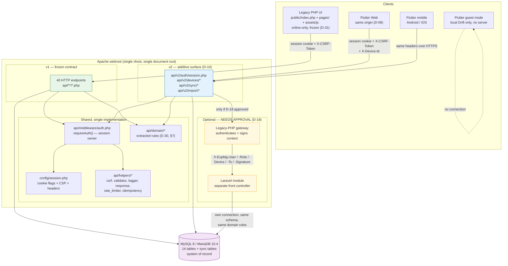

# Backend Coexistence

| Field | Value |
|---|---|
| Status | Specification — Phase 2 |
| Date | 2026-11-15 |
| Purpose | Define how the existing PHP backend, the new v2 surface, and an optional Laravel module live together without duplicating rules or splitting authentication |
| Rule | One request is served by exactly one stack. One rule has exactly one implementation. One session has exactly one owner |

This document is the authority for requirements CO-01…CO-07 and PR-23 in
[`WORK/REQUIREMENTS_TRACEABILITY.md`](../WORK/REQUIREMENTS_TRACEABILITY.md). It resolves nothing that
belongs to the owner: the Laravel coexistence model is **`NEEDS APPROVAL`** (D-18 / UQ-06), and every
statement below about Laravel is conditional on that approval.

---

## 1. Scope and vocabulary

### 1.1 What this document decides

| Topic | Section |
|---|---|
| What stays procedural, and why | §2 |
| The legacy PHP UI's position in the target system | §3 |
| The single authentication boundary | §4 |
| Shared database access | §4.2 |
| Whether a gateway or microservice is necessary | §4.3 |
| When a Laravel module is justified | §5 |
| How duplicate business logic is prevented | §6 |
| Extracting domain rules before v2 writes | §7 |
| Migrating modules incrementally and reversibly | §8 |

### 1.2 Vocabulary

| Term | Meaning in this document |
|---|---|
| **v1** | The 40 existing HTTP endpoints under `api/` plus the CLI worker. Frozen contract (`API_CONTRACT.md` §14) |
| **v2** | The additive surface under `api/v2/` (D-10). New capabilities only: session bootstrap, devices, sync, guest import |
| **Legacy UI** | The server-rendered SPA in `public/index.php` + `pages/` + `public/assets/js/` |
| **Flutter client** | The new client (D-01), Web same-origin (D-08) or mobile |
| **Stack** | A request-serving runtime: legacy PHP, v2 PHP, or Laravel |
| **Rule** | A business invariant whose violation corrupts data (settlement lock, `paid_by`, membership, group limits, money) |

### 1.3 Verified baseline

Facts below were read from the repository at HEAD `ec0e692`; they are the ground truth this design
must fit.

| Fact | Evidence |
|---|---|
| No framework serves any request | Every endpoint is a standalone script with an explicit `require_once` chain |
| Database access is `mysqli` prepared statements only | `config/db.php` exposes `$conn`; no ORM, no query builder |
| Composer exists but only for `.env` loading | `composer.json` requires `vlucas/phpdotenv` only; `config/env.php:25-35` optionally requires `vendor/autoload.php`. No PSR-4 autoload is configured and no endpoint uses the autoloader for application code |
| One shared business helper exists | `api/settlements/settlement_helpers.php` — `calculateSettlements()`, `recordSettlement()` |
| No `api/domain/` directory exists | `Test-Path api/domain` → `False`. Creating it is a hard prerequisite (D-30) |
| Session and headers have exactly one owner | `config/session.php` via `api/middleware/auth.php:23-35`. `api/bootstrap.php` is included by zero files (KD-02, D-32) |
| No CORS headers exist anywhere | Repository-wide search returns zero matches; CSP `connect-src 'self'`; cookie `SameSite=Lax` |
| Every authenticated request is rate limited | `api/middleware/auth.php:144-193`: 120/min per user, 240/min per IP, 30/min heartbeat bucket |

---

## 2. Procedural PHP remains valid where suitable (CO-01)

### 2.1 Decision

The endpoint layer stays procedural. This is not a concession to legacy — it is the correct choice for
this workload, and it remains the default for every new v2 endpoint.

### 2.2 Why

| Reason | Consequence |
|---|---|
| Zero framework boot cost per request | The 120/min user limit is spent on work, not on container resolution |
| Any file is auditable in isolation | A security review of `api/expenses/update.php` needs no framework knowledge |
| Deploys to stock XAMPP/LAMP | No build step, no opcache warm-up, no queue worker requirement |
| The request lifecycle is fully visible | `requireAuth()` → validate → prepare → execute → `json_encode` reads top to bottom |
| Test suite already asserts this shape | 538 assertions target file-level structure (`tests/run_tests.php`) |

### 2.3 What is procedural and what is not

| Concern | Form | Rationale |
|---|---|---|
| HTTP endpoints (v1, v2) | Procedural script per route | One file owns one lifecycle |
| Shared business rules | Procedural functions in `api/domain/` (§7) | Must be callable from a script with no container |
| Validation / response / logging helpers | Procedural functions | Existing pattern, unchanged |
| Infrastructure with stateful resources (Redis, locks, cache) | Classes in `api/services/` | Resource handles need lifetime management |
| Optional Laravel module | Framework-managed | Only if D-18 is approved (§4) |

### 2.4 Conventions every new v2 file must follow

v2 is new code, not new conventions. A v2 endpoint is indistinguishable in shape from a v1 endpoint:

```php
<?php
header('Content-Type: application/json');
require_once __DIR__ . '/../../../config/db.php';
require_once __DIR__ . '/../../../api/middleware/auth.php';
require_once __DIR__ . '/../../../api/helpers/logger.php';
require_once __DIR__ . '/../../../api/domain/expense_rules.php';   // when the rule is needed

requireAuth();
// validate → prepare → bind_param → execute → close
echo json_encode(['ok' => true, ...]);
```

| Rule | Source |
|---|---|
| Never call `session_start()` in an endpoint | `AGENTS.md`; test 27b |
| Never call `$conn->query()` with interpolated values | `AGENTS.md` |
| Response shape is `{'ok': bool, ...}` | `API_CONTRACT.md` §3 |
| Multi-step writes are wrapped in `begin_transaction()` / `commit()` / `rollback()` | `AGENTS.md` |
| `requireAuth()` runs before any database read of user data | `api/middleware/auth.php` |
| CSRF is verified by `verifyCsrf()` only | `api/helpers/csrf.php` |

**Anti-pattern, explicitly forbidden:** a v2 endpoint that "improves" the v1 response shape, adds a
second error envelope, or returns HTTP 200 with `ok:false` where v1 returns 400. Divergence in the
envelope is how two backends start disagreeing about the same table.

---

## 3. The legacy PHP UI remains online-only and unmodified (PR-23, D-31)

### 3.1 What "unmodified" means precisely

| Allowed | Not allowed |
|---|---|
| Nothing in `public/assets/js/`, `pages/`, or `public/index.php` changes | Adding offline capability to the PHP UI |
| The legacy UI keeps calling v1 exactly as `API_CONTRACT.md` documents | Repointing the legacy UI at `/api/v2/` |
| Shared server files may receive **additive, behaviour-preserving** changes (§3.4) | Changing a v1 response field, status code, or error string |
| The legacy UI is retired at Phase 6 cutover | Deleting it before cutover |

The legacy UI is the fallback if the Flutter release fails. Making it depend on v2 would remove that
fallback exactly when it is needed.

### 3.2 Backend coexistence diagram



### 3.3 What each edge means

| Edge | Meaning | Enforced by |
|---|---|---|
| Legacy UI → v1 | Unchanged contract, unchanged headers | `API_CONTRACT.md` §14 freeze |
| Flutter → v2 | New surface; same cookie session, same CSRF header | `api/AUTHENTICATION_AND_AUTHORIZATION.md` |
| Guest → itself | Guest mode has no server connection at all | D-04, `synchronization/GUEST_DATA_MIGRATION.md` §3 |
| v1/v2 → `requireAuth()` | One authentication implementation | `api/middleware/auth.php` |
| v1/v2 → `api/domain/` | One business-rule implementation | §6, §7 |
| v2 → gateway → Laravel | Optional, signed context, Laravel never authenticates | D-18, §4.1 |
| Any stack → MySQL | One schema, one source of truth | §4.2 |

### 3.4 Coexistence invariants

| ID | Invariant | Why it matters |
|---|---|---|
| CO-I-1 | No request is served by two stacks. The gateway either forwards to Laravel or handles locally, never both | Partial serving creates two transaction boundaries for one intent |
| CO-I-2 | The legacy UI never sends `X-Device-Id` and is never required to | It must not need a device registration to keep working |
| CO-I-3 | `config/session.php` is the only place cookie flags, CSP, and security headers are set | KD-02 / D-32; double-sending headers breaks the response |
| CO-I-4 | Changes to shared files are additive and behaviour-preserving; no v1 field, status, or string changes | Freeze scope `MIGRATION_PRESERVATION_PLAN.md` §2.1 |
| CO-I-5 | Every new endpoint appears in `API_CONTRACT.md` §9.1's successor inventory before it ships | Prevents undocumented surface area |
| CO-I-6 | The test baseline stays `433 passed / 105 failed / 538 tests` after every coexistence step | `docs/TEST_BASELINE.md` |
| CO-I-7 | No stack writes to a table it does not own the rules for | §6.1 |

### 3.5 Shared files that may change, and how

| File | Permitted change | Forbidden change |
|---|---|---|
| `api/middleware/auth.php` | Additive: capture actor context for change capture (`@expmg_actor_user_id`, `@expmg_device_uuid`) after `requireAuth()`'s existing checks | Reordering the session-lock release, altering the 401/403/429 paths |
| `config/session.php` | Nothing required by this phase | Any change; D-32 keeps it as-is |
| `api/helpers/validator.php` | New validators for v2-only inputs | Changing existing validator semantics |
| `api/helpers/rate_limiter.php` | New bucket name (`api_sync`, D-28) | Changing the 120/240 defaults |
| `config/idempotency.php` | Wiring to v2 POSTs | Changing the key derivation or TTL |

### 3.6 Verification

`PR-23` is verified by `MANUAL-SCENARIO`, not by an automated assertion, because the claim is "the old
UI still works". The scenario is in
[`testing/ARCHITECTURE_VALIDATION_PLAN.md`](../testing/ARCHITECTURE_VALIDATION_PLAN.md) §3:

1. Log in through `pages/login.php`, open every page in the legacy UI.
2. Create, edit, delete a personal expense; create and check a priced list item.
3. Create a group, join with a second account, add a group expense, calculate and confirm a settlement.
4. Repeat steps 1–3 with the v2 surface present and the sync tables populated.
5. Confirm zero console errors, zero new 4xx, and an unchanged response body for each v1 call.

---

## 4. One authentication boundary (CO-03, D-18, UQ-06)

**Status: `ACCEPTED` (D-18, UQ-06).**

The project owner approved retaining the **procedural PHP 8 backend** with a shared procedural domain helper layer (`api/domain/`). Consistent with D-03 and D-18, Laravel is **not adopted** for Phase 2/3 sync or API development. If and when Laravel is introduced for an approved future use case (e.g. complex reporting or queue orchestration), it will operate under **Model M-1 (Legacy-PHP gateway with signed context header)**:

### 4.1 The approved coexistence model (M-1)

#### M-1 — Legacy-PHP gateway with a signed context header (approved, D-18)

The request arrives at a PHP file that already includes `api/middleware/auth.php`, so
`requireAuth()` has run: session validated, 24-hour expiry checked, CSRF verified, rate limit applied.
The gateway then forwards to the Laravel front controller with:

| Header | Content |
|---|---|
| `X-ExpMg-User` | Authenticated `user_id` |
| `X-ExpMg-Role` | Resolved role for the addressed group, or `none` |
| `X-ExpMg-Device` | `sync_devices.uuid` if present, else empty |
| `X-ExpMg-Ts` | Unix seconds |
| `X-ExpMg-Signature` | `HMAC-SHA256(secret, user|role|device|ts|path|body_hash)` |

Laravel verifies the signature, rejects a timestamp older than 60 seconds, and trusts nothing else.
It never reads the session cookie.

| Aspect | Assessment |
|---|---|
| Authentication implementations | **One** |
| Revocation model | **One** (session destruction) |
| CSRF story | **One** (v1 helper) |
| Changes to existing auth code | None |
| Extra network hop | One loopback per forwarded request |
| New secret to manage | Yes, in `.env` |
| New security-critical file | The gateway, with its own tests |
| Reversibility | High — remove the gateway, Laravel is unreachable |

#### M-2 — Shared session store (database or Redis)

Both stacks read the same session record.

| Aspect | Assessment |
|---|---|
| Authentication implementations | Two readers of one record |
| Changes to `config/session.php` | Required — session handler must change |
| Serialisation parity | Must match between PHP's session format and Laravel's session payload |
| Regression surface | **Every** authentication assertion in 538 tests |
| Failure mode | A format mismatch logs everyone out, intermittently, per stack |
| Verdict | More invasive and more fragile than M-1 for no benefit at this scale |

#### M-3 — Tokens for v2 (and Laravel) only

| Aspect | Assessment |
|---|---|
| Authentication implementations | **Two** |
| Revocation models | **Two** (session destroy vs token revoke) |
| CSRF story | Two (cookies need CSRF; bearer tokens do not) |
| User experience | A user can be logged in to one surface and not the other |
| Verdict | Directly contradicts D-03's "consistent authentication across both" |

### 4.2 Shared database access with one source of truth (CO-04)

Every stack connects to the same MySQL instance with the same credentials from `env()`.

| Rule | Detail |
|---|---|
| Schema authority | `schema.sql` is the source of truth. Laravel migrations are **not** used to create or alter product tables |
| Migration authority | Sequential, hand-written `migration_vX.Y.sql`, applied deliberately. No `php artisan migrate` against product tables |
| Credentials | `DB_HOST` / `DB_USER` / `DB_PASS` / `DB_NAME` from `config/env.php`. No second credential set, no second database |
| Connection lifetime | Request-scoped in every stack. No long-lived global connection, no shared connection pool across stacks |
| Parameter binding | Mandatory everywhere. Laravel's query builder is allowed; `DB::raw()` with an interpolated variable is a review defect equivalent to `$conn->query()` with a variable |
| Character set / collation | Identical for all stacks; set on the connection, not per query |
| `sql_mode` | Identical. A stack that runs with a different `sql_mode` will silently accept or reject different rows |
| Transactions | Never span two stacks. One request, one stack, one transaction boundary (CO-I-1) |
| Time | Server time is authoritative; both stacks use the same timezone configuration |

**Why this is not a formality.** Two stacks with different `sql_mode` values is the classic way a
`CHECK` constraint appears to work in one place and not the other. `chk_expense_amount`,
`chk_budget_amount`, `chk_settlement_amount`, `chk_item_price`, and `chk_max_members` exist in the live
schema; a stack that disables strict mode would bypass the intent.

### 4.3 No gateway or microservice is assumed necessary (CO-07)

The baseline target architecture — v1 plus v2 procedural PHP — requires:

| Component | Required? |
|---|---|
| Second web server / port | No |
| Reverse proxy | No |
| Message broker | No (D-29) |
| Container orchestration | No |
| Separate service process | No |
| Gateway | **Only if Laravel is approved** |

The gateway in M-1 is **a PHP file in the same webroot and the same Apache process model**, not a
network service. It adds no listener, no port, and no deployment unit. If D-18 is rejected, the
gateway disappears and nothing else in this design changes: v1 and v2 both keep calling
`requireAuth()` directly.

**Therefore:** no microservice, broker, or service mesh is part of this architecture, and no
requirement in this phase justifies one. The dataset is a household or small group — tens of users,
thousands of rows (`ARCHITECTURE_DECISIONS.md` D-29).

### 4.4 What the decision blocks

| If… | Then… |
|---|---|
| D-18 approved | §5, §8 module migration, and `deployment/DEPLOYMENT_ARCHITECTURE.md` §6 apply |
| D-18 rejected / Laravel deferred entirely | §5 and §8 become dormant. **Nothing else in Phase 2 is blocked.** v2 procedural PHP is unaffected |
| No decision | All Laravel work stays blocked (UQ-06 is `BLOCKING`); v2, sync, and Flutter work proceed |

---

## 5. Laravel is justified per module, not globally (CO-02)

### 5.1 The five tests

A module may use Laravel only if **all five** pass. Failing one means procedural PHP.

| # | Test | Question |
|---|---|---|
| 1 | Capability | Does the module need something the procedural stack cannot reasonably provide (queued jobs with retries, a mature validation/authorisation layer for a large new domain, an admin UI generator)? |
| 2 | Isolation | Can it be reached through exactly one gateway route, with no legacy endpoint calling into it? |
| 3 | Rule reuse | Can it call `api/domain/` helpers instead of re-implementing a rule? |
| 4 | Reversibility | Can it be removed by deleting one route and one directory, leaving data intact? |
| 5 | Operability | Can it be deployed on the same host, same PHP version, same database, with no new service? |

### 5.2 Current verdict

| Candidate module | Verdict | Reason |
|---|---|---|
| Sync engine (bootstrap/pull/push) | **Procedural** | It is the most rule-sensitive code in the system; it must call `api/domain/` directly with no framework indirection |
| Auth / session bootstrap | **Procedural** | It must be the same session owner as v1 (D-32) |
| Guest import | **Procedural** | Depends on expense/list rules that must not be duplicated |
| Device registry | **Procedural** | Four small endpoints |
| Expenses, groups, lists, settlements, budgets | **Procedural** | Frozen v1 contract |
| PDF / report rendering | **Deferred** | No requirement yet; if one appears, test 1 may pass — it would still need a new approval |
| Admin/ops console | **Deferred** | Not in scope |
| Anything | **None approved** | No module currently passes all five tests |

**This table is a finding, not an oversight.** D-03 authorises Laravel *selectively*; the honest
selective answer today is "no module needs it". Recording that prevents a framework from being
introduced later on the strength of a vague authorisation.

### 5.3 Anti-criteria

Laravel must **not** be introduced because:

- "The new surface should be consistent" — consistency is served by shared helpers, not a framework.
- "Laravel would be cleaner" — cleanliness is not a test.
- "It is already in `composer.json`" — `composer.json` exists only for `vlucas/phpdotenv`; no PSR-4
  autoload is configured and no endpoint loads application code through the autoloader.
- A developer prefers it.

### 5.4 How a module is proposed

1. Write a one-page justification against the five tests.
2. Record it as a new decision (D-33 or later) with status `PROPOSED`.
3. Obtain owner approval before writing code.
4. Add the gateway route and the module to `API_CONTRACT_SPECIFICATION.md` §2's inventory.
5. Add the module to `deployment/DEPLOYMENT_ARCHITECTURE.md` §6.

---

## 6. No duplicate business logic (CO-05)

### 6.1 Rule ownership

| Rule | Canonical location **today** | Target canonical location | Consumers |
|---|---|---|---|
| Settlement lock (reject edit/delete inside a settled period) | Inline in `api/expenses/update.php`, `api/expenses/delete.php` | `api/domain/settlement_lock.php` | v1 expense writes, v2 push, guest import |
| `paid_by` must be a group member | Inline in `api/expenses/create.php`, `update.php` | `api/domain/expense_rules.php` | v1, v2 push, import |
| `is_post_settlement = 0` filter in settlement maths | Inline in `api/settlements/calculate.php` + `settlement_helpers.php` | `api/domain/settlement_lock.php` (predicate) | v1, v2 |
| Admin-only edit/delete of group expenses | Inline in `api/expenses/update.php`, `delete.php` | `api/domain/membership.php` | v1, v2 push |
| Max 5 groups per user / 10 members per group | Inline in `api/groups/create.php`, `join.php` | `api/domain/membership.php` | v1, v2 |
| Settlement confirmation completeness | `api/settlements/confirm.php` (transaction + `FOR UPDATE`) | `api/domain/settlement_lock.php` | v1, v2 |
| List check → expense creation, uncheck → delete by `expense_id` | Inline in `api/lists/check_item.php` | `api/domain/list_rules.php` | v1, v2 |
| Notification `reference_id` = expense id | Inline in `api/expenses/create.php` | `api/domain/notifications.php` | v1, v2 |
| Money validation (`> 0`, ≤ 99 999 999.00, 2 decimals) | `api/helpers/validator.php` + inline casts | `api/domain/money.php` | v1, v2, Flutter mirror |
| Date validation | `api/helpers/validator.php::validateDate()` | unchanged | all |

### 6.2 How duplication is detected

| Mechanism | What it catches |
|---|---|
| Characterization tests (§7.3) | A v2 path that produces a different outcome than v1 for the same input |
| `DOC-REVIEW` of every v2 endpoint | A SQL predicate copied from a v1 endpoint instead of called |
| Grep gate in review | `is_post_settlement` appearing in a new file outside `api/domain/`; `paid_by` appearing in a new validation block |
| Dual-write test | The same intent sent through v1 and v2 produces byte-identical rows |
| Settlement regression test | Any change that alters a computed balance fails immediately |

### 6.3 Server authority and the client mirror

The Flutter domain layer mirrors server rules for responsiveness. It is **never** the authority.

| Rule | Client may evaluate locally? | On disagreement |
|---|---|---|
| Amount > 0, ≤ 99 999 999.00, 2 decimals | Yes — advisory, blocks the save button | Server rejects with a field error; client shows it |
| Date is a real calendar date | Yes — advisory | Server rejects |
| Settlement lock (period settled) | **No** — the client's period data may be stale | Server returns `409`/business error; client refreshes |
| `paid_by` is a group member | Partially — client checks its cached roster | Server is authoritative; a stale roster produces a rejection the client must display, not swallow |
| Admin-only edit | Partially — hides UI affordances | Server returns 403 |
| Max 5 groups / 10 members | Advisory only | Server enforces |
| Settlement confirmation completeness | **No** | Server computes |

**Rule:** where client and server disagree, the server wins and the client is corrected. A client that
"wins" a disagreement has produced a divergence that will surface as a wrong balance
(`SYSTEM_COMPONENTS.md` §2.3).

### 6.4 Permitted duplication

| Duplication | Permitted? | Why |
|---|---|---|
| Field-level format validation | Yes | UX responsiveness; server re-validates |
| Currency formatting | Yes | Presentation, not a rule |
| Localisation strings | Yes | Presentation |
| Settlement arithmetic for display | **No** | The server's calculation is the record. The client displays `calculate.php` output |
| The settlement-lock predicate | **No** | It depends on server state the client cannot know |

---

## 7. Domain-rule extraction (D-30)

### 7.1 Why extraction is a prerequisite

D4 in [`WORK/PHASE_2_DESIGN_PLAN.md`](../WORK/PHASE_2_DESIGN_PLAN.md) §6.1: v2 write endpoints must
enforce the same rules as v1. Today those rules exist only inline. A sync endpoint that re-implements
the settlement lock will eventually disagree with the v1 endpoint, and the disagreement surfaces as a
wrong balance — the highest-severity defect class in this product
(`MIGRATION_PRESERVATION_PLAN.md` §3.2).

**Therefore: no v2 write endpoint ships before its rules exist in `api/domain/`.**

### 7.2 Proposed layout

`api/domain/` does not exist. Creating it is a backend change requiring its own approved phase.

| File | Functions (proposed) | Rules owned | Extracted from |
|---|---|---|---|
| `expense_rules.php` | `validateExpenseInput()`, `assertPayerIsMember()`, `assertExpenseEditable()` | amount/date/note limits, payer membership, personal-vs-group ownership | `api/expenses/create.php`, `update.php`, `delete.php` |
| `settlement_lock.php` | `isDateInSettledPeriod()`, `assertNotSettled()`, `assertPeriodComplete()`, `settlementExpensePredicate()` | settlement lock, `is_post_settlement = 0`, confirmation completeness | `api/expenses/update.php`, `delete.php`, `api/settlements/confirm.php`, `calculate.php` |
| `membership.php` | `assertGroupMember()`, `assertGroupAdmin()`, `assertGroupCapacity()`, `assertUserGroupQuota()` | membership, admin role, 5-group and 10-member limits | `api/groups/create.php`, `join.php`, `remove_member.php`, `api/expenses/*` |
| `list_rules.php` | `assertListOwnership()`, `assertItemCheckable()`, `linkExpenseToItem()`, `unlinkExpenseFromItem()` | list ownership, check→expense, uncheck by `expense_id`, `checked_at` → date conversion | `api/lists/check_item.php`, `add_item.php`, `remove_item.php` |
| `money.php` | `parseAmount()`, `formatAmount()`, `amountToCents()` | 2-decimal money, range, wire format (D-21) | `api/helpers/validator.php`, endpoint casts |
| `notifications.php` | `notifyExpenseCreated()` | `reference_id` = expense id | `api/expenses/create.php` |

### 7.3 Characterization-first procedure

For each rule:

1. **Write the characterization test against current behaviour** — call the existing v1 endpoint,
   assert the current status code, body, and resulting row. It must pass before any refactor.
2. **Extract the predicate/validation verbatim** into `api/domain/<file>.php` as a procedural function.
   Verbatim means the same comparisons, the same error strings, the same SQL predicates.
3. **Replace the inline code with a call** in exactly one v1 endpoint.
4. **Re-run the full suite.** The baseline must remain `433 passed / 105 failed / 538 tests`. A change
   in either number means the extraction altered behaviour.
5. **Repeat per endpoint**, one endpoint per commit, so a regression is bisectable.
6. **Add the v2 consumer** only after all v1 consumers use the helper.

### 7.4 Constraints

| Constraint | Reason |
|---|---|
| Functions are procedural, not classes | Must be callable from a script with no container (§2.3) |
| No new dependencies, no autoloader requirement | `require_once` must remain sufficient |
| Error strings unchanged | `API_CONTRACT.md` §12 freezes them |
| No SQL string interpolation | Helpers receive `$conn` and use prepared statements |
| Helpers do not call `requireAuth()` | Authentication is the endpoint's concern |
| Helpers do not emit HTTP responses | They return a result or throw/return a violation the endpoint formats |

### 7.5 What this is not

| Not this | Why |
|---|---|
| KD-06's OOP service layer (`ExpenseService`, `GroupService`, …) | KD-06 is a planned class-based extraction with 88 failing assertions behind it. D-30 is narrow procedural rule reuse. Conflating them turns a small refactor into a large one |
| A rewrite of v1 | v1 keeps its shape; only the rule bodies move |
| A new framework | No |
| A reason to change the schema | No |

### 7.6 Exit criteria

| # | Criterion |
|---|---|
| 1 | `api/domain/` exists with the six files in §7.2 |
| 2 | Every rule in §6.1 has exactly one implementation, referenced by both v1 and v2 |
| 3 | Suite still `433 / 105 / 538` |
| 4 | A grep for `is_post_settlement` finds it only in `api/domain/`, `settlement_helpers.php`, and read-only settlement queries |
| 5 | The dual-write test (§6.2) passes for create, update, delete on personal and group expenses |

---

## 8. Incremental module migration (CO-06)

### 8.1 A module

A module is a bounded capability with its own rules and endpoints: expenses, groups, lists, budgets,
settlements, notifications, auth.

### 8.2 Migration states

| State | Description | Entry criterion | Rollback |
|---|---|---|---|
| **S0 — Legacy only** | v1 inline rules, v1 only | Default | n/a |
| **S1 — Rules extracted** | Rules live in `api/domain/`; v1 calls them | Characterization tests green (§7.3) | Revert the extraction commit; v1 inline code returns |
| **S2 — v2 shadow read** | v2 read endpoint exists alongside v1; both must return equivalent data | v1 and v2 read the same rows | Delete the v2 file; no data impact |
| **S3 — v2 write** | v2 write endpoint live behind a feature flag; v1 still live | S1 complete, dual-write test green | Disable the flag; v1 remains |
| **S4 — Legacy retired** | v1 endpoint removed | Flutter parity signed off, legacy UI retired (`MIGRATION_PRESERVATION_PLAN.md` §7 Phase 6) | Requires a release rollback; the reason S4 is last |

### 8.3 Ordering

Migrate **leaf-first**: a module with no other legacy module depending on its rules.

```
budgets  →  notifications  →  lists  →  expenses  →  groups  →  settlements  →  auth
```

| Constraint | Reason |
|---|---|
| Never migrate a module whose rules a legacy module still calls | Two live implementations of one rule |
| `settlements` last | It reads expenses, groups, and members; migrating it first means its dependencies are still S0 |
| `auth` never migrates before v2 exists | The session owner must not move (D-32) |
| Guest import requires `expenses` and `lists` at S3 | It writes through their rules |

### 8.4 Reversibility requirements

| Requirement | Detail |
|---|---|
| No schema removal | A retired endpoint's tables stay until the cutover is proven |
| Feature flag per v2 write endpoint | Disabling the flag returns the system to v1 behaviour without a deploy |
| v1 stays deployed | Removing v1 is Phase 6, not a migration step |
| Additive migrations only | `migration_vX.Y.sql` files are applied, never edited after application |
| One module per release | A failed migration must be identifiable to one capability |

### 8.5 Worked example — expenses

| Step | State | Change | Test |
|---|---|---|---|
| 1 | S0 | None | baseline |
| 2 | S1 | Extract `expense_rules.php`, `settlement_lock.php`; refactor `create.php`, `update.php`, `delete.php` | characterization + full suite |
| 3 | S2 | `GET /api/v2/expenses` shadow read | dual-read comparison |
| 4 | S3 | `POST /api/v2/sync/push` handles expense ops | dual-write test |
| 5 | S3 | Flutter writes expenses through v2 | end-to-end |
| 6 | S4 | v1 expense endpoints retired at cutover | legacy UI gone |

### 8.6 Explicitly not migrated

| Item | Status | Reason |
|---|---|---|
| Notification producers → `notification_publisher.php` | `DEFERRED` (KD-05) | A v2.5 migration that is incomplete; not part of coexistence |
| `outbox_events` write side | `DEFERRED` | Not a sync mechanism (`DATABASE_AUDIT.md` §7) |
| `api/services/*` | Dormant (KD-11) | Nothing on the HTTP path includes them |
| `api/bootstrap.php` | Dead (KD-02, D-32) | Activating it double-sends headers |
| Legacy UI | Frozen (D-31) | Retired only at cutover |

---

## 9. Risks

| ID | Risk | Likelihood | Impact | Mitigation |
|---|---|---|---|---|
| R-CO-1 | Laravel is approved and then bypasses `api/domain/` | Medium | High — divergent rules | §5 test 3; review gate; dual-write test |
| R-CO-2 | A v2 endpoint copies a v1 predicate instead of calling it | High (it is the path of least resistance) | High | §6.2 grep gate; §7.3 extraction-first rule |
| R-CO-3 | Extraction changes behaviour subtly (error string, status code) | Medium | Medium | Characterization tests written first; baseline unchanged |
| R-CO-4 | Two stacks run with different `sql_mode` / charset | Low | High — silent constraint bypass | §4.2 parity rule; deployment checklist |
| R-CO-5 | Legacy UI breaks because a shared helper changed | Low | High — removes the fallback | CO-I-4; PR-23 manual scenario |
| R-CO-6 | Gateway becomes a single point of failure | Low (only if D-18) | Medium | It is a PHP file; failure is a 500 on Laravel routes only |
| R-CO-7 | Extraction is mistaken for KD-06 and scope balloons | Medium | Medium | §7.5 explicit non-goals |

---

## 10. Status of architectural questions

| UQ | Status | Decision & Policy |
|---|---|---|
| UQ-06 — which coexistence model (D-18) | `APPROVED` | Procedural PHP 8 backend retained; Laravel remains optional for future justified use under Model M-1 |
| UQ-07 — group deletion with settlements (D-26) | `APPROVED` | 4-state group archival lifecycle; settlements block hard deletion |
| UQ-11 — group expense provenance (D-26) | `APPROVED` | Distinguish deliberate conversions (`type='personal'`) from detached group expenses (`type='group'`, `is_detached=1`) |
| UQ-04 — device revocation behaviour (D-25) | `APPROVED` | Option B: Full revocation via `app_sessions` table terminates sync and session immediately |
| UQ-17 — whether a device must register before syncing (D-34) | `APPROVED` | Mandatory registration before sync push/pull |

All are tracked in [`UNRESOLVED_QUESTIONS.md`](UNRESOLVED_QUESTIONS.md).

---

## 11. Verification

| Requirement | Section | Method | Pass condition |
|---|---|---|---|
| CO-01 Procedural PHP valid where suitable | §2 | `DOC-REVIEW` | §2.4 conventions match `AGENTS.md` and v1 files |
| CO-02 Laravel justified per module | §5 | `DOC-REVIEW` | Every candidate module has a verdict against five tests |
| CO-03 One authentication boundary | §4 | `DOC-REVIEW` (blocked by UQ-06) | Exactly one model is recommended and the other two are rejected with reasons |
| CO-04 Shared DB, one source of truth | §4.2 | `DOC-REVIEW` + deployment checklist | Parity rules are testable at deploy time |
| CO-05 No duplicate business logic | §6 | `DOC-REVIEW` + characterization tests | §6.1 has one location per rule; §7.3 procedure exists |
| CO-06 Incremental, reversible migration | §8 | `DOC-REVIEW` | Every state has an entry criterion and a rollback |
| CO-07 No gateway/microservice assumed | §4.3 | `DOC-REVIEW` | Baseline table shows zero extra components |
| PR-23 Legacy UI unchanged | §3 | `MANUAL-SCENARIO` | §3.6 scenario passes |

---

## 12. Cross-references

| Topic | Document |
|---|---|
| Decision register (D-03, D-18, D-30, D-31, D-32) | [`ARCHITECTURE_DECISIONS.md`](ARCHITECTURE_DECISIONS.md) |
| Layer and boundary definitions | [`TARGET_ARCHITECTURE.md`](TARGET_ARCHITECTURE.md) §3, §5.4 |
| Component inventory (`domain_helpers`, `laravel_module`) | [`SYSTEM_COMPONENTS.md`](SYSTEM_COMPONENTS.md) §1 |
| Backend coexistence diagram index | [`DATA_FLOW.md`](DATA_FLOW.md) §1–§10 |
| Frozen v1 contract | [`API_CONTRACT.md`](../API_CONTRACT.md) §14 |
| Auth/session implementation | [`api/AUTHENTICATION_AND_AUTHORIZATION.md`](../api/AUTHENTICATION_AND_AUTHORIZATION.md), [`security/SESSION_MANAGEMENT.md`](../security/SESSION_MANAGEMENT.md) |
| v2 surface and versioning | [`api/API_VERSIONING.md`](../api/API_VERSIONING.md) |
| Extraction prerequisite in the dependency chain | [`WORK/PHASE_2_DESIGN_PLAN.md`](../WORK/PHASE_2_DESIGN_PLAN.md) §6.1 D4 |
| Deployment (single host, no extra services) | [`deployment/DEPLOYMENT_ARCHITECTURE.md`](../deployment/DEPLOYMENT_ARCHITECTURE.md) §2 |
| Preservation invariants | [`MIGRATION_PRESERVATION_PLAN.md`](../MIGRATION_PRESERVATION_PLAN.md) §3 |
