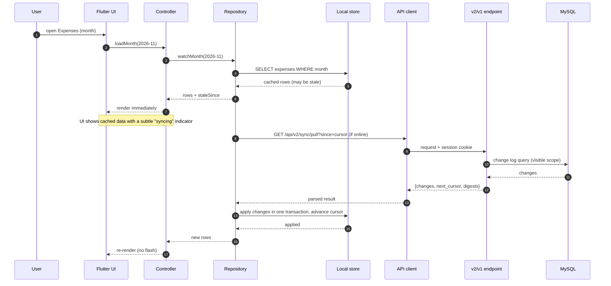
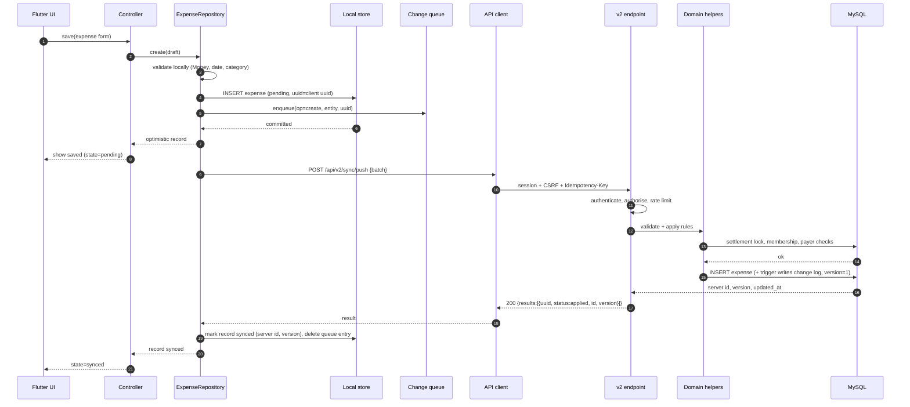
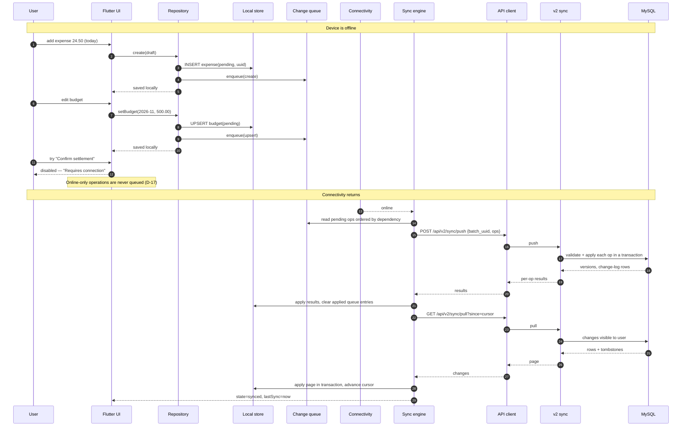
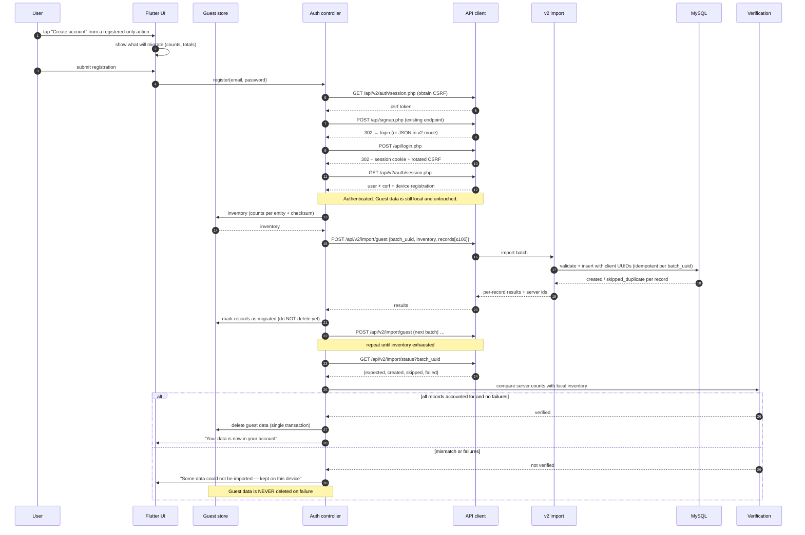
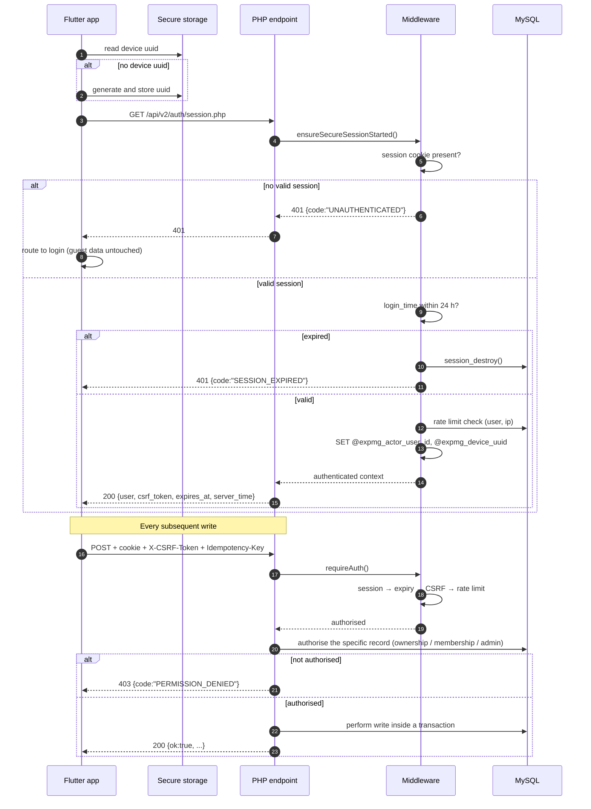
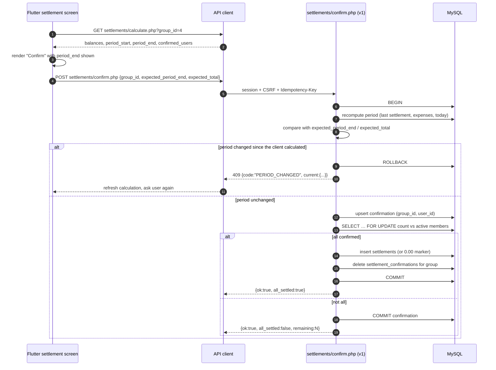
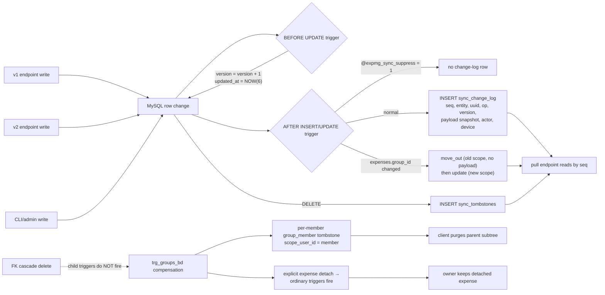
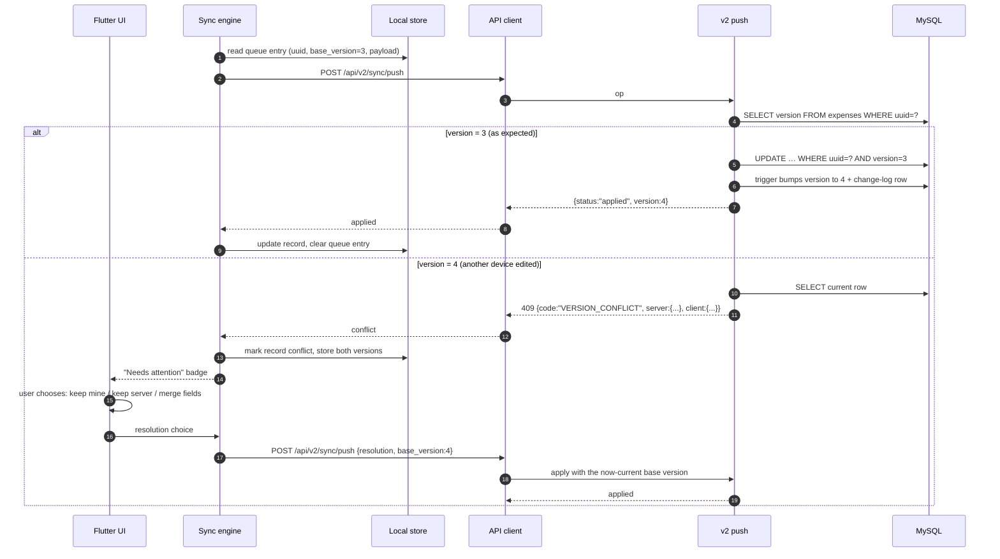
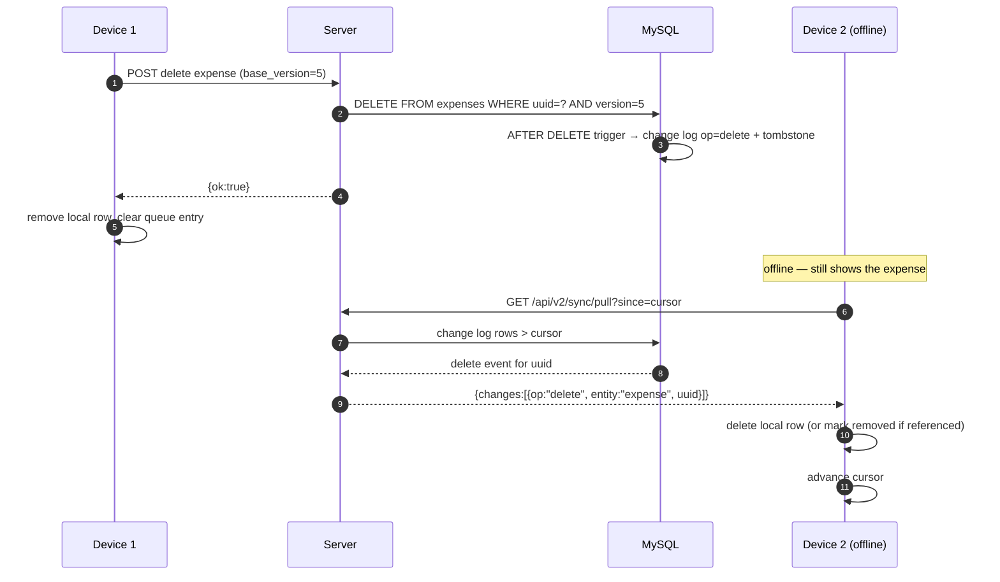
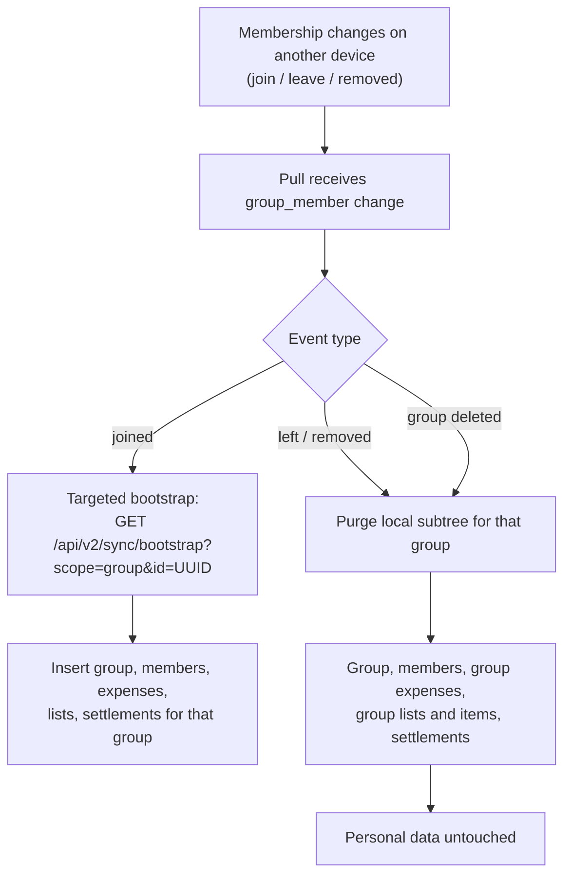

# Data Flow

| Field | Value |
|---|---|
| Status | Specification — Phase 2 |
| Date | 2026-11-15 |
| Purpose | Show exactly how data moves for every architectural scenario |

Every diagram here corresponds to a written rule elsewhere. A diagram without a rule is
decoration and is not permitted (see `WORK/PHASE_2_DESIGN_PLAN.md` §2).

Diagrams in other documents: high-level system → `TARGET_ARCHITECTURE.md` §2; component →
`SYSTEM_COMPONENTS.md` §1; backend coexistence → `BACKEND_COEXISTENCE.md` §3.

---

## 1. Online read (Flutter, registered mode)

**Rules.**
- The UI never waits for the network to show data it already has.
- A failed pull does **not** clear local data and does **not** advance the cursor.
- `staleSince` is displayed only when the last successful pull is older than 5 minutes.

---

## 2. Online write (Flutter, registered mode)

**Rules.**
- The local write commits **before** the network call. The UI is never blocked by the network.
- The queue entry is deleted only after a confirmed server result.
- A `409` moves the record to `conflict`; it is not retried automatically.

---

## 3. Offline write and later synchronisation

**Rules.**
- Push happens **before** pull. This is safe because every push carries `base_version`; a push
  cannot overwrite a newer server state — it fails with a conflict instead.
- Dependency order is fixed: `budget`/`list` → `list_item` → `expense` (see
  `SYNC_WORKFLOWS.md` §4.2).
- The pull cursor advances only after the page is committed locally.

---

## 4. Guest-to-registered migration

**Rules.**
- Deletion of guest data is a separate, final, verified step (D-04).
- For existing accounts (D-22, UQ-01), Option C applies: dry-run surfaces Tier 1 exact UUID skips and Tier 2 heuristic candidates; user can skip import for now, preserving the local guest partition (`account_id = 'guest'`).
- Each batch is idempotent by `batch_uuid`; a retry cannot duplicate records.
- A partial import leaves guest data intact and offers retry.

Full detail: `synchronization/GUEST_DATA_MIGRATION.md`.

---

## 5. Authentication and authorisation flow

**Rules.**
- Two authorisation layers, both mandatory: **authentication** (who) at the middleware and
  **record authorisation** (may this user touch this row) in the endpoint/domain helper.
- A client-supplied `user_id`, `group_id`, `paid_by`, or cursor is never trusted; it is always
  re-derived or re-checked.
- The session cookie is never read by application code; only the session itself is.

Full detail: `api/AUTHENTICATION_AND_AUTHORIZATION.md`, `security/ACCESS_CONTROL.md`.

---

## 6. Settlement closure flow (online only)

**Rules.**
- `expected_period_end` and `expected_total` are **optional** request fields. When absent, the
  endpoint behaves exactly as today (v1 compatibility). When present and mismatched, the server
  refuses with `409 PERIOD_CHANGED`.
- The transaction and `SELECT … FOR UPDATE` are preserved (PR-05).
- The client never computes a settlement result; it only displays server output.

---

## 7. Change-capture flow (server-side, every write)

**Rules.**
- One write produces exactly one change-log row per affected row — except a group deletion, whose
  compensation rows are written deliberately by `trg_groups_bd` (one per member).
- Migrations and backfills set `@expmg_sync_suppress = 1`.
- A cascade delete is represented by the parent's tombstone **only while the parent still resolves
  visibility**. Group deletion destroys the membership rows, so it emits a personally-scoped
  `group_member` tombstone per member instead (`DATABASE_SCHEMA_SPECIFICATION.md` §5.4.3).
- An expense whose `group_id` changes emits `move_out` for the old scope before the new-scope
  `update`, so the old scope can remove its copy without receiving a payload it is not entitled to
  (§5.6.4).
- A surviving group expense is detached by an explicit `UPDATE`, never by `ON DELETE SET NULL`
  (which fires no trigger and would be an unlogged mutation).

Full detail: `database/DATABASE_SCHEMA_SPECIFICATION.md` §5.4.3–§5.4.4 and §5.6.

---

## 8. Conflict detection and resolution flow

**Rules.**
- A conflict never resolves itself for an expense, budget, or list record.
- The server always returns its current row so the user can compare.
- A resolution is a **new write** with the fresh `base_version`; it is not a forced overwrite.

Full detail: `synchronization/CONFLICT_RESOLUTION.md`.

---

## 9. Deletion propagation flow

**Rules.**
- A delete is a tombstone event, not an absence. Absence cannot be distinguished from "not yet
  downloaded".
- If the local row has unsent changes, the delete wins only if the tombstone's version is greater
  than the local base version; otherwise the client surfaces a conflict.

Full detail: `database/DATABASE_SCHEMA_SPECIFICATION.md` §5.4,
`synchronization/SYNC_WORKFLOWS.md` §7.5.

---

## 10. Group membership transition flow

**Rules.**
- A membership transition is not a change-log replay; it is a scoped bootstrap or purge. This
  avoids retroactively exposing a group's history through a cursor.
- Purge is local only. Server data is unaffected (except for a genuine group delete).

---

## 11. Summary of flow guarantees

| Guarantee | Mechanism |
|---|---|
| No lost local write | Local commit precedes network; queue persists |
| No duplicate server write | `batch_uuid` + per-record idempotency + client UUID uniqueness |
| No silent overwrite | `base_version` precondition |
| No lost deletion | Durable tombstone |
| No partial apply | Per-page transaction; cursor advances only after commit |
| No stale financial closure | Online-only confirmation with `expected_period_end` |
| No anonymous data | Guest mode has no network path |
| No unauthorised sync | Server re-derives identity and re-checks ownership on every push |
