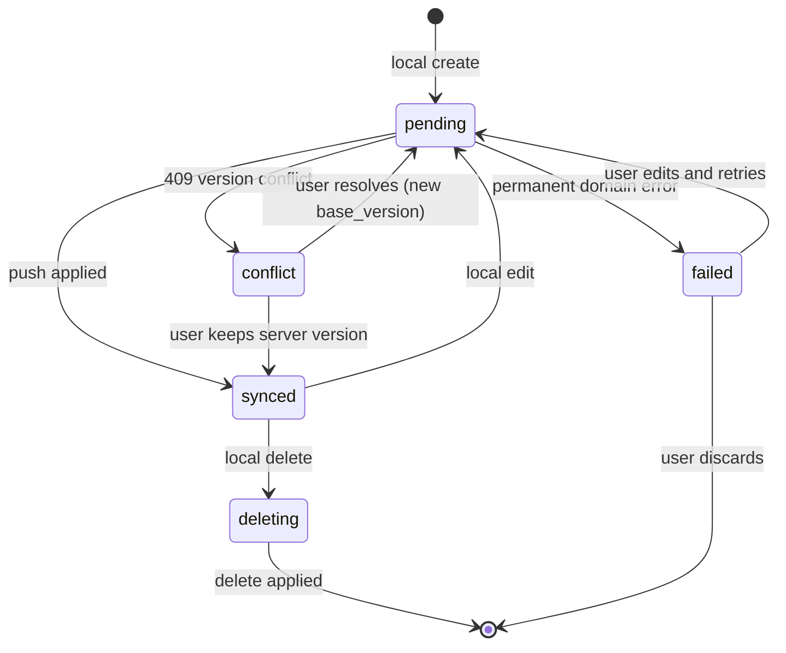

# Flutter Application Architecture

| Field | Value |
|---|---|
| Status | Specification — Phase 2 |
| Date | 2026-11-15 |
| Scope | Structure, layering, state, error handling, platform behaviour |
| Constraint | No Flutter project exists and none may be created in this phase |

---

## 1. Design goals

| Goal | Consequence |
|---|---|
| One behavioural implementation across six platforms | All business logic in shared Dart; platform code limited to storage, sharing, and background execution |
| Offline-first for a defined subset | Local write commits before any network call (D-16) |
| The server is authoritative | The client never decides a financial outcome |
| Testable without a device | Domain and application layers are pure Dart with injected repositories |
| No silent data loss | Every queued change survives restart; every failure is surfaced |

---

## 2. Platform reality check

D-01 requires support for six platforms, but "Flutter supports it" is not the same as "this
feature works there". The table below is the honest position; anything marked *verify* is a spike
task (`TECHNOLOGY_STACK.md` §5).

| Capability | A | I | W | WD | M | L | Notes |
|---|---|---|---|---|---|---|---|
| UI, routing, theme | ✓ | ✓ | ✓ | ✓ | ✓ | ✓ | Shared |
| Cookie session | ✓ | ✓ | ✓ (browser-owned) | ✓ | ✓ | ✓ | Web cannot read `HttpOnly` cookies; the CSRF cookie is readable |
| Same-origin API call | n/a | n/a | **required** | n/a | n/a | n/a | D-08; no CORS exists |
| Drift/SQLite | ✓ | ✓ | ✓ via WASM | ✓ | ✓ | ✓ | Verify V-1 |
| SQLCipher | ✓ | ✓ | **✗** | ✓ | ✓ | ✓ | Verify V-5 |
| Secure storage | ✓ | ✓ | limited | ✓ | ✓ | ✓ (libsecret) | Verify V-6 |
| PDF save/share | ✓ | ✓ | download | ✓ | ✓ | ✓ | Platform-specific share sheet |
| Background sync | ✓ | best-effort | ✗ | ✗ | ✗ | ✗ | Foreground sync is the guarantee |
| Push notifications | ✗ | ✗ | ✗ | ✗ | ✗ | ✗ | Not designed; no infrastructure |
| File picker / share | ✓ | ✓ | limited | ✓ | ✓ | ✓ | Only for registered account data export (CSV/JSON/PDF); guest mode displays educational prompt |

**Conclusion.** The architecture must not assume background execution or push. Every guarantee is
delivered by foreground behaviour plus a durable queue.

---

## 3. Layering

```
presentation  →  application  →  domain
                       ↓
                     data  →  (local store | api client)
```

Dependencies point **inward only**. The domain layer imports no Flutter package beyond
`meta`-level utilities; it must be unit-testable with `dart test` alone.

| Layer | May import | Must not import |
|---|---|---|
| presentation | application, domain (read-only types), Flutter | data, dio, drift |
| application | domain, data (interfaces), Riverpod | Flutter widgets, dio, drift |
| domain | Dart core only | everything else |
| data | domain, dio, drift, platform plugins | presentation, application |

A lint rule (`import_lint` / a custom `analysis_options.yaml` `forbidden_imports`) enforces this.

---

## 4. Project structure

```
lib/
├── main.dart
├── app.dart                      # MaterialApp.router, theme, locale
├── bootstrap.dart                # DI overrides, DB open, migration, first-run
├── core/
│   ├── config/
│   │   ├── app_config.dart       # base URL, environment, feature flags
│   │   └── build_flags.dart      # --dart-define parsing
│   ├── error/
│   │   ├── failure.dart          # sealed failure hierarchy
│   │   ├── error_mapper.dart     # HTTP/Dio/DB → Failure
│   │   └── error_reporter.dart   # redacted logging hook
│   ├── result.dart               # Result<T> / Ok / Err
│   ├── money.dart                # Money(int cents) + parse/format
│   ├── local_date.dart           # LocalDate (no time zone surprises)
│   ├── uuid_source.dart
│   └── clock.dart                # injectable clock (testability)
├── domain/
│   ├── entities/
│   │   ├── expense.dart
│   │   ├── budget.dart
│   │   ├── list_record.dart
│   │   ├── list_item.dart
│   │   ├── group.dart
│   │   ├── member.dart
│   │   ├── settlement.dart
│   │   ├── category.dart
│   │   └── notification.dart
│   ├── value_objects/
│   │   ├── expense_type.dart
│   │   ├── priority.dart
│   │   └── record_state.dart     # synced | pending | conflict | failed
│   ├── policies/
│   │   ├── expense_policy.dart   # amount/date/note/category rules
│   │   ├── budget_policy.dart
│   │   ├── list_policy.dart
│   │   ├── settlement_lock.dart  # advisory only; server decides
│   │   └── offline_capability.dart
│   └── violations.dart
├── data/
│   ├── local/
│   │   ├── database.dart         # Drift database
│   │   ├── tables/               # one file per table
│   │   ├── daos/
│   │   └── migrations/
│   ├── remote/
│   │   ├── api_client.dart
│   │   ├── endpoints.dart        # path constants, one place
│   │   ├── csrf_store.dart
│   │   ├── idempotency.dart
│   │   └── dto/
│   ├── repositories/
│   │   ├── expense_repository.dart
│   │   ├── budget_repository.dart
│   │   ├── list_repository.dart
│   │   ├── group_repository.dart
│   │   ├── settlement_repository.dart
│   │   ├── category_repository.dart
│   │   └── notification_repository.dart
│   └── sync/
│       ├── sync_engine.dart
│       ├── push_queue.dart
│       ├── pull_cursor.dart
│       ├── conflict_store.dart
│       ├── reconciler.dart
│       └── device_registry.dart
├── application/
│   ├── auth/
│   │   ├── auth_controller.dart
│   │   └── session_state.dart
│   ├── guest/
│   │   ├── guest_controller.dart
│   │   └── guest_import_controller.dart
│   ├── expenses/
│   ├── budgets/
│   ├── lists/
│   ├── groups/
│   ├── settlements/
│   ├── notifications/
│   ├── analytics/
│   └── sync/
│       └── sync_status_controller.dart
├── presentation/
│   ├── router/
│   │   ├── app_router.dart
│   │   └── guards.dart
│   ├── theme/
│   │   ├── app_theme.dart
│   │   ├── tokens.dart          # the 9 design tokens
│   │   └── theme_controller.dart
│   ├── common/
│   │   ├── widgets/             # buttons, cards, pills, empty states, money text
│   │   └── layout/
│   └── features/
│       ├── splash/
│       ├── auth/
│       ├── home/
│       ├── expenses/
│       ├── budgets/
│       ├── groups/
│       ├── lists/
│       ├── settlements/
│       ├── notifications/
│       ├── analytics/
│       └── settings/
└── l10n/
```

**Rule.** A file's location determines its allowed imports. `presentation/features/expenses/`
must not contain SQL, HTTP, or money arithmetic.

---

## 5. API client

### 5.1 Responsibilities

| Responsibility | Detail |
|---|---|
| Base URL | From `--dart-define=API_BASE_URL=…`; defaults to a same-origin relative path on web |
| Cookie jar | Persisted across restarts on native; browser-owned on web |
| CSRF | Read from `GET /api/v2/auth/session.php`; cached; refreshed after login and after any 403 |
| Idempotency | Generated per user intent; reused only for retries of that intent |
| Response parsing | `ok` first, then HTTP status; tolerate `success`/`code` keys |
| Error mapping | Transport, HTTP, and `ok:false` collapse into the `Failure` hierarchy |
| Rate limiting | `Retry-After` respected; no retry before it elapses |
| 401 | Clears session state and routes to login; local data retained |
| Logging | Request method/path/status/duration only; **never** bodies |

### 5.2 Failure hierarchy

```dart
sealed class Failure {
  const Failure(this.message, {this.code});
  final String message;
  final String? code;
}

final class NetworkFailure   extends Failure {}   // no connectivity / timeout
final class AuthFailure      extends Failure {}   // 401
final class ForbiddenFailure extends Failure {}   // 403 after CSRF refresh
final class RateLimited      extends Failure { final Duration retryAfter; }
final class ValidationFailure extends Failure {}  // 400/422 with server message
final class ConflictFailure  extends Failure { final Json serverRow; final Json clientRow; }
final class ServerFailure    extends Failure {}   // 5xx
final class UnknownFailure   extends Failure {}
```

**Rule.** The UI shows `failure.message` verbatim for `ValidationFailure` (the server's messages are
part of the contract) and a localised message for the rest.

### 5.3 CSRF lifecycle

1. App start → `GET /api/v2/auth/session.php` → `{user, csrf_token, expires_at}`.
2. Cache the token in memory (never in plain storage).
3. Send as `X-CSRF-Token` on every write.
4. On `403` with a CSRF error string → re-fetch the token once and retry the request once.
5. On a second `403` → `ForbiddenFailure`; do not loop.
6. After login → re-fetch (the token rotates).
7. After 12 hours of app life → re-fetch proactively (server rotates the token).

### 5.4 Idempotency

- A key is created when the user submits an intent (tap Save).
- The key is stored with the queue entry.
- Retries of that entry reuse the key.
- A new user intent always gets a new key.
- Keys are UUIDv4 strings ≤ 200 bytes.

---

## 6. Local persistence

### 6.1 Tables (client-side mirror + sync metadata)

| Table | Purpose |
|---|---|
| `expenses` | Local expense rows + `server_id`, `uuid`, `version`, `state` |
| `budgets` | Local budgets |
| `lists` | Local personal lists; group lists cached read-only |
| `list_items` | Local items |
| `groups` | Cached groups |
| `group_members` | Cached members |
| `settlements` | Cached settlement history (read-only) |
| `categories` | Seeded + refreshed |
| `pending_ops` | The change queue |
| `sync_cursors` | Per-entity cursor |
| `conflicts` | Unresolved conflicts |
| `sync_state` | Last sync time, last error, device id |
| `guest_profile` | Guest identity and flags (registered mode: empty) |

### 6.2 Record state machine



`state` is a column, not a widget concern. Every screen filters or badges by it consistently.

### 6.3 Transactions

- Applying a pulled page: **one** transaction per page, then cursor advance, then notify listeners.
- Enqueuing a local write: **one** transaction covering the record write and the queue entry. A
  crash between them is impossible.
- Guest purge after migration: **one** transaction.

### 6.4 Schema migrations

- Every schema change has a numbered Drift migration and a test that upgrades from the previous
  released version.
- Destructive migrations are forbidden for registered data; if a shape must change, add columns
  and backfill.
- A failed migration on a registered device triggers a rebuild-from-server flow with an explicit
  user message. On a guest device it never destroys data — it preserves the local database and routes the user to registration and support (export is restricted to registered accounts per owner decision).

---

## 7. Error handling

| Source | Handling |
|---|---|
| Local validation | Inline field error, no network call |
| Network failure on write | Keep queue entry; show "will retry"; do not lose the edit |
| Network failure on read | Show cached data + "offline" banner |
| 400/422 | Show the server message; mark the queue entry `failed` (no auto-retry) |
| 403 CSRF | One refresh + one retry |
| 403 permission | `failed` with a discard/duplicate choice |
| 409 conflict | `conflict` state; conflict screen |
| 429 | Block the action with a countdown; do not retry early |
| 5xx | Retry with exponential backoff (max 5 attempts), then `failed` with retry button |
| Local DB error | Log (redacted), surface a repair flow |

**Rule.** No error is swallowed. Every `catch` either maps to a `Failure` that reaches the UI or
records a queue-level failure that the sync screen displays.

---

## 8. State model

### 8.1 Authentication state

```dart
sealed class SessionState {}
final class Unknown      extends SessionState {}   // app starting
final class Guest        extends SessionState {}
final class Authenticated extends SessionState { final User user; final DateTime expiresAt; }
final class Expired      extends SessionState {}
```

- `Unknown` → splash.
- `Guest` → guest shell, no API calls.
- `Authenticated` → registered shell; sync engine enabled.
- `Expired` → login screen with the previous screen remembered.

### 8.2 Guest state

| Field | Meaning |
|---|---|
| `guestId` | Device-local UUID, created on first guest use |
| `hasGuestData` | Whether any record exists (drives the migration prompt) |
| `migrationState` | `none` / `inProgress` / `verifying` / `complete` / `failed` |

### 8.3 Sync state (exposed to the UI)

```dart
enum SyncPhase { idle, pushing, pulling, applying, reconciling, offline, error }

class SyncStatus {
  final SyncPhase phase;
  final DateTime? lastSuccess;
  final int pendingCount;
  final int conflictCount;
  final String? lastError;
  final bool online;
}
```

Displayed as: a small indicator in the app bar (idle/syncing/offline), a badge for pending count,
and a "Needs attention" entry for conflicts.

---

## 9. Presentation concerns

### 9.1 Routing and guards

| Route | Guard |
|---|---|
| `/splash` | none |
| `/login`, `/signup` | redirect to `/home` if authenticated |
| `/guest/*` | only when `Guest` |
| `/home`, `/expenses`, `/budgets`, `/lists`, `/notifications`, `/settings` | `Authenticated` |
| `/groups`, `/settlements` | `Authenticated` (registered-only) |
| `/migrate` | `Authenticated` **and** `hasGuestData` |

Deep links on web map to these paths. A deep link to a registered route while unauthenticated
redirects to login and returns afterwards.

### 9.2 Theme

- The nine design tokens from `public/assets/css/styles.css` are reproduced as a Dart `ThemeExtension`.
- Light/dark/system follow the current behaviour (`theme-init.js` semantics): persisted locally,
  applied before first paint.
- **Guest mode:** Theme customization is disabled for guests (UQ-16); guests receive the standard default appearance with controls hidden/disabled.
- Chart colours come from the same tokens; no ad-hoc colours in widgets.

### 9.3 Money and dates

- All money is `Money(int cents)`. Formatting is locale-aware via `intl`.
- All dates are `LocalDate` (year, month, day) — no `DateTime` in domain entities, to avoid
  timezone drift on `expense_date`.
- Timestamps from the server are parsed as UTC and displayed in local time.

### 9.4 Accessibility and responsiveness

- Minimum tap target 44×44 logical pixels.
- Semantic labels on icon-only buttons.
- Layout breakpoints: compact (<600), medium (600–1024), expanded (>1024) — desktop and web get a
  navigation rail rather than a bottom bar.
- The current UI is responsive; parity is expected, not optional.

---

## 10. Platform-specific considerations

### 10.1 Web

- Must be served same-origin with the API (D-08).
- Service worker caching must not serve a stale `index.html` after a deploy; version the build.
- Cookies are browser-owned; the CSRF cookie is readable, the session cookie is not.
- No SQLCipher; local data is protected only by browser origin isolation.
- PDF export triggers a download, not a share sheet (Registered mode only; guest mode displays educational "Account Required to Export Data" prompt).

### 10.2 Android

- Use the platform share sheet for PDFs and a `FileProvider` for saved files.
- Background sync via `workmanager` is best-effort; the OS may defer it indefinitely.
- Back button must not exit from a nested route without confirmation when there are unsaved edits.

### 10.3 iOS

- Background execution is opportunistic; never promise "syncs in the background".
- Keychain items should be `kSecAttrAccessibleAfterFirstUnlock` so a background sync can read the
  device id.
- File sharing requires `UIFileSharingEnabled` or a share sheet.

### 10.4 Desktop (Windows, macOS, Linux)

- Window sizing and minimum size; multi-window is **not** in scope.
- Linux secure storage requires a running secret service; if absent, degrade with an explicit
  warning rather than crashing.
- No background execution; sync runs while the app is open.

### 10.5 Background sync — the honest position

| Platform | Guarantee |
|---|---|
| Foreground (all) | Sync on start, on resume, on reconnect, after each local write, every 60 s while open |
| Android background | Best-effort via `workmanager`, minimum 15-minute interval |
| iOS background | Best-effort, may not run at all |
| Web / desktop | None |

The UI must never show "synced" for a state that has not been confirmed by the server.

---

## 11. Testing hooks

The architecture exists to make these testable without a device:

| Test type | What it exercises | Tooling |
|---|---|---|
| Domain unit | Policies, `Money`, `LocalDate` | `dart test` |
| Repository unit | Local store + fake API | In-memory Drift (`NativeDatabase.memory()`) |
| Sync engine unit | Push ordering, conflict detection, cursor advance | Fake clock, fake transport |
| Widget | Screens with seeded state | `flutter_test` |
| Golden | Theme parity | `flutter_test` goldens |
| Integration | Real API against a disposable database | `integration_test` |
| Platform smoke | Cookie persistence, storage, share | Manual checklist (`testing/ARCHITECTURE_VALIDATION_PLAN.md` §14) |

---

## 12. What this architecture forbids

| Forbidden | Why |
|---|---|
| `double` anywhere in a money path | Float drift (D-21) |
| Business logic in a widget | Untestable, duplicated |
| Direct `dio` or Drift use outside `data/` | Bypasses CSRF, idempotency, and the queue |
| Queueing an online-only operation | It can never succeed (D-17) |
| Optimistically marking a record `synced` | Only the server can confirm |
| Deleting guest data before verification | Violates D-04 |
| Background sync assumed | It may never run |
| A second state-management system | D-15 |
