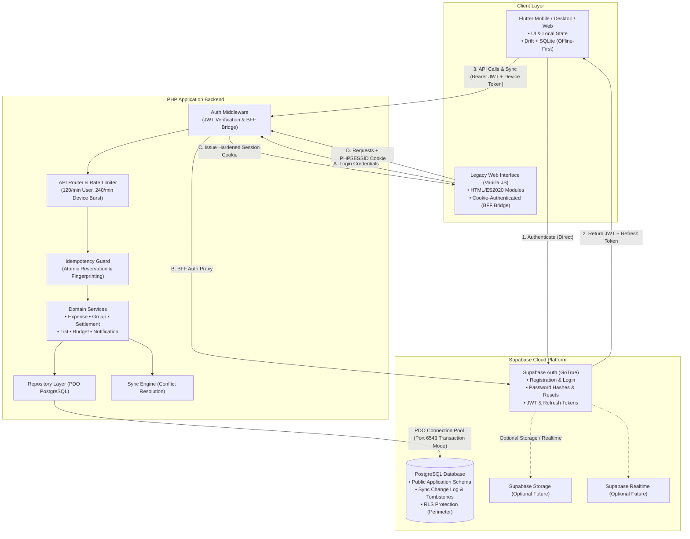
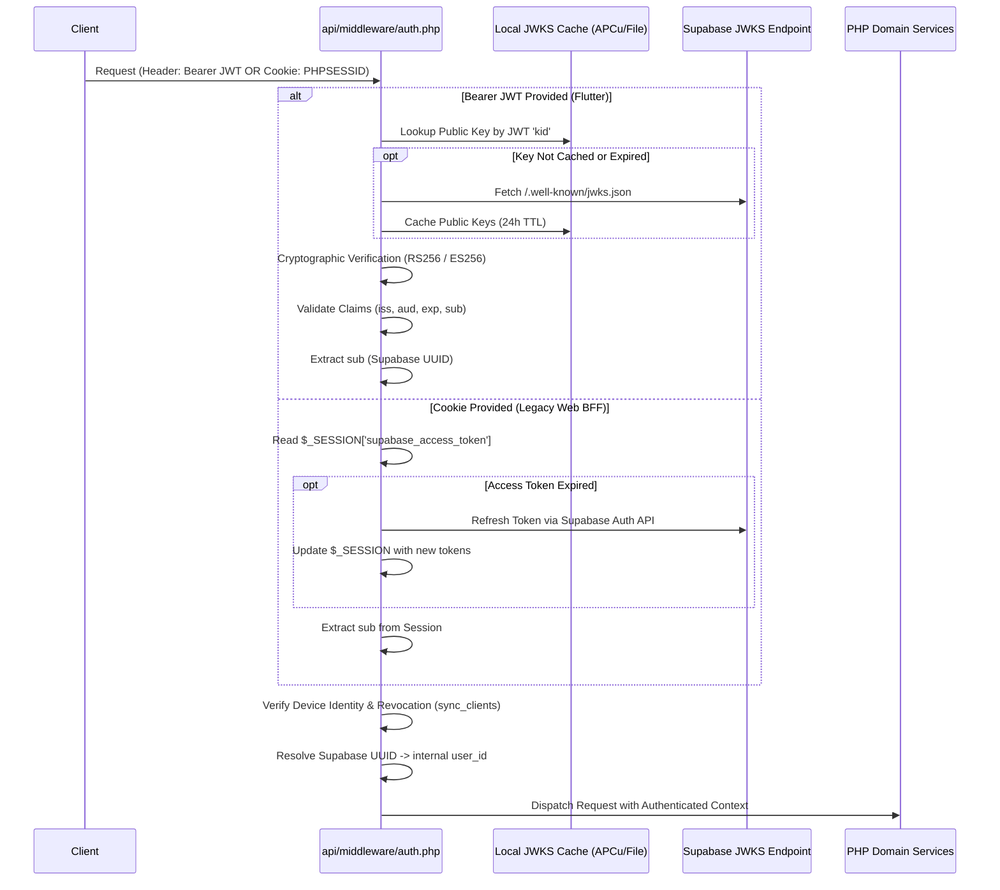
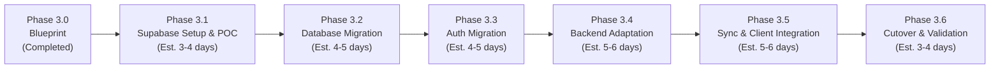

# Phase 3.0 — Architecture Revision & Migration Blueprint
**ExpMgWEB Hybrid Architecture: PHP Domain Backend + Supabase (Auth & PostgreSQL)**

| Document Metadata | Value |
|---|---|
| Document Status | Comprehensive Technical Blueprint (Final Reconciliation & Verification) |
| Architecture Phase | Phase 3.0 (Planning & Documentation) |
| Authoritative Target | Hybrid PHP + Supabase (Auth + PostgreSQL) + Flutter + Legacy Web |
| Date Created | 2026-11-20 |
| Last Reconciled | 2026-11-20 |
| Baseline Reference | Phase 2 Git Tag `phase2-architecture-approved` (Commit `3d3a92d`) |
| Implementation Boundary | **NO APPLICATION CODE, NO MIGRATIONS, NO PROD MUTATIONS** |

---

## 1. Executive Summary & Governance Model

This blueprint establishes the authoritative technical blueprint for migrating the ExpMgWEB platform from its legacy procedural PHP + MariaDB architecture to a modern **Hybrid Architecture** combining:
1. **Supabase Auth (GoTrue)** for identity lifecycle, credential management, and authentication sessions.
2. **Supabase Managed PostgreSQL** as the central relational database engine.
3. **Existing PHP Application Backend** retaining application authorization, business domain services, settlement logic, financial invariants, and the batch synchronization engine.
4. **Cross-Platform Clients:** Flutter (with Drift/SQLite local offline persistence) and the legacy PHP/JavaScript website (via a server-side BFF session bridge).

### 1.1 Core Division of Responsibility
$$\mathbf{Supabase\ Authenticates} \iff \mathbf{PHP\ Authorizes}$$
- **Supabase** verifies identity (*who the caller is* via cryptographic JWTs).
- **PHP** validates permission (*what the user is permitted to do* — enforcing group roles, settlement period locks, member caps, expense mutation rules, and shopping list conversions).
- **Security Invariant:** Client-supplied metadata (`user_metadata`, `app_metadata`) within JWTs must **never** be treated as authoritative for application permissions. All authorization checks are executed by PHP against the database.

### 1.2 Decision Status & Governance Distinction
To preserve rigorous governance, this architecture maintains a strict distinction between policy and engineering:
- **Approved Owner Policies (`ACCEPTED`):** Binding business rules and constraints approved by the project owner (e.g. UQ-01 through UQ-20, D-01, D-03..D-07, D-16..D-18, D-22..D-26, D-28, D-33..D-38). These are invariants that any technical implementation must satisfy.
- **Proposed Technical Decisions (`PROPOSED`):** Engineering mechanisms recommended by the architecture work to implement the approved policies (e.g. Supavisor Port 6543 Transaction Mode, PDO emulated prepared statements, Cloudflare R2 backup pipeline, decoupled `user_identities` table, single-flight token mutex). These remain strictly `PROPOSED` until empirically verified in Phase 3.1.

---

## 2. Work Package 3.0.1 — Review of Existing Phase 2 Architecture

The 38 Architecture Decisions recorded in `docs/architecture/ARCHITECTURE_DECISIONS.md` have been audited to determine their disposition under the Supabase hybrid architecture:

```
Total Decisions Audited: 38
├── RETAINED (Unchanged): 32 Decisions (D-01, D-03..D-08, D-10..D-12, D-14..D-24, D-26..D-31, D-34..D-38)
├── MODIFIED (Adapted for Supabase/PostgreSQL): 6 Decisions (D-02, D-09, D-13, D-25, D-32, D-33)
└── SUPERSEDED: 0 Decisions
```

### 2.1 Retained Architecture Decisions (Unchanged)
The following decisions remain binding and are preserved without modification:
- **D-01 (Flutter + Dart Frontend):** Canonical client for mobile, desktop, and web.
- **D-03 (Selective Laravel Adoption):** PHP retains its lean procedural/service core; no full framework rewrite.
- **D-04, D-38 (Guest Mode):** Local-only, unexported, mergeable into authenticated account upon registration (UQ-01, UQ-16).
- **D-05, D-11 (Multi-Device Sync):** Server-authoritative synchronization with change logs, tombstones, and cursors.
- **D-06 (Versioning & Concurrency):** Optimistic concurrency control via entity `version` integers.
- **D-07 (Documentation-First):** Technical documentation and architecture precede implementation.
- **D-08 (Same-Origin Deployment Default):** Same-origin deployment is preserved as the default web architecture per UQ-15.
- **D-10 (Dedicated v2 API):** Modern synchronization and client APIs live on dedicated `/api/v2/` endpoints.
- **D-12 (UUIDv7 Identity):** Client-generated RFC 9562 UUIDv7 values serve as the immutable record identity.
- **D-14 (Drift / SQLite):** Local persistence on Flutter client devices.
- **D-15 (Riverpod):** Flutter state management and dependency injection.
- **D-16, D-17 (Offline Capability & Online Boundaries):** Offline write matrix preserved; settlement confirmation, list item checking, and group membership mutations remain strictly **online-only** (UQ-08).
- **D-18 (Procedural PHP Core):** Existing business endpoints and extracted domain services remain procedural/OOP hybrid.
- **D-19 (Notification Offline Exclusion):** Notifications remain online-only ephemeral feeds.
- **D-20 (Hard Delete + Tombstones):** Entities are physically removed from primary tables; tombstones record deletion for sync.
- **D-21 (Financial Representation):** Decimals over the wire; integer cents in Dart; `NUMERIC(10,2)` in PostgreSQL.
- **D-22, D-23 (Guest Merge & Account Deletion):** Strict adherence to owner UQ-01 and UQ-02 policies (no credit forfeiture, unsettled balance gate, username retained in historical group archives).
- **D-24 (Session Lifetime):** 7-day web session inactivity; 30-day native device inactivity (UQ-03).
- **D-26 (Group Archival Lifecycle):** Two-tier archival (`ARCHIVED` reversible; `PERMANENTLY_ARCHIVED` irreversible after 6 months; UQ-07).
- **D-27 (Cursor Safety):** Safety lag plus reconciliation checksums.
- **D-28 (Batch Sync & Rate Limits):** 120 req/min/user general, 240 req/min/device burst ceiling, 120 req/min/user dedicated sync bucket (UQ-05).
- **D-29 (No Microservices):** Lean single-instance backend architecture.
- **D-30 (Domain Rule Extraction):** Business rules extracted into domain services shared by v1 and v2 APIs.
- **D-31, D-36 (Legacy Web Preservation):** Two-way compatibility with the existing unmodified web interface (UQ-19).
- **D-34 (Device Registration):** Mandatory device registration before synchronization (UQ-17).
- **D-35 (Reminders):** Account-wide 24-hour reminder triggers reset upon explicit client receipt (UQ-18).
- **D-37 (Platform Sequencing):** Native mobile/desktop release precedes Flutter Web (UQ-14).

### 2.2 Modified Architecture Decisions
- **D-02 (Backend & Database Tech Stack) — MODIFIED:**
  - *Previous:* Procedural PHP backend + MariaDB/MySQL.
  - *Revised:* Procedural/Service-layer PHP backend + **Supabase (Auth & PostgreSQL)**.
- **D-09 (Authentication Architecture) — MODIFIED:**
  - *Previous:* "Cookie-session only; no JWT in this architecture."
  - *Revised:* **Dual Authentication Model**: Native and Flutter clients use cryptographically verified Bearer JWTs issued by Supabase Auth; the legacy PHP/JS website uses a secure Backend-For-Frontend (BFF) session bridge in PHP that validates against Supabase Auth while preserving `PHPSESSID` cookies and CSRF protection.
- **D-13 (Change Capture by Triggers) — MODIFIED:**
  - *Previous:* MariaDB MySQL triggers populating `sync_change_log`.
  - *Revised:* PostgreSQL PL/pgSQL trigger functions executing on `AFTER INSERT OR UPDATE OR DELETE`.
- **D-25 (Device Revocation Model) — MODIFIED:**
  - *Previous:* Local MariaDB session table tracking device tokens.
  - *Revised:* Device registry stored in PostgreSQL `sync_clients` linked to Supabase Auth user UUID; remote revocation triggers invalidation in the PHP application device registry (blocking sync immediately via cryptographic proof verification) as well as Supabase refresh token revocation (UQ-04).
- **D-32 (Session Owner) — MODIFIED:**
  - *Previous:* `config/session.php` owns standalone PHP session cookies for all traffic.
  - *Revised:* Native clients use Supabase Auth Bearer JWTs; legacy web uses a Backend-For-Frontend (BFF) session bridge in PHP that validates against Supabase Auth.
- **D-33 (Remember-Device Credential) — MODIFIED:**
  - *Previous:* Standalone PHP-managed remember token table.
  - *Revised:* Leverages Supabase Auth long-lived refresh tokens secured in hardware-backed storage (Android Keystore / Apple Keychain) with 30-day inactivity expiration.

---

## 3. Work Package 3.0.2 — Supabase + PHP Hybrid Architecture

### 3.1 Target Architecture Diagram



### 3.2 Same-Origin Default vs. Scoped CORS (UQ-15 Compliance)
- **Same-Origin Deployment as Default:**
  In alignment with UQ-15, the production web interface and PHP backend deploy under the same origin (e.g., `https://app.expmgweb.com/` for SPA assets and `https://app.expmgweb.com/api/` for endpoints) via a reverse proxy (Nginx or Apache). In this topology, no browser CORS headers are required.
- **Scoped Cross-Origin Resource Sharing (CORS):**
  CORS headers (`Access-Control-Allow-Origin`, `Access-Control-Allow-Headers: Authorization, Content-Type, X-Device-ID, X-Device-Token`) are strictly restricted to:
  1. Local Flutter Web development and staging previews running on separate local ports.
  2. Any future standalone CDN web deployment if separately authorized.
- **Native Flutter Clients:**
  Native mobile (Android, iOS) and desktop (Windows, macOS, Linux) applications do not execute inside a browser sandbox and are not constrained by browser CORS policies.

---

## 4. Work Package 3.0.3 — Supabase Auth Integration Architecture

### 4.1 Authentication Workflows

#### A. Client Registration & Login (Flutter)
1. Flutter client invokes `supabase.auth.signUp()` or `supabase.auth.signInWithPassword()`.
2. Supabase Auth processes credentials, checks rate limits, and returns:
   - `access_token` (Short-lived JWT, default 1 hour).
   - `refresh_token` (Long-lived credential, persisted in Keystore/Keychain).
   - `user` metadata (including Supabase Auth `id` UUID).
3. Flutter client caches the session and attaches `Authorization: Bearer <access_token>` to all subsequent requests destined for the PHP backend.

#### B. Legacy Web Authentication (BFF Session Bridge)
1. User enters username/email and password on `public/index.php?page=login`.
2. Form submits to `api/login.php`.
3. `api/login.php` resolves username to email if necessary, calls Supabase Auth REST endpoint (`/auth/v1/token?grant_type=password`) using the Supabase Anon Key.
4. On success, PHP:
   - Extracts Supabase `user.id` and maps to application `user_identities.id`.
   - Stores the Supabase access and refresh tokens inside the secure PHP session (`$_SESSION['supabase_access_token']`, `$_SESSION['supabase_refresh_token']`).
   - Issues the hardened `PHPSESSID` cookie (`HttpOnly`, `SameSite=Lax`, `Secure`).
5. Existing web JavaScript continues making standard cookie-authenticated API calls without client-side JWT handling.

### 4.2 PHP Cryptographic JWT Verification
The PHP authentication middleware (`api/middleware/auth.php`) adopts an asymmetric cryptographic verification pipeline:



#### Cryptographic Verification Invariants:
- **Algorithm:** Asymmetric RS256/ES256 via Supabase project JWKS (`https://<project-ref>.supabase.co/auth/v1/.well-known/jwks.json`). Legacy HS256 is supported only as a fallback for local offline testing.
- **Key Rotation & Caching:** Public keys cached locally in APCu or file cache with a 24-hour TTL. If a token arrives with an unknown `kid` (Key ID), the middleware performs an immediate on-demand cache refresh from Supabase before rejecting the token.
- **Claims Validated:**
  - `iss`: Must exactly match `https://<project-ref>.supabase.co/auth/v1`.
  - `aud`: Must equal `authenticated`.
  - `exp`: Must be strictly in the future (`exp > time()`).
  - `sub`: Must be a valid RFC 4122 UUIDv4.
  - `role`: Must equal `authenticated`.

### 4.3 Explicit Client Token-Refresh & Mutex Architecture (Flutter)
The Flutter client implements an explicit HTTP client interceptor (`AuthenticatedHttpClient`):
1. **Single-Flight Token Refresh Mutex (Preventing Thundering Herd):**
   When multiple asynchronous requests execute simultaneously (e.g., initial dashboard load fetching expenses, summary, and budgets) and the access token expires, all concurrent requests receive HTTP 401. 
   - The client interceptor employs a synchronized async mutex (`Completer<String>` lock).
   - The first request to encounter a 401 acquires the lock and dispatches **one single** `supabase.auth.refreshSession()` call to Supabase Auth.
   - All other concurrent requests pause and wait on the existing completion future.
   - Once the new token arrives, all queued requests are re-signed with the single fresh JWT and dispatched in parallel.
2. **Strict Single Retry Guarantee:**
   Requests encountering a confirmed `TOKEN_EXPIRED` 401 are retried **exactly once**. If the retried request fails with 401 again, retry is aborted and the session is terminated.
3. **No Automatic Retry on Unrelated Failures:**
   The refresh interceptor strictly handles HTTP 401 `TOKEN_EXPIRED`. Unrelated authorization and application errors (HTTP 403 Forbidden, 400 Bad Request, 404 Not Found, 422 Unprocessable Entity, 429 Rate Limited, 500 Server Error) **must never trigger token refresh or automatic retries**; they pass directly to application error handlers.

### 4.4 Bearer Device Token Protocol (UQ-04, UQ-17 Compliance)
A bare client-supplied header (`X-Device-ID`) cannot independently establish device identity, as an attacker could forge or rotate header values to evade revocation. Device identity is established through a **unified Bearer Device Token Protocol**:

1. **Mandatory Device Registration (`POST /api/v2/devices/register.php` - UQ-17):**
   - Requires an authenticated user session (`Authorization: Bearer <JWT>`).
   - Client generates a persistent UUIDv7: `device_id`.
   - Client transmits `device_id`, platform, OS version, device name.
   - The server generates a cryptographically secure 256-bit token (`device_token`), computes `device_token_hash = SHA256(device_token)`, and stores it in PostgreSQL:
     ```sql
     INSERT INTO sync_clients (
         device_id, user_id, device_token_hash, platform, is_revoked, created_at
     ) VALUES (
         :device_id, :user_id, :device_token_hash, :platform, false, clock_timestamp()
     );
     ```
   - Server returns `device_token` to the client in the registration response.
   - Client securely stores `device_id` and `device_token` in hardware-backed storage (Android Keystore / Apple Keychain).
2. **Per-Request Verification Protocol:**
   On every synchronization and sensitive API request, the client transmits:
   - `Authorization: Bearer <access_token>`
   - `X-Device-ID: <device_id>`
   - `X-Device-Token: <device_token>`
   PHP verifies that:
   - `device_id` exists in `sync_clients`.
   - `sync_clients.user_id` strictly equals the `user_id` resolved from the verified Supabase Auth JWT.
   - `hash_equals(sync_clients.device_token_hash, hash('sha256', $device_token))` evaluates to `true` (constant-time comparison).
   - `sync_clients.is_revoked === false`.
3. **Revocation Evasion Prevention (UQ-04):**
   A revoked client cannot evade revocation by changing `X-Device-ID`:
   - An unrecognized `X-Device-ID` is rejected immediately (`DEVICE_NOT_REGISTERED`).
   - The client cannot spoof another device because it does not possess the `device_token` matching any other device's registered hash.
   - Re-registration requires an active, unrevoked user session.
   - If marked `is_revoked = true` in `sync_clients`, PHP rejects requests with HTTP 403 Forbidden (`DEVICE_REVOKED`).
   - Revoked offline devices cannot synchronize upon reconnection because the server-side registry permanently blocks them.

---

## 5. Work Package 3.0.4 — Application Identity Mapping & Password Migration

### 5.1 Decoupled Identity & Historical Attribution Architecture (UQ-02 Compliance)
To satisfy UQ-02 without creating "zombie" partially deleted user rows or setting foreign keys to NULL (which would catastrophically corrupt settlement balance calculations and `paid_by` math), the database schema cleanly decouples the **active user account** from the **immutable historical ledger identity**:

```sql
-- 1. Immutable Historical Identity (Survives Account Deletion)
CREATE TABLE user_identities (
    id BIGINT GENERATED BY DEFAULT AS IDENTITY PRIMARY KEY,
    original_username VARCHAR(50) NOT NULL,
    is_deleted BOOLEAN NOT NULL DEFAULT false,
    deleted_at TIMESTAMPTZ NULL,
    created_at TIMESTAMPTZ NOT NULL DEFAULT clock_timestamp()
);

-- 2. Active Account & Authentication Profile (Purged on Deletion)
CREATE TABLE user_accounts (
    user_id BIGINT PRIMARY KEY REFERENCES user_identities(id) ON DELETE RESTRICT,
    supabase_uid UUID NULL UNIQUE,
    email VARCHAR(255) NULL,
    password_hash VARCHAR(255) NULL,
    created_at TIMESTAMPTZ NOT NULL DEFAULT clock_timestamp(),
    updated_at TIMESTAMPTZ NOT NULL DEFAULT clock_timestamp()
);
```

#### Preserving Financial Ledgers & Historical Attribution:
- All financial records (`expenses.paid_by`, `expenses.user_id`, `settlements.payer_id`, `settlements.payee_id`, `settlement_confirmations.user_id`, `post_settlement_confirmations.user_id`) reference `user_identities(id)`.
- When an account is deleted:
  - The row in `user_accounts` is **permanently deleted**. All personal data, emails, password hashes, and tokens are completely expunged.
  - The row in `user_identities` remains permanently with its immutable `id` and `original_username`, marked `is_deleted = true`, `deleted_at = clock_timestamp()`.
  - **Financial Invariant Protected:** Foreign keys on `expenses` and `settlements` remain **100% valid, non-null, and referentially intact**. `paid_by` calculations, balance recalculations, and historical audit reports function with zero data corruption.
  - Historical reports render:
    ```sql
    ui.original_username || CASE WHEN ui.is_deleted THEN ' (This user deleted their account)' ELSE '' END AS payer_name
    ```

### 5.2 Per-Group Unsettled-Balance Validation (UQ-02 Compliance)
Account deletion requires strict pre-flight validation:
- **Per-Group Validation Rule:**
  The user must have **zero debt AND zero credit in every individual group** to which they belong:
  $$\forall g \in \text{UserGroups},\quad \text{balance}(u, g) = 0$$
- **Strict Prohibition on Credit Forfeiture:**
  If the user has an unsettled credit balance in any group ($\text{balance}(u, g) > 0$), deletion is **strictly blocked** (`UNSETTLED_CREDIT_IN_GROUP`). The user is prohibited from waiving or forfeiting credits to delete the account; all credits must be formally settled and confirmed through the normal three-step settlement process.
- **Unsettled Debt Gate:**
  If the user owes money in any group ($\text{balance}(u, g) < 0$), deletion is blocked (`UNSETTLED_DEBT_IN_GROUP`).
- **Hybrid Group Administrator Succession (Owner-Approved Policy):**
  When a user initiates account deletion, the system identifies every group in which the user is an administrator (`role = 'admin'`).
  
  For each group independently:
  1. **Co-Administrator Check:** If the group already has one or more other active co-administrators (`role = 'admin'` where `user_id != departing_admin_id`, `ui.is_deleted = false`, active profile exists in `user_accounts`, and no in-flight account deletion is pending in `outbox_events`), **succession appointment is bypassed for that group**. The remaining co-administrator(s) maintain uninterrupted group governance. The departing administrator is informed in the pre-confirmation review: `"Co-administrator [Username] already holds administrator privileges. Succession transfer not required."`
  2. **Manual Option Offered:** If the departing administrator is the sole active administrator, offer the option to manually select their successor from eligible remaining group members.
  3. **Automatic Successor Displayed:** Concurrently display the member who would become administrator under the automatic succession rule.
  4. **Appoint Manual Selection:** If the departing administrator explicitly selects an eligible member, appoint that selected member as group administrator.
  5. **Appoint Automatic Successor:** If the administrator skips or declines manual selection, automatically appoint the earliest-joined eligible remaining group member.
  
  **Pre-Confirmation Review:** The departing administrator must review a consolidated summary of succession outcomes across all their administered groups before confirming account deletion.
  
  **Automatic Succession Eligibility, Schema Invariants & Deterministic Selection:**
  - *Actual Schema Invariants (Zero Hypothetical Columns):*
    - **No `status` or `departed_at` in `group_members`:** In ExpMgWEB (`schema.sql:77-87`), group membership is strictly binary. Row existence in `group_members` proves active membership; when a user leaves or is removed, the row is permanently deleted (`DELETE FROM group_members`).
    - **`joined_at IS NOT NULL`:** Timestamp column with `DEFAULT clock_timestamp()`. Row existence with non-null timestamp guarantees confirmed membership (no unconfirmed invite records exist in `group_members`).
    - **No `status` column in `user_accounts`:** `user_accounts` is keyed on `user_id BIGINT PRIMARY KEY REFERENCES user_identities(id)`. Active user profiles exist in `user_accounts`; upon account deletion, the profile row is permanently expunged.
    - **Immutable Identity (`user_identities`):** `ui.is_deleted = false` validates that the underlying historical identity is active.
    - **In-Flight Deletion Protection (`outbox_events`):** In-progress account deletions are captured in `outbox_events` (`event_type = 'account.deleted'`). Members with in-flight deletions are excluded via `NOT EXISTS`.
  - *Query & Deterministic Tie-Breaking:*
    ```sql
    SELECT gm.user_id 
    FROM group_members gm
    JOIN user_identities ui ON ui.id = gm.user_id
    JOIN user_accounts ua ON ua.user_id = gm.user_id
    WHERE gm.group_id = :group_id 
      AND gm.user_id != :departing_user_id 
      AND gm.role = 'member'
      AND ui.is_deleted = false
      AND gm.joined_at IS NOT NULL
      AND NOT EXISTS (
          SELECT 1 FROM outbox_events oe 
          WHERE oe.event_type = 'account.deleted' 
            AND oe.status IN ('pending', 'processing') 
            AND oe.payload_json::jsonb->>'user_id' = gm.user_id::text
      )
    ORDER BY gm.joined_at ASC, gm.id ASC 
    LIMIT 1;
    ```
    - Primary ordering: `gm.joined_at ASC` (earliest joined member).
    - Deterministic tie-breaker: `gm.id ASC` (lowest surrogate membership record ID). Because `gm.id` is a monotonically increasing primary key, it is uniquely distinct for every row, guaranteeing 100% deterministic, reproducible selection.
  
  - *Zero-Member Group Policy (Owner Decision 2026-11-20 - Option 2 Approved):*
    If an administered group has **no eligible remaining members** (i.e. the departing administrator is the sole remaining member of the group, or all other members have departed or deleted their accounts):
    - *Pre-Flight & Review:* The group is identified during deletion preview and displayed in the review screen: `"Group '[Name]' has no remaining members. It will automatically transition to ARCHIVED status upon account deletion completion (historical records preserved under D-26)."`.
    - *Zero Balance Requirement:* The user must have settled all expenses in this group ($\text{balance}(u, g) = 0$).
    - *Atomic Archival Transition:* Upon account deletion confirmation, within the PostgreSQL transaction:
      ```sql
      UPDATE groups 
      SET status = 'ARCHIVED', 
          archived_at = clock_timestamp(),
          archived_by = :departing_user_id
      WHERE id = :zero_member_group_id;
      ```
      The departing user's membership is removed (`DELETE FROM group_members WHERE user_id = :departing_user_id AND group_id = :zero_member_group_id`), and the zero-member group transitions to `ARCHIVED` status.
    - *Provenance & Lifecycle:* Historical expenses, settlement records, and confirmations remain intact with the original username and context badge (`"This user deleted their account."`). The group becomes read-only and enters the standard archival lifecycle under D-26. Deleting an active group as a substitute for succession remains prohibited.

### 5.3 Cross-System Deletion Failure-Safe Coordination
Account deletion coordinates between PostgreSQL and Supabase Auth using a **failure-safe outbox pattern**:

```mermaid
sequenceDiagram
    participant Client
    participant PHP as PHP Deletion Gateway
    participant DB as PostgreSQL Database
    participant Outbox as outbox_events
    participant Supabase as Supabase Auth GoTrue API

    Client->>PHP: POST /api/v2/user/delete.php
    PHP->>DB: 1. Validate Per-Group Balances & Admin Succession
    alt Balances != 0 OR Succession Unresolved
        PHP-->>Client: HTTP 400 (Deletion Blocked)
    else Pre-flight Valid
        PHP->>DB: 2. Begin Transaction
        PHP->>Outbox: Enqueue Deletion Event (event_type='account.deleted', status='pending')
        PHP->>DB: Invalidate Active Sessions & Revoke Devices (is_revoked=true)
        PHP->>DB: Commit Transaction
        Note over PHP,DB: User session immediately locked; cannot login

        PHP->>Supabase: 3. Call auth.admin.deleteUser(supabase_uid)
        alt Call Succeeds OR HTTP 404 (Idempotent)
            PHP->>DB: 4. Begin Transaction
            PHP->>DB: Delete Personal Expenses, Lists, Budgets, Notifications
            PHP->>DB: Delete sync_clients (Registered Devices)
            PHP->>DB: Delete user_accounts (Active Profile Purged)
            PHP->>DB: Mark user_identities (is_deleted=true, deleted_at=NOW)
            PHP->>Outbox: Mark Event status='sent' / 'processed'
            PHP->>DB: Commit Transaction
            PHP-->>Client: HTTP 200 (Account Deleted)
        else Call Fails (Network / 5xx)
            PHP-->>Client: HTTP 202 Accepted (Deletion Pending Background Completion)
            Note over Outbox: Background Worker retries Supabase deletion until consistent
        end
    end
```

- **Reconciliation Worker:** A scheduled CLI cron worker (`scripts/reconcile_account_deletions.php`) sweeps pending deletion records older than 5 minutes, retries Supabase Auth deletion with exponential backoff, and completes the local PostgreSQL purge, guaranteeing eventual consistency and zero stranded credentials. Crucially, this background worker executes under the least-privilege runtime database identity `expmg_app` (DML only), strictly avoiding elevated `expmg_migrator` credentials.

### 5.4 Password Migration Strategy & Account Recovery
Existing password hashes can be migrated directly into Supabase Auth **without requiring plaintext passwords or forcing user password resets**:

1. **Legacy Hash Validation:**
   ExpMgWEB MariaDB stores passwords hashed using PHP's standard `password_hash($password, PASSWORD_BCRYPT)`, producing standard modular crypt format strings: `$2y$10$...` (cost factor 10, 60 characters). Official Supabase documentation confirms GoTrue supports importing bcrypt hashes (`$2a$`, `$2b$`, `$2y$`) across all valid cost factors.
2. **Official Admin API Import:**
   Pre-migration automation exports active user records and invokes the Supabase Admin API via `service_role`:
   ```javascript
   const { data, error } = await supabase.auth.admin.createUser({
     email: 'user@example.com',
     password_hash: '$2y$10$...', // Preserves existing MariaDB bcrypt hash
     email_confirm: true,
     user_metadata: {
       username: 'johndoe',
       legacy_user_id: 42
     }
   });
   ```
3. **Username-Login Resolution Strategy:**
   Supabase Auth natively authenticates accounts via `email` or `phone`. Legacy ExpMgWEB allows logging in via `username` (e.g. `johndoe`) or `email`.
   - When a user inputs a login identifier without an `@` character at `api/login.php`, PHP queries PostgreSQL:
     ```sql
     SELECT email FROM user_accounts ua
     JOIN user_identities ui ON ua.user_id = ui.id
     WHERE ui.original_username = ? AND ui.is_deleted = false;
     ```
   - Resolves the canonical email registered with Supabase Auth.
   - PHP forwards the resolved email and user-supplied password to the Supabase Auth REST endpoint.
4. **Synthetic Email Aliases & Account Recovery:**
   - **Missing or Non-Email Usernames:** Legacy test data containing bare usernames without email syntax will be provisioned using a deterministic synthetic alias: `username@internal.expmgweb.local`.
   - **Recovery Impact:** Synthetic email addresses cannot receive password reset emails.
   - **Mandatory Email Verification Flow:** Upon first successful login using their known legacy password, the application detects the synthetic alias and displays a mandatory **"Update & Verify Email"** dialog.
   - The user must provide a valid email address. PHP updates Supabase Auth (`auth.admin.updateUserById(uid, { email })`) and sends a verification link.
   - Until a valid email is verified, password recovery via email is disabled, and the user is warned that account recovery requires an active verified email.
   - **Pre-Migration Audit:** An explicit pre-migration audit script identifies duplicate, missing, or malformed emails before Phase 3.6 cutover.

---

## 6. Work Package 3.0.5 — MariaDB-to-PostgreSQL Compatibility Assessment

### 6.1 Data Type Mapping Table

| Entity / Concept | MariaDB 10.4 / MySQL 8 | PostgreSQL 15+ (Supabase) | Conversion Rationale |
|---|---|---|---|
| **Primary Keys (Integer)** | `INT AUTO_INCREMENT` | `BIGINT GENERATED BY DEFAULT AS IDENTITY` | Allows explicit integer ID imports during migration; advances sequence afterward. |
| **UUIDs (Client Sync)** | `CHAR(36)` / `BINARY(16)` | `UUID` | Native 128-bit type with built-in validation and index optimizations. |
| **Booleans** | `TINYINT(1)` (`0` / `1`) | `BOOLEAN` (`false` / `true`) | Eliminates integer-boolean casting bugs. |
| **Monetary Values** | `DECIMAL(10,2)` | `NUMERIC(10,2)` | Exact precision; prevents floating-point rounding errors. |
| **Timestamps** | `DATETIME(6)` | `TIMESTAMPTZ` | Standardized UTC microsecond resolution (`TIMESTAMP(6) WITH TIME ZONE`). |
| **Short Strings** | `VARCHAR(N)` | `VARCHAR(N)` | Equivalent behavior; limits enforced. |
| **Text Blobs** | `TEXT` | `TEXT` | Equivalent behavior. |
| **JSON Payloads** | `LONGTEXT` / `JSON` | `JSONB` | Binary JSON format with indexing and query operators. |

### 6.2 Sequence Synchronization after Historical Data Import
Because `GENERATED BY DEFAULT AS IDENTITY` allows inserting historical explicit integer primary keys during migration, sequence pointers must be updated immediately following data load. 

To correctly handle **both empty tables and populated tables** without causing empty tables to skip ID `1`, the 3-argument form of `setval(sequence, value, is_called)` is mandatory:

```sql
SELECT setval(
    pg_get_serial_sequence('user_identities', 'id'),
    COALESCE(MAX(id), 1),
    MAX(id) IS NOT NULL
) FROM user_identities;

SELECT setval(
    pg_get_serial_sequence('expenses', 'id'),
    COALESCE(MAX(id), 1),
    MAX(id) IS NOT NULL
) FROM expenses;

SELECT setval(
    pg_get_serial_sequence('groups', 'id'),
    COALESCE(MAX(id), 1),
    MAX(id) IS NOT NULL
) FROM groups;

SELECT setval(
    pg_get_serial_sequence('lists', 'id'),
    COALESCE(MAX(id), 1),
    MAX(id) IS NOT NULL
) FROM lists;

SELECT setval(
    pg_get_serial_sequence('list_items', 'id'),
    COALESCE(MAX(id), 1),
    MAX(id) IS NOT NULL
) FROM list_items;

SELECT setval(
    pg_get_serial_sequence('settlements', 'id'),
    COALESCE(MAX(id), 1),
    MAX(id) IS NOT NULL
) FROM settlements;
```

#### Behavior Analysis:
- **Empty Table (`MAX(id)` is NULL):**
  - `COALESCE(NULL, 1)` yields `1`.
  - `MAX(id) IS NOT NULL` evaluates to `false`.
  - `setval(seq, 1, false)` is executed. The next call to `nextval()` sees `is_called = false` and returns **`1`** (not `2`).
- **Populated Table (e.g. `MAX(id)` = 1042):**
  - `COALESCE(1042, 1)` yields `1042`.
  - `MAX(id) IS NOT NULL` evaluates to `true`.
  - `setval(seq, 1042, true)` is executed. The next call to `nextval()` sees `is_called = true` and returns **`1043`**.

### 6.3 Historical Spike Evidence Caveat
The MariaDB 10.4.32 findings from earlier Phase 2 spikes represent historical legacy engine evidence only. All PostgreSQL compatibility behaviors, triggers, foreign keys, and locking semantics will be formally tested on PostgreSQL in Phase 3.1 and 3.2.

---

## 7. Work Package 3.0.6 — PostgreSQL Database Architecture & Access Roles

### 7.1 PostgreSQL Role & Ownership Model
In PostgreSQL, `ALTER TABLE`, `DROP TABLE`, `CREATE INDEX`, `CREATE TRIGGER`, and `ENABLE ROW LEVEL SECURITY` require table **ownership** or superuser status; they cannot be granted as ordinary table permissions.

The database access architecture separates schema ownership from application runtime:

```
┌────────────────────────────────────────────────────────┐
│                   PostgreSQL Roles                     │
├──────────────────┬─────────────────────────────────────┤
│ postgres         │ Superuser (Initial provisioning)    │
├──────────────────┼─────────────────────────────────────┤
│ expmg_migrator   │ Schema Owner (Owns public schema    │
│                  │ and all tables; executes DDL)       │
├──────────────────┼─────────────────────────────────────┤
│ expmg_app        │ PHP Runtime Role (DML Only: SELECT, │
│                  │ INSERT, UPDATE, DELETE; zero DDL)   │
├──────────────────┼─────────────────────────────────────┤
│ service_role     │ Supabase Admin (Bypasses RLS)       │
├──────────────────┼─────────────────────────────────────┤
│ anon             │ Unauthenticated Client (Blocked)    │
├──────────────────┼─────────────────────────────────────┤
│ authenticated    │ Supabase Client (Blocked by RLS)    │
└──────────────────┴─────────────────────────────────────┘
```

#### A. Schema Migration Role (`expmg_migrator`)
- **Ownership:** Owns the `public` schema and all application tables.
- **Privileges:** As table owner, it possesses inherent technical rights to create tables, alter columns, add indexes, and attach triggers.
- **Destructive DDL Discipline:** Migration scripts are validated by a pre-flight linter that strictly rejects `DROP` statements unless an emergency rollback script is specifically authorized by the owner.

#### B. Application Runtime Role (`expmg_app`)
- **Least-Privilege Grants:**
  ```sql
  GRANT USAGE ON SCHEMA public TO expmg_app;
  GRANT SELECT, INSERT, UPDATE, DELETE ON ALL TABLES IN SCHEMA public TO expmg_app;
  GRANT USAGE, SELECT ON ALL SEQUENCES IN SCHEMA public TO expmg_app;
  ```
- **Automatic Grants for Future Tables:**
  To guarantee that future migration tables automatically receive correct runtime permissions, `expmg_migrator` executes:
  ```sql
  ALTER DEFAULT PRIVILEGES FOR ROLE expmg_migrator IN SCHEMA public 
      GRANT SELECT, INSERT, UPDATE, DELETE ON TABLES TO expmg_app;
  ALTER DEFAULT PRIVILEGES FOR ROLE expmg_migrator IN SCHEMA public 
      GRANT USAGE, SELECT ON SEQUENCES TO expmg_app;
  ```
- **Zero DDL:** `expmg_app` has no ownership and cannot execute `CREATE`, `ALTER`, `DROP`, or `TRUNCATE`.
- **Identity Invariant:** `expmg_app` is the **only trusted database identity** for routine PHP traffic. Connections using Supabase `service_role` are strictly prohibited.
- **Application Authorization:** PHP domain services (`api/domain/`) explicitly enforce user identity, group membership, role permissions, settlement period locking, and financial integrity checks.

#### C. Background & CLI Workers Identity (`expmg_app`)
- **Least-Privilege Worker Execution:** Background CLI workers (including `api/workers/process_outbox.php`, `scripts/reconcile_account_deletions.php`, and `scripts/cleanup_notifications.php`) execute using the runtime database identity `expmg_app` (or an equivalent least-privilege role `expmg_worker` possessing strictly DML permissions).
- **Prohibition on Migration Credentials:** CLI outbox and reconciliation workers are strictly prohibited from using `expmg_migrator` credentials. Background workers perform transactional message consumption and state transitions (`SELECT`, `INSERT`, `UPDATE`, `DELETE`) and require zero DDL or table ownership privileges.

### 7.2 Explicit Privilege Grants & RLS Policy Semantics
The security model operates across two distinct layers:

#### Layer 1: PostgreSQL Privilege Grants (First Line of Defense)
Direct clients connecting via Supabase PostgREST (data API) connect under `anon` or `authenticated` roles. All SQL privileges are explicitly revoked:
```sql
REVOKE ALL ON ALL TABLES IN SCHEMA public FROM anon, authenticated;
REVOKE ALL ON ALL SEQUENCES IN SCHEMA public FROM anon, authenticated;
REVOKE ALL ON ALL ROUTINES IN SCHEMA public FROM anon, authenticated;
ALTER DEFAULT PRIVILEGES IN SCHEMA public REVOKE ALL ON TABLES FROM anon, authenticated;
```
Any direct SQL query from `anon` or `authenticated` fails immediately at the PostgreSQL grant check with `permission denied for table ...`.

#### Layer 2: Row Level Security Semantics (Second Line of Defense)
To provide defense-in-depth against accidental future table grants, RLS is enabled and forced across all tables:
```sql
ALTER TABLE expenses ENABLE ROW LEVEL SECURITY;
ALTER TABLE expenses FORCE ROW LEVEL SECURITY;
```
PostgreSQL RLS semantics distinguish between **Permissive** (default, evaluated with Boolean `OR`) and **Restrictive** (evaluated with Boolean `AND`) policies:
1. **Permissive Policy for `expmg_app`:**
   ```sql
   CREATE POLICY expmg_app_access ON expenses
       AS PERMISSIVE FOR ALL TO expmg_app
       USING (true) WITH CHECK (true);
   ```
2. **Restrictive Barrier Policy for Client Roles:**
   ```sql
   CREATE POLICY block_direct_clients ON expenses
       AS RESTRICTIVE FOR ALL TO anon, authenticated
       USING (false);
   ```
   *(Because restrictive policies are combined with `AND`, this guarantees that even if a permissive policy is accidentally granted to `authenticated` in the future, access remains permanently blocked).*

#### Clarification of the RLS Security Boundary:
RLS acts as an **infrastructure perimeter** preventing unauthorized direct database access. **RLS is NOT the application-level multi-tenant authorization boundary.** Because PHP connects as `expmg_app` (which has full DML access to manage all tables across all users), multi-tenant isolation, user identity matching, group role validation, and financial integrity rules are enforced **strictly in the PHP application domain services** (`api/domain/`).

---

## 8. Work Package 3.0.7 — PHP Database Abstraction & Supavisor Connection Pooling

### 8.1 Supavisor Connection Pooling Analysis
Supabase utilizes **Supavisor** for connection pooling. The two available modes impose distinct constraints on PHP applications:

| Characteristic | Supavisor Transaction Mode (Port 6543) | Supavisor Session Mode (Port 5432) |
|---|---|---|
| **Connection Assignment** | Connection held only for the duration of a single transaction/query. | Connection assigned to the client for the lifetime of the TCP connection. |
| **Max Concurrency** | High (tens of thousands of virtual clients pooled to 15+ backend slots). | Limited to the physical backend PostgreSQL connection limit. |
| **Native Prepared Statements** | **UNSUPPORTED:** PostgreSQL binds named prepared statements to a specific backend connection. Queries landing on different connections cause `prepared statement does not exist` errors. | **SUPPORTED:** Full support for native server-side prepared statements (`PREPARE / EXECUTE`). |
| **Emulated Prepared Statements** | **REQUIRED & FULLY FUNCTIONAL:** PDO interpolates parameters safely in PHP memory before sending parametrized SQL. | Supported. |
| **Persistent Connections (`PDO::ATTR_PERSISTENT`)** | **DISCOURAGED:** Causes idle connection exhaustion in the pooler. | Supported. |
| **Transaction Blocks (`BEGIN / COMMIT / ROLLBACK`)** | **SUPPORTED:** Supavisor pins the connection to the client for the duration of the transaction. | Supported. |
| **Row Locking (`SELECT ... FOR UPDATE`)** | **SUPPORTED** within transaction blocks. | Supported. |

### 8.2 Production PDO Configuration
For the stateless PHP web and API environment, the backend connects to **Port 6543 (Transaction Mode)** with emulated prepares:

```php
class Database {
    private static ?PDO $instance = null;

    public static function getConnection(): PDO {
        if (self::$instance === null) {
            $dsn = sprintf(
                'pgsql:host=%s;port=%d;dbname=%s;sslmode=require',
                env('DB_HOST'), // e.g. aws-0-[region].pooler.supabase.com
                (int) env('DB_PORT', 6543), // Supavisor Transaction Mode
                env('DB_NAME')
            );

            self::$instance = new PDO($dsn, env('DB_USER'), env('DB_PASS'), [
                PDO::ATTR_ERRMODE            => PDO::ERRMODE_EXCEPTION,
                PDO::ATTR_DEFAULT_FETCH_MODE => PDO::FETCH_ASSOC,
                // Critical for Supavisor Transaction Mode: Prevents backend named statement errors
                PDO::ATTR_EMULATE_PREPARES   => true,
                // Critical for pooler stability: Prevents lingering idle connection exhaustion
                PDO::ATTR_PERSISTENT         => false,
            ]);
        }
        return self::$instance;
    }
}
```

- **Port 5432 (Session Mode / Direct):**
  - **Migration Execution:** Schema migrations run exclusively over Port 5432 authenticated as `expmg_migrator` (DDL owner) to execute schema alterations, index creation, and trigger definitions.
  - **Long-Running CLI Workers:** Long-running CLI workers (`process_outbox.php`, reconciliation scripts) connect to Port 5432 to maintain dedicated session locks without Supavisor transaction pool timeouts. **Crucially, CLI workers authenticate as `expmg_app` (least-privilege DML), NEVER as `expmg_migrator`.**
- **Phase 3.1 Verification Requirement:** Phase 3.1 will execute automated test scripts explicitly validating transaction commit/rollback behavior and `SELECT ... FOR UPDATE` row locking across both Port 6543 and Port 5432.

---

## 9. Work Package 3.0.8 — Flutter & Legacy Website Authentication Integration

### 9.1 Client Integration Comparison

| Feature | Flutter Native / Desktop / Web | Legacy PHP/JS Website |
|---|---|---|
| **Authentication Client** | `supabase_flutter` SDK | PHP Backend BFF Proxy (`api/login.php`) |
| **Credential Input** | Email/Password directly to Supabase | Username/Password submitted to PHP endpoint |
| **Session Token on Client** | Short-lived JWT + Refresh Token | Hardened `PHPSESSID` Cookie |
| **API Authentication Header** | `Authorization: Bearer <JWT>` | Cookie automatically included by browser |
| **Token Storage** | Android Keystore / Apple Keychain | `HttpOnly` Secure Session Cookie |
| **Token Refresh Mechanism** | Explicit HTTP client interceptor (`AuthenticatedHttpClient`) | Automatic server-side refresh in PHP session |
| **CSRF Protection** | Unnecessary (Bearer token stateless) | Canonical `verifyCsrf()` check enforced |

### 9.2 Legacy Frontend Compatibility Guarantee
- The compatibility of the existing vanilla JS frontend ([pages/](file:///c:/xampp/htdocs/ExpMgWEB/pages), [public/assets/js/](file:///c:/xampp/htdocs/ExpMgWEB/public/assets/js)) is treated as a **compatibility objective that must be verified through automated regression tests**, not an assumed certainty.
- The BFF proxy in `api/login.php` completely insulates legacy client scripts from Supabase token management.

---

## 10. Work Package 3.0.9 — Revised Synchronization, Offline & Idempotency Architecture

### 10.1 Synchronization Engine Architecture
The synchronization engine preserves all offline-first invariants defined in Phase 2:

```
┌────────────────────────────────────────────────────────┐
│                   Flutter Client                       │
│    (Local Drift / SQLite Encrypted with SQLCipher)     │
└──────────────────────────┬─────────────────────────────┘
                           │
             POST /api/v2/sync/pull & /push
             (Bearer JWT + X-Device-ID + X-Device-Token + Idempotency-Key)
                           │
                           ▼
┌────────────────────────────────────────────────────────┐
│                PHP Sync Engine Gateway                 │
│  1. Authenticate JWT (Supabase Auth)                   │
│  2. Validate Cryptographic Device Possession & Status  │
│  3. Verify Rate Limits (120 req/min user sync bucket)  │
│  4. Enforce Idempotency (Atomic Reservation & Hash)    │
│  5. Enforce Online-Only Boundaries                     │
│  6. Execute 3-Way Conflict Resolution                  │
│  7. Atomic Commit to PostgreSQL via Domain Services    │
└──────────────────────────┬─────────────────────────────┘
                           │
                           ▼
┌────────────────────────────────────────────────────────┐
│               PostgreSQL Central Store                 │
│  • sync_clients (Registered devices & revocation)      │
│  • sync_change_log (High-resolution sequence log)      │
│  • sync_tombstones (Indefinite deletion tracking)      │
└────────────────────────────────────────────────────────┘
```

### 10.2 Server-Side Atomic Idempotency Architecture (`config/idempotency.php`)
To ensure complete financial safety when mutation requests (`POST`, `PUT`, `DELETE`, `/sync/push`) are retried after network failures or token refreshes:

```sql
CREATE TABLE idempotency_records (
    key CHAR(36) PRIMARY KEY,
    user_id BIGINT NOT NULL REFERENCES user_identities(id),
    request_fingerprint CHAR(64) NOT NULL,
    status VARCHAR(20) NOT NULL, -- 'IN_PROGRESS', 'COMPLETED', 'FAILED'
    response_code INT NULL,
    response_headers JSONB NULL,
    response_body TEXT NULL,
    created_at TIMESTAMPTZ NOT NULL DEFAULT clock_timestamp(),
    expires_at TIMESTAMPTZ NOT NULL
);
```

#### The 4-State Idempotency Protocol:
1. **Request Fingerprinting:**
   $$\text{fingerprint} = \text{SHA256}(\text{user\_id} \parallel \text{HTTP\_METHOD} \parallel \text{REQUEST\_URI} \parallel \text{RAW\_BODY})$$
2. **Atomic Reservation:**
   Before business logic executes, PHP attempts:
   ```sql
   INSERT INTO idempotency_records (key, user_id, request_fingerprint, status, expires_at)
   VALUES (:key, :user_id, :fingerprint, 'IN_PROGRESS', clock_timestamp() + INTERVAL '2 minutes')
   ON CONFLICT (key) DO NOTHING;
   ```
3. **Duplicate Request Handling:**
   If the insertion returns 0 rows, a record already exists:
   - **Payload Mismatch:** If stored `request_fingerprint != fingerprint`, return **HTTP 422 Unprocessable Entity** (`IDEMPOTENCY_KEY_REUSED_WITH_DIFFERENT_PAYLOAD`).
   - **Status `IN_PROGRESS`:** Another request with this key is executing. Return **HTTP 409 Conflict** with header `Retry-After: 2`.
   - **Status `COMPLETED`:** Return the stored cached response (`response_code`, `response_headers`, `response_body`) immediately, bypassing business execution.
   - **Status `FAILED`:** Return the stored error response immediately.
4. **Completion & Crash Recovery:**
   - On completion: update record to `status = 'COMPLETED'`, store response payload, and set `expires_at = clock_timestamp() + INTERVAL '24 hours'`.
   - Crash Recovery: If a process terminates while `IN_PROGRESS`, records older than their 2-minute reservation TTL are swept, allowing the client to safely retry.

### 10.3 Authoritative Retention Policies (UQ-09 Compliance)
The blueprint strictly restores the retention policies approved by the owner in UQ-09:
- **Change Logs (`sync_change_log`):** **90 days only**.
- **Tombstones (`sync_tombstones`):** **Indefinite retention by default**. No fixed 90-day expiry. Safe tombstone garbage collection will be designed in a future phase based on synchronization acknowledgements, device revocation, and forced-resynchronization mechanisms.
- **Completed Sync Batches (`sync_batches`):** **45 days** (updated from 30 days per owner decision).
- **Guest Import Audit Records:** **Retained for the lifetime of the account**.

### 10.4 Reminder Schedule & Acknowledgements (UQ-18 Compliance)
- 24-hour reminders are scheduled and tracked at the account level.
- **Measurable Receipt:** Explicit application-level acknowledgement by the client application (`POST /api/v2/reminders/ack.php`) is the authoritative definition of successful receipt, resetting the reminder schedule.

---

## 11. Work Package 3.0.10 — Security, Backup, Hosting, and Cost Strategy

### 11.1 Comprehensive Independent Backup Strategy (Zero-Budget Baseline)
Official Supabase documentation confirms that automated platform daily backups, downloadable snapshots, and Point-in-Time Recovery (PITR) are **restricted to paid plans (Pro $25/mo and above)**. They are **NOT** available on the Supabase Free tier.

To maintain the approved zero-budget baseline, ExpMgWEB establishes an **Independent Automated Backup Strategy**:
1. **Application PostgreSQL Data:** Nightly logical export via `pg_dump --format=custom --schema=public` executed by a scheduled runner over Port 5432 using administrative credentials (`postgres`).
2. **Supabase Auth Backup & Restoration (Distinguishing Configuration vs. User Identities):**
   - **2a. Auth Configuration Backup & Restoration:**
     - *Scope & Exportable Fields:* Project authentication configuration exportable and re-appliable via the Supabase Management API (`GET/PATCH /v1/projects/{ref}/config/auth`): `site_url`, `additional_redirect_urls`, `jwt_exp` (token lifetime), `enable_signup`, `enable_anonymous_sign_ins`, `mailer_autoconfirm`, `smtp_admin_email`, `smtp_host`, `smtp_port`, `smtp_user`, `smtp_sender_name`, password security policies (`password_min_length`, `password_required_characters`), rate limit thresholds (`rate_limit_email_sent`, `rate_limit_verify`, `rate_limit_token_refresh`), email subject/content templates, and MFA enrollment rules.
     - *Sensitive & Non-Exportable Values:*
       - `smtp_pass` (SMTP relay password — write-only and redacted on GET export).
       - `jwt_secret` (Project API JWT signing secret — managed separately under project API configuration).
       - Third-party OAuth client secrets (e.g. `external_google_secret`, `external_apple_secret` — redacted on export).
       - Platform-level / pgsodium database encryption keys (managed at infrastructure layer).
     - *Key Escrow Recovery for Sensitive Secrets:* All non-exportable and sensitive credentials (`JWT_SECRET`, `SMTP_PASS`, OAuth client secrets, and `.env` variables) are captured in an encrypted offline secrets vault (`secrets.vault.gpg`, AES-256 encrypted using the project owner master key). During disaster recovery, exportable settings are restored programmatically via the Management API, while sensitive secrets are decrypted from Key Escrow and re-injected via the Supabase Dashboard or authenticated Management API PATCH payload.
   - **2b. Auth User Identity Data Backup & Restoration:**
     - *Scope & Complete Auth Data Suite:* The actual user records residing in the `auth` schema, encompassing the complete required dataset: `auth.users` (user UUIDs, emails, encrypted bcrypt password hashes `encrypted_password`, verification statuses, timestamps), `auth.identities` (linked auth provider identities), `auth.mfa_factors` (registered TOTP/MFA factors), `auth.mfa_challenges`, `auth.mfa_amr_claims`, `auth.refresh_tokens`, `auth.sessions`, `auth.sso_providers`, and `auth.saml_providers`.
     - *Architectural Criticality:* The UUIDs in `auth.users(id)` map 1:1 to `public.user_accounts(supabase_uid)`. Maintaining identical UUIDs and password hashes during restoration is required to prevent breaking relational foreign keys and avoid forcing user password resets.
     - *Documented Baseline Restoration Workflow:*
       - *Export:* Logical backup targeting the `auth` and `public` schemas via direct Session Port 5432 using `pg_dump`:
         ```bash
         pg_dump --host=db.[source-ref].supabase.co --port=5432 --username=postgres \
                 --format=custom --no-owner --no-acl --schema=auth --schema=public \
                 --file=supabase_backup.dump postgres
         ```
       - *Baseline Restoration:* Restored into the replacement Supabase instance using official documented `pg_restore` parameters:
         ```bash
         pg_restore --host=db.[target-ref].supabase.co --port=5432 --username=postgres \
                    --no-owner --no-acl --clean --if-exists --dbname=postgres \
                    supabase_backup.dump
         ```
       - *Trigger Policy:* Standard documented `pg_restore` with `--clean --if-exists --no-owner --no-acl` serves as the baseline procedure. Manual suppression (`ALTER TABLE auth.users DISABLE TRIGGER ALL`) is **not** prescribed as default; it will be evaluated only if empirical testing reveals trigger conflicts.
     - *JWT Signing-Key Recovery Decision:*
       - *Option A (Baseline Recommended — Restore Original JWT Secret):* If the original JWT Secret from the Key Escrow vault is restored into the replacement project settings *prior* to database restoration, existing active client sessions (JWTs and refresh tokens) remain cryptographically valid, preventing forced user logouts and allowing Flutter clients to resume operation seamlessly.
       - *Option B (Credential Compromise / Inability to Restore Secret — Key Rotation):* If a new JWT secret is generated, all previously issued access tokens and refresh tokens become invalid immediately. Surviving clients receive `HTTP 401 Unauthorized` on next request or token refresh, clear local session storage, and require user re-authentication with existing passwords.
     - *Documented Capabilities vs. Empirical Validation Requirements:*
       - *Documented Provider Capabilities:* `pg_dump`/`pg_restore` over Port 5432 with `postgres` role; bcrypt password hash preservation; setting the JWT secret in Project Settings > API.
       - *Pending Empirical Validation in Phase 3.1:* Verifying whether the free-tier `postgres` user encounters permission restrictions on internal `auth` objects during `pg_restore`; verifying clean restoration of `auth.identities` and `auth.mfa_factors`; and verifying that `public.user_accounts(supabase_uid)` foreign keys restore cleanly without referential integrity ordering errors.
3. **Schema & Migration History:** Included in `pg_dump`, capturing all DDL, functions, triggers, and the migration tracking table.
4. **Configuration & Secrets Recovery:** Encrypted backup of application `.env`, Supabase project configuration, JWKS public keys, and environment variables stored in an off-site credential vault.
5. **Encryption Key Recovery (Key Escrow):** AES-256 backup encryption key is split and escrowed across two independent locations (offline physical air-gapped storage and project owner secure vault).
6. **Restoration & Consistency Verification:** Monthly automated test restoration into an isolated ephemeral Docker container, verifying schema integrity and recalculating settlement balances against the baseline.
7. **Proposed Engineering Targets (Not Verified Guarantees):**
   - **Recovery Point Objective (RPO) Target:** 24 hours (nightly scheduled backup).
   - **Recovery Time Objective (RTO) Target:** 4.0 hours (Status: `PROPOSED` — unverified engineering target pending empirical disaster recovery rehearsal in Phase 3.1 / Phase 3.6).
   - *Procedural Time Breakdown (Total: 210 min):*
     1. Incident detection and operator notification (~30 min).
     2. Provisioning replacement target database / Supabase project (~30 min).
     3. Retrieval and AES-256 decryption of backup from Cloudflare R2 (~15 min).
     4. Restoration of schema, triggers, and sequences via `pg_restore` (~30 min).
     5. Restoration of Supabase Auth complete user dataset, credentials, and identities (~30 min).
     6. Restoration of application data and index rebuild (~30 min).
     7. Execution of sequence synchronization (`setval`) and automated balance verification scripts (~30 min).
     8. DNS cutover, environment configuration, and smoke testing (~15 min).
   - *Operational Contingency & Diagnostic Buffer (30 min):*
     Explicitly allocated for network retries, connection string re-verification, credential sync, or unexpected pooler restart delays.
   - *Total Calculated RTO Target:* 210 min procedural + 30 min contingency = **240 min (4.0 hours)**.
   *(These remain proposed engineering targets until empirically benchmarked and demonstrated through restoration drills).*

### 11.2 Cloudflare R2 & Scheduled Runner Free Allowance Verification
- **Cloudflare R2 Free Tier Allowance:** 10 GB storage per month, 1M Class A operations/month (write/list), 10M Class B operations/month (read), $0.00 egress bandwidth fees. With compressed nightly backups < 10 MB, 14 retained backups require < 150 MB total storage, utilizing **< 1.5% of the free tier**.
- **GitHub Actions Scheduled Runner:** Private repositories include 2,000 free runner minutes per month. A 2-minute daily backup run consumes ~60 minutes/month (**< 3% of free quota**).
- **Cost:** Genuinely $0.00 additional infrastructure cost.

### 11.3 Supabase Free-Tier Operational Assessment (10–20 Users)

| Metric | Published Supabase Free Limit | Expected ExpMgWEB Usage (20 Users) | Assessment & Headroom |
|---|---|---|:---:|
| **Monthly Active Users (MAU)** | 50,000 | 20 users | Published limit; >99.9% headroom |
| **Database Storage** | 500 MB | ~15–30 MB (including logs) | Published limit; >94% headroom |
| **Egress Bandwidth** | 5 GB / month | ~200–500 MB / month | Published limit; >90% headroom |
| **Pooled Connections** | 15+ concurrent (Supavisor) | 2–5 active pooled connections | Published limit; adequate headroom |

#### Inactivity-Pause Mitigation (Realistic Assessment)
- **Platform Behavior:** Free tier projects pause after **7 consecutive days of zero database activity**.
- **Health-Check Cron:** A scheduled daily HTTP health probe (`/api/system/health.php`) is documented as an **experimental mitigation**, not a guarantee against pausing.
- **Operational Reality:** A cohort of 10–20 active users naturally generates multiple database queries per week. In the event of a holiday pause, paused projects retain all data intact and can be restored with a single click in the Supabase dashboard. Upgrading to Supabase Pro ($25/mo) remains an optional future decision, not a hidden prerequisite.

---

## 12. Work Package 3.0.11 — Implementation Work Breakdown & Acceptance Criteria

### Implementation Roadmap



### Subphase Details & Acceptance Gates

| Subphase | Core Deliverables | Acceptance Criteria |
|---|---|---|
| **Phase 3.1: Supabase Setup & Feasibility (PoC)** | Isolated Supabase dev project, PDO PostgreSQL connectivity test, connection pooling verification (Ports 6543 vs 5432), JWT verification probe, complete Auth data export/restore test. | • PHP successfully connects to PostgreSQL via PDO over Port 6543 with `EMULATE_PREPARES => true`.<br>• PHP verifies Supabase RS256/ES256 JWT using public JWKS.<br>• Isolated Supabase environment verifies: password authentication against migrated bcrypt hashes, user UUID preservation, complete Auth data restore (`auth.identities`, `auth.mfa_factors`, `auth.refresh_tokens`), and application foreign-key integrity between `public` and `auth` schemas.<br>• MariaDB development environment remains untouched. |
| **Phase 3.2: Database Migration** | `schema.postgres.sql`, PL/pgSQL triggers, constraint conversion, sequence reset routines, financial balance test script. | • Schema deploys cleanly in isolated PostgreSQL.<br>• PL/pgSQL triggers capture mutations into `sync_change_log`.<br>• Balance calculations match MariaDB baseline to the cent. |
| **Phase 3.3: Authentication Migration** | Updated `api/middleware/auth.php`, `api/login.php` BFF bridge, account pre-seeding script (bcrypt hash import). | • Bearer JWTs validated and mapped to internal `user_id`.<br>• Legacy web logs in via BFF without frontend changes.<br>• Existing bcrypt hashes authenticate successfully in Supabase Auth. |
| **Phase 3.4: PHP Backend Adaptation** | `api/domain/` services, `api/repositories/` (PDO), endpoint refactoring, rate limiter update. | • Endpoints operate on PostgreSQL without inline SQL.<br>• Test suite Section 28 passes against new domain services.<br>• Settlement period locks and rate limits fully enforced. |
| **Phase 3.5: Synchronization & Client Integration** | Flutter sync layer, Drift/SQLite offline queue, device registration, batch sync endpoints. | • Offline CRUD and bidirectional sync verified on Flutter.<br>• Device revocation terminates sync immediately in PHP gateway.<br>• Conflict resolution follows deterministic rules. |
| **Phase 3.6: Data Migration, Validation & Cutover** | Data export/import scripts, balance verification report, rollback script, cutover execution. | • 100% record and relationship parity verified.<br>• Zero balance discrepancies across all users and groups.<br>• Rollback tested; formal owner sign-off prior to cutover. |

---

## 13. Authoritative Evidence & Technical References

| Item / Claim | Classification | Evidence Reference |
|---|---|---|
| **Supabase Auth Bcrypt Import** | Documented Provider Capability | [Supabase Auth Admin API — createUser](https://supabase.com/docs/reference/javascript/auth-admin-createuser)<br>GoTrue supports importing `$2a$`, `$2b$`, and `$2y$` password hashes via `password_hash`. |
| **Asymmetric JWT Verification** | Documented Provider Capability | [Supabase JWT Architecture & Verification](https://supabase.com/docs/guides/auth/jwts)<br>Public keys exposed at `https://<project-ref>.supabase.co/auth/v1/.well-known/jwks.json`. |
| **Supavisor Pooling & PDO** | Documented Provider Capability | [Supabase Connection Management & Supavisor](https://supabase.com/docs/guides/database/connecting-to-postgres#connection-pooler)<br>Port 6543 Transaction Mode requires emulated prepared statements. |
| **PostgreSQL Table Ownership & DDL** | Documented Provider Capability | [PostgreSQL 15+ System Administration & DDL](https://www.postgresql.org/docs/current/ddl-rowsecurity.html)<br>DDL commands require table ownership; DML privileges granted separately. |
| **Supabase Free Tier Backups** | Documented Provider Capability | [Supabase Pricing & Automated Backups](https://supabase.com/pricing)<br>Automated daily backups and PITR are Pro/Enterprise features; Free tier requires manual/scripted exports. |
| **Cloudflare R2 Free Tier Allowance** | Documented Provider Capability | [Cloudflare R2 Pricing](https://www.cloudflare.com/developer-platform/products/r2/)<br>10 GB/month storage free, 1M Class A ops, 10M Class B ops, $0 egress fees. |
| **Hybrid Administrator Succession** | Approved Owner Policy | Owner Decision (2026-11-20); Manual selection + automatic successor display per group with unified pre-confirmation review. |
| **No-Remaining-Member Edge Case** | Approved Owner Policy | Owner Decision (2026-11-20 - Option 2 Approved); Zero-member groups automatically transition to `ARCHIVED` status upon account deletion completion, preserving historical ledgers under D-26. |
| **Dual Authentication Model** | Proposed Technical Decision | Decision D-09 (Proposed Modified); preserves UQ-15 same-origin default and UQ-19 web compatibility. |
| **Decoupled Historical Attribution** | Proposed Technical Decision | Dedicated `user_identities` table; satisfies UQ-02 without zombie user rows and preserves foreign keys. |
| **Bearer Device Token Protocol** | Proposed Technical Decision | Symmetric pre-shared token per registered device; satisfies UQ-04 and UQ-17. |
| **RPO 24h & RTO 4.0h** | Proposed Engineering Target (Unverified) | Target objectives (210 min procedural + 30 min operational contingency = 240 min) to be demonstrated and empirically benchmarked through timed restoration rehearsals in Phase 3.1 and Phase 3.6. |
| **Supavisor Transaction Lock Behavior** | Pending Empirical Verification | Behavior of `SELECT ... FOR UPDATE` under high concurrency to be empirically verified in Phase 3.1. |
| **Complete Auth Data Restore Feasibility** | Pending Empirical Verification | Exporting and restoring complete `auth` schema data via `pg_dump`/`pg_restore` and verifying trigger/foreign key behavior without manual suppression to be empirically verified in Phase 3.1. |

---

## 14. Completion & Implementation Boundary

All 11 work packages under **Phase 3.0** have been fully reconciled and verified:
1. Phase 2 decisions reviewed; D-08 retained as same-origin default; D-09 updated to dual-auth model.
2. Target hybrid architecture and component responsibilities defined.
3. Supabase Auth and asymmetric JWT verification pipeline detailed with single-flight mutex and atomic idempotency.
4. Application identity mapping schema corrected to valid PostgreSQL DDL; bcrypt migration documented with email alias handling; dedicated historical attribution table designed.
5. PostgreSQL compatibility, 3-argument sequence synchronization formula, and data types specified.
6. PostgreSQL role and ownership model established; least-privilege `expmg_app` and explicit RLS policies reconciled (`BYPASSRLS` rejected).
7. Supavisor connection pooling (Port 6543) and PDO emulated prepared statements specified.
8. Flutter and legacy website authentication flows detailed with cryptographic device possession verification.
9. Synchronization architecture updated to restore UQ-09 indefinite tombstone retention and UQ-18 reminders.
10. Comprehensive zero-budget backup strategy (Cloudflare R2 + `pg_dump`) and realistic free-tier assessment defined with proposed RPO/RTO targets.
11. Roadmap updated with supported flowchart and estimated durations.

> [!IMPORTANT]
> **Implementation Boundary:**
> Phase 3.0 is strictly documentation and planning. No application code, proof-of-concept scripts, migration scripts, or database mutations have been executed.
> 
> The project is now ready for formal owner review of the blueprint and subsequent authorization to proceed with **Phase 3.1 (Supabase Setup & Feasibility Verification)**.
