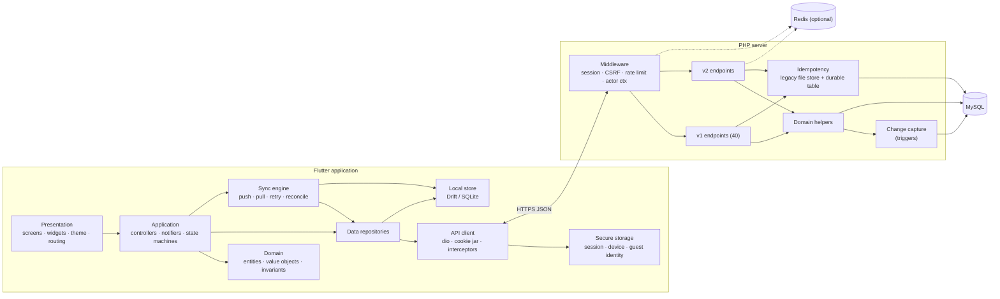

# System Components

| Field | Value |
|---|---|
| Status | Specification — Phase 2 |
| Date | 2026-11-15 |
| Purpose | Define every component, its responsibility, its interfaces, and its failure behaviour |

The high-level view is in [`TARGET_ARCHITECTURE.md`](TARGET_ARCHITECTURE.md). This document
decomposes it.

---

## 1. Component architecture

---

## 2. Client components

### 2.1 Presentation

| Aspect | Definition |
|---|---|
| Responsibility | Render state; capture input; navigate; expose accessibility semantics |
| Inputs | Immutable view state from application layer |
| Outputs | User intents (method calls on controllers) |
| Must not | Call the API, touch the database, or contain arithmetic on money |
| Failure behaviour | Renders an error state; never blocks the app |

### 2.2 Application

| Aspect | Definition |
|---|---|
| Responsibility | Orchestrate use cases, hold screen state, map domain errors to UI messages, drive optimistic updates |
| Inputs | Repository results, user intents |
| Outputs | View state, repository calls |
| Must not | Contain SQL or HTTP |
| Failure behaviour | Surfaces a typed failure to the UI; leaves the local store consistent |

### 2.3 Domain

| Aspect | Definition |
|---|---|
| Responsibility | Entities (`Expense`, `Budget`, `ListRecord`, `ListItem`, `Group`, `Member`, `Settlement`), value objects (`Money`, `LocalDate`, `Uuid`), invariants (amount > 0, ≤ 99 999 999.00, settlement lock predicate), conflict policy decisions |
| Inputs | Plain data |
| Outputs | Validated entities or typed violations |
| Must not | Perform I/O |
| Failure behaviour | Throws/returns a typed `DomainViolation`; never mutates input |

The domain layer is intentionally a **mirror** of the server's `domain_helpers`, not an
independent authority. Where the two disagree, the server wins and the client is corrected
(`BACKEND_COEXISTENCE.md` §6.3).

### 2.4 Repositories

| Repository | Responsibility |
|---|---|
| `ExpenseRepository` | Local CRUD, queue enqueue, remote create/update/delete, merge of pulled changes |
| `BudgetRepository` | Local upsert, queue, remote set |
| `ListRepository` | Personal list CRUD + items; group list read-only locally |
| `GroupRepository` | Read-only local cache of groups and members; operations go online |
| `SettlementRepository` | Read-only; calculate/confirm are online operations |
| `NotificationRepository` | In-memory only (D-19) |
| `CategoryRepository` | Seeded local copy, refreshed on bootstrap |
| `SyncRepository` | Queue, cursors, conflict records, device registration |

### 2.5 API client

| Aspect | Definition |
|---|---|
| Responsibility | One place that knows: base URL, cookie jar, `X-CSRF-Token`, `Idempotency-Key`, `Retry-After`, `ok`-first parsing, 401 handling |
| Inputs | Method, path, form/JSON body, idempotency key |
| Outputs | Typed `ApiResult<T>` |
| Failure behaviour | Maps transport failure, HTTP failure, and `ok:false` into one of: `NetworkFailure`, `AuthFailure`, `RateLimited(retryAfter)`, `DomainFailure(code, message)`, `Conflict(...)`, `ServerFailure` |
| Must not | Retry non-idempotent writes without the same idempotency key |

### 2.6 Local store

| Aspect | Definition |
|---|---|
| Responsibility | Durable records, change queue, cursors, conflict records, guest data, schema migrations |
| Technology | Drift over SQLite (D-14) |
| Failure behaviour | A failed transaction rolls back; a corrupt database is rebuilt from the server for registered users and reported (never silently wiped) for guests |

### 2.7 Sync engine

| Aspect | Definition |
|---|---|
| Responsibility | Decide when to sync, push in dependency order, pull pages, apply changes, advance the cursor, retry with backoff, run reconciliation |
| Triggers | App start, app resume, connectivity regained, after any successful local write, periodic foreground timer, manual pull-to-refresh |
| Must not | Push an online-only operation, advance the cursor past an unapplied change, or resolve a financial conflict without the policy in `CONFLICT_RESOLUTION.md` |

### 2.8 Secure storage

| Aspect | Definition |
|---|---|
| Responsibility | Store the device UUID, guest identity, and any credential material the platform can protect |
| Technology | `flutter_secure_storage` (Keychain / Keystore / libsecret / DPAPI) |
| Note | The session cookie itself lives in the HTTP cookie jar, not here; see `SESSION_MANAGEMENT.md` §3.3 |

---

## 3. Server components

### 3.1 Middleware (`api/middleware/auth.php`)

| Aspect | Definition |
|---|---|
| Responsibility | Start the hardened session; send security headers; validate `user_id`; enforce 24-hour expiry; verify CSRF on writes; apply rate limits; release the session lock; **set the change-capture actor context** |
| Extension required by this design | After authentication, execute `SET @expmg_actor_user_id = ?, @expmg_device_uuid = ?, @expmg_sync_suppress = 0` on the request's MySQL connection (D-13) |
| Failure behaviour | Exits with 401/403/429 and never reaches endpoint code |

### 3.2 v1 endpoints

40 files, unchanged. Their contract is `API_CONTRACT.md`. They gain no new behaviour; they gain
change-log rows automatically via triggers.

### 3.3 v2 endpoints

New files under `api/v2/`. Full specification in `api/SYNC_API_SPECIFICATION.md`.

| Endpoint group | Files |
|---|---|
| Session | `auth/session.php` |
| Devices | `devices/register.php`, `devices/list.php`, `devices/revoke.php` |
| Sync | `sync/bootstrap.php`, `sync/pull.php`, `sync/push.php`, `sync/state.php` |
| Guest import | `import/guest.php`, `import/status.php` |

### 3.4 Domain helpers (`api/domain/`)

Procedural PHP functions, one concern per file. Not classes — the project's procedural convention
is preserved (`AGENTS.md` "Why Procedural Not OOP").

| Helper | Functions (illustrative) | Used by |
|---|---|---|
| `money.php` | `normalizeMoney()`, `formatMoneyString()` | v1, v2 |
| `dates.php` | `validateDate()`, `validateMonth()` | v1, v2 (re-exports existing `validator.php`) |
| `membership.php` | `requireGroupMember()`, `requireGroupAdmin()`, `isGroupMember()` | v1, v2 |
| `settlement_lock.php` | `latestPeriodEnd()`, `assertExpenseDateUnlocked()` | v1, v2 |
| `expense_rules.php` | `validateExpenseInput()`, `normalizeExpenseType()`, `assertPayerIsMember()` | v1, v2 |
| `budget_rules.php` | `validateBudgetInput()` | v1, v2 |
| `list_rules.php` | `validateListItemInput()`, `assertListAccess()` | v1, v2 |
| `change_log.php` | `setActorContext()`, `suppressChangeCapture()` | middleware, migrations |

**This directory does not exist today.** Creating it is a prerequisite (D-30) and is not
authorised in Phase 2.

### 3.5 Change capture

| Aspect | Definition |
|---|---|
| Responsibility | Maintain `version` and `updated_at` on update; write ordered change-log rows; write tombstones on delete |
| Mechanism | MySQL triggers (D-13) |
| Coverage gap | FK cascade deletes do not fire triggers (F-03) — compensated by parent-tombstone purge rules |
| Failure behaviour | A trigger error aborts the originating write |

### 3.6 Idempotency

| Surface | Mechanism | TTL |
|---|---|---|
| v1 (11 endpoints) | Existing file/Redis store, `$_POST`-bound | 900 s |
| v2 push / import | Durable `sync_batches` table, `batch_uuid`-bound | 45 days |

The v1 store is retained unchanged; the durable table is new and separate.

### 3.7 Optional Laravel module

Not present. If adopted (D-18, `NEEDS APPROVAL`), it is a separate front controller reached only
through the legacy auth gateway and never authenticates independently.

---

## 4. Data components

| Component | Responsibility | Degradation |
|---|---|---|
| MySQL | System of record; referential integrity; change capture | None — hard dependency |
| Redis | Rate-limit counters, locks, cache | Absent ⇒ file store / DB path (existing behaviour) |
| File store (`data/idempotency`) | v1 idempotency responses | Absent ⇒ feature bypass (existing behaviour) |
| PHP session files | Session storage | None — hard dependency |

---

## 5. Component interaction matrix

`R` = reads, `W` = writes, `—` = no interaction.

| | MySQL | Redis | Local DB | API | Secure storage |
|---|---|---|---|---|---|
| Presentation | — | — | — | — | — |
| Application | — | — | — | — | — |
| Repository | — | — | R/W | — | — |
| API client | — | — | — | R/W | R |
| Sync engine | — | — | R/W | — | — |
| Guest importer | — | — | R/W | R/W | R |
| v1 endpoints | R/W | R/W | — | — | — |
| v2 endpoints | R/W | R/W | — | — | — |
| Domain helpers | — | — | — | — | — |
| Middleware | R/W | R/W | — | — | — |

Note: domain helpers perform no I/O by design; they receive a `mysqli` handle from the caller when
a rule needs to query (for example the settlement lock).

---

## 6. Failure behaviour summary

| Failure | System response | User-visible effect |
|---|---|---|
| MySQL unavailable | 500 with generic message; logged | "Service unavailable, try again" |
| Redis unavailable | Silent fallback | None |
| Session expired | 401 | Redirect to login; local data retained |
| Rate limited | 429 + `Retry-After` | Countdown, no retry storm |
| CSRF failure | 403 | One silent token refresh and retry, then error |
| Version conflict | 409 with both versions | Conflict screen |
| Settlement lock | 422 `SETTLEMENT_LOCKED` | "This date is already settled" |
| Permission revoked | 403 `PERMISSION_DENIED` | "You no longer have access" + discard/duplicate choice |
| Network loss mid-push | Transport failure | Queue entry retained; retried |
| Local DB corruption (registered) | Rebuild from server | "Repairing local data…" |
| Local DB corruption (guest) | No automatic wipe | Error screen with registration/recovery guidance (data export disabled in guest mode) |
| Server 500 during pull | Abort pull; cursor unchanged | "Sync paused", retried later |

---

## 7. Component ownership and review rules

| Component | Change requires |
|---|---|
| `domain_helpers` | Characterization test first; v1 and v2 contract tests both green |
| `change_capture` triggers | Schema migration test; change-log coverage test |
| `sync_api_v2` | Contract test; security probe for ownership manipulation |
| `local_store` schema | Migration test including upgrade from the previous version |
| Conflict policy | Decision record update |
| Any v1 endpoint | Explicit approval (Phase 1 freeze rules still apply until cutover) |
