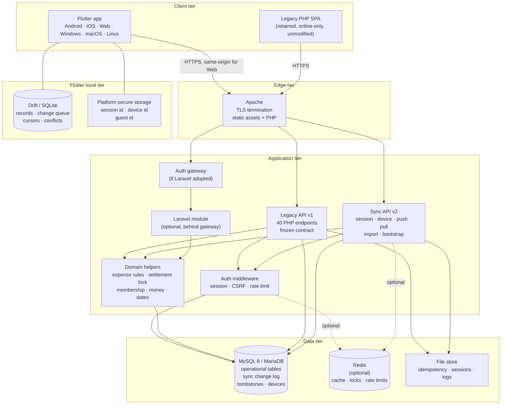

# Target System Architecture

| Field | Value |
|---|---|
| Status | Specification — Phase 2, no implementation authorised |
| Date | 2026-11-15 |
| Scope | The complete target system after the Flutter migration |
| Supersedes | Nothing. Extends `docs/PROJECT_OVERVIEW.md`, which remains authoritative for *current* behaviour |

This document defines **what the system is**. Component internals are in
[`SYSTEM_COMPONENTS.md`](SYSTEM_COMPONENTS.md); message sequences are in
[`DATA_FLOW.md`](DATA_FLOW.md); decisions are in
[`ARCHITECTURE_DECISIONS.md`](ARCHITECTURE_DECISIONS.md).

---

## 1. Architectural principles

| # | Principle | Consequence |
|---|---|---|
| P-1 | **The server is the only authority for registered-user data.** | Every write is re-validated server-side. No client-supplied identity, ownership, or version is trusted without a check. |
| P-2 | **One implementation of each business rule.** | v1 and v2 share extracted domain helpers (D-30). A second copy of the settlement lock is a defect. |
| P-3 | **Additive change only, during migration.** | New columns are nullable-then-constrained; no existing query changes; no existing endpoint changes behaviour. |
| P-4 | **Guest data never reaches the server except through an explicit, verifiable import.** | No anonymous endpoints, no implicit upload. |
| P-5 | **Offline capability is a property of an operation, not of the app.** | Each operation is explicitly online-only or offline-capable (D-16, D-17). |
| P-6 | **Financial invariants outrank availability.** | A sync conflict blocks the write; it never picks a winner that changes money silently. |
| P-7 | **No infrastructure the current host cannot run.** | Apache + PHP + MySQL (+ optional Redis). No broker, no container orchestration (D-29). |
| P-8 | **Everything is traceable.** | Every architectural element maps to a requirement ID in `WORK/REQUIREMENTS_TRACEABILITY.md`. |

---

## 2. High-level system architecture

### 2.1 Reading the diagram

- **Two client tiers coexist.** The legacy SPA is not modified (D-31). It uses only v1.
- **Two API surfaces share one auth boundary.** v2 is not a separate service; it is additional PHP
  files under the same webroot, behind the same `requireAuth()` middleware.
- **Domain helpers sit under both surfaces.** This is the mechanism that prevents duplicate
  business logic (P-2).
- **MySQL is the only system of record for registered data.** Redis and the file store are
  caches/locks and must degrade gracefully (existing rule, `AGENTS.md`).
- **The Flutter local tier is a real database, not a cache.** It owns the change queue, cursors,
  and conflict records.

### 2.2 What is deliberately absent

| Absent | Why |
|---|---|
| API gateway product / reverse proxy tier | Apache already terminates and routes; a gateway product adds operational weight with no requirement (D-29) |
| Message broker | The change log is the queue; MySQL is sufficient at this scale |
| Separate sync microservice | Same reason; and it would duplicate domain rules (P-2) |
| Service mesh / containers | Not supported by the target host and not needed |
| Second authentication system | D-03 and D-09 require one boundary |
| Server-side PDF/report generation | Frontend-only features today; adding them invents scope |

---

## 3. Layer responsibilities

| Layer | Owns | Must not own |
|---|---|---|
| **Presentation (Flutter widgets)** | Rendering, input capture, navigation, localisation, accessibility | Business rules, API calls, persistence |
| **Application (Flutter notifiers/controllers)** | Use-case orchestration, state machines, optimistic UI, error mapping | SQL, HTTP details |
| **Domain (Flutter + PHP)** | Entities, value objects (money, dates), invariants, policy decisions | I/O, framework types |
| **Data (Flutter repositories)** | Local DB access, remote API access, mapping, caching, queue management | Business decisions |
| **API v1/v2 (PHP)** | HTTP contract, authentication, authorisation, validation, transactions | Presentation concerns |
| **Domain helpers (PHP)** | The canonical rule set shared by v1 and v2 | HTTP concerns, SQL schema ownership |
| **MySQL** | Persistence, referential integrity, change capture | Business policy |
| **Sync engine (Flutter + PHP)** | Change detection, ordering, conflict representation, retry | Inventing merge policies outside `CONFLICT_RESOLUTION.md` |

---

## 4. Component inventory

| Component | Tier | Responsibility | Authoritative doc |
|---|---|---|---|
| `flutter_app` | Client | UI, navigation, theme, localisation | `FLUTTER_ARCHITECTURE.md` |
| `local_store` | Client | Drift database: records, queue, cursors, conflicts | `synchronization/OFFLINE_DATA_MANAGEMENT.md` |
| `sync_engine` | Client | Push/pull orchestration, conflict detection, retry | `synchronization/SYNC_WORKFLOWS.md` |
| `api_client` | Client | HTTP, cookie jar, CSRF, idempotency, error mapping | `FLUTTER_ARCHITECTURE.md` §5 |
| `guest_importer` | Client | Guest inventory, batching, verification | `synchronization/GUEST_DATA_MIGRATION.md` |
| `legacy_api_v1` | Server | The 40 existing endpoints | `api/API_CONTRACT_SPECIFICATION.md` §2 |
| `sync_api_v2` | Server | Bootstrap, pull, push, device, import, session | `api/SYNC_API_SPECIFICATION.md` |
| `auth_middleware` | Server | Session, CSRF, rate limit, actor context | `api/AUTHENTICATION_AND_AUTHORIZATION.md` |
| `domain_helpers` | Server | Shared business rules | `architecture/BACKEND_COEXISTENCE.md` §7 |
| `change_capture` | Server | Triggers + change log + tombstones | `database/DATABASE_SCHEMA_SPECIFICATION.md` §5 |
| `laravel_module` | Server (optional) | Future feature modules behind a gateway | `architecture/BACKEND_COEXISTENCE.md` §4 |
| `mysql` | Data | System of record | `database/DATABASE_DESIGN.md` |
| `redis` | Data (optional) | Cache, locks, rate limits | `architecture/SYSTEM_COMPONENTS.md` §5 |

---

## 5. Boundaries

### 5.1 Client ↔ server boundary

- The **only** channel is HTTPS to the API. No direct database access, no file share, no socket.
- The client sends **intent**, never authority: it may say "expense X version 3 is now 42.00"; it
  may not say "user 7 owns this" or "this group accepts me".
- Every response is advisory until confirmed by a subsequent read.

### 5.2 v1 ↔ v2 boundary

- v1 is frozen; v2 is additive.
- Both call the same domain helpers. Neither calls the other over HTTP.
- A v1 write and a v2 write to the same row produce identical business outcomes; they differ only
  in whether a version precondition is checked and whether a device is attributed.

### 5.3 Guest ↔ registered boundary

- Guest mode has **no** server connection.
- The boundary is crossed exactly once per migration, through the guest-import endpoint, with an
  authenticated session.
- Local guest data is deleted only after a verified import (D-04).

### 5.4 PHP ↔ Laravel boundary

- Procedural PHP 8 backend is retained; Laravel remains optional for future justified use (D-18 `ACCEPTED`).
- If introduced for future reporting/queues, Laravel never authenticates directly. It runs behind Model M-1 receiving a signed context header from the legacy gateway.
- Laravel never re-implements a rule that already exists in `api/domain/`.

### 5.5 Operational boundary

- The database is not exposed to clients.
- Logs are not web-readable (existing `.htaccess` rule).
- Secrets live in `.env`, never in the repository.

---

## 6. Data movement (summary)

Full sequences are in [`DATA_FLOW.md`](DATA_FLOW.md).

| Scenario | Path |
|---|---|
| Online read | Flutter → v1/v2 GET → MySQL → JSON → local cache → UI |
| Online write (v1 UI) | Legacy SPA → v1 POST → domain helper → MySQL (+ change log) → JSON |
| Online write (Flutter) | Flutter → v2 POST → domain helper → MySQL (+ change log) → JSON → local apply |
| Offline write | Flutter → local DB (optimistic) → queue entry → **stop** |
| Reconnect | Flutter → v2 push (ordered) → v2 pull (cursor) → local apply → cursor advance |
| Guest use | Flutter → local DB only → **no network** |
| Guest migration | Flutter → v2 import (batched) → MySQL → verification → local purge |
| Settlement close | Flutter → v1/v2 confirm (online only) → MySQL transaction → settlements + change log |

---

## 7. Consistency model

| Concern | Model |
|---|---|
| Server-side writes | Immediate consistency inside a MySQL transaction |
| Cross-device reads | Eventual consistency bounded by sync latency (target: < 5 s online) |
| Conflicts | Detected by version; never resolved silently for financial entities |
| Deletions | Propagated by tombstone; a client may briefly show a deleted record until it syncs |
| Derived analytics | Computed from local records; may be stale until sync completes, and the UI says so |
| Settlement state | **Never** derived locally for closure; always fetched from the server |

---

## 8. Feature preservation map

Every `FEATURE_INVENTORY.md` feature has a target home. Nothing is dropped.

| Feature group | Target | Notes |
|---|---|---|
| AUTH-1…AUTH-7 | Flutter auth screens + v1/v2 session bootstrap | Validation and error text preserved |
| AUTH-8 Guest mode | Flutter local only | New capability (D-04) |
| UI-1…UI-7 | Flutter shell, routing, theme, toasts | Reimplemented, not ported |
| HOME-1…HOME-4 | Flutter calendar | Rebuilt from local expense rows |
| EXP-1…EXP-10 | Flutter expenses | Full parity + offline create/edit/delete |
| BUD-1, BUD-2 | Flutter budget | Read from summary or `budgets/get.php` |
| GRP-1…GRP-9 | Flutter groups | Online-only writes |
| SET-1…SET-9 | Flutter settlement | Online-only closure |
| LST-1…LST-10 | Flutter lists | Check/uncheck online-only |
| UNP-1, UNP-2 | Flutter unpriced | Online |
| NTF-1…NTF-5 | Flutter notifications | Live only (D-19) |
| AN-1…AN-5 | Flutter charts + PDF | Local computation |
| SYS-1…SYS-6 | Unchanged server-side | Not client features |

---

## 9. Non-functional targets

| Property | Target | Basis |
|---|---|---|
| Cold start (mobile) | < 3 s to interactive shell | Product expectation; measured at implementation |
| Local query latency | < 50 ms for a month view on 10 000 rows | SQLite indexed queries |
| Sync latency (online, idle) | < 5 s from remote change to local apply | Foreground polling + push after local write |
| Bootstrap (1 000 expenses) | < 10 s on a 3G-class connection | Cursor pages of 500 |
| Payload size | ≤ 1 MB per pull page | 500 rows × ~1 KB |
| Offline durability | Zero loss across crash, kill, or battery death | SQLite transaction + queue commit |
| Conflict detection | 100 % of version mismatches surfaced | Version precondition on every push |
| Existing suite | 433/105/538 unchanged | `TEST_BASELINE.md` |

---

## 10. Assumptions

Recorded explicitly so they can be challenged.

| # | Assumption | If false |
|---|---|---|
| A-1 | The deployment target remains Apache + PHP + MySQL on a single host | Deployment architecture must be revisited |
| A-2 | Concurrent write volume stays in the tens per minute | The `seq` safety-lag strategy (D-27) may need a serialised counter |
| A-3 | A user belongs to at most 5 groups with at most 10 members each | Pull-scoping cost grows linearly with membership; fan-out table needed |
| A-4 | Records per user stay under ~50 000 | Bootstrap batching and local indexes need review |
| A-5 | Flutter Web can run SQLite-WASM in the target browsers | Web would need a different local store |
| A-6 | The owner accepts same-origin web deployment | Same-origin confirmed (D-08, UQ-15 `APPROVED`) |
| A-7 | Separate remember credential for native clients | Option C approved (D-24, D-33, UQ-03 `APPROVED`) |
| A-8 | No third-party integration requires server-to-server calls | No integration component is specified |

---

## 11. Open architectural risks

Cross-reference: `WORK/PHASE_2_DESIGN_PLAN.md` §7. The key risks:

1. **R-01 cascade capture gap** — mitigated by parent tombstones plus, for group deletion, one
   personally-scoped `group_member` tombstone per member and an explicit expense detach
   (`database/DATABASE_SCHEMA_SPECIFICATION.md` §5.4.3–§5.4.4). Not eliminated: the compensation
   depends on cross-table DML inside a trigger (spike A-DB-4), with an endpoint-side fallback.
2. **R-02 duplicate rules** — mitigated by D-30, which is a hard prerequisite.
3. **R-05 account deletion** — mitigated by owner-approved D-23 / UQ-02 (balance gate, personal data purge, original username preserved with deleted account badge, immediate session revocation).
