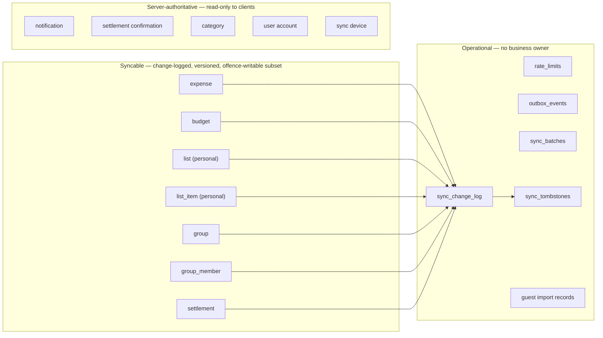
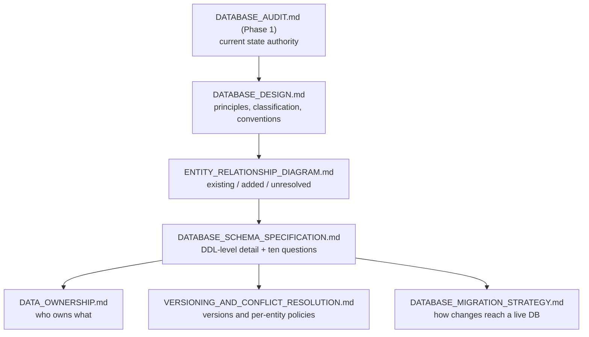

# Database Design

| Field | Value |
|---|---|
| Status | Specification — Phase 2 |
| Date | 2026-11-15 |
| Purpose | The design authority for the MySQL layer of the target architecture: principles, entity classification, conventions, and the boundary between what exists and what is proposed |
| Current-state authority | [`DATABASE_AUDIT.md`](../DATABASE_AUDIT.md) describes what exists today. This document describes what the target design needs and points to the specification that details it |
| Rule | No statement in this document is a schema change. Every proposed object is `PROPOSED` and unexecuted (D-02, D-07) |

---

## 1. Purpose and scope

### 1.1 What this document is

The top-level design statement for the database. It answers: what is the database responsible for,
what are its design principles, what classes of data does it hold, how is it accessed, and which
document specifies each part.

### 1.2 What this document is not

| Not this document | Owner |
|---|---|
| The current schema's table-by-table reference | [`DATABASE_AUDIT.md`](../DATABASE_AUDIT.md) |
| The exact DDL of proposed new tables and columns | [`DATABASE_SCHEMA_SPECIFICATION.md`](DATABASE_SCHEMA_SPECIFICATION.md) |
| The relationship picture | [`ENTITY_RELATIONSHIP_DIAGRAM.md`](ENTITY_RELATIONSHIP_DIAGRAM.md) |
| Who owns which row and who may change it | [`DATA_OWNERSHIP.md`](DATA_OWNERSHIP.md), [`../security/ACCESS_CONTROL.md`](../security/ACCESS_CONTROL.md) |
| Version and conflict rules | [`VERSIONING_AND_CONFLICT_RESOLUTION.md`](VERSIONING_AND_CONFLICT_RESOLUTION.md) |
| How changes reach a live database | [`DATABASE_MIGRATION_STRATEGY.md`](DATABASE_MIGRATION_STRATEGY.md) |
| The sync protocol that uses these structures | [`../synchronization/SYNCHRONIZATION_ARCHITECTURE.md`](../synchronization/SYNCHRONIZATION_ARCHITECTURE.md) |

Every topic is written once, in the document named above, and cross-referenced elsewhere
(`WORK/PHASE_2_DESIGN_PLAN.md` §5).

---

## 2. Design principles

| # | Principle | Consequence |
|---|---|---|
| DP-1 | **MySQL is the system of record.** Every authoritative value lives here; clients hold derivable copies | `TARGET_ARCHITECTURE.md` §5.1 |
| DP-2 | **Additive only.** Existing tables, columns, constraints, and indexes are not removed or repurposed | DB-11; `DATABASE_MIGRATION_STRATEGY.md` §5 |
| DP-3 | **Existing queries stay byte-identical.** No `deleted_at IS NULL` predicate is introduced anywhere | D-20; this is why tombstones exist |
| DP-4 | **The database is a backstop, not the primary rule layer.** PHP enforces business rules first; constraints catch what code misses | `DATABASE_AUDIT.md` §3 |
| DP-5 | **Prepared statements only.** No interpolated SQL anywhere, in any stack | [`../../AGENTS.md`](../../AGENTS.md); `BACKEND_COEXISTENCE.md` §4.2 |
| DP-6 | **Identity is client-generated for new records**, with `id` retained as the internal surrogate | D-12 |
| DP-7 | **Every write is observable.** A write that leaves no change-log row is a permanently desynchronised client | D-13 |
| DP-8 | **Deletion is explicit.** A tombstone records the fact; absence cannot | D-20, `DATA_FLOW.md` §9 |
| DP-9 | **Ordering never depends on a client clock.** Server time and `seq` order everything | D-06, SY-20 |
| DP-10 | **Money is exact.** `DECIMAL(12,2)` in storage; integer cents in the client; a decimal string on the wire | D-21 |
| DP-11 | **One migration sequence, forward-only.** Applied migrations are never edited | `DATABASE_MIGRATION_STRATEGY.md` §3 |
| DP-12 | **Small data, simple operations.** The dataset is thousands of rows; no partitioning, sharding, or broker is justified | D-29 |

---

## 3. Current state (verified)

From [`DATABASE_AUDIT.md`](../DATABASE_AUDIT.md) §1, verified against `schema.sql`:

| Item | Value |
|---|---|
| Database name | `ExpMgWEB` |
| Engine | InnoDB (all tables) |
| Charset / collation | `utf8mb4` / `utf8mb4_general_ci` |
| Tables | 14 |
| Foreign keys | Present on every relationship except `rate_limits` and `outbox_events` |
| `CHECK` constraints | 5 in `schema.sql`, plus `chk_settlement_period` added by `migration_v2.9_settlement_hardening.sql` |
| Tables with `updated_at` | `users`, `groups`, `expenses`, `budgets` |
| Tables without `updated_at` | `lists`, `list_items`, `group_members`, `settlements`, `settlement_confirmations`, `post_settlement_confirmations`, `notifications`, `categories`, `rate_limits`, `outbox_events` |
| Row versions | None |
| UUIDs | None |
| Change log | None |
| Tombstones | None |
| Soft deletes | None — hard `DELETE` only |

**This is the same picture `DATABASE_AUDIT.md` §7.2 calls "not sync-ready".** D-05 requires
synchronisation; D-11 selects the mechanism; the schema work follows from those two decisions.

---

## 4. Entity classification

The canonical classification, from `WORK/PHASE_2_DESIGN_PLAN.md` §12. Every table and every proposed
table belongs to exactly one class.

### 4.1 Syncable entities (7)

Entities that appear in the change log, carry `uuid` and `version`, and participate in pull
deltas.

| Entity | Table | Client may write offline? | Reason |
|---|---|---|---|
| `expense` | `expenses` | Yes — create, edit, delete | D-16 |
| `budget` | `budgets` | Yes — set | D-16 |
| `list` | `lists` (personal only) | Yes — create, rename, delete | D-16 |
| `list_item` | `list_items` (personal lists only) | Yes — add, edit, remove | D-16 |
| `group` | `groups` | No — read and cache only | Server generates `join_code`, enforces capacity |
| `group_member` | `group_members` | No — read only | Membership transitions are server operations |
| `settlement` | `settlements` | No — read only | Financial closure requires a server-computed period |

A **group list or group list item is read-only offline** even though the `list` and `list_item`
entity classes are syncable. The classification is per-row (by `group_id`), not per-table.

### 4.2 Server-authoritative, non-logged entities

Read and cache, never in the change log, never offline-writable.

| Entity | Table | Why excluded from the change log |
|---|---|---|
| `notification` | `notifications` | Seven-day server lifetime; not a navigation key (D-19) |
| `settlement_confirmation` | `settlement_confirmations`, `post_settlement_confirmations` | Keyed by group + user, not by settlement; the client never writes them |
| `category` | `categories` | Seeded, shared, changes only by deployment |
| `user` (account) | `users` | The authenticated identity; not a synchronised record |
| `sync_device` | `sync_devices` (new) | Owned by the server; listed and revoked, never pulled |

### 4.3 Operational records

Not business data. No owner, no sync, bounded retention.

| Table | Purpose | Retention |
|---|---|---|
| `rate_limits` | Rate-limit counters by IP and user key | Action-aware cleanup (`cleanupRateLimits()`) |
| `outbox_events` | Dormant; write side unwired (KD-11) | Never pruned; not a sync mechanism |
| `sync_batches` (new) | Durable idempotency for sync pushes | **45 days after completion** — one recommendation, pending UQ-09 (not an approved policy). A retry beyond 45 days is a new operation, not a replay |
| `sync_change_log` (new) | Ordered change stream | **90 days** — UQ-09 recommendation |
| `sync_tombstones` (new) | Durable deletion markers | **Indefinite** — UQ-09 recommendation |
| `guest_import_batches`, `guest_import_items` (new) | Guest migration audit and idempotency | Retained for the life of the account (owner-approved policy) |

**Retention policy status.** Retention for guest import audit records (`guest_import_batches`,
`guest_import_items`) is owner-approved as **APPROVED policy** for the lifetime of the user account.
The operational retention schedules for `sync_change_log` (90 days), `sync_tombstones` (safe GC framework
without fixed expiry), and `sync_batches` (45 days) are approved as provisional schedules under UQ-09
pending Phase 5 operational GC design. No automated destructive pruning jobs may run without prior review.

### 4.4 Classification diagram

---

## 5. Proposed additions at a glance

**All of the following are `PROPOSED`, unexecuted, and require owner approval before any migration
file is written.** Full specification: [`DATABASE_SCHEMA_SPECIFICATION.md`](DATABASE_SCHEMA_SPECIFICATION.md).

### 5.1 Columns added to existing tables

| Table | Additions | Reason |
|---|---|---|
| `expenses` | `uuid`, `version`, `updated_at` precision | Identity, concurrency, ordering |
| `budgets` | `uuid`, `version`, `updated_at` precision | same |
| `lists` | `uuid`, `version`, `updated_at` | same |
| `list_items` | `uuid`, `version`, `updated_at` | same |
| `groups` | `uuid`, `version`, `updated_at` precision | same |
| `group_members` | `uuid`, `version`, `updated_at` | same |
| `settlements` | `uuid`, `version`, `updated_at` | same |

No column is added to `users`, `categories`, `notifications`, `settlement_confirmations`,
`post_settlement_confirmations`, `rate_limits`, `outbox_events`.

### 5.2 New tables

| Table | Purpose |
|---|---|
| `sync_devices` | Device registry; enables attribution, per-device cursors, revocation |
| `sync_change_log` | Ordered change stream (`seq`, entity, uuid, op, version, snapshot, actor, device) |
| `sync_tombstones` | Durable deletion markers |
| `sync_batches` | Durable idempotency for push requests |
| `guest_import_batches` | Guest migration header: status, counts, client reference |
| `guest_import_items` | Per-record mapping of a guest record to a server record |

### 5.3 Explicitly not added

| Not added | Why |
|---|---|
| `deleted_at` on any table | D-20 — would force `WHERE deleted_at IS NULL` into every existing query |
| `CHECK (type='personal' ⇔ group_id IS NULL)` | Would fail against existing orphaned rows (finding F-02, UQ-11) |
| `app_sessions` | D-25 is `NEEDS APPROVAL`; a session table is not required for sync |
| Any column on `notifications` | D-19 — notifications are outside the sync store |
| A second ID column on new tables | D-12 keeps `id` as the internal surrogate and `uuid` as identity |

---

## 6. Storage conventions

| Concern | Convention | Rationale |
|---|---|---|
| Engine | InnoDB, every table | Transactions, FKs, row locks are all required |
| Charset | `utf8mb4` / `utf8mb4_general_ci` | Existing; no change (a collation change would silently alter `UNIQUE` semantics) |
| Identity | `uuid CHAR(36) CHARACTER SET ascii COLLATE ascii_bin` | D-12; `ascii_bin` gives an exact-match, case-sensitive index at 36 bytes |
| Surrogate key | `id INT UNSIGNED AUTO_INCREMENT` retained | Internal joins only; never the wire identity for new records |
| Version | `version INT UNSIGNED NOT NULL DEFAULT 1` | D-06 |
| Timestamps | `updated_at DATETIME(6)` on syncable tables | Microsecond precision removes same-second ties (`DATABASE_AUDIT.md` §7.2) |
| Dates | `DATE` for business dates (`expense_date`, `period_start`, `period_end`) | A business date is not an instant |
| Money | `DECIMAL(12,2)` | Never `FLOAT`/`DOUBLE`; D-21 |
| Booleans | `TINYINT(1)` with a `CHECK` where the existing schema already has one | Existing convention |
| Enum | `ENUM` for closed sets (`type`, `role`, `priority`, `status`) | Existing convention; adding a value later is an `ALTER` |
| Deletion | Hard delete + tombstone | D-20 |
| Time zone | Server time, single zone, consistent across stacks | SY-20; `BACKEND_COEXISTENCE.md` §4.2 |

### 6.1 Timestamp semantics

| Column | Meaning | Written by |
|---|---|---|
| `created_at` | When the row was created | Server (`CURRENT_TIMESTAMP`, existing default) |
| `updated_at` | When the row was last changed | Server, by the `BEFORE UPDATE` trigger (D-13) — **not** by trusting the client, and **not** by `ON UPDATE` alone on syncable tables |

**Why the trigger owns `updated_at`.** A v1 endpoint writes a row without knowing about sync; a
trigger guarantees the timestamp and version move together for every writer. Relying on
`ON UPDATE CURRENT_TIMESTAMP` would leave `version` unset, and relying on application code would
leave both unset when a future endpoint forgets.

### 6.2 Timestamps are not proof

`updated_at` orders and audits. It never proves that no concurrent modification occurred — that is
what `version` is for (D-06). A design that compares timestamps to decide a conflict contradicts the
accepted decision and is a defect.

---

## 7. Access and connection policy

| Rule | Detail |
|---|---|
| Driver | `mysqli` with prepared statements, in every stack |
| Statement style | `prepare` → `bind_param` → `execute` → `get_result`; always `close()` |
| Failure handling | Check `$stmt !== false` before `bind_param` |
| Transactions | `begin_transaction()` / `commit()` / `rollback()` for every multi-step write |
| Locking reads | `SELECT … FOR UPDATE` only where it already exists (`confirm.php`, `price_unpriced.php`); v2 must adopt the same pattern for the same operations (PR-05) |
| Isolation | MySQL default (`REPEATABLE READ`); the design must not depend on a different level |
| Connection set-up | `SET NAMES utf8mb4` semantics from the driver; `sql_mode` identical across stacks |
| Application account | `expmg_app` with `SELECT, INSERT, UPDATE, DELETE` + `DROP` on `rate_limits`; never `root` |
| Trigger privileges | Applying migrations requires `TRIGGER`; the runtime account does not |
| Connection lifetime | Request-scoped |
| Read-only paths | No writes on `GET` (KD-07 fix must be preserved) |

---

## 8. Constraints philosophy

`DATABASE_AUDIT.md` §3 records that constraints are a backstop. The target design keeps that
position and tightens it where a new structure makes tightening safe.

| Layer | Enforces | Examples |
|---|---|---|
| PHP domain helpers (primary) | Business rules | Settlement lock, `paid_by` membership, group limits, list conversion |
| `CHECK` constraints (backstop) | Value-domain rules that are absolute | `amount > 0`, `price > 0`, `amount_limit > 0`, `max_members > 0`, `amount >= 0`, `period_start <= period_end` |
| `UNIQUE` indexes | Identity and keying | `(group_id, user_id)`, `(user_id, budget_month)`, `username`, `email`, `join_code`, and new: `uuid`, `sync_devices.uuid`, `sync_devices.token` |
| Foreign keys | Referential integrity | With the cascade behaviour analysed in `ENTITY_RELATIONSHIP_DIAGRAM.md` §6 |
| Triggers (new) | Observation, not validation | Version bump, change-log row, tombstone row |

### 8.1 Constraint rules for new objects

| Rule | Reason |
|---|---|
| A new `CHECK` is added only where **all existing rows already satisfy it** | A migration that fails on live data is not deployable; F-02/UQ-11 is exactly this case |
| A new column on an existing table is `NULL`-able unless a backfill makes it safe | Adding `NOT NULL` to a populated table requires a default or a two-step migration |
| `NOT NULL` on new tables is unconditional | New tables start empty |
| New FKs use the existing cascade vocabulary, deliberately chosen per relationship | Silent cascade behaviour is the source of finding F-02 |
| No `ON DELETE CASCADE` from any new table to a business table | A sync record must never be destroyed by a business delete (see §8.2) |

### 8.2 Cascade safety for sync tables

| Relationship | Behaviour | Reason |
|---|---|---|
| `sync_change_log` → nothing | No FK to business tables | A deleted row's change must survive the row |
| `sync_tombstones` → nothing | No FK | The tombstone exists *because* the row is gone |
| `sync_devices.user_id` → `users.id` | `ON DELETE CASCADE` | A device belongs to an account; D-23's anonymise policy keeps the row, so this only fires on a genuine delete |
| `sync_batches.device_id` → `sync_devices.id` | `ON DELETE CASCADE` | Batch idempotency of a revoked device is not needed |
| `guest_import_batches.user_id` → `users.id` | `ON DELETE CASCADE` | Import audit belongs to the account |
| `guest_import_items.batch_id` → `guest_import_batches.id` | `ON DELETE CASCADE` | Item rows are meaningless without their batch |
| `guest_import_items.server_uuid` | No FK; stores a UUID value | The server record may be deleted later; the audit row must remain truthful |

**Note (F-03, corrected).** InnoDB cascade actions do not fire triggers. A cascade delete from
`groups` or `users` therefore produces no change-log row for the cascaded children. A parent tombstone
alone is **not** sufficient for group deletion: the deletion also removes every `group_members` row,
so group-scoped visibility resolves to nobody. The design therefore emits, from `trg_groups_bd`, one
personally-scoped `group_member` tombstone per current member (plus an explicit `expenses` detach so
that surviving expenses are logged normally). Full specification:
`DATABASE_SCHEMA_SPECIFICATION.md` §5.4.3–§5.4.4 and §5.6.9; client effect:
`SYNC_WORKFLOWS.md` §6.2.

---

## 9. Capacity and performance assumptions

| Assumption | Value | Consequence |
|---|---|---|
| Users | Tens | No sharding, no read replicas |
| Groups per user | ≤ 5 (enforced) | Bounded fan-out |
| Members per group | ≤ 10 (enforced) | Bounded fan-out |
| Expenses per user | Thousands | `idx_user_date` covers the common access path |
| Change log growth | ~Thousands of rows/year at this scale | 90-day pruning keeps it small (UQ-09) |
| Tombstone growth | One row per deleted entity | Indefinite retention is affordable (UQ-09) |
| Sync payload size | ≤ 500 operations per push, page size bounded per pull | `SYNC_API_SPECIFICATION.md` §6 |
| Concurrency | Single-digit simultaneous writers | `FOR UPDATE` in two existing paths is sufficient; no global locking |
| Backup | Daily logical dump + binary log | `DATABASE_MIGRATION_STRATEGY.md` §7 |

**Explicitly not needed:** partitioning, sharding, materialised views, a search index, a second
database engine, or a cache for correctness (Redis is optional and never authoritative,
`SYSTEM_COMPONENTS.md` §5).

---

## 10. Document map

---

## 11. Assumptions and unresolved questions

| ID | Statement | Status |
|---|---|---|
| A-DB-1 | The dataset stays at household/small-group scale | Assumption, low risk |
| A-DB-2 | MySQL 8 or MariaDB 10.4.32 remain the engine on both dev and production ([`../../AGENTS.md`](../../AGENTS.md)) | Assumption |
| A-DB-3 | Trigger support and behaviour are equivalent between MySQL 8 and MariaDB 10.4 for the triggers in `DATABASE_SCHEMA_SPECIFICATION.md` §5.6 | **Verify before migration** (`ARCHITECTURE_VALIDATION_PLAN.md` §4) |
| A-DB-4 | The existing `id`-based queries and FKs are never required to change (DP-3) | Assumption, enforced by DB-11 |
| A-DB-5 | No live production data exists beyond the current development database | Assumption — if false, the migration rehearsal in `DATABASE_MIGRATION_STRATEGY.md` §7 is mandatory, not optional |

| UQ | Effect on the database design |
|---|---|
| UQ-02 — account deletion/retention (D-23) | `DATA_OWNERSHIP.md` §9–§10 |
| UQ-07 — group deletion with settlements (D-26) | `DATA_OWNERSHIP.md` §8; a `CHECK` on `type`/`group_id` stays blocked |
| UQ-09 — change-log/tombstone retention | `DATABASE_SCHEMA_SPECIFICATION.md` §5.3 |
| UQ-11 — orphaned group expenses | `DATABASE_SCHEMA_SPECIFICATION.md` §7.3 |
| UQ-06 — Laravel coexistence | `BACKEND_COEXISTENCE.md` §4; affects who may write to triggered tables |
| UQ-04 — device revocation | `DATABASE_SCHEMA_SPECIFICATION.md` §5.1 |
| UQ-17 — whether a device must register before syncing | `DATABASE_SCHEMA_SPECIFICATION.md` §5.1 |
| UQ-16 — guest feature package contents | `synchronization/GUEST_DATA_MIGRATION.md` §3.2 |

---

## 12. Verification

| Claim | Method | Pass condition |
|---|---|---|
| Principles do not contradict an accepted decision | `DOC-REVIEW` | Every DP-n traces to a decision or an audit finding |
| Entity classification is complete | `DOC-REVIEW` | All 14 existing tables and all 6 new tables appear in exactly one class |
| No existing query is affected | `STATIC-CHECK` | §5 additions introduce no predicate any existing query would need |
| Storage conventions match the existing schema | `STATIC-CHECK` | Engine, charset, money type, boolean type unchanged |
| Cascade behaviour of new tables is intentional | `DOC-REVIEW` | §8.2 rows each state a reason |
| Container/list behaviour still valid at scale | `DOC-REVIEW` | §9 assumptions stated and bounded |
