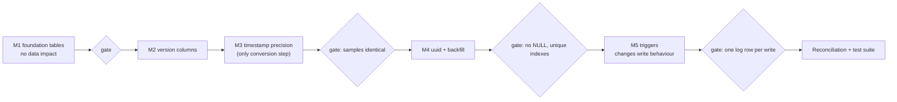

# Database Migration Strategy

| Field | Value |
|---|---|
| Status | Specification — Phase 2. **No migration file is created by this document.** |
| Date | 2026-11-15 |
| Purpose | Define how the proposed schema changes reach a live database safely: sequence, guards, gates, rehearsal, rollback, and backward-compatibility rules |
| Requirements | DB-09, DB-10, DB-11, D-02, D-13 |
| Rule | A migration that cannot be rolled back cannot be applied |

---

## 1. Scope

| Question | Section |
|---|---|
| The principles every migration obeys | §2, §3 |
| The proposed sequence, with rollback per step | §4 |
| How existing queries are proven unchanged | §5 |
| How an older application version keeps working | §6 |
| How a migration is executed and verified | §7 |
| What can go wrong | §8 |

The objects themselves are specified in
[`DATABASE_SCHEMA_SPECIFICATION.md`](DATABASE_SCHEMA_SPECIFICATION.md). This document defines **when
and how**; that document defines **what**.

---

## 2. Principles

| # | Principle | Source |
|---|---|---|
| MP-1 | **Additive only.** No column, index, constraint, or table is dropped or repurposed to make room for a new one | D-02, DP-2 |
| MP-2 | **Guarded and idempotent.** Every file is safe to run twice and safe to run against a database that already has the object (`IF NOT EXISTS`, `information_schema` pre-flight checks, conditional `ALTER`) | Existing convention (`migration_v1.8.sql`, `migration_v2.8`, `migration_v2.9`) |
| MP-3 | **Forward-only, never edited.** An applied migration file is never modified; a correction is a new file | Existing convention |
| MP-4 | **One concern per file**, with one rollback statement per file | §4 |
| MP-5 | **No data loss.** A migration never deletes or rewrites business data except where explicitly specified and approved (the `uuid` backfill adds; it does not change anything else) | D-02 |
| MP-6 | **Suppressed by default.** Every migration sets `@expmg_sync_suppress = 1` before touching a triggered table, so backfills do not flood the change log | D-13 |
| MP-7 | **Rehearsed before production.** A migration is applied to a copy of the real data and verified against the full test suite before it touches the live database | §7 |
| MP-8 | **Reversible within one release window.** Each step's rollback is known before the step is applied | DB-09 |
| MP-9 | **Trigger changes are part of the migration** | `DATABASE_SCHEMA_SPECIFICATION.md` §5.6.7 |
| MP-10 | **`schema.sql` is the long-run source of truth.** A migration exists to bring an existing database to what `schema.sql` will describe; a fresh clone runs `schema.sql` and then any migration that has not been folded in | `DATABASE_AUDIT.md` §5 |

---

## 3. Authoring rules

### 3.1 File conventions

| Item | Convention |
|---|---|
| Name | `migration_vX.Y_<short_name>.sql` — continuing the existing sequence (`migration_v1.8` … `migration_v2.9`) |
| Header | A comment block: purpose, author, date, prerequisites, rollback summary, and whether it is idempotent |
| Pre-flight | An `information_schema` check that reports what will change; abort with a clear message if a prerequisite is missing |
| Guard | Every `CREATE` is `IF NOT EXISTS`; every `ALTER` is preceded by a column/index existence check |
| Session variables | `SET @expmg_sync_suppress = 1;` at the top of any file that writes to a triggered table |
| Time zone | Explicitly set for any migration involving `TIMESTAMP` ↔ `DATETIME` (§4 step M3) |
| Transaction boundaries | DDL in MySQL is not transactionally rolled back, so a file is written to be **re-runnable** rather than atomic |
| Verification | Each file ends with a query block whose expected output is stated in the header comment |
| Rollback | A separate `migration_vX.Y_<name>_rollback.sql`, same conventions |

### 3.2 What a migration must never do

| Never | Why |
|---|---|
| Interpolate a value from a shell variable into SQL | SQL-injection and unrepeatability; all values are literals |
| Drop a column that v1 code reads | v1 must keep working (MP-1) |
| Recreate a table with `CREATE TABLE … SELECT` | Silent loss of constraints, indexes, and FKs |
| Rename a table or column | Every existing query would need a change (DB-11) |
| Touch `rate_limits` or `outbox_events` | Out of scope |
| Exceed one concern | Bisectability |
| Run an unbounded `UPDATE` on a populated table | Long locks; use the batched loop (§4 step M4) |
| Add `NOT NULL` without a default or backfill | The migration fails on live data |
| Add a `CHECK` that existing rows violate | Fails; this is why nothing enforces `type`/`group_id` (`DATABASE_SCHEMA_SPECIFICATION.md` §7.3) |

### 3.3 Migration bookkeeping

There is **no** `schema_migrations` table today; migrations are applied deliberately and guarded.
This strategy keeps that model and notes the consequence:

| Consequence | Handling |
|---|---|
| "Which migrations have been applied?" is answered by inspecting objects | The pre-flight block of each file reports exactly that |
| A skipped migration is possible | §7's verification checklist includes an object-inventory comparison against the expected post-migration state |
| Introducing a bookkeeping table | Out of scope. It would be a seventh new table and needs its own decision |

---

## 4. The proposed sequence (DB-09)

Five migration steps (M1–M5) plus one documentation-parity task (M6). Each is independent enough to
be applied and verified on its own; each has a stated rollback.

**None of these files exists. None may be written before owner approval of D-11, D-13, D-20, D-27,
and the related `PROPOSED` decisions.**

### M1 — Sync foundation tables (new, empty)

| Aspect | Detail |
|---|---|
| File | `migration_v3.0_sync_foundation.sql` |
| Creates | `sync_devices`, `app_sessions`, `sync_change_log`, `sync_tombstones`, `sync_batches`, `guest_import_batches`, `guest_import_items` + their indexes and FKs |
| Depends on | Nothing |
| Data impact | None — all seven tables start empty |
| Rollback | `migration_v3.0_sync_foundation_rollback.sql`: `DROP TABLE` × 7 (children before parents) |
| Gate | All seven tables plus indexes exist; `SELECT COUNT(*)` is 0 on each |

**Why first:** it is the only step with zero data impact, so it can be applied and left in place
while later steps are prepared.

### M2 — Record versions

| Aspect | Detail |
|---|---|
| File | `migration_v3.1_versions.sql` |
| Adds | `version INT UNSIGNED NOT NULL DEFAULT 1` to `expenses`, `budgets`, `groups`, `lists`, `list_items`, `group_members`, `settlements` |
| Depends on | Nothing (M1 not required) |
| Data impact | Existing rows receive `1` from the column default — no backfill statement |
| Rollback | `DROP COLUMN version` on each table |
| Gate | All seven tables have the column; `SELECT COUNT(*)` of `version IS NULL` is 0 |

**Why before the triggers:** a trigger that bumps a non-existent column fails at creation time.

### M3 — Timestamp precision and presence

| Aspect | Detail |
|---|---|
| File | `migration_v3.2_timestamps.sql` |
| Modifies | `expenses.updated_at`, `budgets.updated_at`, `groups.updated_at` → `DATETIME(6)`, keeping the existing auto-update behaviour |
| Adds | `updated_at DATETIME(6) NOT NULL DEFAULT CURRENT_TIMESTAMP(6)` to `lists`, `list_items`, `group_members`, `settlements` |
| Depends on | Nothing |
| Data impact | **The only step with a semantic conversion** (`TIMESTAMP` → `DATETIME(6)`) |
| Rollback | Restore the `TIMESTAMP` definition on three tables; `DROP COLUMN` on four |
| Gate | Column types match; sample values unchanged (§4.1) |

#### 4.1 The `TIMESTAMP` → `DATETIME(6)` conversion procedure

| Step | Action |
|---|---|
| 1 | Record `SELECT NOW(), @@session.time_zone, @@global.time_zone` on the target server |
| 2 | Record a sample: `SELECT id, updated_at FROM expenses ORDER BY id LIMIT 5` and the `MAX(updated_at)` |
| 3 | `SET time_zone = '<the application's configured zone>';` (if the application sets none, `SYSTEM`) — recorded in the migration header |
| 4 | `ALTER TABLE expenses MODIFY updated_at DATETIME(6) NOT NULL DEFAULT CURRENT_TIMESTAMP(6) ON UPDATE CURRENT_TIMESTAMP(6);` and the equivalent for `budgets`, `groups` (guarded by a column-type check) |
| 5 | Re-read the same sample and the `MAX(updated_at)`. **Wall-clock values must be identical**; only the type and precision differ |
| 6 | If a value shifted, the migration is aborted and rolled back — a shifted `updated_at` would make conflict diagnostics misleading |

**Why the time zone must be pinned:** MySQL converts a `TIMESTAMP` to the session time zone on read
and to UTC on write; a `DATETIME` does neither. Performing the `ALTER` under an unexpected session
zone would rewrite every stored value by an offset.

### M4 — Record identities

| Aspect | Detail |
|---|---|
| File | `migration_v3.3_identities.sql` |
| Adds | `uuid CHAR(36) CHARACTER SET ascii COLLATE ascii_bin` (nullable) + the backfill + `NOT NULL` + `uq_<table>_uuid` × 7 |
| Depends on | Nothing |
| Data impact | Adds a value to every existing row; changes no other column |
| Rollback | `DROP INDEX` + `DROP COLUMN` × 7 |
| Gate | No NULL `uuid`; row count unchanged; unique index present on all seven |

#### 4.2 Backfill procedure

```sql
SET @expmg_sync_suppress = 1;
-- per table, in id order, batched
SET @last = 0;
REPEAT
  SET @max = (SELECT MAX(id) FROM expenses WHERE id > @last ORDER BY id LIMIT 1);
  ...
-- implemented in the actual file as a bounded loop of UPDATE … WHERE id BETWEEN ? AND ? ;
-- the migration file uses explicit id ranges so it is re-runnable and observable
```

| Rule | Statement |
|---|---|
| Batched | ~1 000 rows per statement, so no single statement holds a long lock |
| Ordered by `id` | So generated UUIDv7 values are chronological with creation order |
| Idempotent | `WHERE uuid IS NULL`, so a re-run continues where it stopped |
| Verified before the `NOT NULL` | The final `ALTER` fails loudly if any row was missed |
| Suppressed | `@expmg_sync_suppress = 1` — but note that triggers do not exist yet at this step, so the variable is defensive only. It is set anyway, because M4 and M5 may be applied in a different order in a different environment |

**Row-count assertion:** before and after each table, `SELECT COUNT(*)` must be equal. A mismatch
aborts the migration.

### M5 — Change capture

| Aspect | Detail |
|---|---|
| File | `migration_v3.4_change_capture.sql` |
| Creates | 28 triggers (7 tables × `BEFORE UPDATE`, `AFTER INSERT`, `AFTER UPDATE`, `BEFORE DELETE`) |
| Depends on | **M2 and M4** (triggers reference `version` and `uuid`) |
| Data impact | None at apply time; affects future writes |
| Rollback | `migration_v3.4_change_capture_rollback.sql`: `DROP TRIGGER` × 28 |
| Gate | All 28 triggers exist; a test insert/update/delete on each of the seven tables produces exactly one change-log row, one tombstone for the delete, and an incremented version |

**Why last:** it is the only step that changes write behaviour. Applying it before the backfills
would log every backfilled row.

| Ordering rule | Statement |
|---|---|
| If M4 and M5 are applied in the same maintenance window, M4 comes first | Otherwise the `uuid` snapshot in the trigger would be `NULL` for existing rows |
| If M5 is rolled back, M4 may stay | Identities without change capture are harmless; the reverse is not true (a trigger referencing a missing column fails) |

### M6 — Schema parity for the settlement-period constraint (documentation task, not sync work)

| Aspect | Detail |
|---|---|
| Problem | `chk_settlement_period` exists on the live database and in `migration_v2.9_settlement_hardening.sql`, but **not** in `schema.sql`. A fresh clone that runs only `schema.sql` lacks it |
| Task | Add the constraint to `schema.sql` so the source of truth matches the live database, and keep `migration_v1.8.sql`'s guarded pattern for a clone that runs migrations |
| Depends on | Nothing |
| Data impact | None if the constraint already holds on every row (it does on the live database) |
| Rollback | Not applicable — this makes the documentation match reality; it removes nothing |
| **Status** | **Not authorised in Phase 2.** Phase 2 does not edit `schema.sql` (`WORK/PHASE_2_DESIGN_PLAN.md` §9.3). Recorded here so the drift is not lost |

### 4.3 Sequence at a glance



| Gate failure | Action |
|---|---|
| Any gate | Stop. Apply that step's rollback. Report the exact query and result that failed. Do **not** proceed to the next step |
| M3 sample mismatch | Roll back M3 immediately; investigate the session time zone |
| M5 trigger test failure | Roll back M5 only; M1–M4 are inert without triggers and can stay |

---

## 5. Existing queries are not modified (DB-11)

**Requirement:** DB-11 "existing queries are not modified by the sync schema". **Verification:**
`STATIC-CHECK`.

### 5.1 Why existing queries can stay unchanged

| Addition | Would an existing query need it? | Reason |
|---|---|---|
| `version` | No | v1 never reads or writes it; the trigger owns it |
| `updated_at` precision | No | Same column name and semantics; `SELECT *` consumers gain precision, not a different meaning |
| `uuid` | No | v1 never references it; inserts succeed because the column has a default value generated by the application before insert — see §5.2 |
| six new tables | No | Nothing on the v1 path touches them |
| 28 triggers | No | Triggers do not alter query text; they alter what happens on a write |

### 5.2 The one place v1 changes at all: `INSERT` statements

A `uuid NOT NULL` column means every v1 `INSERT` into a syncable table must supply a value. Two
options:

| Option | Assessment |
|---|---|
| A database-side default (`DEFAULT (UUID())`) | **Rejected.** MySQL 8 allows expression defaults, MariaDB 10.4 does **not** — a portability break between the two engines this project runs on (`AGENTS.md`) |
| Application-side generation in the insert path | **Selected.** The endpoint generates a UUIDv7 immediately before the `INSERT` and binds it |

**Consequence:** a small, mechanical change to the `INSERT` statements of the affected v1 endpoints
(expense create, budget set, group create, list create, item add, list check's expense creation,
settlement record). This is:

| Aspect | Statement |
|---|---|
| Not a query-semantics change | The `SELECT`s, `UPDATE`s, `DELETE`s, and aggregates are untouched |
| Not a contract change | No response field, status code, or error string changes |
| Not avoidable | Without it, a v1-created row would have a NULL identity and the `NOT NULL` migration could not be applied |
| Covered by the test suite | Any accidental semantic change shows as a changed pass/fail count; the baseline must remain `433 / 105 / 538` |
| Part of the approved backend phase | It is code, so it is not part of Phase 2 and not authorised here |

### 5.3 The static check

```
git diff --stat -- api/                        # must show only INSERT-statement additions
grep -rn "FROM expenses\|UPDATE expenses\|FROM lists\|FROM settlements" api/ | diff against baseline
```

| Check | Pass condition |
|---|---|
| No `SELECT`/`UPDATE`/`DELETE` text changed | Diff shows added `uuid` binding lines only |
| No new `WHERE` clause referencing a new column | `uuid`/`version` appear only in new v2 files |
| No existing index referenced differently | `EXPLAIN` output for the five representative v1 queries is unchanged (same key, same rows examined) |

**Representative queries for the `EXPLAIN` comparison:** the expense month listing, the group
balance aggregate, the settlement-lock lookup, the unpriced-items feed, and the notification feed.

### 5.4 Why this matters

A schema change that forces a rewrite of existing queries is not additive, whatever the migration
says. The `EXPLAIN` check is included because an index added for sync could theoretically change a
planner choice; if it does, that is a finding to be reported, not a silent change.

---

## 6. Backward compatibility with older application versions (DB-10)

**Requirement:** DB-10 "old application versions keep working during migration".

### 6.1 The compatibility matrix

| Application version | Against the post-migration schema | Why |
|---|---|---|
| **v1 PHP endpoints (current)** | **Work unchanged**, except the `INSERT` additions in §5.2 | New columns are either defaulted or application-supplied; no existing column changes meaning |
| **The legacy PHP UI** | Unchanged | It talks only to v1 |
| **Flutter client, online-only release (no sync)** | Works | It uses v1; nothing in its payloads changes (`API_CONTRACT.md` §14 freeze) |
| **Flutter client with sync (new)** | Works | It is the reason for the migration |
| **A Flutter client older than the server's trigger set** | Works | An old client simply never sees `version`; it keeps calling v1 |
| **A Flutter client newer than the server** | Must degrade, not break | See §6.2 |

### 6.2 The one real compatibility risk: a newer client against an older server

If the Flutter app is released with sync before the server migration is applied, its v2 calls would
404.

| Mitigation | Detail |
|---|---|
| Capability detection | The client calls `GET /api/v2/auth/session.php` at start-up; a 404 means "no v2 on this server", and the client runs in online-only mode |
| Release gate | The server migration precedes the client release; the capability check exists so a staging/demo environment cannot break the app |
| No silent degradation | The UI states "offline mode unavailable on this server" rather than queueing writes that cannot be sent |
| Version reporting | v2 responses include a server build identifier so support can confirm what is deployed (`API_VERSIONING.md` §6) |

### 6.3 Rollback compatibility

| Situation | Behaviour |
|---|---|
| M5 (triggers) rolled back | Writes stop producing change-log rows. Sync clients detect this as "no changes" and keep working online; their queued writes still apply. No data loss while the window is short; the window must be announced |
| M4 (uuid) rolled back | v2 push cannot match records by `uuid`; sync stops. v1 continues |
| M3/M2 rolled back | Same class: v2 stops, v1 continues |
| M1 rolled back | Nothing else depends on it |
| **Invariant:** every rollback leaves v1 fully functional | Rollback never removes a column v1 reads, never changes a constraint v1 relies on |

### 6.4 Data written by a rolled-back step

| Case | Handling |
|---|---|
| M5 rollback leaves change-log rows in place | Harmless; they are ignored while triggers are absent, and a later re-apply continues from the correct `seq` |
| M4 rollback discards UUIDs | Only acceptable if no v2 client has stored them. The rollback therefore requires that v2 has never been enabled — recorded as a precondition in the rollback file's header |
| M2/M3 rollback | Versions and precision are re-derivable; no business data is lost |

---

## 7. Execution protocol

### 7.1 Environments

| Environment | Purpose | Data |
|---|---|---|
| Development (XAMPP) | Author the migration, run the suite | A copy of a realistic dataset |
| Rehearsal | Apply the **entire** sequence to a restored copy of the production dataset and run the full suite plus the migration assertions | A production copy |
| Production/staging | The real application | Live |

**There is no production deployment today** (assumption A-DB-5 in `DATABASE_DESIGN.md`). If that
changes, the rehearsal step becomes mandatory rather than advisory.

### 7.2 Pre-execution checklist

| # | Item |
|---|---|
| 1 | Backup taken: a logical dump of all 14 tables + the six new ones if present, plus a record of `SHOW MASTER STATUS` / binary-log position |
| 2 | Maintenance window agreed; v2 sync disabled (feature flag) if it was ever enabled |
| 3 | The pre-flight block of each file has been run and its output recorded |
| 4 | The rehearsal run's output is attached to the change record |
| 5 | Row counts recorded per table before the change |
| 6 | A rollback plan printed, with the rollback files staged beside the forward files |
| 7 | The application account's grants confirmed (a migration needs `ALTER`, `CREATE`, `TRIGGER` — granted to the migration operator, not to `expmg_app`) |

### 7.3 Execution order

1. Apply the files in order M1 → M5, one at a time, running that step's gate query immediately.
2. After M5, run the sync assertions: insert, update, and delete a throwaway row on each of the
   seven tables and confirm one log row and one tombstone per delete.
3. Run `php tests/run_tests.php` and compare with the baseline `433 passed / 105 failed / 538 tests`.
4. Sign in to the legacy UI and exercise the PR-23 scenario (`BACKEND_COEXISTENCE.md` §3.6).
5. Run the five representative `EXPLAIN` queries (§5.3) and compare with the recorded output.
6. Record the results in the readiness addendum.

### 7.4 Post-execution verification

| # | Verification | Pass condition |
|---|---|---|
| 1 | Object inventory | Six tables, 24 indexes, 28 triggers, 7 uuid columns, 7 version columns, 7 `updated_at` columns exist |
| 2 | No NULL identity | `SELECT COUNT(*) WHERE uuid IS NULL` = 0 on all seven tables |
| 3 | Row counts | Identical to the pre-execution record |
| 4 | Timestamp samples | Identical wall-clock values (M3) |
| 5 | Trigger smoke test | One log row per write; a delete produces both a log row and a tombstone |
| 6 | Suite baseline | `433 / 105 / 538` |
| 7 | Legacy UI | Functional |
| 8 | `EXPLAIN` parity | Same keys, same examined-row class |

### 7.5 Automated pruning (post-migration follow-up)

| Item | Detail |
|---|---|
| Script | `scripts/prune_sync_log.php` — **proposed, not created** |
| Mode | CLI only; `403` over HTTP, matching `scripts/cleanup_notifications.php` and `workers/process_outbox.php` |
| Action | Batched delete of `sync_change_log` rows older than 90 days and of `sync_batches` rows completed more than 45 days ago |
| Guards | Refuses to run without an explicit `--confirm`; logs the counts; sets `@expmg_sync_suppress = 1` |
| Schedule | Daily, beside the existing notification cleanup |
| Retention values | **Pending UQ-09** |

---

## 8. Risks

| ID | Risk | Likelihood | Impact | Mitigation |
|---|---|---|---|---|
| R-M-1 | `TIMESTAMP` → `DATETIME(6)` shifts stored values by a time-zone offset | Medium | High (misleading conflict diagnostics; wrong `updated_at` display) | §4.1 procedure with before/after samples and an abort rule |
| R-M-2 | A trigger is created on one engine but fails on the other (MySQL 8 vs MariaDB 10.4) | Medium | High (all writes fail) | A-DB-3 verification spike before the migration; test the full DDL on both engines |
| R-M-3 | `NOT NULL` on `uuid` fails because a row was missed by the backfill | Low | Medium (migration aborts cleanly) | Idempotent batched backfill + the final `ALTER` as the assertion |
| R-M-4 | Long lock during the backfill on a large table | Low | Medium | Batched updates; the dataset is small (§`DATABASE_DESIGN.md` §9) |
| R-M-5 | The suite baseline changes | Medium | High (a behaviour change slipped in) | Compare counts before/after every step; a change is a stop-the-line finding |
| R-M-6 | A trigger failure breaks a v1 write | Low | High | Trigger bodies are reviewed; failures are surfaced immediately in testing; M5's rollback is `DROP TRIGGER` |
| R-M-7 | An index added for sync changes a v1 query plan | Low | Low–Medium | §5.3 `EXPLAIN` comparison |
| R-M-8 | Rollback is attempted after v2 clients have stored UUIDs | Low | High (orphaned client records) | The M4 rollback header states the precondition (v2 never enabled) |
| R-M-9 | The change log grows unboundedly because the pruning script was never deployed | Medium | Medium | §7.5 is part of the migration release, not a follow-up ticket |
| R-M-10 | Two people apply different steps concurrently | Low | High | Steps are assigned to one operator; the gate queries are run in order |

---

## 9. What Phase 2 does not do

| Not done | Authority |
|---|---|
| No `schema.sql` edit | `WORK/PHASE_2_DESIGN_PLAN.md` §9.3 |
| No `migration_v*.sql` file created | Same |
| No database change of any kind | D-07 |
| No application code change (including the `INSERT` additions in §5.2) | D-02, D-07 |
| No pruning script created | Same |
| No constraint remediation (F-02, UQ-11) | Requires an approved policy |
| No `schema_migrations` bookkeeping table | Would need its own decision (§3.3) |

---

## 10. Verification

| Requirement | Method | Pass condition |
|---|---|---|
| DB-09 additive and rollback-capable | `MIGRATION-TEST` | Every step in §4 has a rollback file and a stated precondition |
| DB-10 older versions keep working | `MIGRATION-TEST` | §6.1 matrix executed in the rehearsal: v1 + the legacy UI + the online-only client all pass after M5 |
| DB-11 existing queries unchanged | `STATIC-CHECK` | §5.3 checks pass; only `INSERT` binding lines added |
| D-13 suppression honoured | `MIGRATION-TEST` | Running M4 after M5 (a deliberately wrong order in a test environment) produces no change-log rows |
| Idempotency | `MIGRATION-TEST` | Every file applied twice produces no error and no duplicate object |
| Trigger parity across engines | `MIGRATION-TEST` | The DDL applies and the trigger smoke test passes on both MySQL 8 and MariaDB 10.4 |
| Test baseline preserved | `UNIT-TEST` | `433 passed / 105 failed / 538 tests` |
| Legacy UI unaffected | `MANUAL-SCENARIO` | The PR-23 scenario passes |
