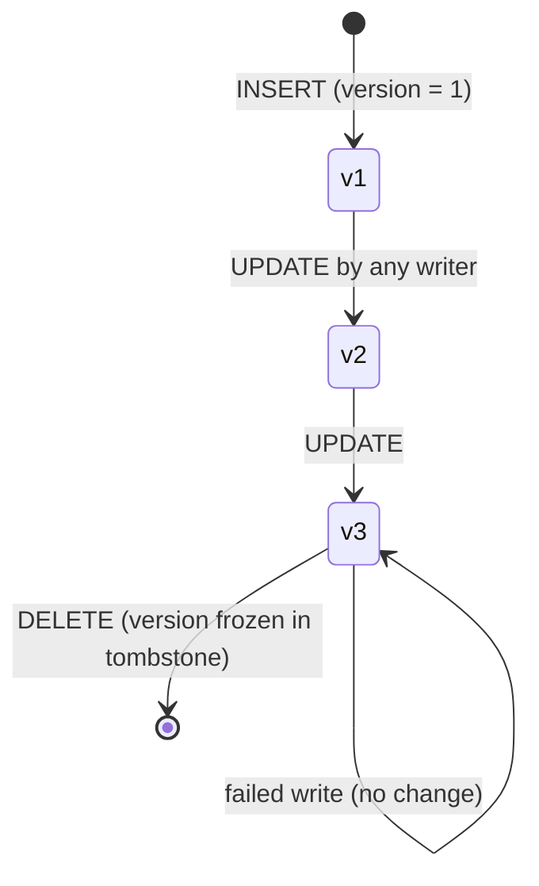
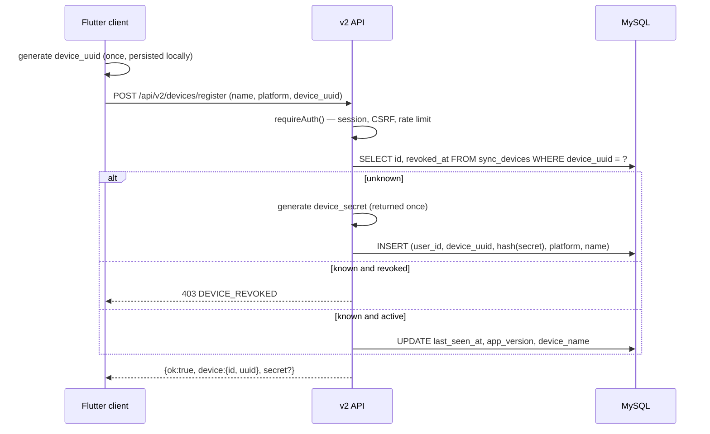

# Database Schema Specification

| Field | Value |
|---|---|
| Status | Specification — Phase 2. **Nothing in this document is executed.** |
| Date | 2026-11-15 |
| Purpose | DDL-level specification of every proposed database object: column additions, six new tables, change-capture triggers, indexes, and the impact answers required before any migration is written |
| Authority | Existing structures are described by [`DATABASE_AUDIT.md`](../DATABASE_AUDIT.md) and `schema.sql`. This document specifies only additions |
| Rule | Every object below is `PROPOSED` and requires owner approval. No migration file, no `schema.sql` edit, and no database change is authorised by this document |

---

## 1. Scope and status vocabulary

| Marker | Meaning |
|---|---|
| **EXISTS** | Present in `schema.sql` today; not modified |
| **MODIFIED** | Present today; receives new columns or a definition change. Existing columns keep their names and meaning |
| **ADDED** | Proposed new object |
| **UNRESOLVED** | Shape depends on an open decision; not specified to DDL level |

This document is the DDL authority for the sync structures. It must agree with
[`VERSIONING_AND_CONFLICT_RESOLUTION.md`](VERSIONING_AND_CONFLICT_RESOLUTION.md) (policy) and
[`../synchronization/SYNCHRONIZATION_ARCHITECTURE.md`](../synchronization/SYNCHRONIZATION_ARCHITECTURE.md)
(protocol). Where they disagree, whichever contradicts an `ACCEPTED` decision in
[`../architecture/ARCHITECTURE_DECISIONS.md`](../architecture/ARCHITECTURE_DECISIONS.md) is the
defective document.

---

## 2. Object inventory

### 2.1 New objects

| Object | Type | Status | Section |
|---|---|---|---|
| `expenses.uuid`, `.version`, `.updated_at`, `.is_detached` | columns | MODIFIED | §3, §7.3 |
| `budgets.uuid`, `.version`, `.updated_at` (redefined) | columns | MODIFIED | §3 |
| `groups.uuid`, `.version`, `.updated_at`, `.status`, archival columns | columns | MODIFIED | §3, §5.4.5 |
| `lists.uuid`, `.version`, `.updated_at` | columns | MODIFIED | §3 |
| `list_items.uuid`, `.version`, `.updated_at` | columns | MODIFIED | §3 |
| `group_members.uuid`, `.version`, `.updated_at` | columns | MODIFIED | §3 |
| `settlements.uuid`, `.version`, `.updated_at` | columns | MODIFIED | §3 |
| `sync_devices` | table | ADDED | §5.1 |
| `app_sessions` | table | ADDED | §5.1.3 |
| `sync_change_log` | table | ADDED | §5.2 |
| `sync_tombstones` | table | ADDED | §5.4 |
| `sync_batches` | table | ADDED | §5.7 |
| `guest_import_batches` | table | ADDED | §5.8 |
| `guest_import_items` | table | ADDED | §5.8 |
| 28 change-capture triggers | triggers | ADDED | §5.6 |
| 19 indexes | indexes | ADDED | §8 |

### 2.2 Tables deliberately untouched

`users`, `categories`, `notifications`, `settlement_confirmations`,
`post_settlement_confirmations`, `rate_limits`, `outbox_events`.

| Table | Why untouched |
|---|---|
| `users` | The identity row is not a synchronised record. Anonymisation fields depend on UQ-02 (UNRESOLVED) |
| `categories` | Deployment-seeded, shared, identical on every device |
| `notifications` | Outside the sync store by D-19 |
| `settlement_confirmations`, `post_settlement_confirmations` | Server-only operations (D-17); keyed by group + user, so a version/cursor design would be meaningless |
| `rate_limits` | Operational counters |
| `outbox_events` | Dormant; the write side is unwired and it is not a sync mechanism |

---

## 3. Column additions to existing tables

### 3.1 `uuid` — canonical record identity (ADDED for all 7; DB-01)

**Decision:** D-12. **Requirement:** DB-01, VC-01.

```sql
-- Shape added to each of: expenses, budgets, groups, lists, list_items, group_members, settlements
uuid CHAR(36) CHARACTER SET ascii COLLATE ascii_bin NOT NULL,
UNIQUE KEY uq_<table>_uuid (uuid)
```

| Property | Value | Reason |
|---|---|---|
| Type | `CHAR(36)` | Human-readable during support work; a full 36-character UUID text |
| Character set | `ascii` | Only `[0-9a-f-]` is ever stored |
| Collation | `ascii_bin` | Exact, case-sensitive match; no collation-dependent `UNIQUE` surprises |
| Nullability | `NOT NULL` after backfill (§3.6) | A syncable row without an identity is not addressable |
| Value source | Client-generated UUIDv7 (fallback v4) for new rows; generated server-side for pre-existing rows and for rows created by the legacy UI | D-12 |
| Index | Unique | Duplicate generation must fail loudly as `409`, never silently corrupt |

**The `id` column remains.** `id` is the internal surrogate and the FK target inside MySQL. The wire
identity of a new record is its `uuid`; existing records are addressed by `uuid` after backfill.
No foreign key in this design uses `uuid`.

**UUIDv7 vs v4.** The design depends on uniqueness, not ordering. If the selected Dart package has no
v7 implementation, v4 is acceptable and requires no schema change
(`ARCHITECTURE_DECISIONS.md` D-12 trade-offs).

**Server-side generation rules.**

| Writer | UUID source |
|---|---|
| v2 push (client-created record) | The `uuid` supplied by the client. If absent or malformed → operation rejected |
| v1 endpoint (legacy UI) | Server generates a UUIDv7 before `INSERT` (a v1 write must produce a syncable row) |
| Change-capture trigger | Never generates; it only reads `NEW.uuid` / `OLD.uuid` |
| Migration backfill | Server generates, ordered by `id` so early rows get earlier v7 timestamps |
| Guest import | The guest record's locally generated UUID is preserved (D-04: identifiers preserved where appropriate) |

**Duplicate handling.** `uq_<table>_uuid` turns a collision into error 1062. v2 push maps this to
`409 DUPLICATE_ID` and returns the existing record. Because UUIDv7 is time-ordered and per-device
generated, a collision indicates a client bug, not normal operation.

### 3.2 `version` — server-maintained record version (ADDED for all 7; VC-01)

**Decision:** D-06. **Requirements:** VC-01, VC-02.

```sql
version INT UNSIGNED NOT NULL DEFAULT 1
```

| Property | Value | Reason |
|---|---|---|
| Initial value | `1` on insert | Every row has a version from birth; no NULL case to handle |
| Increment | `+1` on every update, by the `BEFORE UPDATE` trigger (§5.6) | Independent of writer: v1, v2, CLI, or a future Laravel module |
| Never decrements | `UPDATE … SET version = version + 1` only | A decrement would make an old conflict reappear |
| Wire use | The client sends `base_version`; a mismatch is a conflict | D-06 |
| Maximum | `INT UNSIGNED` (≈4.29 × 10⁹) | Reaching it requires ~4 billion edits of one row |
| In `sync_change_log.version` | The version **after** the write | So a client can set its local version directly from the change entry |

**What does not change version:** a read, a failed write, a suppressed migration write, a
`SELECT … FOR UPDATE`, or a change to a non-syncable table. A migration that backfills data **must**
set `@expmg_sync_suppress = 1`; the trigger still bumps the version (harmless: no client has seen
the old value), but no change-log row is emitted.

**v1 compatibility.** [`../../AGENTS.md`](../../AGENTS.md) and `API_CONTRACT.md` §14 forbid changing v1 behaviour. A v1 write
does not check or send a version. It updates the row; the trigger bumps the version and logs a
change. The legacy UI is unaffected, and sync clients see the change. This is the accepted behaviour
recorded in D-06 ("legacy v1 writes still succeed without a version check, but they bump the
version"). v1 responses are **not** given new fields — `version` is exposed only through v2
(`API_VERSIONING.md` §4).

### 3.3 `updated_at` precision (MODIFIED)

**Requirement:** VC-02; `DATABASE_AUDIT.md` §7.2 ("second granularity allows ties").

```sql
updated_at DATETIME(6) NOT NULL DEFAULT CURRENT_TIMESTAMP(6) ON UPDATE CURRENT_TIMESTAMP(6)
```

| Table | Before | After |
|---|---|---|
| `expenses`, `budgets`, `groups` | `TIMESTAMP` (second precision), auto-update | `DATETIME(6)`, auto-update retained |
| `lists`, `list_items`, `group_members`, `settlements` | no column | column added (§3.4) |

**Why change `TIMESTAMP` → `DATETIME(6)`:**

| Reason | Explanation |
|---|---|
| Uniformity | One definition, one trigger template, one client mapping for all seven syncable tables |
| Microsecond precision | The change log records `changed_at DATETIME(6)`; matching precision keeps a row's `updated_at` and its log entry comparable |
| Explicit value | The `BEFORE UPDATE` trigger assigns the value; `ON UPDATE` remains as a behaviour-preserving safety net for any writer that bypasses the trigger |
| Range | `DATETIME` has no 2038 upper bound; `TIMESTAMP` does |

**Conversion semantics (must be handled deliberately).** `TIMESTAMP` stores UTC and converts to the
session time zone on read/write; `DATETIME` stores the literal wall-clock value. The conversion
migration must therefore `SET time_zone = '<the application time zone>'` for the session before the
`ALTER`, and must be verified by comparing a sample of values before and after. Procedure:
`DATABASE_MIGRATION_STRATEGY.md` §4 step M3.

**Alternative considered and rejected:** keeping `TIMESTAMP` on the three tables that have it. It
produces mixed precision across syncable tables and a trigger that truncates microseconds on some
tables but not others — a defect class that would be found months later in reconciliation output.

### 3.4 `updated_at` added (ADDED for 4 tables)

`lists`, `list_items`, `group_members`, `settlements` receive the column in §3.3's shape.

The backfill value for existing rows is derived in this order: `created_at` where present, otherwise
the row's creation event reconstructed from the change log's absence (a migrated row is stamped with
the migration time rather than guessed).

### 3.5 `uuid` index definition (ADDED)

One unique index per table, named by the existing convention `uq_<table>_uuid`
(cf. `uq_group_user`, `uq_user_month`):

```sql
UNIQUE KEY uq_expenses_uuid (uuid)
UNIQUE KEY uq_budgets_uuid (uuid)
UNIQUE KEY uq_groups_uuid (uuid)
UNIQUE KEY uq_lists_uuid (uuid)
UNIQUE KEY uq_list_items_uuid (uuid)
UNIQUE KEY uq_group_members_uuid (uuid)
UNIQUE KEY uq_settlements_uuid (uuid)
```

| Property | Value |
|---|---|
| Key length | 36 bytes (`ascii`), well under the 767-byte limit for any InnoDB row format |
| Purpose | Identity on the wire, duplicate detection, change-log join by `(entity, entity_uuid)` |
| Not the primary key | `id` remains the clustered primary key; inserting a random-ish `uuid` does not fragment the clustered index |
| Insert locality | UUIDv7 is time-ordered, so the unique index inserts near the end of its range |

### 3.6 Backfill rules for existing rows

A populated table cannot receive `NOT NULL` without a value. Each table therefore takes three
steps, in one migration, with `@expmg_sync_suppress = 1`:

| Step | Statement | Note |
|---|---|---|
| 1 | `ALTER TABLE <t> ADD COLUMN uuid CHAR(36) CHARACTER SET ascii COLLATE ascii_bin NULL` | Accepts NULL temporarily |
| 2 | Backfill ordered by `id`: `UPDATE <t> SET uuid = <generated> WHERE uuid IS NULL AND id BETWEEN ? AND ?` | Batched (for example 1 000 rows) to keep transactions short; the batch boundary is a `WHERE id > ? ORDER BY id LIMIT 1000` loop, not an `OFFSET` |
| 3 | `ALTER TABLE <t> MODIFY uuid CHAR(36) … NOT NULL, ADD UNIQUE KEY uq_<t>_uuid (uuid)` | Fails loudly if step 2 missed a row — the desired failure mode |

`version` is added with `DEFAULT 1` in a single step, so existing rows get `1` without a backfill
(this is why acceptance criterion VC-01 requires "server-maintained version" and not
"server-maintained non-NULL version").

| Table | Rows affected | Expected time |
|---|---|---|
| `expenses` | Thousands | Seconds |
| `list_items` | Hundreds–thousands | Seconds |
| Others | Tens–hundreds | Negligible |

### 3.7 Column matrix

| Table | `uuid` | `version` | `updated_at` | Existing `created_at` |
|---|---|---|---|---|
| `expenses` | ADDED | ADDED | MODIFIED | EXISTS |
| `budgets` | ADDED | ADDED | MODIFIED | EXISTS |
| `groups` | ADDED | ADDED | MODIFIED | EXISTS |
| `lists` | ADDED | ADDED | ADDED | EXISTS |
| `list_items` | ADDED | ADDED | ADDED | EXISTS |
| `group_members` | ADDED | ADDED | ADDED | EXISTS as `joined_at`; `updated_at` is new |
| `settlements` | ADDED | ADDED | ADDED | EXISTS |

### 3.8 Triggers on the modified tables

Each MODIFIED table receives four triggers (§5.6). Three are `AFTER` (insert, update) or `BEFORE`
(delete); one is `BEFORE UPDATE` for the version bump. Trigger creation is part of the same
migration as the column additions, ordered **after** the backfill so that no backfill write is
logged.

### 3.9 Existing column semantics preserved

Nothing in this section changes the meaning of an existing column.

| Column | Preserved meaning | Where stated |
|---|---|---|
| `expenses.paid_by` | The actual payer; the settlement GROUP BY key | [`DATA_OWNERSHIP.md`](DATA_OWNERSHIP.md) §4, §7.1 below |
| `expenses.is_post_settlement` | Late-expense marker; excluded from normal aggregates | §7.2 |
| `expenses.type`, `expenses.group_id` | Personal vs group classification; `group_id` may be NULL | §7.3 |
| `list_items.expense_id` | The exact link used for uncheck deletion | [`../../AGENTS.md`](../../AGENTS.md) |
| `list_items.checked_at` | A datetime; must be converted with `date('Y-m-d', …)` where a date is required | [`../../AGENTS.md`](../../AGENTS.md) |
| `settlements.amount` | `>= 0`; `0.00` marker rows are valid | §3.11 |
| `settlements.period_start/period_end` | The atomic unit of the settlement lock | §7.2 |
| `group_members.role` | `admin` \| `member`; the authorisation source | `DATA_OWNERSHIP.md` §4 |
| `groups.max_members` | Capacity limit, `> 0` | §7.4 |

### 3.10 Columns deliberately not added

| Not added | Why |
|---|---|
| `deleted_at` / `is_deleted` on any table | D-20: would require `WHERE deleted_at IS NULL` in every existing query — a silent regression across 40 endpoints |
| A second timestamp column (`synced_at`, `server_updated_at`) | `updated_at` plus the change log already carry this information; a second column would drift |
| `last_synced_by_device` on business tables | Device attribution belongs in the change log, not on the row (one row can be changed by many devices) |
| `owner_id` renaming for `user_id` | Renaming breaks every existing query for no benefit; `DATA_OWNERSHIP.md` §3 maps the roles instead |
| `uuid` on `categories`, `notifications` | Not synchronised |
| A `row_hash` column | The reconciliation digest is computed at query time; storing it would need maintenance on every write |

### 3.11 Settlement amount semantics preserved (PR-08) — EXISTS, unchanged

**Requirement:** PR-08. **Referenced by:** `REQUIREMENTS_TRACEABILITY.md`.

`settlements.amount` keeps `CHECK (amount >= 0)` — deliberately **not** `> 0`.

| Rule | Statement |
|---|---|
| `0.00` marker rows are valid | When a period closes with all balances equal, `confirm.php`/`recordSettlement()` writes a `0.00` row |
| The marker is functional, not cosmetic | It advances `MAX(period_end)` for the group, which **is** the settlement lock |
| Removing the marker would unlock settled periods | A later edit to an expense inside the closed period would then be accepted — the exact defect class v1.3 fixed |
| `sync_tombstones.last_version` applies to markers too | A `0.00` settlement is a normal syncable `settlement` entity with a `uuid` and `version` |
| The client must not filter zero-amount settlements | A client-side `amount > 0` filter would hide the lock from users and is a defect |

**Consequence for the sync protocol:** the change log records settlement rows regardless of amount,
and a client pulling changes must apply zero-amount settlements exactly like any other, because the
client's cached knowledge of "latest settled period" depends on them.

**Test obligation:** the migration and sync implementation must include a case that closes a period
with equal balances, confirms a `0.00` settlement exists, and asserts that an edit inside that period
is still rejected (`ARCHITECTURE_VALIDATION_PLAN.md` §6, VC-14).

---

## 4. Version model (VC-01, VC-02)

**Requirement:** VC-01 "every syncable row carries a server-maintained version"; VC-02 "version
increments on every update regardless of writer".

### 4.1 Lifecycle



| Transition | Effect on `version` | Effect on `sync_change_log` | Effect on `sync_tombstones` |
|---|---|---|---|
| Insert | Set to `1` (column default) | `op='insert'`, `version=1`, snapshot | none |
| Update | `+1` (BEFORE UPDATE trigger) | `op='update'`, `version=NEW.version`, snapshot | none |
| Delete | Not applicable — row is gone | `op='delete'`, `version=OLD.version`, last snapshot | Row written with `last_version = OLD.version` |
| Suppressed write (migration) | `+1` | none | none |
| Failed write | none | none | none |

### 4.2 Concurrency contract

| Rule | Statement |
|---|---|
| VC-01 | The column is `NOT NULL DEFAULT 1` on all seven syncable tables |
| VC-02 | Only the trigger increments it, so every writer is covered — including writers that do not know sync exists |
| Conflict precondition | A v2 update/delete must supply `base_version`. Absent → `400 MISSING_BASE_VERSION` |
| Conflict detection | `UPDATE … WHERE uuid = ? AND version = ?`; zero rows affected means either a version conflict or a missing row, distinguished by a follow-up `SELECT` |
| Never trust the client's version | The server compares against the stored value; the client's claim is a precondition, not an authority |
| Version is not a cursor | Cursors use `sync_change_log.seq`. A version is per-row; a cursor is global |

### 4.3 Interaction with `updated_at`

| Situation | `version` | `updated_at` |
|---|---|---|
| Two updates in the same microsecond | Two distinct versions | Equal values — which is why timestamp comparison is never the conflict test |
| A clock adjustment on the server | Unaffected | The stored value follows server time; `seq` ordering is unaffected |
| Client clock | Ignored entirely | Never written from a client value |

**Statement of the accepted rule (D-06):** timestamps support auditing, synchronisation, and
ordering; timestamps alone must never be treated as proof that no concurrent modification occurred.

---

## 5. Sync infrastructure

### 5.1 `sync_devices` (ADDED; DB-03)

**Requirement:** DB-03 "device registration is persisted". **Decision:** D-25 (`NEEDS APPROVAL` for
revocation scope), UQ-04, UQ-17.

```sql
CREATE TABLE IF NOT EXISTS sync_devices (
  id                INT UNSIGNED AUTO_INCREMENT PRIMARY KEY,
  user_id           INT UNSIGNED NOT NULL,
  device_uuid       CHAR(36) CHARACTER SET ascii COLLATE ascii_bin NOT NULL,
  device_secret_hash VARCHAR(255) NOT NULL,
  platform          VARCHAR(32) NOT NULL DEFAULT 'unknown',
  app_version       VARCHAR(32) DEFAULT NULL,
  device_name       VARCHAR(100) DEFAULT NULL,
  last_seen_at      DATETIME(6) DEFAULT NULL,
  revoked_at        DATETIME(6) DEFAULT NULL,
  created_at        DATETIME(6) NOT NULL DEFAULT CURRENT_TIMESTAMP(6),
  UNIQUE KEY uq_device_uuid (device_uuid),
  KEY idx_devices_user_seen (user_id, last_seen_at),
  CONSTRAINT fk_devices_user FOREIGN KEY (user_id) REFERENCES users(id) ON DELETE CASCADE
) ENGINE=InnoDB DEFAULT CHARSET=utf8mb4 COLLATE=utf8mb4_general_ci;
```

| Column | Purpose |
|---|---|
| `device_uuid` | The client-generated identity presented as `X-Device-Id`. Unique across the whole installation: a device belongs to exactly one account |
| `device_secret_hash` | The credential that proves device continuity, presented as `X-Device-Secret`. Hashed like a password (bcrypt). **Why a secret is required:** without one, a client could simply invent a new `device_uuid` and escape a revocation |
| `platform`, `app_version`, `device_name` | Support and diagnostics; never used for authorisation |
| `last_seen_at` | The device list UI; also lets an administrator spot an abandoned device |
| `revoked_at` | Non-NULL means the device cannot push or pull (§5.1.1) |

#### 5.1.1 Revocation semantics

Under owner-approved **Option (b)** (D-25, UQ-04), revocation operates through both `sync_devices.revoked_at` and the database-backed `app_sessions` table. The table below represents the canonical three-effect contract:

| # | Capability | Effect of revocation | Enforced by |
|---|---|---|---|
| 1 | **Sync privilege** — push/pull | **Revoked immediately** (`403 DEVICE_REVOKED`) | The v2 sync gateway, on every sync request |
| 2 | **Authenticated session** — any authenticated endpoint | **Revoked immediately** (`401 Session expired/revoked`); row deleted from `app_sessions` | `requireAuth()` middleware via `app_sessions` verification across all 40 v1 endpoints and all v2 endpoints |
| 3 | **Access to downloaded local data** — the client's Drift store | **Unaffected by the server.** Client policy prompts for password; cache preserved encrypted | The client, as a product policy — not a server guarantee |

| Rule | Statement |
|---|---|
| Universal invalidation | Revoking a device atomically sets `sync_devices.revoked_at = NOW(6)`, purges matching rows from `app_sessions`, and revokes native remember credentials |
| Offline limitation | If a device is offline, local data access is gated solely by OS hardware encryption and local app lock timeout until next network contact |
| Re-registration policy | Re-registering hardware requires a fresh, authenticated login with password |
| `users` deletion | Handled via account deletion lifecycle (UQ-02): personal rows purged, shared financial rows preserved with original username retained and context badge |

#### 5.1.2 Registration flow (summary)



`device_secret` is returned **once**, at registration. The client stores it in
`flutter_secure_storage`. Full contract: [`../api/SYNC_API_SPECIFICATION.md`](../api/SYNC_API_SPECIFICATION.md) §4.2.

### 5.2 `sync_change_log` (ADDED; DB-04)

**Requirement:** DB-04 "change tracking is ordered and queryable". **Decision:** D-11.

```sql
CREATE TABLE IF NOT EXISTS sync_change_log (
  seq              BIGINT UNSIGNED AUTO_INCREMENT PRIMARY KEY,
  entity           VARCHAR(32) NOT NULL,
  entity_uuid      CHAR(36) CHARACTER SET ascii COLLATE ascii_bin NOT NULL,
  entity_id        INT UNSIGNED DEFAULT NULL,
  op               ENUM('insert','update','delete','move_out') NOT NULL,
  version          INT UNSIGNED NOT NULL,
  payload_json     LONGTEXT DEFAULT NULL,
  scope_user_id    INT UNSIGNED DEFAULT NULL,
  scope_group_id   INT UNSIGNED DEFAULT NULL,
  actor_user_id    INT UNSIGNED DEFAULT NULL,
  actor_device_uuid CHAR(36) CHARACTER SET ascii DEFAULT NULL,
  changed_at       DATETIME(6) NOT NULL,
  KEY idx_log_entity_uuid (entity, entity_uuid, seq),
  KEY idx_log_scope_user (scope_user_id, seq),
  KEY idx_log_scope_group (scope_group_id, seq),
  KEY idx_log_changed_at (changed_at)
) ENGINE=InnoDB DEFAULT CHARSET=utf8mb4 COLLATE=utf8mb4_general_ci;
```

| Column | Purpose |
|---|---|
| `seq` | The global cursor. Monotonic, append-only. Never updated, never reused |
| `entity` | `expense`, `budget`, `list`, `list_item`, `group`, `group_member`, `settlement` |
| `entity_uuid` | The record's wire identity. **No FK** — the record may be deleted and the log entry must survive |
| `entity_id` | The surrogate key at write time; useful for support joins while the row exists. `NULL` for a delete if it was already gone |
| `op` | `insert` / `update` / `delete` / `move_out` (§5.6.4) |
| `version` | The version **after** the write (`OLD.version` for a delete) |
| `payload_json` | Full row snapshot (business columns only) for `insert` and `update`; the last snapshot for `delete`. `NULL` only if the trigger could not read the row |
| `scope_user_id` | The user who must see this change (row owner) — denormalised so visibility filtering never joins a deleted row |
| `scope_group_id` | The group whose members must see this change |
| `actor_user_id` | Who performed the write, from `@expmg_actor_user_id` (nullable for CLI writes) |
| `actor_device_uuid` | Which device, from `@expmg_device_uuid` (nullable for v1/legacy writes) |
| `changed_at` | Server time, microseconds. Used only for the watermark rule (D-27) and diagnostics — never for ordering clients |

#### 5.2.1 Visibility model

A change is visible to a user when:

```
scope_user_id = :me
  OR scope_group_id IN (SELECT group_id FROM group_members WHERE user_id = :me)
```

| Entity | `scope_user_id` | `scope_group_id` |
|---|---|---|
| `expense` | `NEW.user_id` (the owner) | `NEW.group_id` |
| `budget` | `NEW.user_id` | `NULL` |
| `list` | `NEW.user_id` (creator) | `NEW.group_id` |
| `list_item` | the parent list's `user_id` | the parent list's `group_id` |
| `group` | `NEW.created_by` | `NEW.id` |
| `group_member` | `NEW.user_id` | `NEW.group_id` |
| `settlement` | `NULL` | `NEW.group_id` |

**Rule:** scope values are computed **inside the trigger from the row**, not supplied by the
application. A bug in an endpoint cannot produce an invisible change. For `list_item`, the trigger
reads the parent list to obtain both scopes.

**Visibility is evaluated against *current* membership.** The group clause resolves through
`group_members` as it exists at read time. This is deliberate — a user who has been removed must stop
receiving the group's changes immediately — but it has one consequence the deletion design must
compensate for: **a group-scoped tombstone is invisible to a user whose membership row has just been
deleted.** Group deletion removes every membership row, so the `group` tombstone alone would reach
nobody. §5.4.3 defines the per-member compensation tombstones that close this hole.

#### 5.2.2 Ordering and the cursor hazard (D-27)

`AUTO_INCREMENT` values are allocated before commit, so a reader can observe `seq = 101` without
`seq = 100` having committed. Mitigations, all required:

| # | Mitigation |
|---|---|
| 1 | The pull query returns only `seq <= watermark`, where `watermark` is the highest `seq` whose `changed_at <= now() - 2 s` |
| 2 | The client never advances past the server-supplied `next_cursor` |
| 3 | Every pull response carries per-entity digests computed by the canonical algorithm in `../api/SYNC_API_SPECIFICATION.md` §6.5; the client compares them during reconciliation |

**Ordering within one transaction.** Two writes in the same transaction receive increasing `seq`
values in statement order. When a single logical operation emits more than one log row, the rows are
emitted in this order:

| Operation | Row order |
|---|---|
| Expense moves between scopes (§5.6.4) | `move_out` for the **old** scope, then `update` for the **new** scope |
| Group deletion (§5.4.3) | (1) an explicit detach `UPDATE` for every `expenses` row still pointing at the group → each emits `move_out` (old group scope) then `update` (owner scope); (2) the `group` delete row and tombstone; (3) one `group_member` delete row and tombstone per current member |

A client that applies the page in `seq` order therefore never sees a new-scope payload before the
old-scope removal, never sees a group's rows after the tombstone that purges them, and — critically
for §5.4.3 — has already detached a surviving expense from the group before the purge that would
otherwise delete it.

**Consequence for the schema:** `idx_log_changed_at` exists to compute the watermark efficiently.

### 5.3 Retention and pruning (UQ-09)

**Requirement:** referenced by UQ-09; not a requirement ID of its own.

| Data | Retention | Mechanism | Rationale |
|---|---|---|---|
| `sync_change_log` | **90 days** (recommended) | CLI script `scripts/prune_sync_log.php` (proposed, not created) | Bounds growth; a device whose cursor predates the oldest row re-bootstraps |
| `sync_tombstones` | **Indefinite** (recommended) | Never pruned | Rows are tiny; retention prevents a deleted UUID from being "unknown" to a client that has been offline for months |
| `sync_batches` | 45 days after completion (recommended) | Same CLI script | A retry beyond 45 days is a new operation, not a replay |
| `guest_import_*` | Life of the account | Never pruned | Audit trail for a data-moving operation |

**All four values are recommendations pending UQ-09. None is `ACCEPTED`.** The single recommendation
for `sync_batches` is **45 days after completion**; it appears identically in
`../database/DATABASE_DESIGN.md` §4.3 and UQ-09. Retention is a proposal, not an approved policy —
do not present it to a user as a guarantee, and do not implement a pruner that assumes it is settled.

#### 5.3.1 Bootstrap trigger

A device whose cursor is older than `MIN(seq)` of the retained change log cannot be served an
incremental delta. The pull endpoint responds `410 CURSOR_TOO_OLD`; the client performs a full
bootstrap. This is a normal, expected path and must be tested explicitly
(`ARCHITECTURE_VALIDATION_PLAN.md` §6, SY-16).

#### 5.3.2 Pruning rules

| Rule | Statement |
|---|---|
| Pruning is `DELETE FROM sync_change_log WHERE seq <= :cutoff AND changed_at < :cutoff_time` | Both conditions, so a long-running transaction's late commit cannot lose a visible change |
| Pruning never touches `sync_tombstones` | Tombstones outlive the log by design (DB-05) |
| Pruning runs as a CLI worker with `@expmg_sync_suppress = 1` | Deleting log rows must not itself attempt to log |
| Pruning is batched (for example 5 000 rows per statement) | Avoids a long transaction holding an open read view |
| `AUTO_INCREMENT` is never reset | Reusing a `seq` would silently skip changes on a device |

### 5.4 `sync_tombstones` (ADDED; DB-05, D-20, SY-10)

**Requirements:** DB-05 "tombstones persist beyond change-log retention"; SY-10 "deletions propagate
to offline devices". **Decision:** D-20.

```sql
CREATE TABLE IF NOT EXISTS sync_tombstones (
  seq             BIGINT UNSIGNED AUTO_INCREMENT PRIMARY KEY,
  entity          VARCHAR(32) NOT NULL,
  entity_uuid     CHAR(36) CHARACTER SET ascii COLLATE ascii_bin NOT NULL,
  last_version    INT UNSIGNED NOT NULL,
  scope_user_id   INT UNSIGNED DEFAULT NULL,
  scope_group_id  INT UNSIGNED DEFAULT NULL,
  actor_user_id   INT UNSIGNED DEFAULT NULL,
  cause           ENUM('api','cascade','purge') NOT NULL DEFAULT 'api',
  deleted_at      DATETIME(6) NOT NULL,
  UNIQUE KEY uq_tombstone (entity, entity_uuid),
  KEY idx_tomb_scope_user (scope_user_id, seq),
  KEY idx_tomb_scope_group (scope_group_id, seq),
  KEY idx_tomb_deleted_at (deleted_at)
) ENGINE=InnoDB DEFAULT CHARSET=utf8mb4 COLLATE=utf8mb4_general_ci;
```

| Column | Purpose |
|---|---|
| `entity`, `entity_uuid` | What was deleted. The `UNIQUE` key makes a re-delete idempotent (`INSERT … ON DUPLICATE KEY UPDATE`) |
| `last_version` | The version the row had when deleted. A client compares this with its local base version to decide "delete wins" vs "conflict" (`DATA_FLOW.md` §9 rule) |
| `scope_*` | Same visibility rule as the change log (§5.2.1) |
| `cause` | `api` (endpoint delete), `cascade` (written by a cascade-compensation path), `purge` (retention/admin) |
| `deleted_at` | Server time |

#### 5.4.1 Why a separate table rather than only a change-log row

| Reason | Explanation |
|---|---|
| Retention mismatch | The log is 90 days; a deletion must remain answerable for years (DB-05) |
| Correctness, not storage | "Absence" and "not yet downloaded" are indistinguishable; a durable tombstone removes the ambiguity |
| No foreign key, no cascade | The tombstone exists because the row is gone; any FK would destroy it |
| Small | One short row per deleted entity — thousands of rows after years |

#### 5.4.2 Cascade compensation: the rule and its limits

Because InnoDB cascade actions do not fire triggers (F-03), a cascade delete produces no tombstone
for the cascaded rows. The protocol compensates in two ways, and both are needed:

| Rule | Statement |
|---|---|
| A parent tombstone purges the child subtree **for users who can still see the parent** | `group` tombstone → the client deletes that group's members, lists, items, and settlements locally |
| A parent tombstone is **not** sufficient when the deletion removes the visibility key itself | Group deletion deletes every `group_members` row, so `scope_group_id`-based visibility resolves to nobody (§5.2.1). This is the hole §5.4.3 closes with per-member tombstones |
| A cascade from `users` also requires an account-level event | Handled by the deletion policy (D-23, UQ-02), not by this table |
| Deleting a `group` leaves orphaned group expenses | UQ-11 / D-26. Those expenses are **not** cascaded. They are detached explicitly (§5.4.4), so they are ordinary logged changes visible to their owner |

`cause='cascade'` is what the per-member compensation rows use (§5.4.3).

#### 5.4.3 Group deletion: per-member compensation (F-03 / correction)

**The problem in one line.** `DELETE FROM groups` cascades `group_members`, `lists`, `list_items`,
`settlements`, `settlement_confirmations` and `post_settlement_confirmations`; no child trigger
fires; and the `group` tombstone is group-scoped, so once the membership rows are gone it is visible
to no one. A former member would keep a full cached copy of the group for ever.

**The fix.** `trg_groups_bd` (a `BEFORE DELETE` trigger on `groups`) emits, in one transaction:

1. the `group` change-log delete row and tombstone (`scope_group_id = OLD.id`,
   `scope_user_id = OLD.created_by`) — retained for the admin and for any user who still resolves
   visibility through another path; and
2. **one `group_member` delete row and tombstone per current member**, with
   `scope_user_id = member.user_id` and **`scope_group_id = NULL`**, `cause='cascade'`.

`scope_group_id` must be `NULL` on the compensation rows: that is the whole point. The row becomes
visible through the `scope_user_id = :me` clause, which does not depend on the membership row that is
about to disappear. Every former member therefore receives a tombstone for **their own**
`group_member` row.

**Why that is enough.** The client already treats a tombstone for its own `group_member` row exactly
like a group tombstone: purge the group subtree (`SYNC_WORKFLOWS.md` §6.2). Lists, items,
settlements and confirmations are **not** individually tombstoned — the member tombstone purges them.
That is why `T-SYNC-10` is stated in terms of the member tombstone, not "parent plus every child"
(§15.2 of this document's companion validation plan).

```sql
-- Conceptual; A-DB-4 verifies that cross-table DML is permitted here.
CREATE TRIGGER trg_groups_bd BEFORE DELETE ON groups
FOR EACH ROW
BEGIN
  IF COALESCE(@expmg_sync_suppress, 0) <> 1 THEN
    -- 1. Detach surviving expenses first, so their owners keep them (see §5.4.4).
    UPDATE expenses SET group_id = NULL
     WHERE group_id = OLD.id AND group_id IS NOT NULL;

    -- 2. The group's own delete row + tombstone.
    INSERT INTO sync_change_log (...) VALUES ('group', OLD.uuid, OLD.id, 'delete', OLD.version, ...);
    INSERT INTO sync_tombstones (...) VALUES ('group', OLD.uuid, OLD.version, OLD.created_by, OLD.id, ...);

    -- 3. One personally-scoped tombstone per current member.
    INSERT INTO sync_change_log (entity, entity_uuid, entity_id, op, version, payload_json,
                                 scope_user_id, scope_group_id, actor_user_id, actor_device_uuid, changed_at)
      SELECT 'group_member', gm.uuid, gm.id, 'delete', gm.version, NULL,
             gm.user_id, NULL, @expmg_actor_user_id, @expmg_device_uuid, NOW(6)
        FROM group_members gm WHERE gm.group_id = OLD.id;

    INSERT INTO sync_tombstones (entity, entity_uuid, last_version, scope_user_id, scope_group_id,
                                 actor_user_id, cause, deleted_at)
      SELECT 'group_member', gm.uuid, gm.version, gm.user_id, NULL,
             @expmg_actor_user_id, 'cascade', NOW(6)
        FROM group_members gm WHERE gm.group_id = OLD.id;
  END IF;
END;
```

| Rule | Statement |
|---|---|
| The member rows are read **before** the cascade | A `BEFORE DELETE` trigger on the parent runs before InnoDB deletes the children, so `group_members` is still populated |
| No double emission | The cascade itself fires no child trigger, so the compensation rows are the only ones |
| The compensation rows are `cause='cascade'` | Distinguishes them from an ordinary leave/remove (§5.4.2) |
| `ON DUPLICATE KEY UPDATE` on the tombstones | A retried or re-entered delete cannot duplicate a row |
| A member who left earlier is not covered | Their membership row was already deleted and their own leave already produced a tombstone; nothing remains to purge |
| The same client rule covers leave, removal, and deletion | In every case the user receives a tombstone for their own `group_member` row |

**Idempotency and replay.** The whole trigger body runs in the deleting transaction. If the
transaction rolls back, every compensation row rolls back with it, so there is no partial purge. If
the endpoint is retried, the `group` row no longer exists, so the trigger does not fire again; the
client's bootstrap covers it.

#### 5.4.4 `expenses.group_id` on group deletion: explicit detach, not `ON DELETE SET NULL`

`expenses.group_id` carries `ON DELETE SET NULL`. **A referential action does not fire triggers**, so
if the schema relied on `SET NULL`, the expense would silently lose its group with no version bump,
no change-log row, and no way for its owner's other devices to learn of the change. That would be an
unlogged mutation of a syncable entity — a direct contradiction of D-13.

**Design.** The group-delete path performs the detach **explicitly, as ordinary DML**, before the
group row is deleted (§5.4.3 step 1):

| Step | Effect |
|---|---|
| `UPDATE expenses SET group_id = NULL WHERE group_id = OLD.id` | Fires `trg_expenses_bu` (version + 1) and `trg_expenses_au` (change-log row) for each row, exactly like any other expense update |
| The `AFTER UPDATE` row | `move_out` scoped to the **old** group, then `update` scoped to the owner (`NEW.user_id`, `NEW.group_id = NULL`) — §5.6.4 |
| InnoDB's later `ON DELETE SET NULL` | A **no-op**: every matching row already has `group_id = NULL`, so there is nothing left to set |
| An expense whose owner is a former member | Sees the `update` through `scope_user_id`; keeps the row as a detached personal expense |
| An expense whose owner is *not* the caller | Not visible to any other former member except through the group scope, which their own `group_member` tombstone purges |

**The retention rule (sub-item D).** An expense belongs to exactly one owner (`expenses.user_id`) and
at most one group. When the group is deleted:

| Actor | Local outcome |
|---|---|
| The expense's **owner** | Retains the expense. The `update` arrives before the purge; the row's local `group_uuid` is now `NULL`, so the subtree purge (which selects by `group_uuid = G`) does not select it. It remains in the owner's store preserving its historical group provenance (`type = 'group'`, `is_detached = 1`) — `type` is **not** rewritten to `'personal'` (which would falsify historical collective spending; UQ-11) |
| Every **other former member** | The row is purged with the group subtree. They never receive the `update`, because it is scoped to the owner |
| A device that was offline throughout | On reconnect it pulls the detach `update` and its own `group_member` tombstone in `seq` order and reaches the same outcome |

**Distinguishing Deliberate Conversions vs Group Deletions (UQ-11).** Existing rows already violate any `type='personal' ⇔ group_id IS
NULL` equivalence (F-02). An expense converted deliberately by user action becomes `type = 'personal'` with `group_id = NULL`.
In contrast, an expense detached by group deletion retains `type = 'group'` with `group_id = NULL` and `is_detached = 1`.
The trigger detach is a technical sync mechanism to preserve cursor ordering and prevent data stranding. The underlying *business policies*
(whether settlements must block group deletion under UQ-07, and distinguishing deliberate conversions from detached group expenses under UQ-11)
remain unresolved decisions requiring explicit owner approval.

**Verification (A-DB-4).** Two premises must be confirmed on both MariaDB 10.4.32 and MySQL 8
before implementation: (i) a trigger on `groups` may perform `UPDATE`/`INSERT` on other tables, and
(ii) `ON DELETE SET NULL` fires no trigger on the referencing table. If (i) is refused,
`DATABASE_MIGRATION_STRATEGY.md` records the fallback: the **v2** group-delete endpoint performs
steps 1–3 explicitly before `DELETE FROM groups`; the **frozen v1** delete emits only the group
tombstone, and the reconciliation digest (§6.5) detects the divergence on every former member's next
full pull cycle and repairs it with a targeted bootstrap.

### 5.5 Conflict records (VC-11)

**Requirement:** VC-11 "conflict records are retained for diagnosis".

**Design decision: no dedicated conflict table.** A conflict is recorded in two places that already
exist:

| Location | Retains | Lifetime |
|---|---|---|
| `sync_batches.result_json` (server) | The per-operation outcome, including `code`, `server` snapshot, and the client's submitted payload for every conflicting operation | 45 days (recommended, §5.3) |
| `sync_change_log` (server) | The row snapshots surrounding the conflict — what the row was before and after the winning write | 90 days |
| Client `conflicts` table (Drift) | The user-visible unresolved conflict, both versions, and the chosen resolution | Until resolved and dismissed by the user |

**Why not a `sync_conflicts` table:** the data would be a duplicate of `result_json`, a second write
on the hot path of every conflict, and a third retention policy to manage. `result_json` already
answers the diagnostic questions: *which operation, which base version, what the server held, what
the client sent, and what the final outcome was.*

**Diagnostic query (support):** find the batch by `batch_key` reported in the client's sync log, read
`result_json`, then read the change-log rows for that `entity_uuid` ordered by `seq`.

### 5.6 Change capture: version bump, change log, and actor context (ADDED; D-13, VC-02)

**Requirements:** VC-02, DB-04. **Decision:** D-13.

#### 5.6.1 Trigger inventory

| Table | Triggers | Events |
|---|---|---|
| `expenses` | 4 | `BEFORE UPDATE` (version), `AFTER INSERT`, `AFTER UPDATE`, `BEFORE DELETE` |
| `budgets` | 4 | same |
| `groups` | 4 | same |
| `lists` | 4 | same |
| `list_items` | 4 | same |
| `group_members` | 4 | same |
| `settlements` | 4 | same |
| **Total** | **28** | |

Naming: `trg_<table>_bu`, `trg_<table>_ai`, `trg_<table>_au`, `trg_<table>_bd`.

**One trigger does more than its own table's row.** `trg_groups_bd` also detaches surviving expenses
and emits per-member `group_member` tombstones (§5.4.3). It is still one of the four `groups`
triggers; the extra work exists only because InnoDB cascades bypass the child triggers. No other
trigger writes outside its own table.

#### 5.6.2 Why `BEFORE DELETE`, not `AFTER DELETE`

| Reason | Explanation |
|---|---|
| `AFTER DELETE` cannot read the deleted row | `OLD` is unavailable; `last_version` and the diagnostic snapshot could not be captured |
| The tombstone needs the version at deletion | `last_version` is the client's conflict test |
| The change-log delete entry needs a snapshot | D-20 defines the log as carrying the last snapshot for diagnosis |

**Risk accepted:** if the transaction rolls back after the `BEFORE DELETE` trigger fires, the
tombstone and log insert roll back with it (they are part of the same transaction), so there is no
ghost tombstone.

#### 5.6.3 `BEFORE UPDATE`: version and timestamp

Conceptual form applied to each of the seven tables:

```sql
CREATE TRIGGER trg_expenses_bu BEFORE UPDATE ON expenses
FOR EACH ROW
BEGIN
  SET NEW.version    = OLD.version + 1;   -- unconditional: every writer is covered (VC-02)
  SET NEW.updated_at = NOW(6);            -- explicit value; ON UPDATE remains as a safety net
END;
```

| Rule | Statement |
|---|---|
| Unconditional increment | The trigger does not consult `@expmg_sync_suppress`. Suppression affects **logging**, not versioning — D-13's text is explicit that suppression prevents "false changes" in the change log |
| The version cannot be set by a client | A v2 write must not send a version for assignment; the trigger overwrites any supplied value |
| A no-op update still bumps | `UPDATE … SET note = note` increments the version. Acceptable: v1 endpoints do not issue no-op updates, and a spurious version bump is harmless (it cannot fabricate a conflict for a client that has the old value — it *creates* a conflict, which is the safe direction) |
| Trigger failure fails the write | Correct: a write that is not versioned would desynchronise clients |

#### 5.6.4 `AFTER INSERT` / `AFTER UPDATE`: change-log row and NULL-safe `move_out` (C-02)

```sql
-- Conceptual form; the real definition carries every business column in payload_json
CREATE TRIGGER trg_expenses_au AFTER UPDATE ON expenses
FOR EACH ROW
BEGIN
  IF COALESCE(@expmg_sync_suppress, 0) <> 1 THEN
    -- 1. NULL-safe check: emit move_out to the old group if an expense departed a group
    IF OLD.group_id IS NOT NULL AND NOT (OLD.group_id <=> NEW.group_id) THEN
      INSERT INTO sync_change_log
        (entity, entity_uuid, entity_id, op, version, payload_json,
         scope_user_id, scope_group_id, actor_user_id, actor_device_uuid, changed_at)
      VALUES
        ('expense', NEW.uuid, NEW.id, 'move_out', NEW.version,
         NULL,
         NULL, OLD.group_id,
         @expmg_actor_user_id, @expmg_device_uuid, NOW(6));
    END IF;

    -- 2. Emit the updated record to the new scope (owner + new group if any)
    INSERT INTO sync_change_log
      (entity, entity_uuid, entity_id, op, version, payload_json,
       scope_user_id, scope_group_id, actor_user_id, actor_device_uuid, changed_at)
    VALUES
      ('expense', NEW.uuid, NEW.id, 'update', NEW.version,
       JSON_OBJECT('uuid', NEW.uuid, 'amount', NEW.amount, /* … */),
       NEW.user_id, NEW.group_id,
       @expmg_actor_user_id, @expmg_device_uuid, NOW(6));
  END IF;
END;
```

| Rule | Statement |
|---|---|
| `AFTER` so the row is final | The logged `version` is the post-bump value; no ordering dependency on the `BEFORE` trigger |
| Snapshot content | Business columns only: no passwords (none of these tables has one), no server-internal counters |
| `payload_json` uses `JSON_OBJECT` | Native MySQL/MariaDB JSON construction; no string concatenation (no escaping bugs) |
| Money in the payload | Emitted as a JSON number by the database; the **API layer** converts it to a decimal string for the wire (D-21). The stored log is a database artifact, not the wire format |
| Visibility fields computed in the trigger | §5.2.1 |
| Suppression | `@expmg_sync_suppress = 1` → no row. Used by migrations, backfills, pruning, and any administrative repair |
| Actor context | Read from session variables; `NULL` when unset (CLI, migration) |

**`move_out`: the old-scope removal event (C-02 NULL-safe specification).** An `UPDATE` may change `expenses.group_id` (v1 permits it). In standard SQL, comparison operators like `<>` evaluate to `UNKNOWN` when either operand is `NULL`. Relying on `OLD.group_id <> NEW.group_id` would fail whenever an expense transitions to or from personal ownership (`group_id IS NULL`), silently omitting the required `move_out` event.

The trigger therefore uses the NULL-safe equality operator `<=>`:
```sql
OLD.group_id IS NOT NULL AND NOT (OLD.group_id <=> NEW.group_id)
```

This guarantees correct evaluation across all three possible scope transitions:

| Transition | Scope Condition | Emitted Rows (in `seq` order) | Scope Visibility & Security |
|---|---|---|---|
| **1. Group A → Personal** (`OLD=A, NEW=NULL`) | Condition is **TRUE** (`A IS NOT NULL AND NOT (A <=> NULL)`) | 1. `op = 'move_out'`, `scope_group_id = A`, `payload_json = NULL`<br>2. `op = 'update'`, `scope_user_id = NEW.user_id`, `scope_group_id = NULL`, full payload | Old Group A members receive `move_out` and purge their cached copy without recording a tombstone. They receive **zero payload** (no disclosure of personal updates). Owner receives `update` and retains expense as personal. |
| **2. Group A → Group B** (`OLD=A, NEW=B`) | Condition is **TRUE** (`A IS NOT NULL AND NOT (A <=> B)`) | 1. `op = 'move_out'`, `scope_group_id = A`, `payload_json = NULL`<br>2. `op = 'update'`, `scope_group_id = B`, `scope_user_id = NEW.user_id`, full payload | Group A members purge their local copy; zero disclosure of Group B details. Group B members and owner receive full `update`. |
| **3. Personal → Group A** (`OLD=NULL, NEW=A`) | Condition is **FALSE** (`OLD.group_id IS NOT NULL` is false) | 1. `op = 'update'`, `scope_group_id = A`, `scope_user_id = NEW.user_id`, full payload | No `move_out` emitted (there was no prior group scope). Group A members and owner receive the new group expense. |
| **Intra-scope update** (`A → A` or `NULL → NULL`) | Condition is **FALSE** (`OLD <=> NEW` is true) | 1. `op = 'update'` (single row) | Standard in-place update. No `move_out` emitted. |

| Operational Rule | Statement |
|---|---|
| Ordering | `move_out` is emitted strictly before `update`, so a client applying in `seq` order removes the old copy before any new-scope payload can arrive |
| `move_out` is emitted only by `trg_expenses_au` | `lists` and `list_items` cannot change group; `budgets` have no group; `group_members` are created/deleted, not moved |
| A `move_out` is not a tombstone | The record still exists elsewhere. The client removes its local copy and records **no** tombstone — recording one would make a later legitimate insert of the same UUID look like a conflict |
| The old scope may already be gone | If `OLD.group_id` refers to a deleted group, no member resolves visibility and the row is delivered to nobody — harmless, and the compensation tombstone (§5.4.3) has already purged that scope |
| `move_out` rows are not digest-relevant | Digests cover live rows only (§6.5); `move_out` is an instruction, not a record state |
| Offline resilience | If an expense moved while a client was offline, applying `move_out` removes the stale copy, and the subsequent `update` (if the client is in the new scope) re-inserts it with the canonical server version |

#### 5.6.5 `BEFORE DELETE`: tombstone and delete log entry

```sql
CREATE TRIGGER trg_expenses_bd BEFORE DELETE ON expenses
FOR EACH ROW
BEGIN
  IF COALESCE(@expmg_sync_suppress, 0) <> 1 THEN
    INSERT INTO sync_change_log
      (entity, entity_uuid, entity_id, op, version, payload_json,
       scope_user_id, scope_group_id, actor_user_id, actor_device_uuid, changed_at)
    VALUES
      ('expense', OLD.uuid, OLD.id, 'delete', OLD.version,
       JSON_OBJECT(/* last snapshot */),
       OLD.user_id, OLD.group_id,
       @expmg_actor_user_id, @expmg_device_uuid, NOW(6));

    INSERT INTO sync_tombstones
      (entity, entity_uuid, last_version, scope_user_id, scope_group_id,
       actor_user_id, cause, deleted_at)
    VALUES
      ('expense', OLD.uuid, OLD.version, OLD.user_id, OLD.group_id,
       @expmg_actor_user_id, 'api', NOW(6))
    ON DUPLICATE KEY UPDATE
      last_version = GREATEST(last_version, VALUES(last_version)),
      deleted_at   = VALUES(deleted_at);
  END IF;
END;
```

**Idempotency:** `ON DUPLICATE KEY UPDATE` makes a repeated delete of the same UUID safe; the
`GREATEST` guard prevents an older delete from lowering `last_version`.

#### 5.6.6 Actor context: session variables

| Variable | Set by | Meaning | Default when unset |
|---|---|---|---|
| `@expmg_actor_user_id` | `api/middleware/auth.php` immediately after `requireAuth()` succeeds | The authenticated user performing the request | `NULL` |
| `@expmg_device_uuid` | Same place, from `X-Device-Id` when the request carries it | Attributed device | `NULL` |
| `@expmg_sync_suppress` | Migration scripts, CLI workers, administrative repairs | `1` = do not write log/tombstone rows | `0` |

| Rule | Statement |
|---|---|
| Set once per request, before any write | Otherwise the first write of a request is unattributed |
| `SET @var = ?` via a prepared statement | Values come from the session, not from user input directly; the assignment itself uses `bind_param` |
| Never set from a client header other than `X-Device-Id` | `X-Device-Id` is validated against `sync_devices` for the authenticated user before use |
| Absence is not an error | CLI and migration writes legitimately have no actor |
| The variable must not leak across requests | Each request has its own connection; `mysqli` does not pool connections across requests |

**Consequence for `api/middleware/auth.php`:** an additive change, placed after the existing checks
and **after** the session-lock release (`BACKEND_COEXISTENCE.md` §3.5). It must not alter the
existing 401/403/429 paths.

#### 5.6.7 Trigger governance

| Rule | Statement |
|---|---|
| Triggers are version-controlled | Their `CREATE TRIGGER` statements live in `schema.sql` and in every migration that touches a triggered table |
| A migration that alters a triggered table must recreate its triggers | `DROP TRIGGER IF EXISTS` … `CREATE TRIGGER` in the same file |
| `DROP TABLE`/`RENAME` require trigger cleanup | Documented in `DATABASE_MIGRATION_STRATEGY.md` §3 |
| Trigger bodies are reviewed like application code | They execute on every write |
| A trigger error message must be diagnosable | Include the entity name in any explicit `SIGNAL` (not used in the initial design) |
| Failure to create a trigger fails the migration | A partly-triggered table is worse than an untriggered one |

#### 5.6.8 Fallback if triggers prove unmaintainable

D-13 names the fallback explicitly: application-level change capture in every write path
(~20 write sites across 40 files) plus v2 endpoints. The trigger design is preferred because a
forgotten write path is the worst class of sync bug. The fallback is a decision change, not an
implementation choice — it requires a new decision entry.

#### 5.6.9 `trg_groups_bd`: the one compensating trigger

The group-delete trigger is the only trigger whose body is not a straight transcription of the
`expenses` pattern, because it must compensate for the child triggers InnoDB will never fire.

| Step | Statement | Why |
|---|---|---|
| 1 | `UPDATE expenses SET group_id = NULL WHERE group_id = OLD.id` | Converts an unlogged referential action into an ordinary, version-bumped, logged expense update (§5.4.4) |
| 2 | `INSERT INTO sync_change_log` — the `group` row, `op='delete'` | The parent's own change entry |
| 3 | `INSERT INTO sync_tombstones` — the `group` row, `cause='api'` | The parent's durable tombstone |
| 4 | `INSERT INTO sync_change_log … SELECT … FROM group_members WHERE group_id = OLD.id` — `entity='group_member'`, `op='delete'`, `scope_user_id = gm.user_id`, `scope_group_id = NULL` | Gives every current member a personally-scoped deletion event |
| 5 | `INSERT INTO sync_tombstones … SELECT …` — same scope, `cause='cascade'` | Durable, personally-scoped tombstone |

| Rule | Statement |
|---|---|
| It is a `BEFORE DELETE` trigger | It must read `group_members` while they still exist |
| It is idempotent by construction | A second delete of the same group finds no row and does not fire |
| It does not tombstone `lists`, `list_items`, `settlements`, or confirmations | The member tombstone purges the whole subtree client-side; tombstoning every descendant would multiply rows for no benefit |
| It does not change `expenses.type` | `type` is provenance; `group_id` is current membership (§5.4.4, UQ-11) |
| It runs inside the deleting transaction | A rollback removes every compensation row; there is no ghost |
| Its permissibility is A-DB-4 | If cross-table DML in a trigger is refused, the endpoint-side fallback in §5.4.4 applies |

### 5.7 `sync_batches` (ADDED; DB-06)

**Requirement:** DB-06 "durable idempotency for sync batches".

```sql
CREATE TABLE IF NOT EXISTS sync_batches (
  id            INT UNSIGNED AUTO_INCREMENT PRIMARY KEY,
  user_id       INT UNSIGNED NOT NULL,
  device_id     INT UNSIGNED NOT NULL,
  batch_key     CHAR(36) CHARACTER SET ascii COLLATE ascii_bin NOT NULL,
  request_hash  CHAR(64) CHARACTER SET ascii COLLATE ascii_bin NOT NULL,
  state         ENUM('received','applied','partial','rejected') NOT NULL DEFAULT 'received',
  result_json   LONGTEXT DEFAULT NULL,
  created_at    DATETIME(6) NOT NULL DEFAULT CURRENT_TIMESTAMP(6),
  completed_at  DATETIME(6) DEFAULT NULL,
  UNIQUE KEY uq_batch_key (batch_key),
  KEY idx_batches_user_created (user_id, created_at),
  KEY idx_batches_device (device_id),
  CONSTRAINT fk_batches_user   FOREIGN KEY (user_id)   REFERENCES users(id)        ON DELETE CASCADE,
  CONSTRAINT fk_batches_device FOREIGN KEY (device_id) REFERENCES sync_devices(id) ON DELETE CASCADE
) ENGINE=InnoDB DEFAULT CHARSET=utf8mb4 COLLATE=utf8mb4_general_ci;
```

| Column | Purpose |
|---|---|
| `batch_key` | Client-generated idempotency key for the whole push. Replaying the same key returns the stored result and applies nothing |
| `request_hash` | `SHA-256` of the normalised request body. A repeated key with a **different** body is `409 BATCH_KEY_REUSED` — it indicates a client bug, and silently returning the old result would hide data loss |
| `state` | `received` (in progress or crashed), `applied` (all operations applied), `partial` (some applied — the result says which), `rejected` (no operation applied) |
| `result_json` | The per-operation outcome array, returned verbatim on replay. Also the conflict record (§5.5) |
| `created_at` / `completed_at` | Diagnose a crashed or long-running push |

| Rule | Statement |
|---|---|
| Ordering | A push is a sequence of operations; each operation is applied in the supplied order inside one transaction where possible |
| Crash recovery | A `received` batch older than 10 minutes is treated as abandoned; the client may retry with the same key, which re-executes (operations are individually idempotent by `uuid` + `base_version`) |
| 500-operation ceiling | Enforced before any write; exceeding it is `413 BATCH_TOO_LARGE` |
| Idempotency is at two levels | The HTTP layer (`config/idempotency.php`, existing) protects v1 and v2 alike; `sync_batches` protects the *logical* replay of a sync batch across sessions |

### 5.8 Guest-import tracking (ADDED; DB-07)

**Requirement:** DB-07 "guest import is tracked per batch and per record".

```sql
CREATE TABLE IF NOT EXISTS guest_import_batches (
  id            INT UNSIGNED AUTO_INCREMENT PRIMARY KEY,
  user_id       INT UNSIGNED NOT NULL,
  batch_key     CHAR(36) CHARACTER SET ascii COLLATE ascii_bin NOT NULL,
  state         ENUM('preview','committed','verified','failed') NOT NULL DEFAULT 'preview',
  dry_run       TINYINT(1) NOT NULL DEFAULT 0,
  item_count    INT UNSIGNED NOT NULL DEFAULT 0,
  applied_count INT UNSIGNED NOT NULL DEFAULT 0,
  created_at    DATETIME(6) NOT NULL DEFAULT CURRENT_TIMESTAMP(6),
  completed_at  DATETIME(6) DEFAULT NULL,
  UNIQUE KEY uq_import_batch_key (batch_key),
  KEY idx_import_user_created (user_id, created_at),
  CONSTRAINT fk_import_user FOREIGN KEY (user_id) REFERENCES users(id) ON DELETE CASCADE
) ENGINE=InnoDB DEFAULT CHARSET=utf8mb4 COLLATE=utf8mb4_general_ci;

CREATE TABLE IF NOT EXISTS guest_import_items (
  id          INT UNSIGNED AUTO_INCREMENT PRIMARY KEY,
  batch_id    INT UNSIGNED NOT NULL,
  entity      VARCHAR(32) NOT NULL,
  local_ref   VARCHAR(64) NOT NULL,
  server_uuid CHAR(36) CHARACTER SET ascii COLLATE ascii_bin DEFAULT NULL,
  server_id   INT UNSIGNED DEFAULT NULL,
  outcome     ENUM('created','skipped','duplicate','failed','would_create','would_skip') NOT NULL,
  error_code  VARCHAR(64) DEFAULT NULL,
  created_at  DATETIME(6) NOT NULL DEFAULT CURRENT_TIMESTAMP(6),
  UNIQUE KEY uq_import_item (batch_id, entity, local_ref),
  KEY idx_import_items_batch (batch_id),
  CONSTRAINT fk_import_item_batch FOREIGN KEY (batch_id) REFERENCES guest_import_batches(id) ON DELETE CASCADE
) ENGINE=InnoDB DEFAULT CHARSET=utf8mb4 COLLATE=utf8mb4_general_ci;
```

| Element | Purpose |
|---|---|
| `batch_key` | Client-generated; makes the whole import idempotent. A repeated commit returns the stored outcome |
| `dry_run` + `would_*` outcomes | The preview pass (D-22 recommendation) writes only `would_create` / `would_skip` rows, so the user can be shown counts and collisions before anything is written |
| `state` | `preview` → `committed` → `verified` (client confirmed the records are readable server-side) → or `failed` |
| `local_ref` | The guest record's local identifier — an opaque string up to 64 chars, not necessarily a UUID |
| `server_uuid` | The server identity the record received. **No FK** — the audit stays truthful if the record is later deleted |
| `outcome` | Per-record result. `duplicate` means a `uuid` already existed (D-22 duplicate detection by UUID) |
| `applied_count` vs `item_count` | The verification basis: D-04 requires migration to be verified **before** local guest data is deleted |

| Rule | Statement |
|---|---|
| The import writes through the same domain rules as any other write | Not a bulk `INSERT … SELECT`. Each record goes through `api/domain/` validation (`BACKEND_COEXISTENCE.md` §6) |
| The import is one batch, multiple records, in one transaction where feasible | Partial application is recorded per item rather than hidden |
| A `dry_run` batch never writes business tables | Only `would_*` item rows |
| Deleting an account cascades the audit away | `ON DELETE CASCADE` on `user_id` |
| Guest data is deleted on the device only after `verified` | D-04; `../synchronization/GUEST_DATA_MIGRATION.md` §6 |

---

## 6. The ten required impact questions (DB-08)

**Requirement:** DB-08 "every schema change documents ten impact answers". **Acceptance criterion 7**
of `WORK/PHASE_2_DESIGN_PLAN.md` §11.

### 6.1 The questions

| # | Question |
|---|---|
| Q1 | **Purpose** — which requirement or decision demands this change? |
| Q2 | **Existing rows** — what happens to data already present? |
| Q3 | **Existing queries** — must any existing query change? (the answer must be "no") |
| Q4 | **Backward compatibility** — can an older application version keep working? |
| Q5 | **Rollback** — how is the change reversed if it proves harmful? |
| Q6 | **Indexes** — which indexes are added or removed, and why? |
| Q7 | **Write path** — what changes for a writer (v1, v2, CLI)? |
| Q8 | **Read path** — what changes for a reader? |
| Q9 | **Growth and pruning** — how does the object grow, and what bounds it? |
| Q10 | **Security and privacy** — does it expose, retain, or duplicate personal data? |

### 6.2 Answers by change group

| Group | Q1 Purpose | Q2 Existing rows | Q3 Existing queries | Q4 Backward compatible | Q5 Rollback |
|---|---|---|---|---|---|
| **G1** `uuid` × 7 | D-12, DB-01 | 3-step backfill (§3.6) | No | Yes — v1 never reads `uuid` | Drop the column and its unique index |
| **G2** `version` × 7 | D-06, VC-01 | Default `1`, no backfill | No | Yes — v1 never reads `version` | Drop the column |
| **G3** `updated_at` redefined × 3 | D-06, VC-02 | Value preserved, precision increased, time-zone pinned | No — column name and read semantics unchanged | Yes — a coarser reading of a finer timestamp | Restore `TIMESTAMP` definition |
| **G4** `updated_at` added × 4 | D-11, VC-02 | Backfilled from `created_at` where present | No | Yes | Drop the column |
| **G5** `sync_devices` | D-25, DB-03 | New table, empty | No | Yes — nothing reads it until v2 ships | Drop the table |
| **G6** `sync_change_log` | D-11, DB-04 | New table, empty | No | Yes | Drop the table and its 28 triggers |
| **G7** `sync_tombstones` | D-20, DB-05 | New table, empty | No | Yes | Drop the table |
| **G8** `sync_batches` | DB-06 | New table, empty | No | Yes | Drop the table |
| **G9** `guest_import_*` | DB-07, D-04 | New tables, empty | No | Yes | Drop the tables |
| **G10** 28 triggers | D-13, VC-02 | No existing row changes; triggers act only on future writes | No | Yes — v1 writes work unchanged | `DROP TRIGGER` × 28 |

| Group | Q6 Indexes | Q7 Write path | Q8 Read path | Q9 Growth / pruning | Q10 Security / privacy |
|---|---|---|---|---|---|
| **G1** | 7 unique (`uq_*_uuid`) | Each writer must supply or generate a UUID | v2 reads by `uuid`; v1 unchanged | None (one value per row) | The UUID is an opaque identifier; it carries no personal data |
| **G2** | None | The trigger increments; no writer sets it | v2 exposes it; v1 unchanged | None | None |
| **G3** | None | The trigger assigns the value | Unchanged | None | Unchanged |
| **G4** | None | The trigger assigns the value | Unchanged | None | Unchanged |
| **G5** | 2 (`uq_device_uuid`, `idx_devices_user_seen`) | One row per device registration | Device list, revocation | One row per device — negligible | Stores a device name and a hashed secret. **Never stores the plaintext secret**; the name may be user-identifying and is shown only to its owner |
| **G6** | 4 (`idx_log_*`) | One extra `INSERT` per row write (trigger) | Pull queries by `seq` + scope | ~1 row per write; 90-day pruning (§5.3) | **Contains row snapshots.** Scope filtering prevents cross-user leakage; the payload must never include `users.password`. Retention is bounded to 90 days |
| **G7** | 4 (`uq_tombstone`, `idx_tomb_*`) | One extra `INSERT` per row delete (trigger) | Pull and conflict tests | One row per deleted entity; retained indefinitely, by design | Minimal: an entity name, a UUID, a version, a scope. No business content |
| **G8** | 3 | One `INSERT` + one `UPDATE` per push | Replay lookup by `batch_key` | One row per push batch; 30-day pruning (recommended) | **Contains submitted payloads and server snapshots** in `result_json`. Same scope rule as the batch owner; retention bounded |
| **G9** | 3 | One batch row + N item rows per import | Status and verification reads | One item row per imported record — bounded by the guest's own record count | Contains a local reference and a server UUID; **no financial content**. Per-account scoping; audit kept for the account's life |
| **G10** | None | Trigger execution on 7 tables | None | None | The actor variables are session-scoped and never persisted except as attribution columns |

### 6.3 Rollback grouping

The groups are ordered so that rollback is a prefix operation:

```
M1 (G5–G9 new empty tables)  →  M2 (G2 version)  →  M3 (G3/G4 timestamps)
→  M4 (G1 uuid + backfill)  →  M5 (G10 triggers)
```

Reverse order: drop triggers first (M5), then `uuid`, then timestamps, then `version`, then the new
tables. Full sequence, gates, and rehearsal: [`DATABASE_MIGRATION_STRATEGY.md`](DATABASE_MIGRATION_STRATEGY.md) §4.

---

## 7. Preserved semantics

### 7.1 Ownership and write semantics (PRESERVED)

| Rule | Statement | Owner |
|---|---|---|
| Personal expense | Only `user_id` (owner) may edit/delete | `DATA_OWNERSHIP.md` §4.1 |
| Group expense | Only a group `admin` may edit/delete | `DATA_OWNERSHIP.md` §4.2 |
| `paid_by` is the settlement key | Never `user_id`, never `created_by` | `DATA_OWNERSHIP.md` §4, PR-01 |
| Settlement lock | A group expense dated inside a settled period is rejected on edit and delete | `DATA_OWNERSHIP.md` §4.4 |
| Admin-only `settle.php` | Any non-admin call is rejected [SUPERSEDED by UQ-10 Option B: deprecated with HTTP 410 Gone] | `API_CONTRACT.md` |
| Group limits | Max 5 groups per user, 10 members per group | `DATA_OWNERSHIP.md` §6 |

**Effect of this specification:** none of these rules moves into the database. The sync path
re-validates every one of them server-side on push (D-05 consequence: "a sync path that trusts the
client would be a security regression").

### 7.2 Settlement aggregation semantics (PRESERVED; PR-02, PR-06)

**Requirements:** PR-02 "normal settlement aggregates exclude `is_post_settlement = 1`"; PR-06
"late expenses use the post-settlement flow only". **Referenced by:** `REQUIREMENTS_TRACEABILITY.md`.

| Rule | Statement | Where enforced |
|---|---|---|
| Exclusion filter | Every normal balance aggregate includes `AND e.is_post_settlement = 0` | `calculate.php`, `post_calculate.php`, `settlement_helpers.php` |
| The filter is not moved into a view or trigger | It stays in the queries that need it, so a future reader sees it | [`../../AGENTS.md`](../../AGENTS.md); this specification adds nothing |
| Late expenses | `is_post_settlement = 1` rows are created only through the established paths; they never enter a normal aggregate | `post_calculate.php`, `post_confirm.php` |
| Settlement lock source | `SELECT MAX(period_end) FROM settlements WHERE group_id = ?` — unchanged | v1 behaviour |
| Zero-amount markers | `settlements.amount >= 0`; a `0.00` row advances the lock | §3.11, PR-08 |
| Confirmation completeness | A period closes only when all active `group_members` have a confirmation row for the server-computed period | `confirm.php` (transaction + `SELECT … FOR UPDATE`, PR-05) |
| Sync's obligation | The change log may deliver `settlement` rows and confirmations to the client, but **the client never computes a balance for display from raw rows without the server's calculation** | `VERSIONING_AND_CONFLICT_RESOLUTION.md` §7.2 |

**Interaction with `is_post_settlement` and the change log:** a late expense is an ordinary
`expense` change-log entry. The client displays late expenses separately based on
`is_post_settlement`, exactly as the legacy UI does. The flag is never rewritten by the sync layer.

### 7.3 `type` / `group_id` consistency (APPROVED; DB-14, UQ-11)

**Requirement:** DB-14 "`type`/`group_id` consistency remediation is decided" — **status `APPROVED` (UQ-11 Option A, D-26)**.

The project owner approved **Option A**: distinguish deliberate group-to-personal conversions from detached group expenses resulting from group deletion:

| Situation | Type | `group_id` | `is_detached` | Meaning |
|---|---|---|---|---|
| Active personal expense | `personal` | `NULL` | `0` | Standard personal expense created by user |
| Active group expense | `group` | Valid FK | `0` | Active group expense belonging to an active group |
| Deliberate conversion | `personal` | `NULL` | `0` | Explicit user move out of group; change-log recorded as `move_out` |
| Detached group expense | `group` | `NULL` | `1` | Group was deleted/archived; historical collective spending provenance preserved |

**Domain-accurate constraint:**
```sql
ALTER TABLE expenses ADD COLUMN is_detached TINYINT(1) NOT NULL DEFAULT 0;
ALTER TABLE expenses ADD CONSTRAINT chk_expense_group_consistency
  CHECK (
    (type = 'personal' AND group_id IS NULL AND is_detached = 0) OR
    (type = 'group' AND group_id IS NOT NULL AND is_detached = 0) OR
    (type = 'group' AND group_id IS NULL AND is_detached = 1)
  );
```

This constraint accurately reflects domain truth, protects existing detached rows without destructive coercion, and enforces rigorous consistency for future writes.
| Delete orphans | No schema change; data loss must be explicitly approved |
| Leave as-is | This section remains the standing description, and no `CHECK` is ever added |

### 7.4 Group limits (PRESERVED; PR-17)

Max 5 groups per user and max 10 members per group remain enforced in PHP before `INSERT`. The
schema keeps `chk_max_members (max_members > 0)` as a value-domain backstop only. A sync push that
creates a group or membership is subject to the same checks through `api/domain/membership.php`
(`BACKEND_COEXISTENCE.md` §6.1). `groups.max_members` is **not** modified by this specification.

---

## 8. Indexes (DB-12)

**Requirement:** DB-12 "required indexes are specified with justification".

### 8.1 New indexes

| # | Index | Table | Columns | Serves | Justification |
|---|---|---|---|---|---|
| 1 | `uq_expenses_uuid` | `expenses` | `uuid` (unique) | Identity lookup, push precondition, change-log join | Uniqueness is a correctness requirement, not an optimisation |
| 2 | `uq_budgets_uuid` | `budgets` | `uuid` (unique) | same | same |
| 3 | `uq_groups_uuid` | `groups` | `uuid` (unique) | same | same |
| 4 | `uq_lists_uuid` | `lists` | `uuid` (unique) | same | same |
| 5 | `uq_list_items_uuid` | `list_items` | `uuid` (unique) | same | same |
| 6 | `uq_group_members_uuid` | `group_members` | `uuid` (unique) | same | same |
| 7 | `uq_settlements_uuid` | `settlements` | `uuid` (unique) | same | same |
| 8 | `uq_device_uuid` | `sync_devices` | `device_uuid` (unique) | Device lookup on every sync request | One device must map to exactly one account |
| 9 | `idx_devices_user_seen` | `sync_devices` | `(user_id, last_seen_at)` | "My devices" list, ordered by recency | Covers the list query without a sort |
| 10 | `idx_log_entity_uuid` | `sync_change_log` | `(entity, entity_uuid, seq)` | "History of this record" (diagnostics, conflict analysis) | Leftmost prefix supports entity-only scans too |
| 11 | `idx_log_scope_user` | `sync_change_log` | `(scope_user_id, seq)` | The pull query's personal half | Range scan on `seq > cursor` within one user |
| 12 | `idx_log_scope_group` | `sync_change_log` | `(scope_group_id, seq)` | The pull query's group half | Range scan on `seq > cursor` within one group |
| 13 | `idx_log_changed_at` | `sync_change_log` | `changed_at` | Watermark computation (D-27) and pruning | The only way to find `max(seq)` under the safety lag |
| 14 | `uq_tombstone` | `sync_tombstones` | `(entity, entity_uuid)` (unique) | Idempotent delete handling; conflict test | Also the lookup key for "is this UUID deleted?" |
| 15 | `idx_tomb_scope_user` | `sync_tombstones` | `(scope_user_id, seq)` | Tombstone pull, personal half | Same shape as the log |
| 16 | `idx_tomb_scope_group` | `sync_tombstones` | `(scope_group_id, seq)` | Tombstone pull, group half | Same |
| 17 | `idx_tomb_deleted_at` | `sync_tombstones` | `deleted_at` | Retention reporting; support queries | Cheap; avoid a full scan on diagnostics |
| 18 | `uq_batch_key` | `sync_batches` | `batch_key` (unique) | Replay lookup | The idempotency guarantee itself |
| 19 | `idx_batches_user_created` | `sync_batches` | `(user_id, created_at)` | Pruning and support | Bounded scan per user |
| 20 | `idx_batches_device` | `sync_batches` | `device_id` | FK support + per-device diagnostics | Required by the FK |
| 21 | `uq_import_batch_key` | `guest_import_batches` | `batch_key` (unique) | Import idempotency | same as batch key |
| 22 | `idx_import_user_created` | `guest_import_batches` | `(user_id, created_at)` | Import status/history | Bounded scan |
| 23 | `uq_import_item` | `guest_import_items` | `(batch_id, entity, local_ref)` (unique) | Per-record idempotency | Re-submitting the same local record cannot create a duplicate |
| 24 | `idx_import_items_batch` | `guest_import_items` | `batch_id` | Listing a batch's items | Required by the FK and the status endpoint |

24 indexes are created across 6 new tables and 7 modified tables (the inventory in §2.1 counts the
19 that are not FK-support indexes).

### 8.2 Deliberately not added

| Index | Why not |
|---|---|
| `idx_expenses_uuid_updated` (composite) | Superseded by the change log; the "what changed" question is answered by `seq`, and the "this record" question by the unique key |
| Index on `version` | Never filtered alone; always used with a `uuid` or `id` predicate |
| Index on `actor_device_uuid` | Diagnostics only, at a scale where a scan is acceptable |
| Index on `sync_change_log.payload_json` | Not queryable; JSON content is for the client |
| Any index removed | Existing indexes are load-bearing for v1 queries and are not touched (DB-11) |
| `FULLTEXT` on `expenses.note` | No requirement; the current search uses `LIKE` on a small dataset |

### 8.3 Interaction with existing indexes

| Existing index | Still valid | Note |
|---|---|---|
| `expenses.idx_user_date` | Yes | v1 month listing; also serves "my expenses" locally |
| `expenses.idx_group_date` | Yes | Group reports and the settlement lock's neighbour query |
| `expenses.idx_post_settl` | Yes | `is_post_settlement` grouping |
| `expenses.idx_paid_by` | Yes | Settlement aggregation |
| `expenses.idx_expense_date` | Yes | Range scans by date |
| `list_items.idx_unpriced_lookup` | Yes | Unpriced-item feed |
| `list_items.idx_list_priority` | Yes | Item ordering |
| `settlements.idx_settlement_period` | Yes | The lock lookup |
| `notifications.idx_*` | Yes | Unchanged; notifications are outside sync |
| `rate_limits.idx_*` | Yes | Unchanged |

**Rule:** no existing index is dropped, renamed, or reordered by this design. A migration that
"optimises" an existing index is out of scope and would need its own decision.

---

## 9. Retention summary (all values pending UQ-09)

| Data | Retention | Hard bound? |
|---|---|---|
| Business rows | Life of the account/group | No |
| `sync_change_log` | 90 days | Yes — pruning script |
| `sync_tombstones` | Indefinite | No |
| `sync_batches` | 45 days | Yes — pruning script |
| `guest_import_*` | Life of the account | Cascades with `users` |
| `notifications` | 7 days | Existing (`cleanup_notifications.php`) |
| `rate_limits` | Action-aware | Existing (`cleanupRateLimits()`) |
| `outbox_events` | Never | Not a sync mechanism |

---

## 10. Migration pointer

The order in which these objects are created, the gates between steps, the rehearsal, and the
rollback procedure are specified in
[`DATABASE_MIGRATION_STRATEGY.md`](DATABASE_MIGRATION_STRATEGY.md). This document defines **what**;
that document defines **when and how**.

---

## 11. Verification

| Requirement | Method | Pass condition |
|---|---|---|
| DB-01 stable identity | `MIGRATION-TEST` | Every syncable table has a non-null `uuid` with a unique index after migration; no two rows share a value |
| DB-03 device registration persisted | `MIGRATION-TEST` | `sync_devices` exists with `uq_device_uuid`; a second registration of the same UUID does not create a second row |
| DB-04 change tracking ordered | `MIGRATION-TEST` | Insert/update/delete on each of the 7 tables produces exactly one log row with an increasing `seq` |
| DB-05 tombstones outlive the log | `MIGRATION-TEST` | Pruning the log leaves tombstones intact |
| DB-06 durable idempotency | `CONTRACT-TEST` | The same `batch_key` twice applies operations once and returns the stored result |
| DB-07 import tracked per batch/record | `CONTRACT-TEST` | A dry-run batch writes only `would_*` rows; a commit writes one item row per record |
| DB-08 ten-question impact | `DOC-REVIEW` | §6 answers all ten for all ten groups |
| DB-12 indexes justified | `STATIC-CHECK` | Every new index appears in §8.1 with a stated query |
| DB-14 status is honest | `DOC-REVIEW` | §7.3 is marked APPROVED and cites UQ-11 Option A |
| VC-01 version on every syncable row | `MIGRATION-TEST` | All seven tables have `version NOT NULL DEFAULT 1` |
| VC-02 version increments for every writer | `MIGRATION-TEST` | A v1 endpoint write, a direct SQL `UPDATE`, and a v2 write each increment the version |
| VC-11 conflict records retained | `DOC-REVIEW` + `CONTRACT-TEST` | §5.5 names the two retention locations; a conflicted push leaves a `result_json` with both versions |
| PR-02 `is_post_settlement` filter preserved | `UNIT-TEST` | Existing settlement tests still pass; no new query omits the filter |
| PR-08 zero-amount markers preserved | `MIGRATION-TEST` | §3.11 scenario passes |
| DB-11 existing queries unchanged | `STATIC-CHECK` | Diff of `api/**` shows no query text change attributable to this schema |
