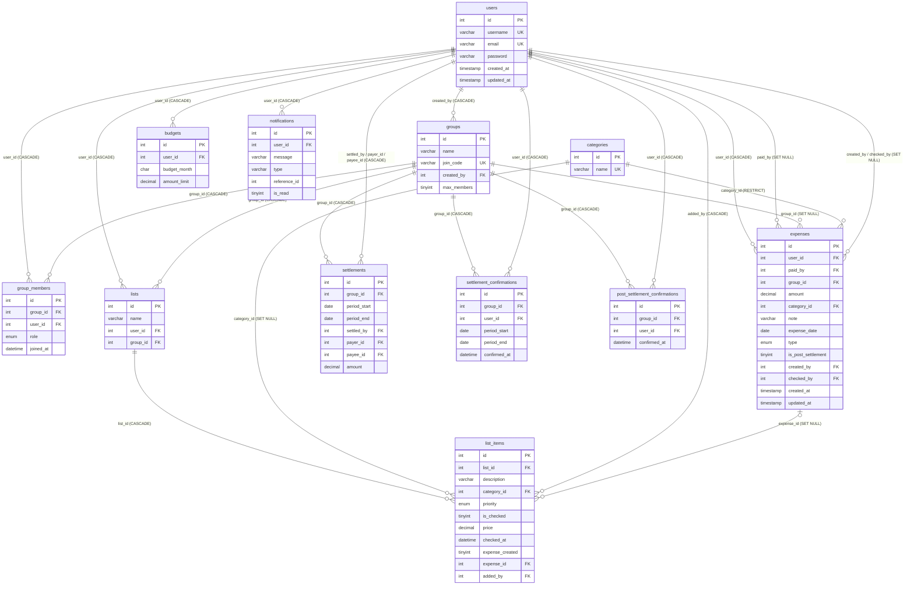
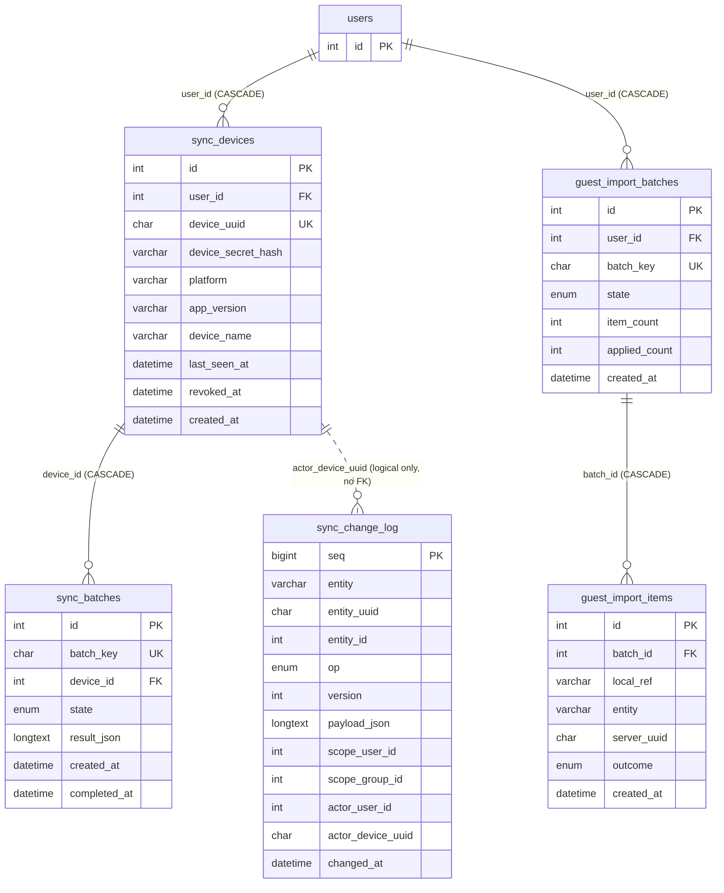
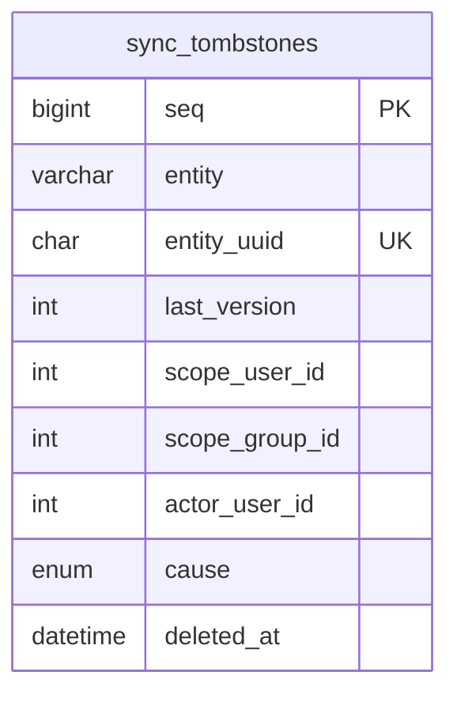
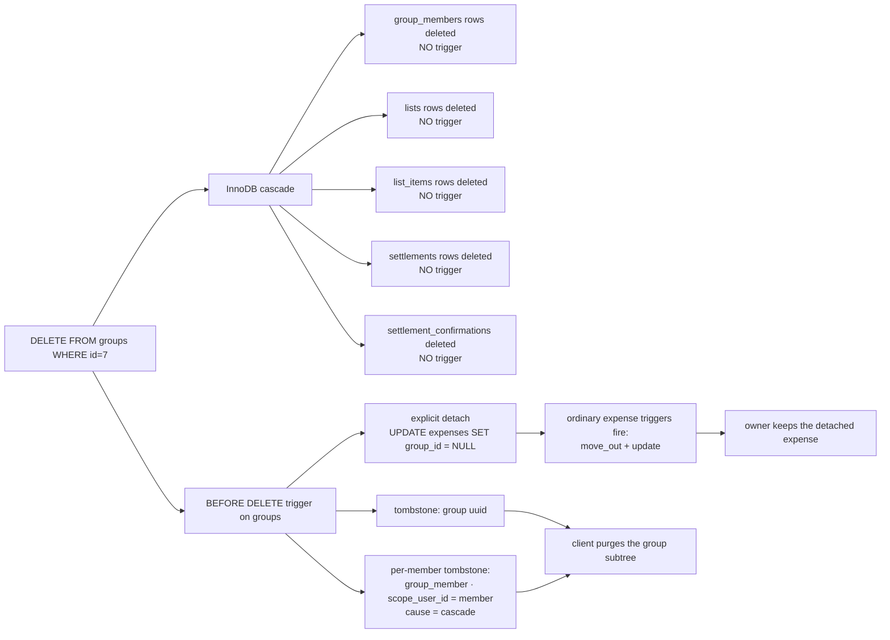

# Entity Relationship Diagram

| Field | Value |
|---|---|
| Status | Specification — Phase 2 |
| Date | 2026-11-15 |
| Purpose | Show the existing data model, the proposed additions, and the structures that remain unresolved — and distinguish the three clearly |
| Source of truth for existing structures | `schema.sql` (verified at HEAD `ec0e692`) |
| Rule | Proposed structures are `PROPOSED`. This document creates nothing |

---

## 1. How to read this document

An ER diagram that mixes what exists with what is proposed is misleading. This document therefore
presents three views:

| View | Section | Shows |
|---|---|---|
| Existing | §2 | The 14 tables exactly as `schema.sql` creates them |
| Additions | §3 | The 6 proposed tables and how they attach to existing ones |
| Combined | §4 | Everything at once, colour-coded by status |
| Unresolved | §5 | Structures that must **not** be assumed settled |

| Marker | Meaning |
|---|---|
| **EXISTS** | In `schema.sql` today |
| **ADDED** | Proposed by this phase; requires the migration in `DATABASE_MIGRATION_STRATEGY.md` §4 |
| **MODIFIED** | An existing table receiving new columns only; no existing column changes |
| **UNRESOLVED** | Shape depends on an open owner decision; not specified to DDL level |

---

## 2. Existing model (EXISTS)



`rate_limits` and `outbox_events` have no relationships (no foreign keys) and are omitted from the
diagram; their columns are listed in [`DATABASE_AUDIT.md`](../DATABASE_AUDIT.md) §2.

### 2.1 Uniqueness and composite keys (EXISTS)

| Table | Constraint | Note |
|---|---|---|
| `users` | `username`, `email` unique | |
| `categories` | `name` unique | Seeded, shared |
| `groups` | `join_code` unique | Shareable code |
| `group_members` | `uq_group_user (group_id, user_id)` | One row per membership |
| `budgets` | `uq_user_month (user_id, budget_month)` | Makes the write an upsert |
| `settlement_confirmations` | `uq_group_user (group_id, user_id)` | **Keyed by group + user, not by settlement or period.** The source of PR-04 and D-17 |
| `post_settlement_confirmations` | `uq_ps_conf (group_id, user_id)` | Current late-expense round only |

### 2.2 Existing `CHECK` constraints (EXISTS)

| Named constraint | Table | Predicate |
|---|---|---|
| `chk_expense_amount` | `expenses` | `amount > 0` |
| `chk_budget_amount` | `budgets` | `amount_limit > 0` |
| `chk_item_price` | `list_items` | `price IS NULL OR price > 0` |
| `chk_settlement_amount` | `settlements` | `amount >= 0` — deliberate: `0.00` marker rows advance the lock (PR-08) |
| `chk_max_members` | `groups` | `max_members > 0` |
| `chk_settlement_period` | `settlements` | `period_start >= '2000-01-01' AND period_start <= period_end` — added by `migration_v2.9_settlement_hardening.sql`; **not present in `schema.sql`** |

---

## 3. Proposed additions (ADDED / MODIFIED)



`sync_tombstones` has no foreign keys by design (§5.4 of the specification): a tombstone must
survive the deletion of everything it refers to.



### 3.1 Columns added to existing tables (MODIFIED)

| Table | Added columns | Nothing else changes |
|---|---|---|
| `expenses` | `uuid CHAR(36)`, `version INT UNSIGNED`, `updated_at` → `DATETIME(6)` | Existing columns, indexes, FKs, and checks unchanged |
| `budgets` | same | same |
| `lists` | `uuid`, `version`, `updated_at` (new column) | same |
| `list_items` | same | same |
| `groups` | `uuid`, `version`, `updated_at` precision | same |
| `group_members` | `uuid`, `version`, `updated_at` (new column) | same |
| `settlements` | `uuid`, `version`, `updated_at` (new column) | same |

Full column definitions: [`DATABASE_SCHEMA_SPECIFICATION.md`](DATABASE_SCHEMA_SPECIFICATION.md) §3.

```mermaid
erDiagram
    expenses {
        int id PK
        char uuid UK "ADDED"
        int version "ADDED"
        datetime updated_at "MODIFIED precision"
    }
    budgets {
        int id PK
        char uuid UK "ADDED"
        int version "ADDED"
        datetime updated_at "MODIFIED precision"
    }
    groups {
        int id PK
        char uuid UK "ADDED"
        int version "ADDED"
        datetime updated_at "MODIFIED precision"
    }
    lists {
        int id PK
        char uuid UK "ADDED"
        int version "ADDED"
        datetime updated_at "ADDED"
    }
    list_items {
        int id PK
        char uuid UK "ADDED"
        int version "ADDED"
        datetime updated_at "ADDED"
    }
    group_members {
        int id PK
        char uuid UK "ADDED"
        int version "ADDED"
        datetime updated_at "ADDED"
    }
    settlements {
        int id PK
        char uuid UK "ADDED"
        int version "ADDED"
        datetime updated_at "ADDED"
    }
```



---

## 4. Combined target model

Colour-coded: **green** = exists unchanged, **amber** = exists and gains columns only, **blue** =
proposed new, **grey dashed** = unresolved.

```mermaid
flowchart TB
    subgraph Core["Existing core"]
        U["users"]:::exists
        CAT["categories"]:::exists
        NO["notifications"]:::exists
        RL["rate_limits"]:::exists
        OB["outbox_events"]:::exists
    end

    subgraph Sync["Syncable entities — gain uuid + version"]
        GR["groups"]:::mod
        GM["group_members"]:::mod
        EX["expenses"]:::mod
        BU["budgets"]:::mod
        LS["lists"]:::mod
        LI["list_items"]:::mod
        SE["settlements"]:::mod
    end

    subgraph Confirm["Confirmations — unchanged, server-only"]
        SC["settlement_confirmations"]:::exists
        PS["post_settlement_confirmations"]:::exists
    end

    subgraph New["Proposed sync infrastructure"]
        DV["sync_devices"]:::added
        CL["sync_change_log"]:::added
        TB["sync_tombstones"]:::added
        SB["sync_batches"]:::added
        GB["guest_import_batches"]:::added
        GI["guest_import_items"]:::added
    end

    subgraph Open["Unresolved structures"]
        UQ1["Orphaned rows: expenses.type='group'<br/>with group_id IS NULL (UQ-11)"]:::open
        UQ2["Possible future CHECK on<br/>type/group_id (UQ-11)"]:::open
        UQ3["app_sessions table for<br/>session revocation (UQ-04 / D-25)"]:::open
        UQ4["Account anonymisation fields<br/>for deletion policy (UQ-02 / D-23)"]:::open
        UQ5["chk_settlement_period absent<br/>from schema.sql (drift)"]:::open
    end

    U --> GR
    U --> GM
    GR --> GM
    U --> EX
    GR --> EX
    CAT --> EX
    U --> BU
    U --> LS
    GR --> LS
    LS --> LI
    EX --> LI
    U --> NO
    GR --> SE
    U --> SE
    GR --> SC
    U --> SC
    GR --> PS
    U --> PS

    U --> DV
    DV --> SB
    DV -.-> CL
    U --> GB
    GB --> GI
    CL --> TB

    GR -.-> UQ1
    EX -.-> UQ1
    UQ1 -.-> UQ2
    UQ5 -.-> SE
    U -.-> UQ4
    DV -.-> UQ3

    classDef exists fill:#e8f5e9,stroke:#2e7d32
    classDef mod fill:#fff8e1,stroke:#f9a825
    classDef added fill:#e3f2fd,stroke:#1565c0
    classDef open fill:#f5f5f5,stroke:#757575,stroke-dasharray: 5 5
```



### 4.1 Relationship count

| View | Entities | Relationships |
|---|---|---|
| Existing | 14 tables + 4 tables with no relationships | 21 FK relationships |
| Added | 6 tables | 5 FK relationships + 1 logical link (change log → tombstones by entity/UUID, not FK) |

---

## 5. Unresolved structures

**These must not be designed against, and must not appear in a migration until the named question is
answered.** They are listed here exactly so that no reader mistakes them for settled design.

| # | Unresolved structure | Depends on | Why it is not settled |
|---|---|---|---|
| U-1 | Rows where `expenses.type = 'group'` and `group_id IS NULL` (produced by every group deletion) | UQ-11 (`BLOCKING`) | Remediation (convert to `personal`, delete, or mark orphaned) is an owner decision |
| U-2 | A `CHECK` enforcing `type='group' ⇒ group_id IS NOT NULL` | UQ-11 | Cannot be added while U-1 rows exist (finding F-02) |
| U-3 | `app_sessions` (enumerable, revocable sessions) | UQ-04 / D-25 (`NEEDS APPROVAL`) | Only needed if the owner wants session revocation beyond sync devices |
| U-4 | Account-deletion representation (`deleted_at`, `anonymised_at`, or a status column) | UQ-02 / D-23 (`NEEDS APPROVAL`) | The policy itself (anonymise vs block vs delete) is undecided |
| U-5 | `settlements.chk_settlement_period` in `schema.sql` | Not an owner question — a **documented drift** | The constraint exists on the live database and in `migration_v2.9_settlement_hardening.sql` but not in `schema.sql`. A fresh clone lacks it until migrations run. Phase 2 does not edit `schema.sql`; the divergence must be closed by an approved migration-phase task |
| U-6 | Tombstone retention window | UQ-09 (default recommended) | Indefinite recommended; not approved |
| U-7 | Change-log retention window | UQ-09 (default recommended) | 90 days recommended; not approved |

### 5.1 Why the diagram cannot show these

An ER diagram expresses structure, and every item above is either a data-remediation policy, a
retention policy, or a conditional table. Drawing them as entities would assert a shape that has not
been agreed — precisely the failure mode this document exists to prevent.

---

## 6. Foreign-key behaviour reference (EXISTS)

| Relationship | On delete | Consequence |
|---|---|---|
| `groups.created_by` → `users` | `CASCADE` | Deleting a user deletes their groups — and therefore everything cascading from those groups |
| `group_members` → `groups`, `users` | `CASCADE` | Membership disappears with either side |
| `expenses.user_id` → `users` | `CASCADE` | **Deleting a user deletes their expense rows** (finding F-04) |
| `expenses.paid_by` → `users` | `SET NULL` | The payer reference is lost but the amount remains |
| `expenses.group_id` → `groups` | `SET NULL` | **The orphan-row source** (finding F-02) |
| `expenses.category_id` → `categories` | `RESTRICT` | A category cannot be deleted while used |
| `expenses.created_by`, `checked_by` → `users` | `SET NULL` | History survives; attribution does not |
| `budgets.user_id` → `users` | `CASCADE` | |
| `lists.user_id` → `users` | `CASCADE` | Deleting a user deletes their lists |
| `lists.group_id` → `groups` | `CASCADE` | Group lists vanish with the group |
| `list_items` → `lists` | `CASCADE` | Items vanish with the list |
| `list_items.added_by` → `users` | `CASCADE` | **A user deletion deletes items they added to someone else's list** |
| `list_items.expense_id` → `expenses` | `SET NULL` | Uncheck logic deletes by `expense_id` before the link is nulled |
| `notifications.user_id` → `users` | `CASCADE` | |
| `settlements` → `groups` | `CASCADE` | **Deleting a group destroys its settlement history** (F-02) |
| `settlements.settled_by`, `payer_id`, `payee_id` → `users` | `CASCADE` | **A user deletion destroys settlements they participated in** (F-04) |
| Confirmations → `groups`, `users` | `CASCADE` | |

---

## 7. Cascade gap analysis (F-02, F-03, F-04)

### 7.1 F-03 — cascades do not fire triggers

InnoDB referential actions bypass triggers. With change capture by trigger (D-13), a cascade delete
produces **no** change-log row and **no** tombstone for the cascaded rows.



**Compensation rule.** Every cascade in this schema originates from a single identifiable parent
(`groups` or `users`), and the parent's tombstone purges the local subtree (`SYNC_WORKFLOWS.md` §7.5).
That rule is **not sufficient for group deletion**, because the deletion also destroys the membership
rows through which a group-scoped tombstone is resolved. The design therefore adds two things inside
`trg_groups_bd` (`DATABASE_SCHEMA_SPECIFICATION.md` §5.4.3–§5.4.4):

1. one **personally scoped** `group_member` tombstone per current member, so every former member
   learns of the deletion; and
2. an **explicit** `UPDATE expenses SET group_id = NULL` before the delete, so surviving expenses
   are version-bumped and logged by the ordinary expense triggers instead of being silently changed
   by `ON DELETE SET NULL` (which fires no trigger).

Both rest on spike **A-DB-4** (cross-table DML inside a trigger). If that is refused, the v2 endpoint
performs the steps before `DELETE FROM groups`, and the reconciliation digest repairs any divergence
on the next full pull cycle.

The one-parent property still matters for every **other** cascade: a future cascade from a second
parent would need its own tombstone.

### 7.2 F-02 — group deletion leaves orphaned group expenses

```
groups ──CASCADE──► group_members, lists, list_items, confirmations, settlements
groups ──SET NULL─► expenses.group_id
```

Result: `expenses` rows keep `type='group'` with `group_id = NULL`. UQ-11 governs remediation;
D-26 recommends refusing deletion when settlements exist and converting orphans to `personal`.

**Consequence for the sync design:** the group-delete path does **not** rely on `ON DELETE SET NULL`
(it fires no trigger and would be unlogged). It detaches the expenses explicitly, so each surviving
expense is an ordinary logged update scoped to its owner, and only the owner keeps it. Until UQ-11 is
answered, the sync protocol must treat a detached row as an ordinary expense whose `group_id` is null
and must not assume the `type`/`group_id` invariant holds
(`DATABASE_SCHEMA_SPECIFICATION.md` §7.3, §5.4.4).

### 7.3 F-04 — user deletion destroys other members' financial history

`DELETE FROM users` cascades to `expenses.user_id`, `lists.user_id`, `group_members`,
`notifications`, and — critically — `settlements.payer_id / payee_id / settled_by`. One member
deleting their account rewrites everyone else's settlement history.

**Consequence:** D-23 recommends anonymisation over deletion specifically to keep these references
valid. No API exposes account deletion today, so this is a design-time obligation, not a live
defect.

---

## 8. Verification

| Claim | Method | Pass condition |
|---|---|---|
| Existing diagram matches `schema.sql` | `STATIC-CHECK` | Every table, FK, and cascade action in §2/§6 appears in `schema.sql` |
| Additions are distinguishable from existing structures | `DOC-REVIEW` | Accept criterion 8 of `WORK/PHASE_2_DESIGN_PLAN.md` §11 |
| No diagram asserts an unresolved structure | `DOC-REVIEW` | Every unresolved item appears only in §5, not in §3/§4 entity definitions |
| Cascade gaps are compensated, not ignored | `DOC-REVIEW` | §7.1 states the compensation rule and its precondition |
| Retention defaults are not presented as decided | `DOC-REVIEW` | U-6/U-7 cite UQ-09 |
