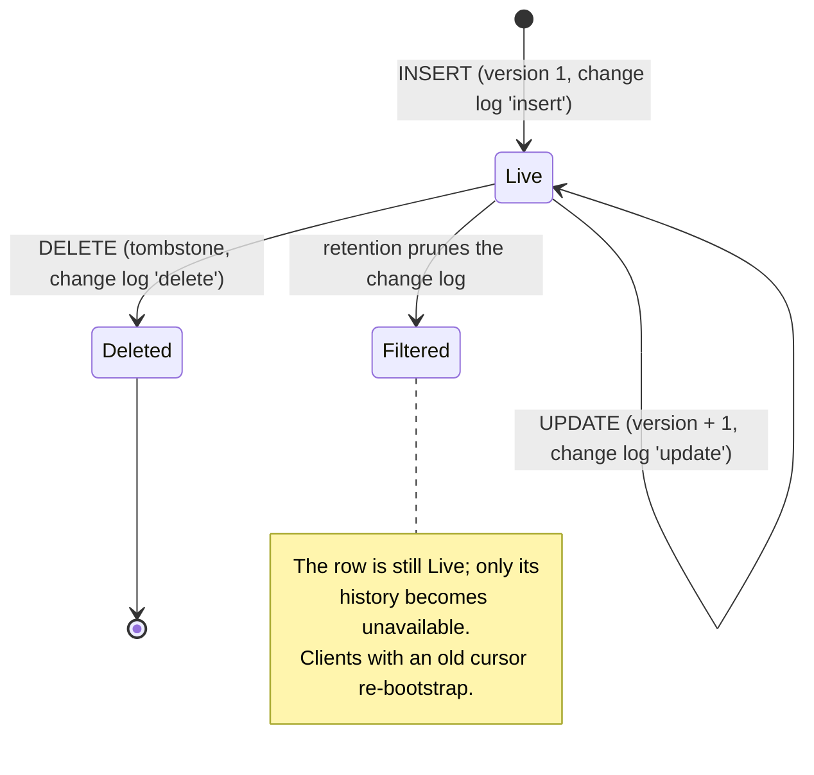
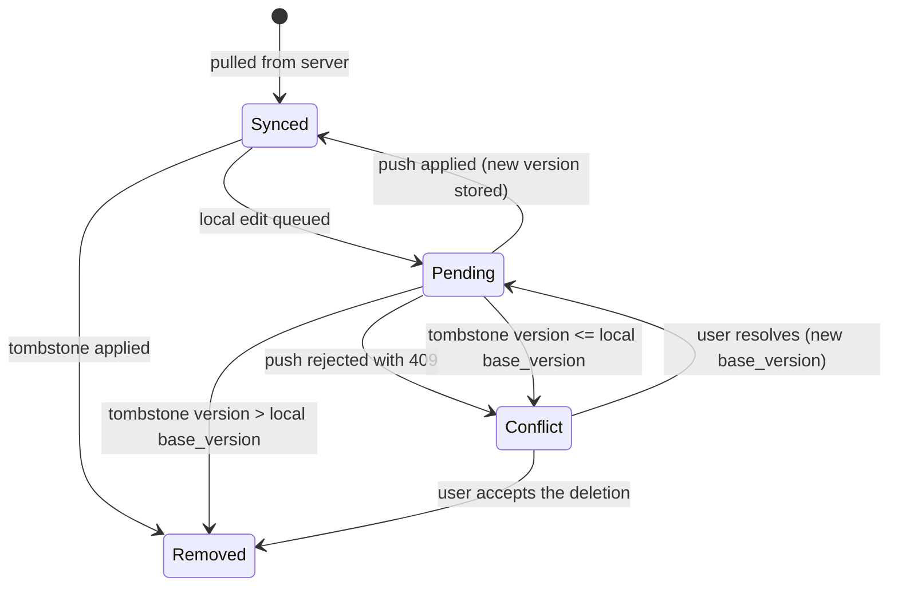

# Versioning and Conflict Resolution

| Field | Value |
|---|---|
| Status | Specification — Phase 2 |
| Date | 2026-11-15 |
| Purpose | Define the version model, how concurrent modification is detected, how conflicts are represented, and the per-entity policy for resolving them |
| Requirements | D-06, VC-01…VC-11, SY-08, SY-20, PR-01, PR-04 |
| Companion | [`../synchronization/CONFLICT_RESOLUTION.md`](../synchronization/CONFLICT_RESOLUTION.md) specifies the *user-facing* resolution workflow. This document specifies the *data* mechanics and the policies |
| Rule | No entity gets the same policy as another without a stated reason. "Last write wins" is never a universal default |

---

## 1. Scope

| Question | Section |
|---|---|
| What a version is and how it is maintained | §2 |
| The states a record passes through | §3 |
| How concurrent modification is detected | §4 |
| How a conflict is represented on the wire and in storage | §5 |
| Why ordering never depends on a clock | §6 |
| The policy for each entity class | §7 |
| Retry, duplicate, and out-of-order handling | §8 |
| What is deliberately not solved | §9 |

The database objects referenced here are specified in
[`DATABASE_SCHEMA_SPECIFICATION.md`](DATABASE_SCHEMA_SPECIFICATION.md); the client-side model is in
[`../synchronization/OFFLINE_DATA_MANAGEMENT.md`](../synchronization/OFFLINE_DATA_MANAGEMENT.md).

---

## 2. The version model

### 2.1 Definition

| Property | Statement |
|---|---|
| A version belongs to a row | `version INT UNSIGNED NOT NULL DEFAULT 1`, added to the seven syncable tables |
| It is server-maintained | Only the `BEFORE UPDATE` trigger increments it (`DATABASE_SCHEMA_SPECIFICATION.md` §5.6.3) |
| It is monotonic per row | Never decremented, never reused, never reset |
| It is not a cursor | Cursors use `sync_change_log.seq`, which is global; a version is local to a row |
| It is not a timestamp | Two updates in the same microsecond get different versions |
| It is exposed only by v2 | v1 responses do not gain fields (VC-10, `API_VERSIONING.md` §4) |

### 2.2 Why a version and not a timestamp (D-06)

| Approach | Failure mode | Verdict |
|---|---|---|
| Compare `updated_at` | Second-granularity ties make "which write was first" unanswerable; clocks can move backwards | Rejected |
| Compare an ETag derived from the row content | Two different field sets can hash equal after an unrelated change; a hash cannot express "which version is newer" for a merge decision | Rejected |
| Compare a monotonic integer | Exact equality test, unambiguous ordering, trivial to log | **Selected** |

**Accepted rule:** timestamps support auditing, synchronisation, and ordering; timestamps alone must
never be treated as proof that concurrent modification did not occur.

### 2.3 Where the version comes from in each direction

| Direction | Field | Notes |
|---|---|---|
| Server → client (change log / pull) | `version` after the write | The client stores it as the record's local version |
| Client → server (push, update/delete) | `base_version` | A precondition, not an instruction |
| Server response on success | The new `version` | The client updates its local record |
| Server response on conflict | The server's current row **including its version** | The client can compare and offer a resolution |
| v1 endpoints | Nothing | Unchanged |

### 2.4 What a version does **not** protect

| Not protected | Consequence | Mitigation |
|---|---|---|
| A v1 write racing a v2 write | The v1 write has no precondition, so it always succeeds and bumps the version | Accepted: v1 is authoritative for the legacy UI. The v2 client sees the change on its next pull and its queued write then conflicts — which is the desired direction (no silent overwrite of the v2 client's intent) |
| A direct SQL write (support) | Same as v1 | Documented operational procedure: repair writes set `@expmg_sync_suppress = 1` only for backfills, never for corrections that clients must see |
| A cross-entity invariant | Fixing an expense and its list item is not atomic across push requests | §7.5 |

---

## 3. Record and entity states

### 3.1 Server-side



### 3.2 Client-side (per record)



The two transitions that matter:

| Rule | Statement |
|---|---|
| A tombstone wins only if it is newer than the local base version | Otherwise the local edit may still be valid and the user decides (`DATA_FLOW.md` §9) |
| A conflict is never silently resolved for a financial record | §7 |

---

## 4. Concurrent-modification detection (SY-08)

**Requirement:** SY-08 "concurrent modification is detected".

### 4.1 The mechanism

Every v2 update and delete carries `base_version`. The server applies the write inside a transaction:

```
BEGIN;
SELECT version FROM <t> WHERE uuid = ? FOR UPDATE;      -- the authoritative current version
  IF row missing                → 404 RECORD_NOT_FOUND
  IF version <> :base_version   → 409 VERSION_CONFLICT (+ current row)
UPDATE <t> SET … WHERE uuid = ? AND version = :base_version;
COMMIT;
```

| Rule | Statement |
|---|---|
| The `SELECT … FOR UPDATE` is required | The check and the write must be atomic; a non-locking read followed by an update is a race (the same defect class as the pre-v1.3 confirmation race, PR-05) |
| The affected-row count is checked | Zero rows means a race occurred between the select and the update; the operation is retried once, then returned as `409` |
| The precondition is applied to `delete` as well | Deleting a record that changed without the client's knowledge is data loss |
| `base_version` is mandatory | Absent → `400 MISSING_BASE_VERSION`. An update without a precondition is a forced overwrite and is not permitted |
| A conflict response always contains the server's current row | The client must be able to show both sides without a second request |

### 4.2 Detected cases

| Case | Detected by | Result |
|---|---|---|
| Another device edited the same field | Version mismatch | `409 VERSION_CONFLICT` |
| Another device edited a different field | Version mismatch (row-level version, not field-level) | `409 VERSION_CONFLICT` — the user decides; the client may present a field-level diff |
| Another device deleted the record | `404 RECORD_NOT_FOUND` + tombstone present | `409 RECORD_DELETED` (distinguishable, so the UI can say "deleted on another device") |
| The same device sent the request twice | `sync_batches.batch_key` | Replay returns the stored result; no second application |
| Two devices created the same `uuid` | Unique index | `409 DUPLICATE_ID` with the existing record |
| The record is inside a settled period | Settlement-lock check (a business rule, not a version rule) | `409 PERIOD_SETTLED` with the period details |
| A group confirmation period changed | Server-computed period vs `expected_period_end` | `409 PERIOD_CHANGED` (D-17) |
| The user is no longer a member | Membership check | `403` — not a conflict; the client purges the subtree (`DATA_OWNERSHIP.md` §7.4) |
| The actor is no longer an admin | Role check | `403` |

### 4.3 Not detected (and why that is acceptable)

| Case | Why not | Consequence |
|---|---|---|
| A field-level divergence introduced by two non-overlapping updates applied in sequence | The second looks like a normal update against the version it was given | A client that pulls between the two writes sees both; a client that does not, sees the second — which is a real change, not a lost one |
| A conflict between a v1 write and a v2 write | v1 carries no version (§2.4) | Documented and accepted |
| Two `list_items` checked concurrently for the same list | `check_item` is online-only (D-17) | The window is a server-side transaction |
| Two clients confirming the same settlement period | `confirm.php`'s transaction and `FOR UPDATE` | PR-04/PR-05 |

---

## 5. Conflict representation

### 5.1 On the wire (server → client)

```json
{
  "ok": false,
  "code": "VERSION_CONFLICT",
  "error": "The record was modified by another device",
  "entity": "expense",
  "uuid": "01931f6e-…",
  "server": {
    "uuid": "01931f6e-…",
    "version": 4,
    "amount": "24.50",
    "note": "Dinner",
    "expense_date": "2026-11-14",
    "updated_at": "2026-11-15T09:14:22.418273Z"
  },
  "client_baseline": {
    "version": 3,
    "amount": "24.50",
    "note": "Dinner with tip",
    "expense_date": "2026-11-14"
  }
}
```

| Field | Rule |
|---|---|
| `server` | Always the current row, in v2 shape (money as decimal strings, dates as `YYYY-MM-DD`) |
| `client_baseline` | What the client believed it was basing the change on — echoed so a support log is self-contained |
| `code` | A stable machine-readable string, catalogued in `API_ERROR_HANDLING.md` §3 |
| HTTP status | `409` |
| Multi-operation push | A conflict on one operation does not prevent other operations in the batch from applying; the per-operation results array carries the outcome. This is why `sync_batches.state` can be `partial` |

### 5.2 In storage

| Location | Content | Lifetime |
|---|---|---|
| `sync_batches.result_json` (server) | The complete per-operation outcome, including conflicts | 45 days (recommended, UQ-09) |
| `sync_change_log` (server) | Row snapshots around the winning write | 90 days (recommended, UQ-09) |
| Client `conflicts` table (Drift) | The unresolved conflict, both sides, the user's choice | Until resolved and dismissed |

No dedicated server-side conflict table exists; the reasoning is in
[`DATABASE_SCHEMA_SPECIFICATION.md`](DATABASE_SCHEMA_SPECIFICATION.md) §5.5.

### 5.3 Client-side conflict record (shape)

| Field | Purpose |
|---|---|
| `entity`, `uuid` | Which record |
| `base_version` | The client's assumed version (diagnostics) |
| `server_version`, `server_payload` | The server's side, verbatim |
| `local_payload` | The client's queued change |
| `detected_at` | Server time from the response |
| `resolution_state` | `unresolved` / `resolved` / `dismissed` |
| `resolution_choice` | `keep_local` / `keep_server` / `merge` / `accept_delete` |
| `resolved_at`, `resulting_version` | Audit |

**Never stored:** the user's typed values that were already rejected and superseded — the payload is
the queued change, not a form draft.

### 5.4 A resolution is a new write

| Rule | Statement |
|---|---|
| Resolving a conflict means pushing again | With `base_version` set to the version the user saw (the server's, or its successor if it changed again) |
| There is no "force overwrite" operation | A forced overwrite is a way to lose another device's data without recording that it happened |
| A resolution can itself conflict | The loop is bounded: after N attempts the client surfaces the conflict again with a fresh server state. The bound is specified in `CONFLICT_RESOLUTION.md` §6 |
| The change log records the resolution as an ordinary update | No special event type |

---

## 6. Ordering, clock skew, and out-of-order delivery (SY-20)

**Requirement:** SY-20 "clock skew never determines record ordering".

### 6.1 The three time sources

| Source | Trust | Used for |
|---|---|---|
| Server clock (`NOW(6)`, `changed_at`) | Authoritative | The watermark rule (D-27), `updated_at`, conflict diagnostics |
| Client device clock | **Untrusted** | Local display and local queue timestamps only; never sent as a decision input |
| `sync_change_log.seq` | Authoritative for ordering | The cursor |

### 6.2 Rules

| Rule | Statement |
|---|---|
| Ordering of changes is by `seq` only | A client applies changes in `seq` order within a pull page and never re-sorts by a timestamp |
| A client's business timestamps are data, not ordering | `expense_date` is a business fact the user typed; it is validated but never used to order sync |
| Client-supplied timestamps are acceptable as **values** | A v2 push may carry an `expense_date`. It may not carry a `created_at` or `updated_at` that the server honours |
| The server may record a client claim for diagnostics | For example a queue entry's local creation time, echoed into `result_json`. Never written to a business column |
| A device with a wrong clock still syncs correctly | It cannot affect ordering, only the display of its own queue |
| Clock skew between devices is invisible to the protocol | Two devices editing the same row is resolved by version, not by time |
| `expense_date` in the future | Rejected by `validateDate()` semantics as today (a future date beyond the accepted range is an application rule, not a version rule) |

### 6.3 Out-of-order delivery

| Situation | Rule |
|---|---|
| Pull pages arrive out of order | Impossible by construction: the client requests `since=<its own cursor>` and applies within a page; it never applies page N+1 before page N |
| A push's result arrives after a pull has already applied the same change | Applying the change twice is idempotent: applying an `update` with an older `version` than the local record is a no-op |
| A tombstone arrives before the record it deletes | The client records the tombstone (it is keyed by UUID) and applies it when or if the record appears |
| Two changes to the same row in one page | Applied in `seq` order; the later version wins locally, which matches the server |
| A change arrives for a record the client has never seen and whose version is > 1 | Applied as a partial record; the client marks it incomplete and includes it in the reconciliation digest. A full bootstrap resolves the remainder |

### 6.4 Why this matters for the settlement rule

The settlement lock is a server-computed fact about a period. If ordering or timestamps could
influence whether an edit is "inside" a period, a device with a skewed clock could invalidate a
closed period. It cannot: the lock is computed from stored `settlements.period_end` values on the
server, and the client's only contribution is the `expense_date` it is trying to write, which is
validated as a business date.

---

## 7. Per-entity conflict policies

**Decisions:** D-06 ("different entities get different policies"), D-11, D-16, D-17.

### 7.1 Policy vocabulary

| Policy | Meaning |
|---|---|
| **Manual** | The server returns `409`; the user chooses. No automatic merge |
| **Field-merge (offered)** | The server returns `409`, but the client may pre-fill a merge of non-overlapping fields for the user to confirm. The result is still a new write |
| **Server-wins (silent)** | No conflict is possible because the client cannot write the entity, or the write is an operation rather than a record update |
| **Delete-wins-if-newer** | A tombstone supersedes a pending local edit when its `last_version` exceeds the local base version; otherwise manual |

### 7.2 Expense, settlement, and confirmation policies

| Entity | Policy | Rationale |
|---|---|---|
| **Expense** (personal and group) | **Manual**, with field-merge offered for non-overlapping fields | D-06: a lost update is a wrong balance. Amount, date, payer, and note are all financially meaningful; nothing may be merged silently |
| **Expense delete vs concurrent edit** | Manual unless the tombstone's `last_version` exceeds the local base version | If the record was edited after the delete was issued, both intents are real |
| **Settlement** | **Server-wins (silent)** — the client cannot write it | D-16/D-17: settlement rows are produced only by the server's confirmation flow. A client can never conflict with one |
| **Settlement confirmation** | **Not synchronised** | D-17: online-only. `settlement_confirmations` is keyed `(group_id, user_id)`, so a queued confirmation would be computed against a stale period and could wrongly count toward closure (PR-04) |
| **Post-settlement confirmation** | **Not synchronised** | Same reasoning |
| **Settlement lock rejection** | Not a conflict, a domain refusal | `409 PERIOD_SETTLED` carries the period that blocks the edit; the client shows it and keeps the queued change for the user to retarget or discard |
| **`0.00` marker settlements** | Treated as ordinary server-wins changes | A client must never filter them out: they carry the lock (§`DATABASE_SCHEMA_SPECIFICATION.md` §3.11, PR-08) |
| **`paid_by` change on a conflict** | Manual; the client re-validates the member list before offering a choice | The former payer may have left the group; the correct merge may be "use the server's payer" |

**Explicit statement of PR-01's place here:** the version mechanism never decides *who the payer is*.
A conflict resolution that changes `paid_by` is a business edit, validated like any other
(`DATA_OWNERSHIP.md` §4.3).

**Explicit statement of PR-04's place here:** a period closes only when **all** active members have a
confirmation row for the server-computed period. The client cannot contribute a confirmation from a
queue, and cannot compute the period. Versioning is therefore irrelevant to the confirmation gate —
which is exactly why it is online-only.

### 7.3 Budget policy

| Aspect | Policy |
|---|---|
| Conflict | **Manual**, but with a natural resolution: a budget row is a single scalar (`amount_limit`) for `(user_id, budget_month)` |
| Merge offer | Not applicable — one field, no field-level merge is meaningful |
| Delete vs edit | There is no delete; a budget is upserted |
| Why not last-write-wins | The value is financial (a spending ceiling). Silently replacing a deliberate 500 with a stale 250 hides an intent, even though the row is not shared with other users |
| Consequence | A conflict on a budget is presented as "you set X on this device; another device set Y" with a two-option choice |

### 7.4 List and list-item policy

| Entity | Policy | Rationale |
|---|---|---|
| **Personal list** (name) | **Manual** | Owner-only, but two of the owner's devices can conflict; the name is user-authored text |
| **Personal list delete** | Delete-wins-if-newer | If the record was renaming-changed after the delete was issued, manual |
| **Personal list item** | **Manual** with field-merge offered | Description, price, priority, category are independent fields; merging non-overlapping changes is safe and is the common case (two devices adding different items never conflict at all — they are different rows) |
| **Personal list item with a generated expense** | Special: the item's `expense_id` and the expense are two rows | A conflict on the item does not automatically conflict the expense; a resolution that checks/unchecks is an **operation** and must be done online (D-17) |
| **Group list / item** | **Server-wins (silent)** — read-only offline | D-16: shared collaborative state |
| **Check / uncheck** | **Not synchronised** | An operation, not a record write (D-17). It creates or deletes an expense inside a transaction with a server-measured 600-second window |
| **`is_checked` written by a pull** | Applied without conflict | The client mirrors the server |

### 7.5 Group and membership policy

| Entity | Policy |
|---|---|
| **Group** (name, join code, limits) | Server-wins; the client cannot write it |
| **Group membership** | Server-wins; join/leave/remove are operations |
| **Removal of the local user** | Not a conflict; a hard local purge (`DATA_OWNERSHIP.md` §7.4) |
| **A pending local group expense when the user is removed** | The push is rejected `403`. The client purges the group subtree and discards the queued write, warning the user first, because the expense belongs to a group they are no longer in |
| **Group deletion while an expense is queued** | The expense push is rejected (`404` group / `403` membership); the same rule applies |

**Why "discard with a warning" rather than "keep for retargeting":** the record's group no longer
exists or the user has no right to write it. Offering a retarget to a different group would silently
move a financial record between ledgers. The user must re-enter it deliberately if they still want
it.

### 7.6 Policy summary table

| Entity class | Conflict-capable offline writes | Policy | Auto-merge? |
|---|---|---|---|
| Personal expense | create, update, delete | Manual (+ field merge offered) | Non-overlapping fields only, user-confirmed |
| Group expense | create, update (admin), delete (admin) | Manual (+ field merge offered) | same |
| Budget | set (upsert) | Manual | No |
| Personal list | create, rename, delete | Manual | No (single field) |
| Personal list item | add, edit, remove | Manual (+ field merge offered) | Non-overlapping fields only |
| Group list / item | none | Server-wins | n/a |
| Group, group_member | none | Server-wins | n/a |
| Settlement, confirmations | none | Server-wins / not synchronised | n/a |
| Notification | none | Not synchronised (D-19) | n/a |
| Device | register/revoke (online) | Not synchronised | n/a |

---

## 8. Retry, duplicates, and recovery

### 8.1 Retry rules

| Rule | Statement |
|---|---|
| Every push is idempotent | `batch_key` + per-operation `uuid`/`base_version` |
| A retry uses the **same** `batch_key` | A new key is a new operation and would re-apply whatever is still queued |
| A retry after a `409` is **not** a retry | It is a resolution: a new request with a new `base_version` and, typically, a new `batch_key` |
| Exponential backoff with jitter, capped | Transport failures only: 1 s, 2 s, 4 s, … cap 60 s. A `409` or `400` must not be retried blindly |
| `Retry-After` is honoured | The rate-limit responses carry it (`API_CONTRACT.md` §5); the client must wait at least that long |
| A network timeout does not mean failure | The client must re-query by `batch_key` (or pull) before re-sending with a different key |
| A `500` is retried with backoff up to a bound, then surfaced | With the same `batch_key`, so a server-side half-application is detected on replay |

### 8.2 Duplicate handling matrix

| Duplicate | Detected by | Result |
|---|---|---|
| Same `batch_key`, same body | `sync_batches` lookup + `request_hash` | The stored `result_json` is returned; nothing is applied |
| Same `batch_key`, different body | `request_hash` mismatch | `409 BATCH_KEY_REUSED` — a client bug; silently returning the old result would hide data loss |
| Same `uuid` in an `insert` | `uq_<table>_uuid` | `409 DUPLICATE_ID` + the existing record |
| Same `uuid` in an `update` with the current version | Normal path | Applied |
| Same `uuid` in an `update` with a stale version | Version check | `409 VERSION_CONFLICT` |
| Same delete twice | `sync_tombstones` `ON DUPLICATE KEY UPDATE` | The second delete is a successful no-op |
| `rate_limits` row for a retry | Expected | The retry consumes quota by design; `api_sync` has its own bucket (D-28) |

### 8.3 Recovery from an interrupted sync

| Interruption | Recovery |
|---|---|
| The client crashed mid-push | On restart, the queue is intact; re-send with the same `batch_key`. The server either returns the stored result or re-applies idempotently |
| The server crashed mid-push | The transaction rolled back; the batch row is `received`. After the abandonment window (10 min) a retry with the same key re-executes |
| The client crashed mid-pull | The cursor was not advanced (the client advances only after applying a page in one local transaction). The next pull repeats the page — idempotent |
| The server pruned past the client's cursor | `410 CURSOR_TOO_OLD` → full bootstrap |
| The client's stored cursor is ahead of the server watermark (a `seq` rewind after restore) | `410 CURSOR_TOO_OLD` → full bootstrap; never an empty page (`SYNC_API_SPECIFICATION.md` §6.4) |
| The client's local store was cleared | Full bootstrap; the server is the source of truth |
| A device was revoked mid-operation | `403 DEVICE_REVOKED`; the client stops syncing and informs the user. Local data is retained (the session is still valid) until the session expires or the user signs in again |

### 8.4 Assertions the implementation must satisfy

| # | Assertion |
|---|---|
| 1 | Applying the same change twice leaves the local store byte-identical (modulo the cursor) |
| 2 | Applying a change with `version <= local_version` is a no-op |
| 3 | A conflict never leaves a record in an inconsistent local state (both sides stored, record marked `conflict`) |
| 4 | A resolution that is itself rejected re-opens the conflict rather than losing it |
| 5 | No code path advances the cursor before its page is fully applied |

---

## 9. Deliberately not solved

| Not solved | Reason |
|---|---|
| Field-level automatic merge without user confirmation | Rejected by D-06 for financial records |
| CRDT / operational transforms | Rejected in D-11 option D |
| Cross-entity transactional push (expense + its list item) | A push is per-operation; the list check/uncheck path is online-only precisely to avoid needing it |
| Conflict resolution for a record the user can no longer access | The correctness answer is purge (§7.5), not merge |
| Merging two accounts' data | UQ-01/D-22, a policy question about guest data, not a versioning mechanism |
| Automatic retry of a conflicting write | Would discard a user's intent — §5.4 |
| Undo of a resolved conflict | The change log records what happened; an undo is a new edit |

---

## 10. Verification

| Requirement | Method | Pass condition |
|---|---|---|
| D-06 version-based OCC | `CONTRACT-TEST` | An update with a stale `base_version` returns `409` and does not change the row |
| VC-01 version on every syncable row | `MIGRATION-TEST` | All 7 tables have `version NOT NULL DEFAULT 1` |
| VC-02 version increments per writer | `MIGRATION-TEST` | v1 write, v2 write, and direct SQL each increment |
| VC-03 conflict carries server state | `CONTRACT-TEST` | A `409` body contains the server row and the echoed baseline |
| VC-11 conflicts retained for diagnosis | `CONTRACT-TEST` | A conflicted push leaves a queryable `result_json` |
| SY-08 concurrent modification detected | `CONTRACT-TEST` | Two devices editing the same row: the second gets `409` |
| SY-20 clock skew is irrelevant | `UNIT-TEST` | Setting a client clock forward/backward does not change ordering or the outcome of a conflict test |
| PR-01 payer is never version-derived | `UNIT-TEST` | A merge option that changes `paid_by` is validated against membership |
| PR-04 confirmation gate unaffected by versions | `CONTRACT-TEST` | The existing confirmation test suite passes unchanged; a queued offline confirmation is impossible by design |
| §8.4 assertions | `UNIT-TEST` + `INTEGRATION-TEST` | All five hold, including a simulated crash between pull pages |
