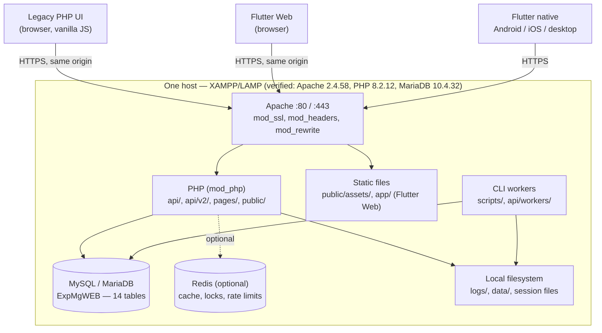

# Deployment Architecture

| Field | Value |
|---|---|
| Status | `PROPOSED` — Phase 2 target design. Nothing here is implemented. |
| Phase | 2 (Target Architecture and Technical Design) |
| Work package | WP-11 |
| Requirements | DP-01 … DP-08, FL-08, FL-10 (`OPEN`), SE-01, SE-13, PR-23, CO-04 |
| Decisions used | D-01, D-02, D-08, D-09, D-18, D-29, D-30, D-31, D-32, D-37 |
| Open questions | UQ-04, UQ-06, UQ-09, UQ-14, UQ-15 |
| Supersedes | Nothing. Phase 1 has no deployment document. |

This document defines where every piece of the target system runs, how it is reached, how it is
configured, how it is released, how it is backed up, and what is monitored. It is a design record:
no file outside `docs/` is created or changed by it.

The single most important statement in this document is the first one: **the deployment target does
not change**. The Flutter client is an additional consumer of the existing PHP/MySQL application on
the existing host. No container, broker, service mesh, or second database is introduced (D-29).

---

## 1. Scope, constraints, and verified facts

### 1.1 In scope

| Area | Section |
|---|---|
| Hosting topology and infrastructure limits | §2 |
| Environments and transport security | §3 |
| Flutter Web hosting (same origin) | §4 |
| Configuration, build, and release | §5 |
| Deployment units and release gates | §6 |
| Operational access, accounts, CLI jobs, runtime | §7 |
| Backup, retention, recovery | §8 |
| Logging, monitoring, sync health | §9 |
| Deferred and open deployment items | §10 |
| Verification | §11 |

### 1.2 Verified environment facts

Everything in this table was read from the running environment or the repository at the Phase 2
baseline (`ec0e692`). These are observations, not proposals.

| Fact | Value | How it was verified |
|---|---|---|
| Document root | `C:/xampp/htdocs` (the repository is a **subdirectory**, `/ExpMgWEB`) | `httpd.conf` `DocumentRoot` |
| Overrides | `AllowOverride All` | `httpd.conf` |
| Apache | 2.4.58 (Win64), Apache Lounge VS17 | `httpd.exe -v` |
| PHP | 8.2.12 (ZTS, VS17) | `php -v` |
| Database | MariaDB 10.4.32 (XAMPP build) | `mysql --version` |
| Listening ports | `Listen 80` and `Listen 443` (`httpd-ssl.conf` is included, `SSLEngine on`) | `httpd.conf`, `httpd-ssl.conf` |
| Loaded modules relevant here | `mod_headers`, `mod_rewrite`, `mod_ssl` | `httpd.conf` `LoadModule` lines |
| **Not** loaded | `mod_deflate`, `mod_expires`, `mod_http2` (all commented out) | `httpd.conf` |
| MIME for WebAssembly | `application/wasm  wasm` is present | `conf/mime.types` |
| Session storage | `session.save_path = C:\xampp\tmp` (shared with every other PHP app on the host) | `php -r ini_get()` |
| Upload / POST limits | `upload_max_filesize = 40M`, `post_max_size = 40M` | `php -r ini_get()` |
| Memory limit | `memory_limit = 512M` | `php -r ini_get()` |
| Webroot lockdown | Root `.htaccess` denies dotfiles, `*.sql`, `*.md`, `*.log`, `*.txt`, `*.ini`, `*.lock`, `*.jsonl`, `composer.*`, `run_tests.php`, and the `config/`, `scripts/`, `tests/`, `data/`, `logs/`, `vendor/`, `partials/`, `.git/` directories | `.htaccess` |
| Security headers at the web-server layer | `X-Frame-Options: DENY`, `nosniff`, `Referrer-Policy`, CSP — set in `.htaccess` **and** in `config/session.php` | `.htaccess`, `config/session.php` |
| CSP (both copies identical) | `default-src 'self'; script-src 'self' https://cdn.jsdelivr.net https://fonts.googleapis.com; style-src 'self' 'unsafe-inline' https://fonts.googleapis.com; font-src 'self' https://fonts.gstatic.com; img-src 'self' data:; connect-src 'self'; base-uri 'self'; frame-ancestors 'none'` | `config/session.php`, `.htaccess` |
| Application DB account | `expmg_app` — `SELECT, INSERT, UPDATE, DELETE` on `ExpMgWEB.*` plus `DROP` on `ExpMgWEB.rate_limits`; never `root` | `.env.example` |
| Environment variables | `DB_HOST`, `DB_PORT`, `DB_USER`, `DB_PASS`, `DB_NAME`, `APP_ENV`, `APP_DEBUG`, `NOTIFICATIONS_BACKEND`, `REDIS_*` | `.env.example` |
| Scheduled jobs configured | None in the repository; `scripts/CRON_SETUP.md` documents the intended daily schedule | `scripts/CRON_SETUP.md` |
| CI configuration | **None** — no `.github/`, no pipeline file, no `Dockerfile`, no compose file | Directory listing |
| Flutter artifacts | **None** — `app/` does not exist yet | `Test-Path app` → false |

### 1.3 Deployment units

| Unit | Exists today | Introduced by Phase 2 | Section |
|---|---|---|---|
| Legacy PHP application (40 HTTP endpoints + 1 CLI worker) | Yes | No — unmodified (D-31) | §6.1 |
| v2 PHP endpoints under `api/v2/` | No | Yes (proposed, not implemented) | §6.1 |
| MySQL/MariaDB database | Yes | No — additive migrations only | §8, §6 |
| Redis | Optional | No | §2.2 |
| Flutter Web static build | No | Yes | §4 |
| Flutter native binaries (Android, iOS, Windows, macOS, Linux) | No | Yes | §5.2 |
| Optional Laravel module | No | **Conditional** on D-18 / UQ-06 | §6.2 |
| CLI workers (`scripts/`, `api/workers/`) | Yes | One proposed addition (`prune_sync_log.php`) | §7.2 |

### 1.4 Non-goals

| Not in Phase 2 | Why |
|---|---|
| Containerisation, orchestration, infrastructure-as-code | D-29; no requirement justifies it and the host cannot support it |
| Multi-region or active-active | The dataset is a household or small group (`ARCHITECTURE_DECISIONS.md` D-29) |
| CDN for the Web build | Same-origin requirement (D-08); a CDN origin breaks `connect-src 'self'` and `SameSite=Lax` |
| Store submission, signing accounts, code-signing certificates | Product/legal work, not architecture; recorded as a release prerequisite in §5.2 |
| A separate API host or subdomain | Requires CORS, `SameSite=None`, and a security re-review (UQ-15) |
| Database engine migration (MySQL 8 ↔ MariaDB 10.4) | Parity is verified by a spike (`ARCHITECTURE_VALIDATION_PLAN.md` §4), not decided here |

---

## 2. Hosting topology (DP-08, D-29)

**Requirements:** DP-08 "no infrastructure beyond LAMP/MySQL/optional Redis"; D-29.

### 2.1 The topology

The diagram has three consequences that the rest of this document depends on:

1. **There is one origin.** The API, the legacy UI, and the Flutter Web build share host, port, and
   certificate. `connect-src 'self'` and `SameSite=Lax` therefore remain valid unchanged (D-08).
2. **There is one database.** Sync, v1, and v2 all read and write the same 14 tables plus the
   proposed sync tables. There is no second copy to reconcile.
3. **There is one process model.** A "background job" is a CLI invocation, not a daemon, a queue
   worker, or a broker.

### 2.2 Ports and processes

| Port | Process | Exposure | Notes |
|---|---|---|---|
| 80 | Apache | Public in production only as a redirect to 443 | `Listen 80` is verified; a plaintext API response must never be served in production |
| 443 | Apache (`mod_ssl`) | Public | `httpd-ssl.conf` is included and `SSLEngine on` is present |
| 3306 | MySQL/MariaDB | **Local only** | Must not be reachable from the network; `DB_HOST=127.0.0.1` |
| 6379 | Redis | **Local only**, optional | Absent is a supported state (`RedisService::get()` returns `null`) |

| Rule | Statement |
|---|---|
| No new listening port is introduced by Phase 2 | The Flutter Web build is static files; v2 is PHP in the same webroot |
| MySQL is never exposed | The application is the only client |
| Redis is never a hard dependency | Every caller degrades to DB or file-store equivalents (`AGENTS.md` — "Redis Is Always Optional") |
| The CLI worker pattern is preserved | `api/workers/process_outbox.php` refuses HTTP with `403`; new jobs follow the same pattern |

### 2.3 Why no additional infrastructure (D-29)

| Rejected | Why it is rejected |
|---|---|
| Message broker (RabbitMQ, Kafka, SQS) | The change log lives in MySQL; the dataset is thousands of rows; a broker adds a process the host cannot supervise and no requirement asks for one |
| Container runtime | XAMPP on Windows is the stated target; a container would change the operational model without changing a single requirement |
| Kubernetes / service mesh | No multi-service topology exists to orchestrate |
| Separate sync service | The sync engine must call the same domain helpers as v1 (`api/domain/`, D-30); splitting it across a network boundary would duplicate or remote-call those rules |
| External object storage | There are no user uploads; exports are generated client-side (`SECURITY_ARCHITECTURE.md` §9.3) |
| A second database for sync | Would require distributed transactions or eventual reconciliation of financial data — the exact risk this design avoids |

**Scale statement (honest).** This topology serves a household or small group: tens of users,
thousands of expense rows, tens of devices. It has no horizontal scale-out, no failover, and no
session replication. If the product ever needs those, that is a new architecture decision, not an
extension of this one.

### 2.4 Honest limits of a single host

| Limit | Consequence | Mitigation in this design |
|---|---|---|
| Single point of failure | Host loss = total outage | Backup and restore (§8); no HA claim |
| Session files on local disk | Sessions do not survive a host loss; a second host would not share them | Acceptable: re-login is the recovery path (24 h absolute lifetime, `SESSION_MANAGEMENT.md` §4) |
| Shared session directory | `C:\xampp\tmp` is shared with other PHP apps on the same XAMPP install | Deploy the project on a host where it is the only PHP app, or set a per-app `session.save_path` (an ops action, not a code change) |
| No `mod_deflate` / `mod_expires` | No gzip; no HTTP cache headers from the server | Flutter Web asset caching is handled by an `app/.htaccess` (§4.2); enabling the modules is an ops action |
| Windows host | Case-insensitive filesystem; `cron` is Task Scheduler | `scripts/CRON_SETUP.md` already documents the Task Scheduler form |
| No CI | Releases are manual | §5.6 release checklist; CI is `PROPOSED`, not adopted |

### 2.5 Document root and URL layout

The current, verified layout is the baseline. It is **not** changed by Phase 2.

| URL | Serves | Source |
|---|---|---|
| `/ExpMgWEB/` | Legacy SPA shell | `public/index.php` via the root `.htaccess`/directory index |
| `/ExpMgWEB/api/...` | v1 endpoints | `api/` |
| `/ExpMgWEB/api/v2/...` | v2 endpoints (**proposed**) | `api/v2/` |
| `/ExpMgWEB/public/assets/...` | CSS/JS | `public/assets/` |
| `/ExpMgWEB/app/...` | Flutter Web build (**proposed**) | build output, not source |
| Everything else at the root | Denied by `.htaccess` | `.htaccess` |

| Constraint | Statement |
|---|---|
| The repository root is the document root | Verified. Moving the document root to `public/` is the stronger long-term fix (`TECHNICAL_DEBT.md` KD-09) but it changes **every** existing URL and is `DEFERRED` (§10) |
| Flutter Web lives under the same origin | `app/` is a subdirectory, so the cookie (`path=/`) is in scope and no CORS is needed |
| The build output is not committed | `app/` is a deployment artifact; committing it would put generated JS in the history and defeat cache-busting |
| `.htaccess` denies `*.md` | The Phase 2 documentation is not web-readable, which is why this design can be written in the webroot |

---

## 3. Environments and transport security (DP-01, DP-04, SE-01)

**Requirements:** DP-01 "development, test, staging, production are defined"; DP-04 "HTTPS is
mandatory outside local development"; SE-01 "transport security requirements are stated per
platform".

### 3.1 Environment matrix

| Environment | Purpose | Host | Database | Transport | `APP_ENV` | `APP_DEBUG` | Data |
|---|---|---|---|---|---|---|---|
| **Development** | Feature work on one machine | Local XAMPP, `http://localhost/ExpMgWEB/` | Local `ExpMgWEB` | HTTP permitted (localhost only) | `development` | `0` (verified default) | Disposable; may contain test users |
| **Test** | Automated suite (`tests/run_tests.php`) and PENTEST | Local XAMPP or a dedicated test host | A **separate** database name (for example `ExpMgWEB_test`) | HTTP acceptable on a loopback host | `test` | `0` | Reset freely; the suite creates and removes rows |
| **Staging** | Pre-release verification against a production-like host | Production-like host, HTTPS | A copy of production structure (never production data unless approved) | HTTPS only | `staging` | `0` | Synthetic or anonymised |
| **Production** | Real users | The deployment host | `ExpMgWEB` | HTTPS only; port 80 redirects to 443 | `production` | `0` | Real financial data |

| Rule | Statement |
|---|---|
| Staging is **specified but optional** | DP-01 requires it to be *defined*; a one-person project may legitimately run dev → production, but the environment and its constraints are stated so the choice is explicit |
| The test suite never runs against production | It truncates tables (`scripts/truncate_rate_limits.php`, suite fixtures) |
| `APP_DEBUG` is `0` everywhere | `1` is a local diagnostic, never a deployed value |
| `APP_ENV` is informational today | No code branches on it; it exists so deployment intent is recorded and can be used by future logging/monitoring |

### 3.2 Configuration source

| Rule | Statement |
|---|---|
| Configuration comes from the environment, not from code | `config/env.php` (phpdotenv) provides `env()`; `config/db.php` reads `DB_*` (KD-01 fixed) |
| One `.env` per environment | `.env` is git-ignored; `.env.example` documents every key and holds no secrets |
| `.env` is never web-readable | Root `.htaccess` denies dotfiles (verified) |
| Defaults are safe | A missing `DB_*` fails the connection rather than silently using `root` with no password |
| The client never receives a server secret | No `REDIS_*`, `DB_*`, or key material is exposed to Flutter; the Flutter build has exactly one injected value, the API base URL (§5.1) |

### 3.3 HTTPS enforcement (DP-04)

`expmgIsHttps()` in `config/session.php` (verified) returns true when any of these holds:

1. `$_SERVER['HTTPS']` is set and not `off`;
2. `X-Forwarded-Proto: https`;
3. `SERVER_PORT == 443`.

| Rule | Statement |
|---|---|
| HTTPS is mandatory in staging and production | DP-04. Port 80 exists only to redirect |
| The `Secure` cookie flag follows the detected scheme | `configureSecureSessionCookie()` passes `expmgIsHttps()` as `secure`; local HTTP therefore still works and production gets `Secure` |
| A TLS-terminating proxy **must** forward `X-Forwarded-Proto` | Otherwise the app sees HTTP, omits `Secure`, and — worse — the session cookie is transmitted on a scheme the operator believes is encrypted |
| A spoofed `X-Forwarded-Proto` fails closed, not open | A client that sends the header over plain HTTP makes the app set `Secure`; the browser then refuses to store the cookie and login fails. It cannot downgrade an HTTPS deployment |
| Local development is the only HTTP exception | Loopback (`localhost`, `127.0.0.1`, an emulator alias) only |
| HTTP fallback is forbidden in clients | SE-01: a failed TLS handshake is an error, never a silent downgrade |

### 3.4 TLS termination

Two shapes are acceptable; both preserve the same application contract.

| Shape | When | Requirements |
|---|---|---|
| **Apache terminates TLS** (`mod_ssl`, `Listen 443` — already present in the XAMPP config) | Single host, direct exposure | A real certificate (§3.5); port 80 → 443 redirect; `SSLProtocol`/`SSLCipherSuite` hardened by ops |
| **A reverse proxy terminates TLS** and forwards to Apache | Hosting provider or an existing gateway | `X-Forwarded-Proto: https` forwarded; Apache not reachable from the internet on 80/443; same certificate rules |

| Rule | Statement |
|---|---|
| HTTP/2 is not required | `mod_http2` is not loaded (verified). Enabling it is an ops improvement, not a design dependency |
| HSTS is not currently sent | Adding `Strict-Transport-Security` is an ops hardening step and must not be added while any environment still serves HTTP on the same hostname |
| Certificate renewal is an operational process | A design that depends on a pinned certificate is rejected (`SECURITY_ARCHITECTURE.md` §4.1) |

### 3.5 Certificates and native clients

| Client | Certificate expectation | Local development |
|---|---|---|
| Browser (legacy UI, Flutter Web) | A publicly trusted certificate in staging/production | A self-signed certificate can be accepted manually in a browser |
| Android | Platform trust store; no `badCertificateCallback` in release | An emulator reaching the host over HTTP is the documented exception; a **physical** device needs a trusted certificate (for example `mkcert` installed on the device) or a staging host |
| iOS | Platform trust store; App Transport Security left enabled | Same as Android; a self-signed certificate must be trusted in the device profile |
| Desktop | Platform trust store | Same as Android |

| Rule | Statement |
|---|---|
| No certificate pinning | Pinning without a rotation process turns a routine renewal into a total client outage (`SECURITY_ARCHITECTURE.md` §4.1) |
| No "ignore certificate errors" flag in a release build | Not even behind a debug toggle that ships |
| A physical-device development workflow is documented, not improvised | `mkcert`-style local CA or a staging host; either is an ops task |

### 3.6 Android cleartext policy

| Rule | Statement |
|---|---|
| Release builds refuse cleartext | Android 9+ default; do not add `usesCleartextTraffic` to the release manifest |
| A debug-only network-security config may permit cleartext to a LAN host | It must live in `android/app/src/debug/`, never in `main/` |
| iOS equivalent | A debug-only `NSExceptionDomains` entry for the development host, never in the release plist |

---

## 4. Flutter Web hosting (DP-03, FL-08, FL-10, D-08)

**Requirements:** DP-03 "same-origin hosting is the baseline for web"; FL-08 "Flutter Web deployment
constraint is documented"; FL-10 "web as a first-class target is decided" — `OPEN`, UQ-14.
**Decision:** D-08.

### 4.1 Why same-origin is not a preference

Three verified facts make it a constraint:

| Fact | Source | Consequence |
|---|---|---|
| No CORS headers exist anywhere in the repository | Repository-wide search: zero matches | A cross-origin `fetch` has no permission to proceed |
| CSP `connect-src 'self'` | `config/session.php`, `.htaccess` | The browser refuses a connection to another origin before it is sent |
| Cookie `SameSite=Lax` | `config/session.php` | Even with CORS, the session cookie would not be attached to a cross-site request |

| Rule | Statement |
|---|---|
| The Web build is served from the same host, port, and certificate as the API | A subdirectory (`/ExpMgWEB/app/`) |
| The API base URL is a same-origin relative path in the Web build | §5.1 |
| A separate origin is a new decision | It requires CORS design, `SameSite=None`, and a security re-review (UQ-15) |

### 4.2 Layout and server configuration for `app/`

| Path | Content | Cache policy |
|---|---|---|
| `app/index.html` | Entry document | `no-store` — it names the hashed assets |
| `app/flutter_service_worker.js` | Service worker | `no-cache` — a stale worker can pin an old build |
| `app/main.dart.js`, `app/flutter.js` | Compiled application | Immutable, long-lived |
| `app/assets/**` | Fonts, images, `AssetManifest.json` | Immutable when the filename carries a content hash |
| `app/canvaskit/**` | CanvasKit JS/WASM (self-hosted) | Immutable, long-lived |
| `app/manifest.json`, icons | PWA metadata | Short-lived |

An `app/.htaccess` is required (it is a deployment artifact, not a Phase 2 file):

| Directive purpose | Why |
|---|---|
| `AddType application/wasm .wasm` | The host already maps it (verified), but the rule makes the artifact portable to a host that does not |
| `Header set Cache-Control "public, max-age=31536000, immutable"` for hashed files | The host has no `mod_expires` (verified), so caching must be declared explicitly |
| `Header set Cache-Control "no-store"` for `index.html` | Otherwise a browser can pair an old document with new assets |
| `Options -Indexes` | Consistent with the root policy |
| No rewrite rule | The default Flutter Web URL strategy is hash-based, so deep links need no server fallback. Switching to path-based URLs requires a rewrite rule and a decision (it changes 404 behaviour) |

| Rule | Statement |
|---|---|
| The service worker must not intercept `/api/` | A cached API response would break authentication, CSRF, and sync |
| The build output is deployed as an immutable directory per release | `app/` is replaced atomically; the previous directory is kept for rollback (§6.4) |
| `app/` is excluded from the repository | Build artifact (§2.5) |

### 4.3 Web as a first-class target (FL-10 — `OPEN`, UQ-14)

The architecture **supports** Web as a first-class target; the product has **not** decided that it
is one. This section states both, so the gap is not hidden.

| Supported on Web | Limit that must be stated to the user |
|---|---|
| Login, session cookie, CSRF, all v1 reads | The cookie is a browser cookie; clearing site data logs the user out |
| Offline read cache and offline writes for the D-16 entity set | Storage is IndexedDB-backed and subject to browser eviction; there is no "keep data" guarantee |
| Sync push/pull while the tab is open | No background sync: a closed tab does not sync. On reopen, the queue drains |
| Charts and PDF export | Rendered in the browser; no server-side export exists (`SECURITY_ARCHITECTURE.md` §9.3) |
| Guest mode | Local only, in the browser's storage |

| Not supported on Web | Reason |
|---|---|
| SQLCipher-style encryption at rest | No equivalent in the browser; this is the documented gap (`SECURITY_ARCHITECTURE.md` §5.2) |
| Device secret in a platform keystore | No keystore; the Web build must not pretend otherwise (UQ-14 consequence) |
| Background sync when the app is closed | Browser platform limit (`FLUTTER_ARCHITECTURE.md` §10.5) |
| Push notifications | Not in scope (D-19 excludes notifications from the offline store) |

**Platform Release Sequencing (UQ-14 Reassessment):**
Under the recommended Native-First rollout (UQ-14 Option B), Native Mobile (Android, iOS) and
Native Desktop (Windows, macOS, Linux) are delivered in **Release 1** sharing a unified native SQLite
engine via Drift FFI and hardware-backed secure storage. Flutter Web is staged for **Release 2**,
pending validation of spike A-WEB-1 (CanvasKit under strict CSP) and browser IndexedDB/OPFS quota
verification. In the interim, browser users continue using the existing, fully stable legacy PHP/JS
SPA (frozen per D-31) with zero interruption.

### 4.4 CSP compatibility

The current CSP is verified and identical in `config/session.php` and `.htaccess` (§1.2). Three
consequences for Flutter Web:

| Requirement | Rule | Status |
|---|---|---|
| CanvasKit assets are served from `self` | Flutter's default CanvasKit URL is a third-party CDN; it must be overridden to a local copy | **Must implement** — the default would be blocked by `script-src`/`connect-src` |
| No eval-like facility in application code | `script-src` has no `'unsafe-eval'`; Flutter's compiled output does not use `eval` | Expected to hold |
| WebAssembly compilation | Browsers apply `script-src` to WASM compilation; CanvasKit is a WASM module, and a strict CSP typically requires `'wasm-unsafe-eval'` | **`NEEDS VERIFICATION` — spike A-WEB-1** (`ARCHITECTURE_VALIDATION_PLAN.md` §14) |

| Rule | Statement |
|---|---|
| A CSP change is a decision, never an inline edit | `SECURITY_ARCHITECTURE.md` §4.4; `SESSION_MANAGEMENT.md` §5.4 |
| The smallest possible relaxation is preferred | If A-WEB-1 shows `'wasm-unsafe-eval'` is required, it is added alone, with a threat note — not `'unsafe-eval'`, and not a CDN origin |
| The fallback is not "disable the CSP" | That would weaken the legacy UI too, which shares the header |
| Verification is a console-clean browser run against the real header | `ARCHITECTURE_VALIDATION_PLAN.md` §14 |

**This is the single largest deployment risk in Phase 2.** It is a real, current constraint: the
header exists today, the legacy UI is unaffected by it, and the new client may need a documented
amendment. It is recorded as a finding (F-11) in the readiness report rather than decided here.

### 4.5 Service worker, caching, and deep links

| Rule | Statement |
|---|---|
| Service worker scope is the `app/` subdirectory | It must never claim `/ExpMgWEB/` or `/api/` |
| A new release replaces the worker and the document together | `no-store` on `index.html`; the worker's own cache name carries the build id |
| Deep links use the hash strategy by default | No server rewrite is needed; a path strategy is a decision (§4.2) |
| A 404 inside `app/` must not fall through to the API | The directory contains only static files; a missing asset is a 404, which is correct |
| The Web build never calls `document.cookie` for the session | The cookie is `HttpOnly` and invisible to JavaScript by design |

### 4.6 What the Web deployment must not do

| Not allowed | Why |
|---|---|
| Serve the build from a CDN or a second host | Breaks D-08 and the CSP |
| Inline a script or style into `index.html` | `script-src` has no `'unsafe-inline'`; `style-src` does, but the build should not rely on it |
| Add a `connect-src` entry for a third-party API | The client talks only to this API |
| Disable the service worker to "fix" caching | The correct fix is a build id in the cache name |
| Ship a source map | It exposes source to every user; upload maps to a private location if crash reporting needs them |

---

## 5. Configuration, build, and release (DP-02)

**Requirement:** DP-02 "API base URL is environment-configured, not hardcoded".

### 5.1 API base URL

| Platform | Value | Mechanism |
|---|---|---|
| Web | A same-origin relative path (`/ExpMgWEB/api/v2`), or `''` with relative calls | Compile-time define, defaulting to same-origin |
| Android / iOS / desktop | An absolute `https://…` origin | Compile-time define (`--dart-define=API_BASE_URL=…`) |

| Rule | Statement |
|---|---|
| One constant, read once at start-up | No endpoint URL is assembled from a hardcoded host |
| The value is not user-editable in a shipped build | A user-supplied base URL is an SSRF/credential-leak vector |
| No secret is compiled into the client | The only injected value is the base URL |
| A missing value fails fast | The app shows a configuration error rather than calling `localhost` |
| The base URL is logged (host only, no query) in debug builds | For support, never in release |

### 5.2 Build matrix

| Target | Artifact | Signing | Store submission |
|---|---|---|---|
| Web | `app/` static directory | n/a | n/a |
| Android | `.aab` (store) and `.apk` (internal) | Release keystore | Out of scope for Phase 2 |
| iOS | `.ipa` | Apple developer account | Out of scope |
| Windows | `.msix` or portable `.exe` | Optional code signing | Out of scope |
| macOS | `.app` / `.dmg` | Notarisation | Out of scope |
| Linux | AppImage / `.deb` | Optional | Out of scope |

| Rule | Statement |
|---|---|
| The Flutter SDK version is pinned and recorded | A build must be reproducible from the repository plus that version |
| `pubspec.lock` is committed | Dependency resolution is part of the build record |
| The Web build is built in release mode with a self-hosted CanvasKit | §4.4 |
| Every artifact records its build number and commit | Displayed in-app and returned by the v2 version endpoint (`API_VERSIONING.md` §6.4) |

### 5.3 Release sequence

| # | Step | Gate |
|---|---|---|
| 1 | Confirm the working tree is the intended commit | `git status` clean, commit recorded |
| 2 | Run the canonical suite | `php tests/run_tests.php` — baseline **433 passed / 105 failed / 538 tests** unchanged (`docs/TEST_BASELINE.md`) |
| 3 | Apply pending migrations, if any, per the migration strategy | `DATABASE_MIGRATION_STRATEGY.md` §7 |
| 4 | Build the Web bundle (and native artifacts if releasing them) | Build succeeds; no CSP-violating asset URL |
| 5 | Deploy `app/` to a new versioned directory and switch | Previous directory retained |
| 6 | Verify the deployment | Health check (§9.2), console-clean Web smoke (§14 of the validation plan), one authenticated read |
| 7 | Record the release | Commit, build number, migration ids applied, verification result |

| Rule | Statement |
|---|---|
| A release that changes the suite baseline is not released | The baseline is the regression contract; a change is a reviewed event (`docs/TEST_BASELINE.md`) |
| A migration is never applied by the web application | DDL uses a DBA account (§7.1) |
| The release is reversible | Every unit has a rollback (§6.4) |

### 5.4 Rollback per unit

| Unit | Rollback |
|---|---|
| Flutter Web | Repoint to the previous `app/` directory (immutable per release) |
| Native app | Users keep the previous installed version; a server-side compatibility break is forbidden by `API_VERSIONING.md` §3 |
| v2 PHP endpoints | Deploy the previous file set; v2 is additive, so v1 is unaffected |
| Database | Per `DATABASE_MIGRATION_STRATEGY.md` §6.3 — a step is reversed only if its data consequences are understood; otherwise restore (§8.5) |
| Optional Laravel module | Delete the gateway route and the module directory (BACKEND_COEXISTENCE §5.1 test 4) |

### 5.5 Version reporting

| Surface | What it reports |
|---|---|
| `GET /api/v2/version.php` (**proposed**, `API_VERSIONING.md` §6.4) | API generation, minimum supported client generation, server build |
| Flutter app | App version + build number, shown in settings |
| Sync handshake | The client sends its generation; the server refuses a generation it no longer supports (`API_VERSIONING.md` §5.1) |

### 5.6 There is no CI today

| Fact | Consequence |
|---|---|
| No `.github/`, no pipeline, no container build (verified) | Steps 1–7 above are manual and error-prone |
| **`PROPOSED`:** a minimal pipeline that runs `php tests/run_tests.php` against a disposable database and builds the Web bundle | Would enforce the baseline gate automatically; not adopted by this phase and not assumed anywhere |

---

## 6. Deployment units and release gates

### 6.1 Units

| Unit | Contents | Changes in Phase 2? | Rollback |
|---|---|---|---|
| `legacy_php` | `api/` (40 HTTP endpoints + 1 CLI worker), `config/`, `pages/`, `public/`, `partials/` | No (D-31). `api/domain/` extraction is additive and must preserve behaviour (D-30) | Previous file set |
| `v2_php` | `api/v2/` (proposed) | New | Previous file set; v1 unaffected |
| `database` | 14 tables + proposed sync tables | Additive migrations only | §8.5 / migration strategy |
| `redis` | Optional cache/lock/rate-limit store | No | Absent is supported |
| `flutter_web` | `app/` | New | Previous directory |
| `flutter_native` | Store/desktop binaries | New | Previous installed version |
| `laravel_module` | Optional, one gateway route + one directory | **Conditional** (D-18, UQ-06) | Delete route + directory |

### 6.2 Adding a backend module (conditional on D-18)

`BACKEND_COEXISTENCE.md` §5.4 defines the approval procedure. This section defines the deployment
consequences of an approved module. **No module is approved today** — `BACKEND_COEXISTENCE.md` §5.2
records that no candidate passes all five tests.

| Requirement | Statement |
|---|---|
| Same host, same PHP version, same database | Operability test 5. A module that needs a different runtime is rejected |
| No new listening port or service | The module is reached through one PHP gateway route in the same webroot |
| Composer autoload is scoped to the module directory | The application does not use a PSR-4 autoloader today (verified: `composer.json` requires only `phpdotenv`) |
| The module calls `api/domain/` helpers | It must not re-implement a business rule (`BACKEND_COEXISTENCE.md` §6) |
| Removal = delete the route and the directory | Data stays intact; no migration is owned by the module |
| The module is added to this section before it is deployed | §5.4 step 5 of `BACKEND_COEXISTENCE.md` |
| A module that needs a queue worker is rejected unless a decision approves the worker | The host supervises no daemon (§2.2) |

### 6.3 Release gates

| Gate | Pass condition |
|---|---|
| Test baseline | `433 / 105 / 538` unchanged, or a reviewed baseline update |
| HTTPS | Enforced in every non-local environment (§3.3) |
| CSP | Unchanged, or a recorded decision with a threat note (§4.4) |
| Secrets | No `.env`, key, or credential in the commit or the build artifact |
| Migrations | Applied per `DATABASE_MIGRATION_STRATEGY.md` §7, with the post-execution checks |
| Documentation | Any contract change is reflected in `docs/` in the same release |
| Legacy UI | The PR-23 scenario passes (`BACKEND_COEXISTENCE.md` §3.6) |

### 6.4 What a release must never do

| Never | Why |
|---|---|
| Change the schema without a migration file | `schema.sql` is the source of truth; a live `ALTER` is unreproducible |
| Relax the CSP inline | It weakens the legacy UI too (§4.4) |
| Deploy with `APP_DEBUG=1` | Leaks internals into responses |
| Serve the API over plaintext in production | DP-04, SE-01 |
| Point the client at a second origin | D-08 |
| Ship a build whose base URL is `localhost` | A configuration failure, not a runtime fallback |

---

## 7. Operational access, database accounts, and runtime (DP-07)

**Requirements:** DP-07 "Laravel deployment requirements are stated if adopted"; `ACCESS_CONTROL.md`
§1 ("database-level operator access is an operational capability outside the API").

### 7.1 Accounts

| Account | Purpose | Privileges | Used by |
|---|---|---|---|
| `expmg_app` | The application | `SELECT, INSERT, UPDATE, DELETE` on `ExpMgWEB.*`; `DROP` on `ExpMgWEB.rate_limits` only (verified in `.env.example`) | PHP under Apache and CLI workers |
| DBA account (for example `root`, local only) | Schema creation and migrations | Full DDL on `ExpMgWEB.*` | A human operator, never the application |
| OS/Apache operator | Deploy files, restart Apache, read logs | Filesystem | A human operator |
| MySQL operator | Backup, restore, grants | Server-level | A human operator |

| Rule | Statement |
|---|---|
| The application never runs as `root` | Verified intent in `.env.example`; a regression is a deployment defect |
| The application cannot alter the schema | DDL is a DBA action; this is also why a trigger-creation migration is a deployment step, not an endpoint |
| There is no product-level super-user, support role, or service account | `ACCESS_CONTROL.md` §1 |
| Client applications hold no database credential | They hold a session cookie and a device secret only |
| The DBA account is not reachable remotely | Local socket / loopback only |

### 7.2 CLI and scheduled jobs

| Job | File | Schedule | Status |
|---|---|---|---|
| Notification retention (7 days) | `scripts/cleanup_notifications.php` | Daily 03:00 (`scripts/CRON_SETUP.md`) | Exists; schedule is documentation only |
| Rate-limit cleanup | `cleanupRateLimits()` (called from the app, action-aware) | Opportunistic | Exists |
| Outbox replay | `api/workers/process_outbox.php` | Manual / diagnostic | Exists; CLI-only (`403` over HTTP) |
| Rate-limit truncation | `scripts/truncate_rate_limits.php` | Test/debug only | Exists |
| Change-log pruning | `scripts/prune_sync_log.php` | Daily | **Proposed** — does not exist (`DATABASE_SCHEMA_SPECIFICATION.md` §5.3.2) |

| Rule | Statement |
|---|---|
| Every job is CLI-only and refuses HTTP | `php_sapi_name() !== 'cli'` guard, as in the existing worker |
| A job is idempotent | Running it twice is harmless; retention deletes by age |
| A job logs its outcome | `logMessage()` with counts, never payloads (`SECURITY_ARCHITECTURE.md` §8.2) |
| A job that writes sync-visible rows suppresses change capture | `@expmg_sync_suppress = 1` (D-13) |
| Windows uses Task Scheduler | The documented form in `scripts/CRON_SETUP.md` |

### 7.3 Laravel runtime requirements (only if D-18 is approved)

| Requirement | Statement |
|---|---|
| PHP version | The host's PHP (8.2 verified). No second PHP runtime |
| Extensions | Whatever the module's `composer.json` requires, already present on the host; installing a new PHP extension is an ops action that must be recorded |
| Writable paths | A module-scoped `storage/` and `bootstrap/cache/`, both outside the webroot or denied by `.htaccess` |
| Session owner | The gateway authenticates with the **existing** `requireAuth()` and passes the user id; the module does not start its own session (`SESSION_MANAGEMENT.md` §2) |
| Queue worker | Not deployed unless a decision approves one; the default is synchronous execution inside the request |
| Scheduler | Not deployed; a scheduled task is a CLI script in `scripts/` (§7.2) |
| Configuration | Reads the same `.env` through `config/env.php`; no second configuration file |
| Removal | Delete the gateway route and the module directory; no data migration belongs to the module |

### 7.4 Writable paths

| Path | Written by | Must be |
|---|---|---|
| `logs/app.log` (+ `*.jsonl` telemetry) | `logMessage()`, stress scripts | Writable by the web user; **not** web-readable (verified `.htaccess`) |
| `data/idempotency/` | `config/idempotency.php` | Writable; denied by the root `.htaccess` (`data/`) |
| `data/locks/` | `LockService` file fallback | Writable; denied |
| `data/notifications/` | Dormant file store (KD-05) | Writable if ever wired; denied today |
| `C:\xampp\tmp` | PHP sessions | Writable; shared — see §2.4 |
| `app/` (deployed build) | Deployment | Read-only to the web user |

| Rule | Statement |
|---|---|
| Nothing outside these paths is written at runtime | A write elsewhere is a defect, not a configuration option |
| The webroot never holds a backup or a dump | Root `.htaccess` denies `*.sql`; backups live outside the webroot anyway (§8.4) |

### 7.5 Secrets and rotation

| Secret | Where it lives | Rotation |
|---|---|---|
| Database password | `.env` | Change in MySQL, then in `.env`, then restart Apache/PHP-FPM |
| Redis password (optional) | `.env` | Same |
| Session identifier | PHP session file | Rotated on login (`session_regenerate_id`, verified) |
| Device secret (proposed) | Server: hashed in `sync_devices`; client: platform keystore | Per-device; revocation is D-25 / UQ-04 |
| TLS private key | Web server | Per certificate lifecycle |

| Rule | Statement |
|---|---|
| No secret is in the repository | `.env` ignored; `.env.example` holds placeholders |
| No secret is in a Flutter build | §5.1 |
| A secret is never logged | `SECURITY_ARCHITECTURE.md` §8.1 |
| A rotation is a deployment event with a verification step | Log in, read one authenticated endpoint, confirm the log has no credential |

### 7.6 Operational checks

| Check | How | Note |
|---|---|---|
| Application reachable | `GET /ExpMgWEB/` returns the SPA shell | — |
| Database reachable | Any authenticated read, or the health endpoint | — |
| Health snapshot | `GET /api/system/health.php` | **Requires authentication** (verified: `requireAuth()` runs unless CLI). An external uptime monitor cannot poll it anonymously — see §9.2 |
| Queue pressure | Same endpoint (`outboxStats()`) | Thresholds in §9.2 |
| Redis state | Same endpoint (`getRedis()` snapshot) | `null`/disconnected is a supported state |
| Logs | `logs/app.log` | No rotation configured today (§9.6) |

---

## 8. Backup, retention, and recovery (DP-05)

**Requirement:** DP-05 "database backup and recovery are specified".

### 8.1 What is backed up

| Item | Included | Why |
|---|---|---|
| All 14 tables + the proposed sync tables | **Yes** | The product data and the sync state |
| Triggers and the schema | **Yes** | Change capture lives in triggers; a data-only dump cannot be restored into a working system |
| `.env` (or the secrets it contains) | **Yes**, separately and encrypted | Without it a restore cannot connect |
| Application code | No — it is in git | A commit is the artifact |
| Flutter Web build | No — reproducible | A build is reproducible from a commit + SDK version |
| `logs/` | No | Diagnostics, not records; retention-bounded (§9.6) |
| `data/idempotency/`, `data/locks/` | No | Ephemeral by design (KD-08) |

### 8.2 Method

| Rule | Statement |
|---|---|
| Use a transactionally consistent dump | `mysqldump --single-transaction --default-character-set=utf8mb4 --triggers --routines ExpMgWEB` |
| Include triggers | The default; state it explicitly so a `--skip-triggers` variant is never used |
| Dump outside the webroot | Root `.htaccess` denies `*.sql` as defence in depth, not as the control |
| Encrypt at rest | The dump contains financial data and password hashes |
| Copy off-host | A backup on the failing host is not a backup |
| Record the dump's commit and migration level | A restore must know which code expects it |
| Verify by restoring | An unverified backup is a hope; §8.5 is the procedure |

### 8.3 Recovery objectives (`PROPOSED`, pending UQ-09)

| Objective | Proposed value | Rationale |
|---|---|---|
| RPO (maximum data loss) | 24 hours | A daily dump for a household-scale dataset |
| RTO (time to restore) | 4 hours | One host, one database, documented procedure |
| Backup verification | Monthly restore into a scratch database | Proves the procedure, not just the file |

**These are recommendations, not decisions.** UQ-09 covers retention windows; a recovery objective
is the same class of policy.

### 8.4 Retention of backups

| Tier | Proposed | Note |
|---|---|---|
| Daily | 7 | Covers a week of mistakes |
| Weekly | 4 | Covers a month |
| Monthly | 6 | Covers a semester |
| Pre-migration | Kept until the migration is verified and the next monthly exists | `DATABASE_MIGRATION_STRATEGY.md` §7.2 requires a pre-execution backup |

| Rule | Statement |
|---|---|
| Backups have their own window, separate from application retention | `SECURITY_ARCHITECTURE.md` §9.2 |
| A backup window is a policy, not a default | UQ-09; the values above are `PROPOSED` |
| Deleting a backup is deliberate and logged | Never a side effect of a cleanup script |

### 8.5 Restore procedure

| # | Step | Verification |
|---|---|---|
| 1 | Take a backup of the **current** state before restoring anything | File exists and is non-empty |
| 2 | Restore the schema and data into the target database | No error; character set is `utf8mb4` |
| 3 | Confirm triggers exist | `SHOW TRIGGERS FROM ExpMgWEB` returns the full set (`DATABASE_SCHEMA_SPECIFICATION.md` §5.6) |
| 4 | Confirm row counts against the dump's recorded counts | Equal, per table |
| 5 | Confirm `sync_tombstones` and `sync_change_log` counts | Equal; a missing tombstone resurrects deleted data on the next pull |
| 6 | Run the post-restore sync step (§8.6) | Cursors are invalidated |
| 7 | Smoke test | Log in (legacy UI), read an expense list, create and delete one expense, confirm the change log advanced |
| 8 | Record the restore | Who, when, from which backup, verification result |

### 8.6 The restore hazard specific to sync

A restore rewinds `sync_change_log.seq`. A device holding a cursor **ahead** of the restored
watermark would receive an empty pull forever and silently miss every change made after the backup
point. This is the opposite direction to "cursor too old", and it is handled by the same code:
`SYNC_API_SPECIFICATION.md` §6.4 (canonical) defines **both** out-of-range directions as
`410 CURSOR_TOO_OLD` → bootstrap, and treats only a *malformed* cursor as `400 INVALID_CURSOR`.

| Rule | Statement | Status |
|---|---|---|
| `pull` must reject a cursor greater than the server watermark | It returns `410 CURSOR_TOO_OLD`, which the client already handles by bootstrapping. A cursor the server cannot place is invalid, not empty | Canonical in `SYNC_API_SPECIFICATION.md` §6.4; no new error code |
| `sync/state.php` reports `cursor_valid: false` for a cursor the server cannot place | The client can detect the condition before pulling | Consistent with the existing `cursor_valid` field (§4.8) |
| After any restore, the operator assumes every device will re-bootstrap | The bootstrap is bounded and resumable (SY-16), so this is a normal path | Operational rule |
| The reconciliation digest detects divergence within one sync cycle | D-27; a mismatch triggers a targeted bootstrap | Already specified |
| A restore is recorded in the release log with the migration level | §8.5 step 8 | Operational rule |

---

## 9. Logging, monitoring, and sync health (DP-06)

**Requirement:** DP-06 "logging and monitoring cover sync health".

### 9.1 What is logged today

| Fact | Detail |
|---|---|
| Logger | `logMessage(level, message, context)` → `logs/app.log` (`api/helpers/logger.php`) |
| Current size | 2.3 KB at the Phase 2 baseline — small, because production use is minimal |
| Telemetry files | `logs/concurrency_telemetry.jsonl`, `logs/telemetry.jsonl`, `logs/soak_metrics.jsonl` — written by stress scripts, not by request handling |
| Rotation | **None configured.** Growth is unbounded until an operator intervenes |
| Web exposure | Denied by `.htaccess` (`*.log`, `logs/`) — KD-09 fixed |

| Rule | Statement |
|---|---|
| Logs are bounded | Retention or rotation is an operational requirement; the window is UQ-09 (`SECURITY_ARCHITECTURE.md` §9.2) |
| A log line never contains a credential or a payload | `SECURITY_ARCHITECTURE.md` §8.1 |
| A permission refusal is INFO/WARNING | Volume control, not an incident |
| A `500`, a trigger failure, or a batch failure is ERROR | With the endpoint and batch key, never the payload |

### 9.2 The health endpoint

`GET /api/system/health.php` (verified) returns an inline snapshot:

| Signal | Source | Threshold (verified) |
|---|---|---|
| Outbox queue pressure | `outboxStats()` | `> 80` → `critical`; `> 50` or unavailable → `degraded`; `> 25` or Redis down → `warning` |
| Redis connected | `getRedis()->getHealthSnapshot()` | Disconnected is `warning`, not failure |
| Outbox availability | `outboxStats()` | Unavailable is `degraded` |

| Constraint | Consequence |
|---|---|
| The endpoint requires authentication | An anonymous uptime monitor cannot use it. Options: (a) monitor an unauthenticated static asset and treat the API as up if the host answers; (b) call the endpoint from a monitoring account; (c) add a separate minimal probe — a decision, not an assumption |
| The outbox is not the sync mechanism | Its pressure is a diagnostic, not a sync health metric (`DATABASE_AUDIT.md` §7) |
| The snapshot is computed inline | No historical series is stored; there is no time-series database and none is proposed |

### 9.3 Sync health signals

These are the signals that will matter once sync exists. Sources are either existing (`logs/app.log`)
or proposed (a `sync_metrics` aggregate, or a CLI report over `sync_batches`).

| Signal | Source | Why it matters | Proposed threshold |
|---|---|---|---|
| Push batch failure rate | `sync_batches` outcomes + log | A rising rate means a client or contract defect | > 5% over an hour → investigate |
| Conflict rate per entity | `sync_batches.result_json` | A high rate means devices are stale or users are colliding | > 10% of writes → review |
| `410 CURSOR_TOO_OLD` rate | Access log / log lines | A high rate means clients are offline longer than the log retention, or a restore occurred | > 1% of pulls → check retention (§8.6) |
| `409` class rate (`CONFLICT`, `PERIOD_CHANGED`, `BATCH_KEY_REUSED`) | Log lines | Distinguishes user behaviour from a defect | Review weekly |
| Trigger errors | ERROR log lines | A trigger failure means the change log is diverging from the data | Any occurrence → incident |
| Change-log growth | Row count / `MAX(seq)` | Unbounded growth means pruning is not running | Daily growth > 10% of the 90-day envelope → check pruning |
| Tombstone count | Row count | A sudden jump means a bulk delete (for example a group deletion cascade) | Investigate any jump > 20% |
| Device count per user | `sync_devices` | Detects a runaway registration loop | > 5 per user → review |
| Bootstrap frequency | Log lines | Frequent full bootstraps hide a cursor bug | > 1 per device per day → investigate |

**Every threshold above is `PROPOSED`.** No monitoring system exists today, and this document does
not claim one does.

### 9.4 What monitoring exists today

| Capability | Status |
|---|---|
| Application log | Yes |
| Health snapshot (on demand, authenticated) | Yes |
| Metrics collection / time series | No |
| Alerting | No |
| Uptime monitoring | No |
| Error aggregation | No |

### 9.5 Proposed monitoring (`PROPOSED`, not adopted)

| Step | Why |
|---|---|
| A daily CLI report over `sync_batches` and the log | No new infrastructure; matches the CLI-worker pattern |
| An uptime check on a static asset plus an authenticated health call from a monitoring account | §9.2's authentication constraint |
| A size-based log rotation | §9.6 |

### 9.6 Log rotation

| Rule | Statement |
|---|---|
| Rotation is size- or date-based | A 10 MB threshold with 5 retained files is a reasonable starting point (`PROPOSED`) |
| The web server must be able to reopen the file | On Windows, a rename-then-recreate is safer than a truncate |
| Rotation is not a retention policy | It bounds disk usage; retention is UQ-09 |
| A rotated file is never web-readable | The root `.htaccess` denies `*.log` in the tree |

### 9.7 Privacy constraints on telemetry

| Rule | Statement |
|---|---|
| No financial amount is paired with an identity in a client log | `SECURITY_ARCHITECTURE.md` §8.1 |
| Counts, codes, batch keys, and timings are allowed | Enough to diagnose |
| Crash reporting is optional and payload-free | `SECURITY_ARCHITECTURE.md` §8.3 |
| A device id in a log is a pseudonym, not a person | Retained only as long as the log window |

---

## 10. Status of deployment architectural items

| Item | Status | Decision & Policy |
|---|---|---|
| Move the document root to `public/` (KD-09's stronger fix) | `DEFERRED` | Changes URL layout; deferred to future hardening |
| CI pipeline running the suite and the Web build | `PROPOSED` | A future operational enhancement; §5.6 |
| Backup RPO/RTO and retention windows (UQ-09) | `APPROVED WITH PROVISIONAL POLICY` | 90-day sync change log, indefinite tombstones, 30-day batches |
| Laravel module deployment (UQ-06 / D-18) | `ACCEPTED` | Procedural PHP 8 backend retained; Laravel remains dormant until justified future need |
| Web platform sequencing and encryption gap (UQ-14 / FL-10) | `APPROVED` | Staged rollout: Release 1 Native (Android, iOS, Windows, macOS, Linux); Release 2 Flutter Web post A-WEB-1 |
| Cross-origin Web/API (UQ-15 / D-08) | `APPROVED` | Same-origin hosting (`/ExpMgWEB/app/`) confirmed; no CORS |
| Device revocation operations (UQ-04 / D-25) | `APPROVED` | Option B: Full revocation via `app_sessions` database table immediately terminates sync and sessions |
| CSP amendment for CanvasKit WASM | `PLANNED` | Spike A-WEB-1 remains planned; required before Release 2 Web |
| Log rotation and log retention window | `PROPOSED` | Operational maintenance task |
| Health-endpoint monitoring strategy | `OPEN` | §9.2 |
| Android/iOS signing and store accounts | `DEFERRED` | Product/release preparation |
| Redis as a supported (not experimental) dependency | `OPEN` | Optional cache/queue; graceful degradation maintained |

---

## 11. Verification

| Requirement | Method | Pass condition |
|---|---|---|
| DP-01 environments defined | `DOC-REVIEW` | §3.1 covers development, test, staging, production with transport, data, and flags |
| DP-02 API base URL is configured | `DOC-REVIEW` + `STATIC-CHECK` | §5.1; no hardcoded host in client source; one injected value |
| DP-03 same-origin baseline | `DOC-REVIEW` | §4.1 cites the three verified constraints |
| DP-04 HTTPS mandatory | `DOC-REVIEW` + `PLATFORM-SMOKE` | §3.3; a staging request over HTTP redirects; the cookie is `Secure` |
| DP-05 backup and recovery specified | `DOC-REVIEW` + `MANUAL-SCENARIO` | §8.5 executed once against a scratch database |
| DP-06 logging/monitoring cover sync health | `DOC-REVIEW` | §9.3 lists signals with sources; no claim of existing monitoring |
| DP-07 Laravel requirements stated | `DOC-REVIEW` | §7.3 and §6.2; dormant while UQ-06 is open |
| DP-08 no extra infrastructure | `DOC-REVIEW` | §2.2 and §2.3; no new port or service |
| FL-08 Web deployment constraint documented | `PLATFORM-SMOKE` | §4; the build runs console-clean under the real CSP (§14 of the validation plan) |
| FL-10 Web first-class | `DOC-REVIEW` | §4.3 states the open question and both consequences |
| SE-01 transport per platform | `DOC-REVIEW` | §3.3–§3.6 and `SECURITY_ARCHITECTURE.md` §4.1 agree |
| SE-13 controls not weakened | `DOC-REVIEW` + suite baseline | `.htaccess` and CSP rules in §1.2 are unchanged by this design |
| PR-23 legacy UI unaffected | `MANUAL-SCENARIO` | The scenario in `BACKEND_COEXISTENCE.md` §3.6 passes after a v2/Web deployment |
| A-WEB-1 CanvasKit under CSP | `PLATFORM-SMOKE` | Either it runs under the current header, or the required amendment is documented and approved |

---

## 12. Cross-references

| Topic | Document |
|---|---|
| Decisions (D-08, D-18, D-29, D-31, D-32) | [`../architecture/ARCHITECTURE_DECISIONS.md`](../architecture/ARCHITECTURE_DECISIONS.md) |
| Component inventory | [`../architecture/SYSTEM_COMPONENTS.md`](../architecture/SYSTEM_COMPONENTS.md) §1 |
| Legacy/v2 coexistence and module rules | [`../architecture/BACKEND_COEXISTENCE.md`](../architecture/BACKEND_COEXISTENCE.md) §5, §6 |
| Session cookie, lifetime, same-origin | [`../security/SESSION_MANAGEMENT.md`](../security/SESSION_MANAGEMENT.md) §3, §5 |
| CSP, transport, logging, retention | [`../security/SECURITY_ARCHITECTURE.md`](../security/SECURITY_ARCHITECTURE.md) §4, §8, §9 |
| Migration execution protocol | [`../database/DATABASE_MIGRATION_STRATEGY.md`](../database/DATABASE_MIGRATION_STRATEGY.md) §7 |
| Trigger set to verify after restore | [`../database/DATABASE_SCHEMA_SPECIFICATION.md`](../database/DATABASE_SCHEMA_SPECIFICATION.md) §5.6 |
| Cursor and restore rules | [`../api/SYNC_API_SPECIFICATION.md`](../api/SYNC_API_SPECIFICATION.md) §6.4 |
| Version reporting | [`../api/API_VERSIONING.md`](../api/API_VERSIONING.md) §6.4 |
| Test obligations | [`../testing/ARCHITECTURE_VALIDATION_PLAN.md`](../testing/ARCHITECTURE_VALIDATION_PLAN.md) |
| Open questions | [`../architecture/UNRESOLVED_QUESTIONS.md`](../architecture/UNRESOLVED_QUESTIONS.md) |
