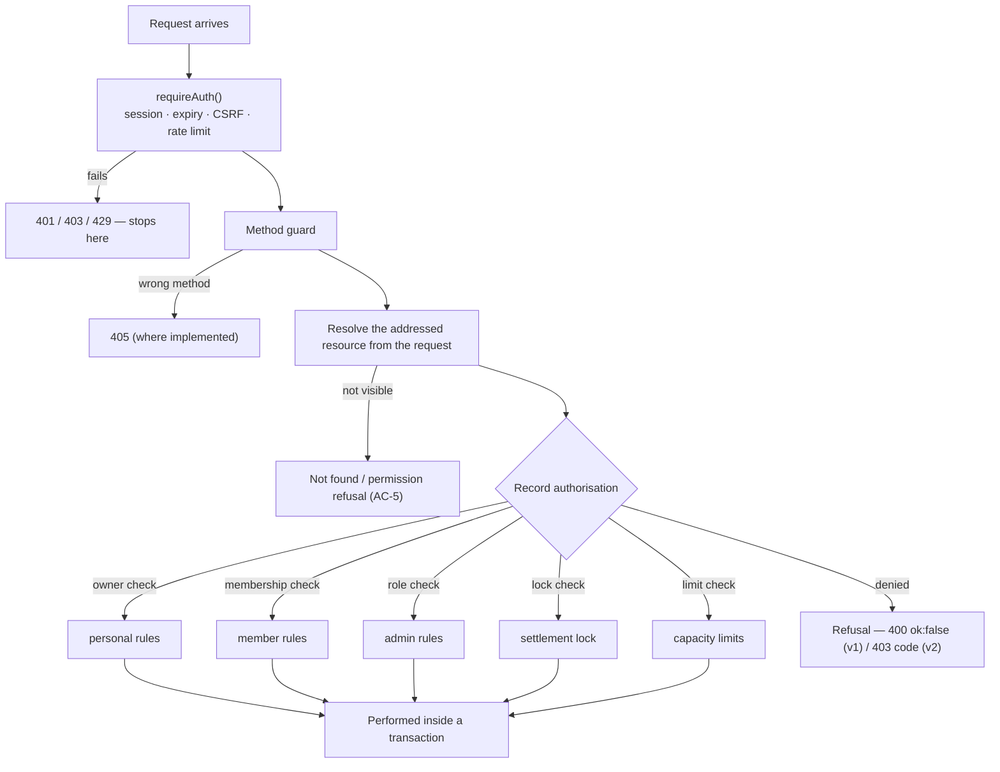

# Access Control

| Field | Value |
|---|---|
| Status | Specification — Phase 2 |
| Date | 2026-11-15 |
| Purpose | Define who may perform each operation, how the server decides, and how the decision is enforced uniformly across the v1 surface, the v2 surface, and the sync path |
| Requirements | PR-07, AA-02, GM-03, SE-06, SE-10, SY-15 |
| Companion | [`../database/DATA_OWNERSHIP.md`](../database/DATA_OWNERSHIP.md) defines *who owns what*. This document defines *how each request is checked* |
| Rule | Authorisation is re-evaluated on the server for every request, on every surface. A client's claim is never authority |

---

## 1. Scope and principles

| Topic | Section |
|---|---|
| The subjects that can act | §2 |
| The decision pipeline | §3 |
| The endpoint authorisation matrix | §4 |
| The rule catalogue | §5 |
| Guest isolation and the no-anonymous rule | §6 |
| Row-level access, visibility, and the sync scope | §7 |
| Privilege transitions | §8 |
| Failure conventions | §9 |

### 1.1 Principles

| # | Principle |
|---|---|
| AC-1 | **Deny by default.** An operation is permitted only if a rule grants it |
| AC-2 | **One rule, one implementation.** A permission rule lives in the endpoint or an `api/domain/` helper; the sync path calls the same helper (`../architecture/BACKEND_COEXISTENCE.md` §6) |
| AC-3 | **The session identifies; the database authorises.** `$_SESSION['user_id']` says who; `group_members`, `expenses.user_id`, and `lists.user_id` say what |
| AC-4 | **Never trust a client-supplied identity.** `user_id`, `group_id`, `paid_by`, `role`, `is_post_settlement`, `version`, cursor, device id — all are claims to be validated |
| AC-5 | **A missing row and a forbidden row are answered the same way** where enumeration would otherwise be possible |
| AC-6 | **Authorisation is not a UI concern.** Hiding a button is not a control; every rule is enforced server-side |
| AC-7 | **The freeze applies.** v1's status codes and error strings do not change (`API_CONTRACT.md` §14) |

---

## 2. Subjects

| Subject | How identified | What it may do |
|---|---|---|
| **Anonymous** | No session | Sign up, log in. Nothing else — including anything guest-related (§6) |
| **Guest** | No server identity at all | Client-local features only. Makes **no API request** |
| **Authenticated user** | Session `user_id` | Their own personal data; the operations their roles grant |
| **Owner** | `expenses.user_id` / `lists.user_id` / `budgets.user_id` / `notifications.user_id` matches the session | Full control of that personal record |
| **Group member** | A `group_members` row for `(group_id, session user)` | Read group data; create group expenses; calculate settlements; confirm their own confirmation |
| **Group admin** | `group_members.role = 'admin'` for that group | Everything a member may do, plus edit/delete group expenses, manage lists, remove members, delete the group, settle |
| **Recipient** | `notifications.user_id` matches the session | Read and mark their own notifications |
| **Registered device** | An active `sync_devices` row for the session user, verified in `app_sessions` | Sync push/pull; device registration required before first sync (D-34, UQ-17); never more permissions than the owning user |

**There is no super-user, no support role, and no service account in the product.** Database-level
operator access is an operational capability outside the API
([`../deployment/DEPLOYMENT_ARCHITECTURE.md`](../deployment/DEPLOYMENT_ARCHITECTURE.md) §7).

---

## 3. The decision pipeline

| Stage | Where it lives | Applies to |
|---|---|---|
| Session / expiry / CSRF / rate limit | `api/middleware/auth.php` | Every protected request, both surfaces |
| Method guard | The endpoint (`requirePostMethod()` / `requireGetMethod()` where used) | Per endpoint |
| Resource resolution | The endpoint or an `api/domain/` helper | Requests that address an existing row |
| Record authorisation | The endpoint or an `api/domain/` helper | Every row-touching operation |
| Transaction | The endpoint | Multi-step writes |

**Rule:** stages 3–5 are the same code for v1 and v2. A v2 sync push resolves each operation and
calls the same helper; it does not have a parallel permission model
(`../architecture/BACKEND_COEXISTENCE.md` §7).

---

## 4. Endpoint authorisation matrix (PR-07)

**Requirement:** PR-07 "`settle.php` / `settle_all.php` are admin-only". Verified in source:
`api/settlements/settle.php:67-79` and `api/settlements/settle_all.php:31-49` both load the caller's
membership row and refuse when `role !== 'admin'`.

| Endpoint | Auth | Required authorisation | Refusal |
|---|---|---|---|
| `GET /api/expenses/list.php` | Yes | Session user only; results scoped to the caller | — |
| `GET /api/expenses/summary.php` | Yes | Caller's own data | — |
| `GET /api/expenses/categories.php` | Yes | Any authenticated user (shared seed data) | — |
| `GET /api/expenses/unpriced.php` | Yes | Caller's own lists | — |
| `POST /api/expenses/create.php` | Yes | Personal: `user_id = :me`. Group: member + payer is a member | 400 `ok:false` |
| `POST /api/expenses/update.php` | Yes | Personal: owner. Group: **admin** (verified `update.php:104-118`) | 400 `Only the group admin can edit group expenses.` |
| `POST /api/expenses/delete.php` | Yes | Personal: owner. Group: **admin** (verified `delete.php:67-75`) | 400 `Only the group admin can delete group expenses.` |
| `POST /api/expenses/price_unpriced.php` | Yes | Item's list owner / group admin; settlement lock applies | 400 `ok:false` |
| `POST /api/groups/create.php` | Yes | Any authenticated user; ≤ 5 groups | 400 `ok:false` |
| `POST /api/groups/join.php` | Yes | Any authenticated user with a valid `join_code`; ≤ 10 members; ≤ 5 groups | 400 `ok:false` |
| `POST /api/groups/leave.php` | Yes | The caller's own membership | 400 `ok:false` |
| `POST /api/groups/delete.php` | Yes | **Admin** (creator-admin) | 400 `ok:false` |
| `POST /api/groups/remove_member.php` | Yes | **Admin**; cannot remove an admin (verified `remove_member.php:37-61`) | 400 `Only the group admin can remove members.` / `Admin cannot be removed from the group.` |
| `GET /api/groups/details.php` | Yes | Any **member** of the group | — |
| `GET /api/groups/user_groups.php` | Yes | Caller's own memberships | — |
| `POST /api/lists/create.php` | Yes | Personal: any user. Group: **admin** | 400 `ok:false` |
| `POST /api/lists/delete.php` | Yes | Personal: owner. Group: **admin** | 400 `ok:false` |
| `POST /api/lists/add_item.php` | Yes | Personal: owner. Group: **admin** | 400 `ok:false` |
| `POST /api/lists/remove_item.php` | Yes | Personal: owner. Group: **admin** | 400 `ok:false` |
| `POST /api/lists/check_item.php` | Yes | Item's list owner (personal) or **admin** (group); settlement lock; 600-second uncheck window | 400 `ok:false` |
| `GET /api/lists/details.php` | Yes | Personal: owner. Group: **member** | — |
| `GET /api/lists/user_lists.php` | Yes | Caller's own lists + their groups' lists | — |
| `GET /api/budgets/get.php` | Yes | Caller's own budget | — |
| `POST /api/budgets/set.php` | Yes | Caller's own budget (upsert) | 400 `ok:false` |
| `GET /api/settlements/calculate.php` | Yes | **Member** of the group | — |
| `POST /api/settlements/confirm.php` | Yes | **Member**; the confirmation is their own row; period computed server-side | 400 `ok:false` |
| `POST /api/settlements/settle.php` | Yes | **Deprecated (UQ-10 Option B)** | 410 `Endpoint deprecated. Use collaborative settlement workflow (calculate.php -> confirm.php).` |
| `POST /api/settlements/settle_all.php` | Yes | **Deprecated (UQ-10 Option B)** | 410 `Endpoint deprecated. Use collaborative settlement workflow (calculate.php -> confirm.php).` |
| `POST /api/settlements/post_calculate.php` | Yes | **Member** | 400 `ok:false` |
| `POST /api/settlements/post_confirm.php` | Yes | **Member**; their own confirmation | 400 `ok:false` |
| `GET /api/settlements/history.php` | Yes | **Member** of the group | — |
| `GET /api/settlements/details.php` | Yes | **Member** of the group | — |
| `GET /api/notifications/count.php` | Yes | Caller's own notifications (heartbeat bucket) | — |
| `GET /api/notifications/list.php` | Yes | Caller's own notifications (read-only) | — |
| `GET /api/notifications/history.php` | Yes | Caller's own notifications (read-only) | — |
| `POST /api/notifications/read.php` | Yes | **Recipient** of that notification | 400 `ok:false` |
| `GET /api/system/health.php` | Yes | Any authenticated user (inline snapshot) | — |
| `POST /api/login.php` | No | Credential check + CSRF + IP rate limit | 302 to login page / 429 |
| `POST /api/signup.php` | No | CSRF + IP rate limit (3/hour) | 302 to signup page / 429 |
| `GET|POST /api/logout.php` | No | None by design (PR-22, KD-31) | — |
| `api/workers/process_outbox.php` | n/a | **CLI only** — 403 over HTTP | 403 `Forbidden: CLI execution only.` |

**Reference:** the authoritative per-endpoint behaviour, including request fields and response
shapes, is `API_CONTRACT.md` §9. This table states only the authorisation requirement.

### 4.1 The PR-07 rule restated

| Rule | Statement |
|---|---|
| `settle.php` and `settle_all.php` are deprecated | Both endpoints are formally deprecated (UQ-10 Option B) and respond with HTTP 410 Gone; actual endpoint/test edits on hold until UQ-20 |
| The admin check reads `group_members.role` for that group | Not `groups.created_by`, which may be a non-member |
| "Admin" is per group | An admin of group A has no authority in group B |
| Collaborative settlement is authoritative | All settlements execute through the multi-party consensus ceremony (`calculate.php` -> `confirm.php`); unilateral admin force-settling is eliminated |
| The sync surface cannot settle | Settlement creation is a server operation (D-16/D-17); no v2 push operation exists for it |

### 4.2 Rules that are **not** endpoint-local

| Rule | Why it is not just an endpoint guard |
|---|---|
| Settlement lock | The same check runs on `update`, `delete`, `price_unpriced`, and every v2 push of the same operation |
| `paid_by` membership | Runs on create, update, list-check confirm, and push |
| Group limits | Runs on create and join, and on a pushed membership (which cannot occur offline) |
| Payer existence | A `paid_by` that does not resolve to a member is a data-integrity failure, not a permission failure — the two produce different messages |

### 4.3 v2 surface authorization matrix

| Endpoint | Session required | Authorisation rule | Failure response |
|---|---|---|---|
| `POST /api/v2/devices/register.php` | Yes | Any authenticated user; generates/records device UUID (D-34, UQ-17) | 400 `INVALID_PAYLOAD` / 401 |
| `GET /api/v2/devices/list.php` | Yes | Caller's own active registered devices and sessions | 401 |
| `POST /api/v2/devices/revoke.php` | Yes | Caller's own registered device; sets `revoked_at` and purges `app_sessions` (D-25) | 403 / 404 |
| `POST /api/v2/sync/push.php` | Yes | Registered, unrevoked device; validates operation permissions (D-16, D-28) | 403 `DEVICE_REVOKED` / 400 |
| `GET /api/v2/sync/pull.php` | Yes | Registered, unrevoked device; scope-filtered by user membership | 403 `DEVICE_REVOKED` / 410 `CURSOR_TOO_OLD` |
| `POST /api/v2/groups/archive.php` | Yes | **Group admin** only; initiates group archival (D-26, UQ-07) | 403 `ADMIN_REQUIRED` |
| `POST /api/v2/groups/restore.php` | Yes | **Group admin** only; within 3-month restoration window | 403 `ADMIN_REQUIRED` / 410 |
| `POST /api/v2/groups/permanent_delete.php` | Yes | **Group admin** only; after 6-month archival window | 403 `ADMIN_REQUIRED` / 400 |
| `POST /api/v2/reminders/ack.php` | Yes | Authenticated user; resets 24-hour reminder schedule account-wide (D-35, UQ-18) | 400 / 401 |

---

## 5. The rule catalogue

| ID | Rule | Applies to | Enforced by |
|---|---|---|---|
| R-AC-01 | Personal expense: owner only for edit/delete | `expenses.user_id` | Endpoint / helper |
| R-AC-02 | Group expense: admin only for edit/delete | `group_members.role` | Endpoint / helper |
| R-AC-03 | Group expense: member required to create | `group_members` row | Endpoint / helper |
| R-AC-04 | `paid_by` must be an active member of the group | `group_members` row | Endpoint / helper |
| R-AC-05 | Group expense inside a settled period is immutable | `settlements.period_end` | Helper (`settlement_lock`) |
| R-AC-06 | A period closes only when all active members confirmed | `settlement_confirmations` count vs member count | `confirm.php` inside a transaction with `FOR UPDATE` (PR-05) |
| R-AC-07 | Settlement creation (`settle*`) is admin-only | `group_members.role` | Endpoint (PR-07) |
| R-AC-08 | A member may confirm only their own confirmation | `settlement_confirmations.user_id` = session | Endpoint |
| R-AC-09 | List operations follow the list's owner (personal) or admin (group) | `lists.user_id` / `group_members.role` | Endpoint / helper |
| R-AC-10 | Uncheck must delete exactly the linked expense, within the 600-second window | `list_items.expense_id`, `checked_at` | `check_item.php` inside a transaction |
| R-AC-11 | Budget is owner-only | `budgets.user_id` | Endpoint |
| R-AC-12 | Notification read is recipient-only | `notifications.user_id` | Endpoint |
| R-AC-13 | Max 5 groups per user | `group_members` count | Endpoint / helper |
| R-AC-14 | Max 10 members per group | `group_members` count vs `groups.max_members` | Endpoint / helper |
| R-AC-15 | Group delete / member removal are admin-only | `group_members.role` | Endpoint |
| R-AC-16 | An admin cannot be removed through `remove_member` | Target's role | Endpoint |
| R-AC-17 | A non-member has no group access of any kind | `group_members` row | Query scoping |
| R-AC-18 | Notifications are never created by a client | `type`, `reference_id` | No endpoint exists |
| R-AC-19 | A `type`/`group_id` inconsistency is not an authorisation signal | See `../database/DATABASE_SCHEMA_SPECIFICATION.md` §7.3 | Design rule |
| R-AC-20 | Sync device requests require an active `sync_devices` row when a device is presented | `sync_devices.revoked_at` | v2 sync gate |

---

## 6. Guest isolation and the no-anonymous rule (GM-03, AA-02, SE-10)

### 6.1 The rule

| Rule | Statement |
|---|---|
| There is **no** anonymous API access | Every endpoint except login, signup, and logout requires a session. Guest mode adds no exception |
| Guest mode is client-local | It stores data in the Flutter local store and makes **no** HTTP request — not even a "health" or "sync" probe |
| Guest data never reaches the server except through the import flow | Which requires an authenticated session (`../synchronization/GUEST_DATA_MIGRATION.md` §4) |
| There is no anonymous "try it" path | The server cannot be made to hold guest data |
| Guest identity does not exist | No device registration, no anonymous session, no temporary user row |

### 6.2 Why (D-04's rationale, restated for enforcement)

| Reason | Consequence |
|---|---|
| Anonymous server data has no owner, so no retention or deletion policy can be correct | The server never holds it |
| Anonymous endpoints are an attack surface with no authentication to slow an attacker | None exist |
| A guest who later registers must not find their data already on a server they do not control | Import is explicit and authenticated |
| Phones lose data | The UI states plainly that guest data has no backup (`../synchronization/GUEST_DATA_MIGRATION.md` §3.3) |

### 6.3 GM-03: guests cannot reach registered-only functionality

GM-03 is a **client-side** requirement with a server-side backstop.

| Layer | Enforcement |
|---|---|
| Client | Guest mode exposes only the guest package; registered-only routes are unreachable (`../synchronization/GUEST_DATA_MIGRATION.md` §3.2) |
| Client | Any attempt to reach a registered feature triggers the registration flow rather than a call |
| Server | Even if a guest-mode client somehow issued a request, it has no session and receives 401 |
| Server | A guest-mode client is not a special client type; it simply never sends a request |

**Therefore SE-10 (guest data isolation) is structural:** there is no shared store, no shared
identifier space, and no server endpoint that could mix guest and registered data. The only moment
the two can meet is the import, which is scoped to the importing user's session and writes through
normal authorisation.

### 6.4 What must never be added

| Never | Why |
|---|---|
| An anonymous sync endpoint | Would require an anonymous identity |
| A device registration before login | A device belongs to a user (`DATABASE_SCHEMA_SPECIFICATION.md` §5.1) |
| A public read endpoint for "demo" data | The seed categories already come from an authenticated endpoint |
| A guest session id | A session implies server state for an unidentifiable principal |

---

## 7. Row-level access and the sync scope (SY-15, SE-06)

### 7.1 The visibility rule

A row is visible to a user when one of these holds:

| Entity class | Visible when |
|---|---|
| Personal expense, budget, personal list, personal list item | `user_id = :me` (or, for an item, its parent list's `user_id = :me`) |
| Group expense, group list, group list item, settlement | The user has a `group_members` row for the row's `group_id` |
| Notification | `notifications.user_id = :me` |
| Group, group membership | The user is a member of that group (their own membership row is visible to them) |
| Category | Any authenticated user |
| Sync device | `sync_devices.user_id = :me` |
| Change-log and tombstone rows | The scope rule in `DATABASE_SCHEMA_SPECIFICATION.md` §5.2.1 — the same predicate, computed at write time |

**The two predicates must agree.** The change log's `scope_user_id` / `scope_group_id` are derived by
a trigger from the row itself, so a discrepancy between "what a user can read" and "what a user is
sent" would require the underlying ownership columns to be wrong — which is itself a defect.

### 7.2 SE-06: the sync path never trusts client-supplied ownership

| Client claim | Server behaviour |
|---|---|
| `user_id` in a push payload | **Ignored.** The owner is the session user (personal) or derived from `group_id` (group) |
| `group_id` | Validated: the caller must be a member (create) or admin (update/delete) of that group |
| `paid_by` | Validated against active membership; a non-member payer is refused |
| `type` | Derived/validated against `group_id`; a pushed `type='personal'` with a `group_id` is refused |
| `is_post_settlement` | **Server-controlled.** A client cannot set or clear it — a client that could would be able to move an expense in or out of settlement maths |
| `created_by`, `checked_by`, `settled_by` | Server-set from the session or from the flow that produced the row |
| `version` | Read-only precondition (`base_version`), never an assignment |
| `uuid` | Accepted as identity; a collision is a `409`, never an overwrite |
| `device_uuid` | Validated against `sync_devices` for this user |
| cursor | A claim about how much the client has seen; used to select changes, never to widen visibility |

| Rule | Statement |
|---|---|
| A pushed payload is a **proposal**, completed and validated server-side | The server fills in the fields the client may not choose |
| A field the client may not choose and that is present is **ignored, not honoured** | Ignoring is safer than rejecting, because a future client version that sends an extra field must not break |
| The exception is a field whose presence indicates an attempt to escalate | `is_post_settlement`, `settled_by`, `role`, and `revoked_at` are never accepted on any surface |
| Nothing in the sync path reads the `user_id` recorded in a change-log row to decide permission | Scope columns decide **delivery** (`../database/DATA_OWNERSHIP.md` §2) |

### 7.3 SY-15: no cross-user data through ID manipulation

| Attack | Why it fails |
|---|---|
| Supply another user's expense `uuid` in a push update | The row is resolved, then the owner/admin check refuses; the error does not disclose the row's contents |
| Request a pull with a cursor and expect another user's changes | The pull query intersects the cursor with the scope predicate; the cursor cannot widen it |
| Register a device UUID already registered to another user | The lookup is `WHERE device_uuid = ? AND user_id = :me`; the row is not found, so it is treated as unregistered |
| Guess a `batch_key` of another user | The batch lookup is scoped to the caller; a foreign key is not found, so it is treated as a new batch — and the pushed operations are still authorisation-checked individually |
| Read another user's change-log rows through a support endpoint | No such endpoint exists |
| Enumerate group ids to read group data | Membership scoping makes a non-member's request indistinguishable from a non-existent group (AC-5) |
| Manipulate a `list_item.expense_id` to delete another user's expense | The uncheck path resolves the item through the list, then the expense through the item's own FK; the FK cannot point at a foreign expense through any write path |

**PENTEST obligation:** each row above is a test case in
[`../testing/ARCHITECTURE_VALIDATION_PLAN.md`](../testing/ARCHITECTURE_VALIDATION_PLAN.md) §13.

### 7.4 Aggregate and derivative access

| Surface | Access |
|---|---|
| Expense summary / charts | Caller-scoped; the underlying rows are already filtered |
| Settlement calculation | Group members only; the calculation reveals other members' balances, which is intended inside a group |
| Group details | Members only |
| Unpriced-items feed | Caller's own lists and their groups' lists |
| Health endpoint | Authenticated, but returns no user data |

**Rule:** a derivative read must not reveal more than the rows it derives from. A summary endpoint
that aggregated across groups the caller does not belong to would be a leak even though it returns
no rows.

---

## 8. Privilege transitions

| Transition | Effective immediately? | Notes |
|---|---|---|
| Login | Yes | New session, fresh CSRF token |
| Logout | Yes | The session is destroyed |
| Join a group | Yes | The membership row is the grant |
| Leave a group | Yes | All group access ends; the sync stream narrows (`DATA_OWNERSHIP.md` §7) |
| Removed by an admin | Yes | Same as leaving, enforced by the admin's action |
| Role change | Yes | No role is cached in the session (§`../api/AUTHENTICATION_AND_AUTHORIZATION.md` §2.3) |
| Group deleted | Yes | Cascade removes membership; the group is gone |
| Session expiry | Yes | Next request → 401 |
| Device revocation | Immediately for sync | The web session survives until expiry (D-25) |
| Account deletion / disable | **Policy open** | D-23, UQ-02 |

| Rule | Statement |
|---|---|
| No caching of authorisation | Roles and memberships are read per request |
| No grace period | A removed member's queued offline writes are refused on push (`../database/VERSIONING_AND_CONFLICT_RESOLUTION.md` §7.5) |
| The client mirrors, the server decides | The client hides UI affordances; the server is the control |

---

## 9. Failure conventions

| Condition | v1 (frozen — verified) | v2 (proposed) |
|---|---|---|
| No session | `401 {"ok":false,"error":"Authentication required"}` | `401 {"ok":false,"code":"UNAUTHENTICATED","error":"…"}` |
| Expired session | `401 {"ok":false,"error":"Session expired"}` | `401 {"ok":false,"code":"SESSION_EXPIRED",…}` |
| CSRF invalid | `403` + one of the frozen CSRF strings | `403 {"code":"CSRF_INVALID"}` |
| **Permission denied** | **`400 {"ok":false,"error":"<frozen permission string>"}`** — verified: `apiResponse()` defaults to 400 and no v1 endpoint passes 403 for authorisation | `403 {"code":"PERMISSION_DENIED","error":"…"}` |
| Rate limited | `429` + `retry_after`, `limited_by` | `429` + `retry_after`, `code:"RATE_LIMITED"` |
| Record not visible | Same response as "not found" (AC-5) | Same |
| Wrong HTTP method | `405` where `requirePostMethod()`/`requireGetMethod()` is used; otherwise the endpoint's own behaviour (mixed state, `API_CONTRACT.md` §9.1) | 405 consistently |
| CLI-only file over HTTP | `403 {"ok":false,"error":"Forbidden: CLI execution only."}` | n/a |

**Client rule:** treat the `ok` flag as authoritative for business outcomes and the HTTP status for
transport classes. A client that only checks the status code will mis-handle v1 refusals.

**Documentation note (recorded for the readiness report):** `AGENTS.md` states that non-admin
attempts "must return `ok: false` with HTTP 403". The verified behaviour is HTTP 400. The frozen
contract is 400, so v1 is **not** changed; the discrepancy is a documentation defect in `AGENTS.md`,
not a code defect, and it is logged in
[`../WORK/PHASE_2_READINESS_REPORT.md`](../WORK/PHASE_2_READINESS_REPORT.md).

---

## 10. Verification

| Requirement | Method | Pass condition |
|---|---|---|
| PR-07 settle deprecation | `CONTRACT-TEST` | Calls to `settle.php` and `settle_all.php` receive HTTP 410 Gone (UQ-10 Option B; test edits on hold until UQ-20) |
| AA-02 no anonymous access | `PENTEST` | No endpoint except login/signup/logout/session-status answers without a session |
| GM-03 guests cannot reach registered functionality | `MANUAL-SCENARIO` | A guest-mode build performs zero API calls; stored request logs contain no guest-originated request |
| SE-06 sync never trusts client ownership | `PENTEST` | Pushed `user_id`, `group_id`, `paid_by`, `type`, and `is_post_settlement` are ignored or refused as specified |
| SE-10 guest data isolation | `MANUAL-SCENARIO` | Guest data exists only in the local store; after import it belongs to exactly one account |
| SY-15 no cross-user access through IDs | `PENTEST` | Every attack in §7.3 fails without disclosing foreign data |
| R-AC-01…R-AC-20 | `CONTRACT-TEST` | Each rule has at least one test; the table in §5 maps rule → surface |
| §9 conventions | `CONTRACT-TEST` | v1 refusals are 400 with `ok:false`; v2 refusals are 403 with a `code` |
