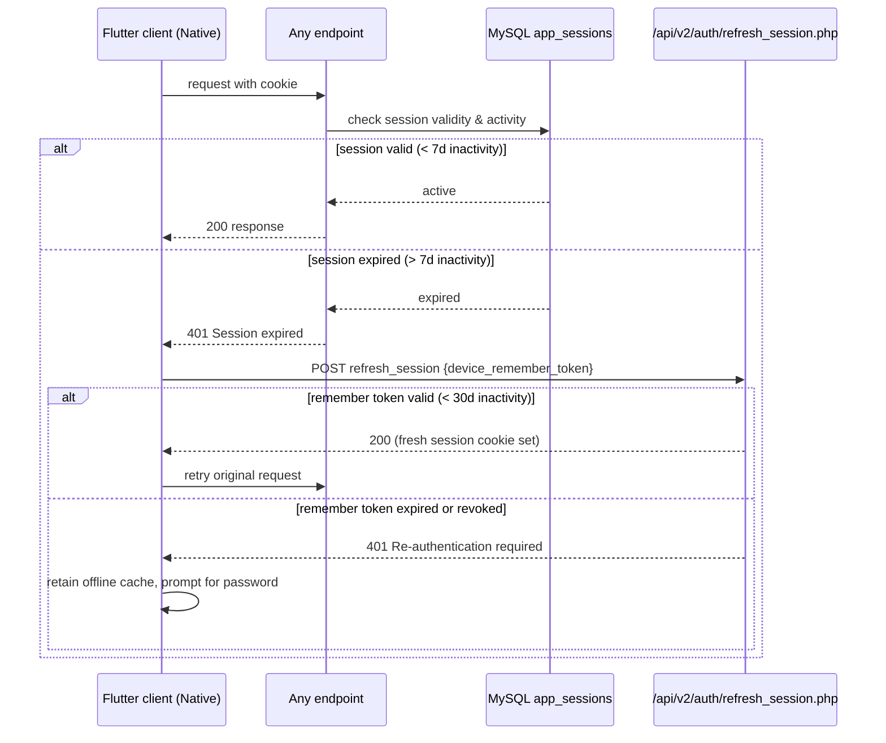
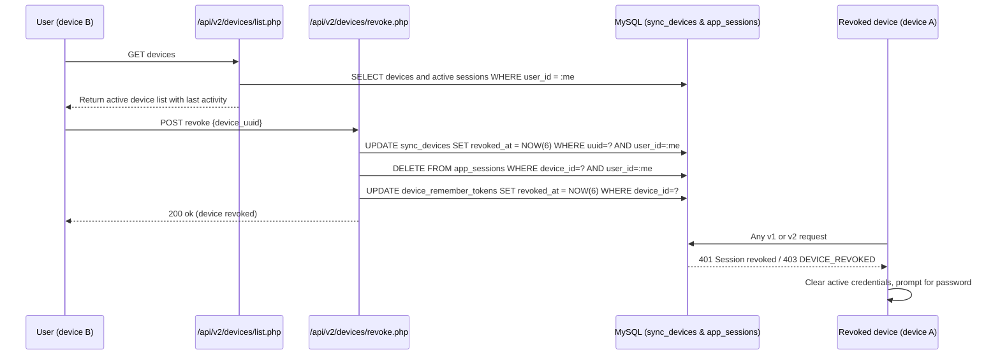

# Session Management

| Field | Value |
|---|---|
| Status | Specification — Phase 2 |
| Date | 2026-11-18 |
| Purpose | Define who owns the session, how the cookie behaves, how long a session lives, how multiple devices coexist, and how a device is revoked |
| Requirements | AA-04, AA-05, AA-06, AA-07, PR-22 |
| Decisions | D-09, D-24 (`ACCEPTED`), D-25 (`ACCEPTED`), D-32, D-33 (`ACCEPTED`) |
| Verified against | `config/session.php`, `api/middleware/auth.php`, `api/login.php`, `api/logout.php` at HEAD `ec0e692` |

---

## 1. Scope

| Topic | Section |
|---|---|
| The single session owner | §2 |
| Cookie parameters, storage, and the client side | §3 |
| Lifetime, expiry, renewal, and 401 handling | §4 |
| Multiple devices and the same-origin constraint | §5 |
| Device revocation | §6 |
| Login and logout lifecycle | §7 |
| Threats and their mitigations | §8 |

CSRF is specified in [`../api/AUTHENTICATION_AND_AUTHORIZATION.md`](../api/AUTHENTICATION_AND_AUTHORIZATION.md) §5.
Device *records* are specified in
[`../database/DATABASE_SCHEMA_SPECIFICATION.md`](../database/DATABASE_SCHEMA_SPECIFICATION.md) §5.1.

---

## 2. The single session owner (D-32)

**Decision:** D-32. **Debt:** KD-02. **Requirement:** PR-22's context.

### 2.1 The rule

| Rule | Statement |
|---|---|
| One implementation | `config/session.php` configures the cookie and the security headers. It is the only place that does |
| One entry point for APIs | `api/middleware/auth.php` requires `config/session.php` and calls `ensureSecureSessionStarted()` before anything else |
| One entry point for the shell | `public/index.php` does the same for the SPA shell |
| `api/bootstrap.php` stays dead | It contains a **duplicate** of the same hardening and is included by **zero** files. Including it in an endpoint would double-send headers and is explicitly forbidden |
| Endpoints never call `session_start()` | Test 27b enforces this. `api/logout.php` is the documented exception (§7.2) |

### 2.2 Why this matters more in the target architecture

The Flutter client depends on the session's exact behaviour: cookie flags decide whether the browser
build can authenticate at all, and the header set decides whether the Web build's asset loading
works under the CSP. Two implementations drifting apart would produce a platform-specific
"sometimes logged out" bug.

### 2.3 The functions (verified)

| Function | Responsibility |
|---|---|
| `configureSecureSessionCookie()` | Sets `use_strict_mode`, `use_only_cookies`, `cookie_httponly`, and the cookie parameters. No-op if a session is already active |
| `ensureSecureSessionStarted()` | Calls the above, then `session_start()`, exactly once |
| `expmgSendSecurityHeaders()` | Emits CSP, `X-Content-Type-Options`, `X-Frame-Options`, `Referrer-Policy` |

### 2.4 What must not be added to this file

| Not added | Why |
|---|---|
| A database or Redis session handler | Would make the session a second store to operate and back up, for no requirement. It is also model M-2 in `../architecture/BACKEND_COEXISTENCE.md` §4.1, which is not recommended |
| A second cookie | One credential, one cookie |
| A refresh-token cookie | No token scheme (D-09) |
| CORS-enabling cookie flags | `SameSite=None` would be needed only for a cross-origin deployment, which D-08 forbids |
| Session-fixation defences beyond `use_strict_mode` + regeneration | Already handled at login (§7.1) |

---

## 3. The cookie and where session state lives

### 3.1 Cookie parameters (verified)

| Parameter | Value | Rationale |
|---|---|---|
| `lifetime` | `0` (session cookie) | The browser drops it when the window closes; the server-side 24-hour limit is the real bound (§4) |
| `path` | `/` | The whole application, including `/api/` and the Flutter Web subdirectory |
| `domain` | `''` (host-only) | No subdomain sharing; nothing needs it |
| `secure` | `true` only on HTTPS | `expmgIsHttps()`. Local XAMPP over HTTP still works; production requires HTTPS (§`../deployment/DEPLOYMENT_ARCHITECTURE.md` §3) |
| `httponly` | `true` | JavaScript cannot read the session id |
| `samesite` | `Lax` | Blocks cross-site `POST` from attaching the cookie; permits top-level navigation |

### 3.2 Session state on the server (verified, D-25)

| Aspect | Value | Consequence |
|---|---|---|
| Handler | PHP's default file handler + `app_sessions` registry | Sessions live in the system temp directory, tracked in MySQL `app_sessions` table |
| Locking | Exclusive `flock` per session file | Concurrent requests from one user serialise unless the lock is released early — which is exactly why `requireAuth()` calls `session_write_close()` before rate limiting (`../api/AUTHENTICATION_AND_AUTHORIZATION.md` §3.2) |
| Enumerability | **Full via `app_sessions`** | Active sessions are recorded with `session_id_hash`, `user_id`, `device_id`, `ip_address`, `last_activity_at`, and `expires_at` |
| Consequence | "Sign out everywhere" and per-device revocation are supported | D-25 `ACCEPTED` (`app_sessions` registry) |

### 3.3 Where the cookie lives on each platform (AA-04)

| Platform | Credential store | Persistence across restarts | Notes |
|---|---|---|---|
| Flutter Web | Browser cookie jar | Yes, while the browser session lives | Same-origin only (D-08). The page must not be served from a different origin |
| Android | App-private cookie jar (`dio` cookie manager + platform storage) | Yes, if persisted explicitly | The cookie is not readable by other apps. Recommend persisting only the session id, never the CSRF token |
| iOS | App-private cookie jar | Yes, if persisted explicitly | Same |
| Windows / macOS / Linux | App-private file in the app support directory | Yes, if persisted explicitly | File permissions must be user-only (`SECURITY_ARCHITECTURE.md` §5) |

| Rule | Statement |
|---|---|
| The cookie jar is the **only** place the session id is stored | It is never written to the local database, a log, or an analytics event |
| The CSRF token is memory-only | Re-obtained from `/api/v2/auth/session.php` on start-up |
| Logout clears both | §7.3 |

**`SYSTEM_COMPONENTS.md` §2.1's note applies here:** the session cookie lives in the HTTP cookie jar,
not in the application's secure storage. The device *secret* (a different credential) is in secure
storage.

### 3.4 Session-fixation and hijacking protections (verified)

| Protection | Where |
|---|---|
| `session.use_strict_mode = 1` | Rejects client-supplied, uninitialised session ids |
| `session.use_only_cookies = 1` | No session id in URLs |
| `session_regenerate_id(true)` at login | A fresh id after privilege elevation; the old file is destroyed |
| `HttpOnly` | No script access |
| `SameSite=Lax` | No cross-site `POST` attachment |
| 24-hour absolute expiry | Bounds the value of a stolen id |
| CSRF on writes | A stolen cookie alone cannot perform a state-changing request from a foreign origin |

**Not present, and not required by any requirement:** binding a session to an IP address or user
agent. Both break mobile networks and legitimate client updates for a marginal gain; the decision is
recorded here so it is not reintroduced as a "hardening".

---

## 4. Lifetime, expiry, and renewal (AA-05, D-24, D-33)

### 4.1 The dual-tier lifetime model (owner-approved Option C)

The project owner approved **Option C** (D-24, D-33): separate credential mechanisms for web and native platforms rather than a monolithic sliding PHP session cookie:

| Platform | Credential & Lifetime | Mechanism & Storage | Renewal & Revocation |
|---|---|---|---|
| **Web browser** | **7-day inactivity session** | Standard hardened PHP session cookie (`SameSite=Lax`, `HttpOnly`, `Secure` on HTTPS) | Inactivity timeout tracked in `app_sessions`; destroyed on logout or expiry |
| **Native clients** (Android, iOS, Windows, macOS, Linux) | **30-day inactivity remember credential** | Cryptographic device token stored in OS secure storage (KeyStore, Keychain, DPAPI, libsecret) | Presented on startup to mint a fresh short-lived session; revoked via server device registry |

Under this model:
- The server does **not** issue a 30-day sliding PHP session cookie to browsers.
- Native clients do not store raw user passwords. They store a high-entropy `device_remember_token` in hardware-backed secure storage.
- On launch or when the current session expires, native clients present the `device_remember_token` to `/api/v2/auth/refresh_session.php` to obtain a fresh session.
- If a native device is inactive for > 30 days, the remember credential expires and requires full user password authentication.

### 4.2 Enforcement and server obligations

| Enforcement point | Rule |
|---|---|
| Inactivity check | `requireAuth()` verifies `now - last_activity_at <= 604800` (7 days for active web sessions); updates `last_activity_at` |
| Database validation | `app_sessions` row must exist and not be revoked; if missing/revoked → `session_destroy()` → `401 Session expired/revoked` |
| Native refresh gate | `/api/v2/auth/refresh_session.php` verifies `device_remember_token`, checks `sync_devices.revoked_at IS NULL`, checks `now - last_used_at <= 2592000` (30 days), regenerates session id and writes new `app_sessions` row |
| Client visibility | `/api/v2/auth/session.php` returns `session.expires_at` and `session.platform` |

### 4.3 Expiry timeline



### 4.4 Client obligations (must be implemented)

| # | Obligation |
|---|---|
| 1 | On `401`, native clients attempt background session exchange with `device_remember_token`. If refresh fails, route to login. Never delete local offline data |
| 2 | Before the queue is flushed, verify session readiness; if session is expired, trigger refresh **before** pushing batch writes |
| 3 | A queued write must survive 401 and remain queued in Drift store (it belongs to the user, not the transient session) |
| 4 | On successful re-login/refresh, pending queues flush idempotently |
| 5 | Never store passwords on disk. Use platform secure storage (Keychain, KeyStore, DPAPI, libsecret) strictly for `device_remember_token` |
| 6 | Sessions are per-device; revoking one device does not disrupt other devices (§5) |

### 4.5 What a session expiry does **not** affect

| Unaffected | Why |
|---|---|
| Local offline data | It is the user's data, not the session's |
| Group membership and roles | Server-side, re-evaluated on the next request |
| Pending sync queue | Preserved for the next successful login |
| Device registration | The `sync_devices` row remains valid until revoked |

### 4.6 Anti-patterns (explicitly forbidden)

| Anti-pattern | Why it is forbidden |
|---|---|
| A "remember me" that extends the server session | It is D-24's option (c) and needs an approved threat model |
| Re-login with stored credentials | Storing a password — even encrypted — for automatic re-authentication is a new credential store |
| Polling an endpoint to keep the session warm | It cannot work (absolute expiry) and wastes the rate-limit budget |
| Treating `expires_at` as authoritative on the client | It is informational; the server decides |

---

## 5. Multiple devices and the same-origin constraint (AA-06)

### 5.1 Sessions are per-device

| Property | Behaviour |
|---|---|
| Login on device A and device B | Two independent sessions, each with its own `login_time` and its own 24-hour clock |
| Logout on device A | Device B is unaffected |
| Session destruction on A | B is unaffected |
| No shared or "primary" session | There is no session list, so no session can be identified from another |
| Data convergence | Achieved by sync (`../synchronization/SYNC_WORKFLOWS.md`), not by the session |

### 5.2 Why this satisfies AA-06 without a second auth system

AA-06 asks that multi-device access work without introducing tokens. It does: every device performs
its own login with the same credential, and every device's writes converge through the version-based
sync protocol. The only per-device artefact is the device record, which is **attribution and
revocation**, not authentication (§6).

### 5.3 Same-origin constraint for Flutter Web (D-08, verified)

| Constraint | Verified source | Consequence |
|---|---|---|
| No CORS headers exist anywhere | Repository-wide search: zero matches | A cross-origin request has no permission to proceed |
| CSP `connect-src 'self'` | `config/session.php` | The browser refuses a connection to another origin before it is made |
| Cookie `SameSite=Lax` | `config/session.php` | Even with CORS, the cookie would not be attached to a cross-site `fetch` |
| Session cookie `path=/` | `config/session.php` | A Flutter Web build under the same host and a subdirectory **is** in scope |

| Rule | Statement |
|---|---|
| Flutter Web is served same-origin | Same host, same port, a subdirectory (`/ExpMgWEB/app/`) |
| The API base URL is a compile-time value | Defaulting to a same-origin relative path |
| A separate origin requires a new decision | It implies CORS design, `SameSite=None`, and a security review (UQ-15) |
| Native platforms are unaffected | CORS is a browser concept |

### 5.4 Consequences of same-origin for the Web build

| Item | Handling |
|---|---|
| Service worker scope | Registered under the subdirectory; must not intercept `/api/*` |
| Cache busting | Asset names include a build hash |
| Cookie visibility | The cookie is sent automatically by the browser; the app never reads it |
| CSP compatibility | The current CSP already permits `self` scripts, styles, and connections. Flutter Web's WASM/JS assets load from `self`. If a Flutter Web release requires an eval-like facility, that is a **CSP change requiring a decision**, not a silent relaxation |
| CanvasKit assets | Served from the same origin; verify no CDN default remains (`../deployment/DEPLOYMENT_ARCHITECTURE.md` §4) |

**Verification obligation:** the Web build must be smoke-tested against the real CSP with the browser
console visible, because a CSP violation appears as a subtle missing feature rather than a crash
(`../testing/ARCHITECTURE_VALIDATION_PLAN.md` §14).

---

## 6. Device revocation (AA-07, D-25)

**Status: `ACCEPTED`** — D-25 / UQ-04. The project owner approved **Option (b)**: database-backed session registry via `app_sessions` paired with `sync_devices`, delivering full session and device revocation across both v1 and v2 API surfaces.

### 6.1 The mechanism

| Fact | Resolution |
|---|---|
| Sessions tracked in `app_sessions` | Every active web session and native device session is recorded with `session_id_hash`, `device_id`, `user_id`, and timestamps |
| `sync_devices` gives per-device registry | Every syncing device has a stable UUIDv7 `device_id` and registration record |
| Revocation action | User revokes a device via `/api/v2/devices/revoke.php` or account security dashboard |
| Universal invalidation | The server atomically marks `sync_devices.revoked_at = NOW(6)`, deletes matching rows in `app_sessions`, and revokes native remember credentials |

### 6.2 The three effects under approved Option (b)

| # | Capability | Governed by | Approved behaviour (Option b: `app_sessions`) |
|---|---|---|---|
| 1 | **Synchronization privilege** — may this device push/pull? | `sync_devices.revoked_at`; checked on every `sync/*` request | **Revoked immediately** (`403 DEVICE_REVOKED`) |
| 2 | **Authenticated session** — may this device still call any authenticated endpoint? | `app_sessions` table check in `requireAuth()` | **Revoked immediately** (`401 Session expired/revoked`); applies to all 40 v1 endpoints and all v2 endpoints |
| 3 | **Access to already-downloaded local data** — may the user open the local Drift store? | Client policy and OS secure storage | The app prompts for re-authentication; local encrypted cache is retained until local timeout or network reconnect |

| Rule | Statement |
|---|---|
| Universal termination | Revoking a device terminates both sync and authenticated sessions immediately. Stolen devices cannot make further API requests |
| Offline limitation | The server cannot reach an offline device to execute remote wipe. If an adversary has physical extraction capability before the device reconnects or local timeout triggers, data at rest encryption is the active control |
| Re-registration policy | A revoked device is permanently barred from reusing its revoked `device_id`. Re-registering the hardware requires a full fresh authentication with password |

### 6.3 Revocation sequence



### 6.4 What revocation is not

| Not this | Reason |
|---|---|
| Account suspension | That is §10 of [`../database/DATA_OWNERSHIP.md`](../database/DATA_OWNERSHIP.md) |
| Password change | A separate operation; password change revokes all other sessions in `app_sessions` |
| Data deletion | No business data is affected |
| A substitute for session expiry | The session still expires on its own inactivity clock |

---

## 7. Login and logout lifecycle (PR-22)

### 7.1 Login (verified)

| Step | Action |
|---|---|
| 1 | `verifyCsrf()` runs **before** the credential check |
| 2 | IP rate limit: 5 attempts / 15 minutes |
| 3 | Credentials verified against the bcrypt hash |
| 4 | `session_regenerate_id(true)` — the fixation defence |
| 5 | `$_SESSION['user_id']`, `$_SESSION['login_time']` |
| 6 | `generateCsrfToken()` — a fresh token per login |
| 7 | `302 Location: ../public/index.php` (success) or `../pages/login.php` (generic failure) |

**A login is also where a device becomes known to the client**: the client generates its device UUID
before the first login and registers it afterwards (§`../database/DATABASE_SCHEMA_SPECIFICATION.md`
§5.1.2).

### 7.2 Logout (verified, KD-31, PR-22 — preserved)

| Aspect | Behaviour |
|---|---|
| Method guard | None |
| `requireAuth()` | Not called |
| CSRF | Not required |
| Session start | Called directly — the documented exception to the "endpoints never call `session_start()`" rule |
| Effect | `$_SESSION = []`, cookie expired, `session_destroy()`, `302 Location: ../pages/login.php` |

**Preservation rule (PR-22):** the file's behaviour is frozen. It is unguarded by design decision —
a forced logout is a nuisance, not a compromise — and the CSRF gate deliberately does not apply so
that a user with an expired CSRF token can still sign out.

### 7.3 Client logout sequence

```mermaid
sequenceDiagram
    participant App as Flutter app
    participant API as /api/logout.php
    participant Store as Local store
    App->>API: GET (no CSRF header required)
    API-->>App: 302 → pages/login.php
    App->>App: clear the cookie jar
    App->>App: clear in-memory CSRF token and user
    App->>Store: keep registered-user data (D-16)
    Note over App,Store: registered data stays; guest data is separate and untouched
```

| Rule | Statement |
|---|---|
| Federation with sync | On the next login the client re-bootstraps or resumes from its cursor; nothing is deleted |
| Device record | Not deleted by logout; the device remains registered until revoked (§6) |
| Guest data | Unaffected; guest mode never had a session |

### 7.4 Ordering hazards

| Hazard | Rule |
|---|---|
| Logging out while a push is in flight | The push may succeed or fail with 401. The client treats both as "retry after login"; the queue is not discarded |
| Logging out with queued writes | The queue persists. The UI must warn that unsent changes remain |
| A 401 during a background sync | Do not log the user out automatically on a *single* 401 unless `SESSION_EXPIRED`/`UNAUTHENTICATED` is explicit; a transient failure must not be treated as an expiry (`../api/API_ERROR_HANDLING.md` §4) |

---

## 8. Threats and mitigations

| Threat | Mitigation in this design | Residual risk |
|---|---|---|
| Session hijacking (stolen cookie) | `HttpOnly`, `SameSite=Lax`, HTTPS-only flag in production, 7-day inactivity expiry, CSRF on writes, database revocation | A stolen cookie is usable until expired or revoked via dashboard |
| Session fixation | `use_strict_mode`, `session_regenerate_id(true)` at login | None known |
| CSRF | `verifyCsrf()` on every write, header-first token, failure gate | `logout.php` is exempt by decision |
| Cross-site cookie attachment | `SameSite=Lax` | Top-level `GET` navigation carries the cookie — harmless for the read-only `GET`s that exist |
| XSS stealing the session | `HttpOnly` means the cookie is unreadable; CSP restricts script sources | An XSS could still *act* as the user; CSP and output escaping are the defence |
| Device impersonation | `device_secret` continuity check; `device_uuid` scoped per user | A client that loses its secret must re-register |
| Session enumeration | Fully enumerated in `app_sessions` table; revocable per device | None |
| Long-lived credential theft on a mobile device | Device remember tokens stored in hardware-backed storage (Keychain/KeyStore/DPAPI/libsecret); revocable remotely | Compromise of hardware key store allows token extraction until remote revocation |
| Token theft | Hardware secure storage prevents unprivileged extraction | — |

---

## 9. Status of architectural questions

| UQ | Status | Decision & Policy |
|---|---|---|
| UQ-03 — session lifetime for native clients (D-24, D-33) | `APPROVED` | Option C: 7-day inactivity web sessions; 30-day inactivity remember credentials in native secure storage |
| UQ-04 — device revocation model (D-25) | `APPROVED` | Option B: Full revocation via `app_sessions` table; terminates sync and session immediately |
| UQ-15 — a separate origin for Flutter Web (D-08) | `APPROVED` | Same-origin hosting (`/ExpMgWEB/app/`) confirmed; no CORS headers permitted |

---

## 10. Verification

| Requirement | Method | Pass condition |
|---|---|---|
| AA-04 cookie session works on all platforms | `PLATFORM-SMOKE` | Login, one write, and logout succeed on Web, Android, iOS, Windows, macOS, Linux |
| AA-05 expiry defined and enforced | `CONTRACT-TEST` | A session older than 24 hours receives `401 Session expired`; `expires_at` matches the server's own computation |
| AA-06 multi-device sessions | `DOC-REVIEW` | §5.1 describes two independent sessions; no token scheme is introduced |
| AA-07 device registration/revocation | `DOC-REVIEW` (blocked by UQ-04) | §6 has a mechanism, a scope, and an explicit open policy |
| D-32 single session owner | `STATIC-CHECK` | `api/bootstrap.php` is still included by zero files; no endpoint calls `session_start()` except `logout.php` |
| PR-22 logout preserved | `DOC-REVIEW` | The described behaviour matches `api/logout.php` byte-for-byte |
| D-08 same-origin | `PENTEST` + `MANUAL-SCENARIO` | The Web build loads and authenticates on the same origin with the real CSP; no CORS header exists |
| §8 threats | `PENTEST` | Each threat's test appears in `../testing/ARCHITECTURE_VALIDATION_PLAN.md` §13 |
