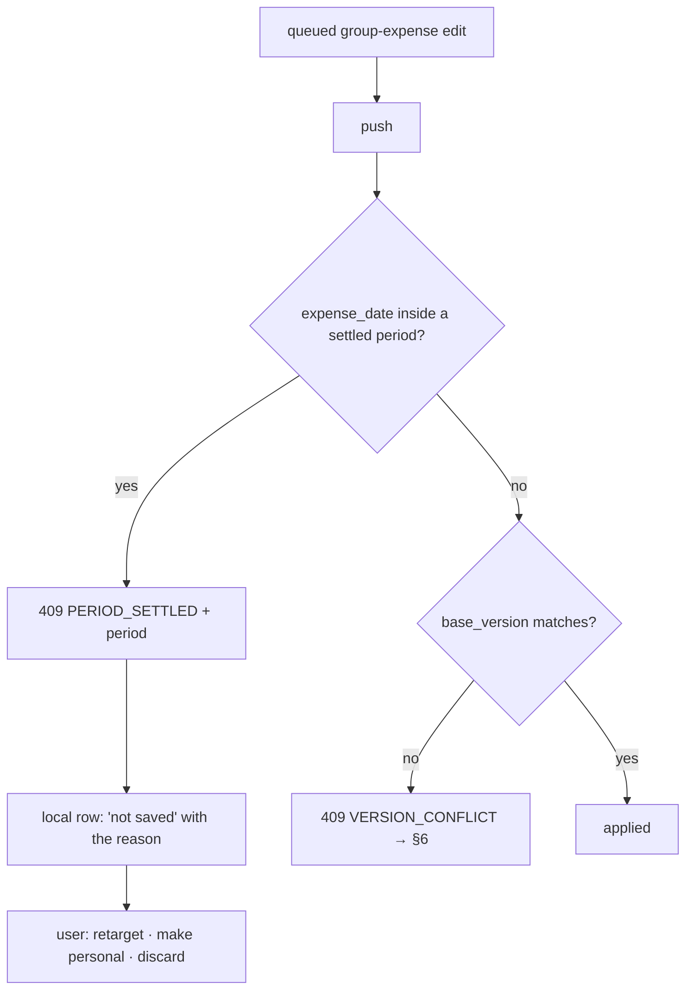

# Conflict Resolution

| Field | Value |
|---|---|
| Status | Specification — Phase 2 |
| Date | 2026-11-15 |
| Purpose | Define what happens when two devices change the same record: which policy applies, what the user sees, what choices are offered, and what is forbidden |
| Requirements | SY-09, SY-14, VC-05, VC-06, VC-07, PR-03 |
| Decisions | D-06, D-16, D-17, D-18 (the domain rule), D-27 |
| Rule | A conflict is never resolved silently for a financial record, and never in a way that violates a settlement or ownership rule |

---

## 1. Scope

| Topic | Section |
|---|---|
| The principle | §2 |
| The per-entity policy | §3 |
| Where last-write-wins is used | §4 |
| Financial and settlement rules | §5 |
| The resolution workflow | §6 |
| Field-level merge offers | §7 |
| The conflict surface | §8 |
| What each choice means | §9 |

Data mechanics: [`../database/VERSIONING_AND_CONFLICT_RESOLUTION.md`](../database/VERSIONING_AND_CONFLICT_RESOLUTION.md).
Detection and storage: same document, §4–§5. The queue: [`OFFLINE_DATA_MANAGEMENT.md`](OFFLINE_DATA_MANAGEMENT.md) §4.

---

## 2. The principle

### 2.1 Statements

| # | Statement |
|---|---|
| CR-1 | **A lost update is a wrong balance.** Financial records are never merged on a "latest wins" basis |
| CR-2 | **Detection is automatic; resolution is not.** The server detects; the user (or a stated policy) decides |
| CR-3 | **Both sides are always available.** A conflict response carries the server's row; the client holds the local row |
| CR-4 | **A resolution is a new write**, with a fresh `base_version` — never a forced overwrite |
| CR-5 | **No rule is bypassed by resolution.** A merge cannot create a settled-period edit, a non-member payer, or an unauthorised change |
| CR-6 | **Nothing is discarded without the user seeing it** |
| CR-7 | **A conflict is never auto-retried** |

### 2.2 Why the whole mechanism exists

Without versions, the current system silently applies the last write. Two devices editing the same
expense — one raising it to 42.00, the other correcting it to 40.00 — produce one of the two values,
with no record that the other intent existed, and a settlement that may already have consumed the
first. Version-based detection turns that silent loss into a decision
(`../database/VERSIONING_AND_CONFLICT_RESOLUTION.md` §2.2).

### 2.3 What is not a conflict

| Situation | Why it is not a conflict |
|---|---|
| Two devices insert different records | Different UUIDs; both apply |
| Two devices add different items to the same list | Different rows |
| A device writes a record the server has never seen | A create |
| A read after another device's write | The write is the change; the read just sees it |
| A server-side change with no local edit | It is a normal pull |
| A change to a record with no queued operation | Normal |

---

## 3. The per-entity policy (SY-09)

**Requirement:** SY-09 "conflicts are resolved by a defined per-entity policy". The authoritative
policy table is
[`../database/VERSIONING_AND_CONFLICT_RESOLUTION.md`](../database/VERSIONING_AND_CONFLICT_RESOLUTION.md)
§7; this section states which policies the **user** interacts with.

| Entity | Policy | User interaction |
|---|---|---|
| **Personal expense** | Manual, field merge offered | Yes — a choice per conflict |
| **Group expense** | Manual, field merge offered | Yes |
| **Expense delete vs edit** | Manual unless the tombstone is clearly newer | Yes |
| **Budget** | Manual | Yes — a two-option choice (one field) |
| **Personal list** (name) | Manual | Yes |
| **Personal list delete** | Delete-wins-if-newer, else manual | Sometimes |
| **Personal list item** | Manual, field merge offered | Yes |
| **Group list / item** | Server-wins | No — the client cannot write them offline |
| **Group, group member** | Server-wins | No |
| **Settlement, confirmations** | Server-only / not synchronised | No |
| **Notification** | Not synchronised (D-19) | No |

| Rule | Statement |
|---|---|
| Every interactive policy offers "keep mine", "keep theirs", and (where meaningful) "merge" | A policy with no escape hatch is not a policy |
| "Keep mine" is always a **new write** against the current version | CR-4 |
| A conflict on a record the user can no longer write is not offered | §5.4 |

---

## 4. Where last-write-wins is used (VC-05)

**Requirement:** VC-05 "last-write-wins is applied only where justified".

| Domain | LWW justified? | Why |
|---|---|---|
| Server-authoritative entities (group, group_member, settlement, notification, category) | **Yes, in effect** | The client cannot write them; the server's value is the only value. This is not a merge decision — there is nothing to merge |
| Group list / list item | **Yes, in effect** | Read-only offline; the server's value is authoritative |
| A pulled change over a **synced** local record (no pending operation) | **Yes** | There is no competing intent: the local record has not been edited |
| Duplicate create (`409 DUPLICATE_ID`) | **Yes, in effect** | The server's record is adopted; the client's was never stored |
| Personal expense | **No** | Financial |
| Group expense | **No** | Financial, and affects other members |
| Budget | **No** | A spending ceiling is a deliberate value; silently replacing it hides an intent |
| Personal list / item | **No** | User-authored content; the cost of asking is one tap |

| Rule | Statement |
|---|---|
| "In effect" means the policy falls out of the fact that the client cannot write the entity | It is not an implemented merge rule and must not be cited as one |
| LWW is never applied because it is convenient | Every use is listed above |
| A new entity added to the sync store must be assigned a policy before it ships | An unassigned policy defaults to manual |
| The reason LWW is acceptable for server-authoritative data is that **no user intent is lost** | The client never expressed an intent for those entities offline |

### 4.1 The mechanism that implements "no pending operation"

| Local state | Incoming change |
|---|---|
| `synced` | Apply (version increases) |
| `pending` / `inflight` | Do not apply blindly: compare versions when the push result arrives; the push is the authority |
| `conflict` | The incoming change updates the **server side** of the stored conflict; the user's choice is still required |
| `removed` | Ignore (already deleted locally by an authoritative tombstone) |

---

## 5. Financial and settlement rules (SY-14, VC-06)

**Requirement:** SY-14 "sync never silently violates a settlement or ownership rule"; VC-06
"financial records never auto-merge".

### 5.1 Settlement and confirmation rows are server-only (VC-07)

**Requirement:** VC-07 "settlement and confirmation rows are server-only".

| Rule | Statement |
|---|---|
| No client write can create, modify, or delete a `settlement` row | Settlement creation is `confirm.php`/`settle*` on the server |
| No client write can create, modify, or delete a confirmation row | Confirmations are the members' own online action (D-17) |
| A client receiving a `settlement` change applies it as a read | Server-wins (§4) |
| A `0.00` marker settlement is applied like any other | It carries the lock; filtering it out is a defect (`../database/DATABASE_SCHEMA_SPECIFICATION.md` §3.11, PR-08) |
| A conflict can never be about a settlement row | There is no client-side intent for one |

**Consequence for the UI:** the settlement screen has no "unsaved" or "conflict" state for settlement
rows. It has a "requires connection" state for the actions (`SYNC_WORKFLOWS.md` §3).

### 5.2 The settlement lock (PR-03)

**Requirement:** PR-03 "a group expense dated on or before the latest `period_end` is rejected on
create/update/delete/price".

| Aspect | Rule |
|---|---|
| The lock is a **domain refusal**, not a conflict | The server returns `409 PERIOD_SETTLED` with the period; there is no second version to choose between |
| The queued write cannot succeed as written | The date is inside a closed period |
| The client must not retry it | Retrying cannot help (`SYNC_WORKFLOWS.md` §9.1) |
| The user's options | Retarget the expense to a date after the period, move it to a personal expense, or discard the write |
| The record is restored locally if it was a delete | A refused delete of a locked record restores the row (`OFFLINE_DATA_MANAGEMENT.md` §4.4) |
| The lock outranks the conflict policy | Even an admin cannot merge past it; authority does not unlock a closed period (`../database/DATA_OWNERSHIP.md` §4.4) |



**Why the lock is checked before the version:** a locked period is a business fact that makes the
write impossible regardless of version. Reporting a version conflict would send the user into a
resolution screen that cannot succeed.

### 5.3 Ownership and membership cannot be merged around

| Rule | Statement |
|---|---|
| A merge cannot change `paid_by` to a non-member | The server re-validates the payer on every write |
| A merge cannot move a record to a group the user is not in | The group is derived from the record and the caller's membership |
| A merge cannot grant admin rights | The role check runs before the version check |
| A merge cannot clear `is_post_settlement` | The flag is server-controlled (`../security/ACCESS_CONTROL.md` §7.2) |
| "Keep mine" is re-validated | It is a new write; being a resolution grants no exemption |

### 5.4 Conflicts on records the user can no longer write

| Situation | Behaviour |
|---|---|
| The user was removed from the group | The subtree is purged; no conflict is offered (`SYNC_WORKFLOWS.md` §6.3) |
| The record was deleted by another device | The user chooses "accept the deletion" or "re-create as a new record". The re-create is a **new create**, not a resurrection |
| The user is no longer an admin | The conflict is marked with the reason; the write cannot be applied until an admin acts. The UI says so instead of offering a doomed choice |
| The group was deleted | The write is discarded with a warning; the expense cannot belong to a non-existent group |

| Rule | Statement |
|---|---|
| Never offer a choice that cannot be honoured | An impossible option erodes trust faster than an honest refusal |
| An honest refusal names the cause and the remedy | "Only a group admin can edit this expense. Ask your group admin." |

---

## 6. The resolution workflow

### 6.1 Detection to decision

```mermaid
sequenceDiagram
    autonumber
    participant SY as Sync engine
    participant S as Server
    participant L as Local store
    participant UI as UI
    participant U as User

    SY->>S: push {op, uuid, base_version:3}
    S->>S: current version 4 → conflict
    S-->>SY: 409 {server: {...v4}, client_baseline: {...v3}}
    SY->>L: insert conflict (both sides, state=unresolved)
    SY->>L: mark record conflict
    SY-->>UI: needs attention (1)
    U->>UI: open the conflict
    UI->>U: side-by-side: mine vs theirs, field differences highlighted
    U->>UI: choose keep mine / keep theirs / merge
    UI->>SY: resolve(choice)
    SY->>S: push {op, base_version:4, payload}
    alt applied
        S-->>SY: {applied, version:5}
        SY->>L: update record, close conflict
    else conflicted again (another device wrote again)
        S-->>SY: 409 {server: v5}
        SY->>L: update the server side; conflict stays unresolved
    end
```

### 6.2 The bounded loop

| Rule | Statement |
|---|---|
| A resolution attempt that conflicts again **updates** the stored conflict | With the newer server state; the user sees fresh data |
| After **3** consecutive failed resolutions of the same record, the client stops auto-offering the same screen | It shows an explicit notice: "This record keeps changing on another device" with the latest server state and a "wait and retry" instruction |
| The counter resets when a resolution succeeds or the server state stops changing | A flapping network is not a conflict |
| The conflict is never auto-closed | Not by time, not by a later pull |
| The user can abandon resolution | The record stays flagged; it is not lost |

**Why a bound exists:** an unbounded loop between two active devices would burn battery and network
without converging. Three attempts is enough to detect contention; the remedy is a human one.

### 6.3 The record's state during resolution

| State | Visible behaviour |
|---|---|
| `conflict`, unresolved | The record shows the **local** version with a badge; a note says it has not been saved to the server |
| `conflict`, resolved, applied | The badge disappears; the version is the server's |
| `conflict`, resolved, failed again | The badge stays; the server side is refreshed |

| Rule | Statement |
|---|---|
| The local version is shown, because that is what the user typed | Hiding it in favour of the server's would look like the edit vanished |
| The server's version is always one tap away | Side-by-side comparison |
| The record is not "frozen" | The user can keep editing it; further edits update the local side of the conflict |
| Editing a record in conflict does not enqueue a second operation | The existing conflict and the payload are updated; CR-7 |

### 6.4 What "keep theirs" does to a pending local edit

| Rule | Statement |
|---|---|
| The local payload is discarded **after the user confirms** | With the server's row shown first |
| The queue entry is removed | Nothing is retried |
| The record becomes `synced` | At the server's version |
| The discarded payload is retained in the conflict row until resolution is closed | So a mistaken choice is recoverable from the record's history in the same session |

---

## 7. Field-level merge offers

### 7.1 What may be merged automatically (as a pre-filled suggestion only)

| Entity | Mergeable fields | Never merged |
|---|---|---|
| Expense | `note`, `category` (as a suggestion), `expense_date` (subject to the lock) | `amount`, `paid_by`, `group_id`, `type`, `is_post_settlement`, `uuid` |
| Budget | — (one field) | `amount_limit` |
| List | `name` | `group_id`, `user_id` |
| List item | `description`, `priority`, `category`, `price` (as a suggestion) | `list_id`, `expense_uuid`, `is_checked` |
| Group | — | everything |

| Rule | Statement |
|---|---|
| A merge is a **suggestion**, always confirmed by the user | Nothing is applied automatically |
| Amount is never merged | There is no "average" of two amounts that means anything |
| `paid_by` is never merged | The payer is a fact about who spent money, not an editable attribute that can be reconciled |
| `is_checked` is never merged | It reflects a server operation (D-17), not a record edit |
| A merge that would produce a locked-period date is refused before the request | With the same explanation as §5.2 |
| When the fields do not overlap, the suggestion is "merge all non-conflicting changes" | The common case for a list item |

### 7.2 Why amounts and payers are not mergeable

| Field | Reason |
|---|---|
| `amount` | Non-overlapping changes to one number cannot both be true. Choosing one is a decision, and the client has no basis to choose |
| `paid_by` | Choosing the wrong payer re-attributes a real debt. The correct resolution is usually "the server's, because that member paid", which the user can select — but the client must not guess |
| `expense_date` | Changing a date can move an expense into or out of a settled period; the server validates, but the client must not silently pick one |

---

## 8. The conflict surface (APPROVED; UQ-12)

**Status: `APPROVED` (UQ-12).**

### 8.1 The owner-approved "Needs Attention" model

The project owner approved a dedicated, non-modal **"Needs Attention"** surface in the application UI:

| Element | Description |
|---|---|
| A global "Needs Attention" inbox | Dedicated screen and badge listing all unresolved conflicts, permanently refused writes, and sync divergences |
| A per-record badge | Visible marker on conflicting records wherever they appear in lists, calendars, or summaries |
| Side-by-side comparison | Mine on the left, theirs on the right, differing fields highlighted |
| Conflict resolution rules | Safe auto-merge for non-financial metadata (category, non-substantive notes); strictly **NO auto-merge for financial fields** (amounts, payer, splits, settlements) |
| A plain-language summary | Clear explanation of the discrepancy (e.g. "Another member updated this amount on another device") |
| An explanation of consequences | "Changing the date affects whether this expense is part of the closed period" |
| A "not saved" state for permanently refused writes | Distinct from a conflict (§`SYNC_WORKFLOWS.md` §9.4) |
| Reminder schedule | Account-wide 24-hour reminder countdown resets when any device displays and acks the alert (D-35, UQ-18) |

### 8.2 Rules

| Rule | Statement |
|---|---|
| The existing record view remains usable | A conflict does not block the app |
| The badge count is accurate | It is the count of unresolved conflicts, from the local table |
| No modal on app start | A conflict interrupts when the user is working on that record, not on launch |
| Accessibility | The comparison is readable by a screen reader with field labels, not just colours |
| Localisation | Field labels come from the same catalogue as the forms |

---

## 9. What each choice means

| Choice | Client action | Server effect | Reversible? |
|---|---|---|---|
| **Keep mine** | Push with `base_version` = the server's current version | A new write; a change-log entry; the version increments | Yes — it is an ordinary edit |
| **Keep theirs** | Discard the local payload (after confirmation); adopt the server row | None | The discarded payload is retained in the conflict row until closure |
| **Merge (per field)** | Compose a payload from both sides; push | A new write | Yes |
| **Accept the deletion** | Apply the tombstone locally; close the conflict | None (the deletion already happened) | No — the local row was already removed by the tombstone |
| **Re-create after a deletion** | A **new create** with a **new UUID** | A new record | Yes, but it is a different record with no history link |
| **Discard my change** (a permanently refused write) | Remove the queue entry and the local change; restore the server state | None | No — the local edit is gone after an explicit confirmation |

| Rule | Statement |
|---|---|
| The distinction between "keep theirs" and "accept the deletion" is shown | One is a value difference, the other is the record ceasing to exist |
| A re-create never reuses the deleted UUID | Reusing it would make the tombstone and the new record collide in every client |
| Every destructive choice requires explicit confirmation | §§9's last two rows |

---

## 10. Status of architectural questions

| UQ | Status | Decision & Policy |
|---|---|---|
| UQ-12 — conflict notification UX | `APPROVED` | Dedicated "Needs Attention" area; safe auto-merge for metadata; strictly no auto-merge for financial fields |
| UQ-18 — permanently rejected writes | `APPROVED` | Surfaced in Needs Attention; 24h reminder countdown resets account-wide upon receipt by any device (D-35) |
| UQ-11 — `type`/`group_id` orphans | `APPROVED` | Distinguish deliberate conversions (`type='personal'`) from detached group expenses (`type='group'`, `is_detached=1`) |

---

## 11. Verification

| Requirement | Method | Pass condition |
|---|---|---|
| SY-09 per-entity policy | `CONTRACT-TEST` | Each row in §3 is exercised; the outcome matches the stated policy |
| SY-14 no rule violation through sync | `CONTRACT-TEST` | A resolution attempt that would violate the lock, membership, or ownership is refused with the domain error, not applied |
| VC-05 LWW only where justified | `DOC-REVIEW` | §4 lists every LWW use and §4's rules are implemented (the local-state table) |
| VC-06 financial records never auto-merge | `CONTRACT-TEST` | A concurrent amount change produces a conflict, never an automatic merge |
| VC-07 settlements server-only | `CONTRACT-TEST` | No push operation can create, modify, or delete a settlement or confirmation |
| PR-03 lock on create/update/delete/price | `CONTRACT-TEST` | Each of the four operations is refused inside a settled period |
| CR-1…CR-7 | `DOC-REVIEW` + tests | Each principle maps to at least one test |
| §6.2 bounded loop | `INTEGRATION-TEST` | Three consecutive conflicts produce the contention notice; the conflict is never auto-closed |
| §7.1 merge restrictions | `UNIT-TEST` | `amount`, `paid_by`, `is_checked`, and `is_post_settlement` are never present in a merge payload |
| §8 surface | `MANUAL-SCENARIO` | The inbox, badge, side-by-side, and per-field choice work; the count is accurate |
