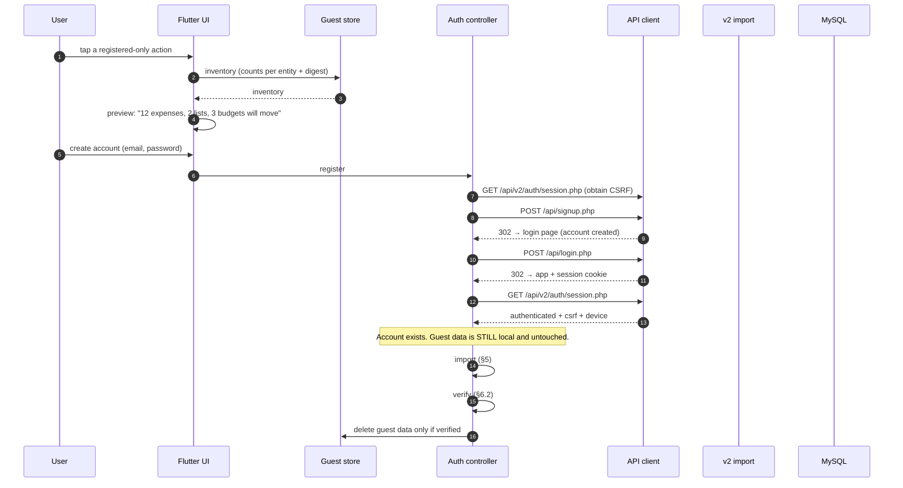
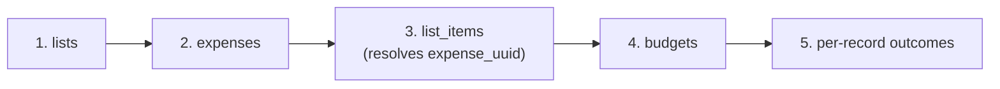
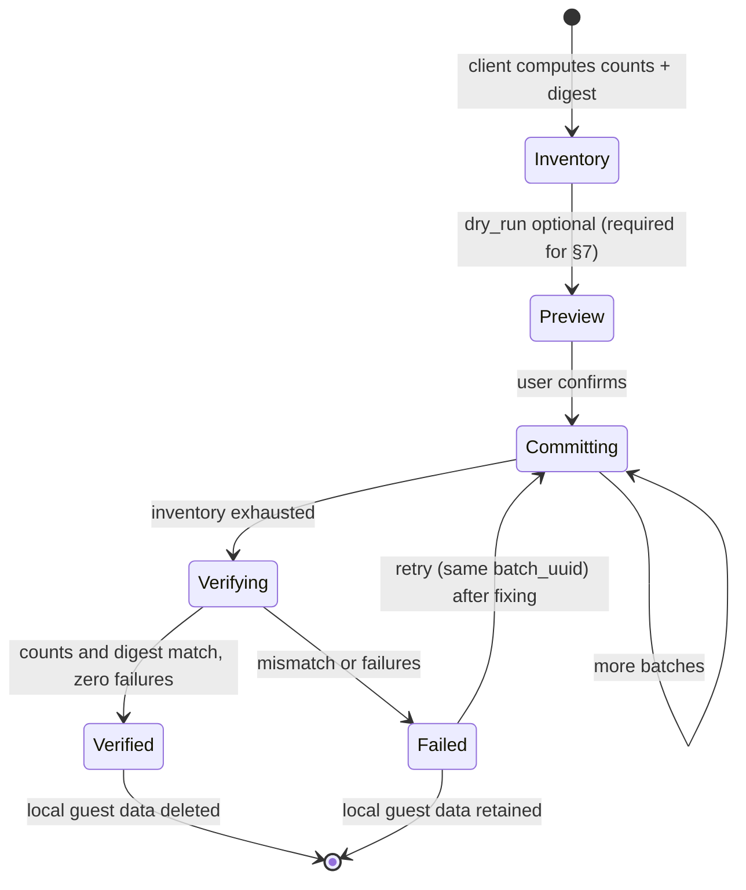

# Guest Data Migration

| Field | Value |
|---|---|
| Status | Specification — Phase 2 |
| Date | 2026-11-15 |
| Purpose | Define guest mode's boundary, the registration transition, the migration of local guest data into a new account, its verification, and the open policy for an existing account |
| Requirements | D-04, GM-01…GM-12 |
| Decisions | D-04 (`ACCEPTED`), D-22 (`NEEDS APPROVAL`), D-11, D-12 |
| Rule | Guest data is never sent to the server except through an authenticated import, and is never deleted from the device until the import is verified |

---

## 1. Scope

| Question | Section |
|---|---|
| What guest mode is, and is not | §2 |
| The guest feature boundary | §3 |
| The registration transition | §4 |
| Migration into a new account | §5 |
| Reliability: idempotency, partial import, verification, failure | §6 |
| Import into an existing account (open policy) | §7 |
| Security and privacy | §8 |

Related: the local store is specified in
[`OFFLINE_DATA_MANAGEMENT.md`](OFFLINE_DATA_MANAGEMENT.md); the import endpoints in
[`../api/SYNC_API_SPECIFICATION.md`](../api/SYNC_API_SPECIFICATION.md) §8; the guest flow diagram in
[`../architecture/DATA_FLOW.md`](../architecture/DATA_FLOW.md) §4.

---

## 2. The canonical guest model

### 2.1 Definition (D-04)

| Property | Statement |
|---|---|
| Identity | **None.** A guest has no user row, no session, and no server-side identity |
| Storage | The Flutter local store only (Drift/SQLite, per platform) |
| Network | Guest mode makes **no API request of any kind** (GM-01) |
| Scope | A restricted feature package (§3.2) |
| Exit | Registration, or an explicit import into an existing account (§7) |
| Backup | **None.** Losing the device loses the data. The UI must say so (§3.3) |

### 2.2 What the current application has

**Verified: there is no guest mode today.** Every screen except splash, login, and signup requires an
authenticated session (`FEATURE_INVENTORY.md` AUTH-8). Guest mode is a **new** capability, and the
import flow is a **new** endpoint surface.

### 2.3 Why guest mode is local-only

| Reason | Consequence |
|---|---|
| Anonymous server data has no owner | No correct retention or deletion policy exists for it |
| The security model has no anonymous endpoints | Creating one would add an unauthenticated surface |
| Data must not appear in an account the user has not consented to enter | Import is explicit and authenticated |
| The alternative (anonymous accounts) | Would require a second identity system — rejected |

---

## 3. The guest feature boundary

### 3.1 GM-01: no API request of any kind

| Rule | Statement |
|---|---|
| Guest mode issues **zero** HTTP requests | Not health, not categories, not session status, not sync |
| The category list is a **local seed** | Shipped with the app, mirroring the server's nine seeded names |
| There is no "guest" client type on the server | The server cannot tell a guest-mode client from an uninstalled one |
| Enforcement | The API client is not constructed in guest mode; the route table does not include registered features |
| Verification | `MANUAL-SCENARIO` with request logging at the proxy: no request with the guest build's user agent during a full guest session |
| Contrast | Registered mode with no connectivity still queues writes offline (D-05, D-16) — that is a different mode |

### 3.2 The guest package (GM-02 — APPROVED, UQ-16, D-38)

The project owner approved the guest feature package (UQ-16):

| Capability | Guest | Notes |
|---|---|---|
| Personal expenses — create, edit, delete | **Yes** | The core value |
| Categories | **Yes** | Local seed, read-only |
| Personal budgets | **Yes** | Single-user scalar |
| Personal lists and items | **Yes** | Owner-only personal lists and items |
| Calendar view | **Yes** | Derived from local expenses |
| Analytics / charts | **Yes** | Local aggregation |
| Data export (CSV, JSON, PDF) | **No** (Owner-approved requirement) | Educational prompt shown ("Account Required to Export Data"); export capability unlocked post-registration |
| Theme customization | **No** (Owner-approved requirement) | Disabled in guest mode; standard default theme enforced |
| Guest data **not backed up** warning | **Yes** | Disclosed prominently in UI |
| Groups, group expenses, group lists | **No** | Requires server identity and other users |
| Settlements and confirmations | **No** | Financial closure requires the server |
| Notifications | **No** | Server-generated |
| Sharing / invite | **No** | Requires a group |
| Multi-device sync | **No** | Requires an account |
| Account settings, profile | **No** | Requires an account |

| Rule | Statement |
|---|---|
| The boundary is enforced by absence, not by permission checks | The screens, routes, and API client simply do not exist in guest mode |
| A guest tapping a registered feature is routed to registration (§4) | Not shown a permission error |
| The boundary is **not** a server concern | It is a client-mode concern; the server denies all anonymous access anyway (`../security/ACCESS_CONTROL.md` §6) |

#### 3.2.1 Why lists are proposed rather than assumed

Personal lists are useful offline and are owner-only, which matches the guest model. However, a
checked priced list item creates an **expense**, which means the guest package would need the
item→expense conversion locally — a rule that the server enforces with a settlement-lock check. In
guest mode there is no settlement lock (no groups), so the conversion is safe. The question is
therefore a product choice, not a technical one, which is why it is UQ-16's subject.

### 3.3 The data-loss warning

| Rule | Statement |
|---|---|
| The absence of backup is disclosed | Guest data has no server copy (D-04) |
| Disclosure is not optional | A feature that silently loses money records on a lost phone is a trust failure |
| Where | At first launch into guest mode, and available in settings thereafter (UQ-16 asks whether both) |
| Wording | States plainly: the data is on this device only; uninstalling or losing the device loses it; creating an account moves it into the account |
| After migration | The warning disappears; the data is now server-backed |

### 3.4 What guest mode is not

| Not this | Reason |
|---|---|
| An anonymous account | There is no server identity |
| A trial of registered features | The feature sets differ by design |
| A second profile inside the app | Guest mode is a mode, not a profile; there is one guest dataset per installation |
| A sync peer | Guests have no cursor and no device record |
| A source of server data | Nothing from a guest is ever read by the server |

---

## 4. The registration transition (GM-05)

### 4.1 The trigger

| Trigger | Behaviour |
|---|---|
| The user taps a registered-only feature | A registration prompt explains what will migrate |
| The user chooses "Create account" from settings | The same flow |
| The user signs in to an existing account | A **different** flow — §7 (policy open) |

**Registration becomes mandatory at the boundary (GM-05).** There is no path from a registered
feature into guest mode, and no half-state.

### 4.2 The flow



| Rule | Statement |
|---|---|
| Account creation precedes migration | The import requires an authenticated session |
| Signup does not log in | `api/signup.php` redirects to the login page (verified); the client performs a login |
| The CSRF token is obtained without HTML | Via the session endpoint (finding F-01 closed) |
| The device is registered after login | Not before: a device belongs to a user |
| Guest data is untouched until verification | §6.5 |

### 4.3 Failure at the boundary

| Failure | Behaviour |
|---|---|
| Signup fails (validation, rate limit) | Guest data untouched; the form explains the problem; the user may retry |
| Login fails after signup | Guest data untouched; the account exists and the user may sign in later |
| Session expires during migration | The import resumes after re-login; the batch is idempotent (§6.3) |
| Import partially fails | §6.4 — guest data is retained and the user is told exactly what did not move |
| The user abandons the flow | Guest data untouched; the account exists; the next sign-in triggers §7's policy |

**Invariant:** at no point in this flow does a failure destroy guest data.

---

## 5. Migration into a new account (GM-06)

### 5.1 What is migrated

| Entity | Migrated? | Identity | Relationship preservation |
|---|---|---|---|
| Personal list | Yes | Local UUID preserved | — |
| Personal list item | Yes | Local UUID preserved | Parent list by UUID |
| Expense (personal) | Yes | Local UUID preserved | Category by name; generated-from-item link by UUID |
| Budget | Yes | Local UUID preserved (or replaced by `(user_id, month)`) | — |
| Category | No — mapped | — | By **name** against the server's seeded nine |
| Group / group expense / settlement / notification | No | — | Guest mode never had them |
| Device record | No — created separately at login | — | — |

| Rule | Statement |
|---|---|
| Identifiers are preserved (D-04) | The server stores the client's UUID. No ID remapping occurs, which is one reason UUIDs exist (D-12) |
| Relationships survive | A list item points at the same list; an expense points at the same category name and, where applicable, the item that generated it |
| Timestamps are relevant, not arbitrary | Business dates (`expense_date`) are preserved exactly. `created_at`/`updated_at` are server-generated at import time, because a client clock is untrusted (SY-20). The original creation time is not a business fact for an expense beyond its date |
| Totals are preserved | The sum of migrated amounts equals the sum of guest amounts; the verification digest proves it (§6.2) |
| Nothing is invented | The import creates what the user had and nothing else |

**On timestamps, stated plainly because it is a visible difference:** a guest expense entered in
January and imported in November has `expense_date` = January (preserved) and `created_at` = November
(the import time). It appears in the correct month, report, and settlement maths — because those use
`expense_date` — while the audit timestamp records when the record reached the server. Fabricating a
`created_at` from an untrusted device clock would be worse.

### 5.2 Order of operations (server-side, inside one transaction)



| Step | Why this order |
|---|---|
| Lists before items | An item needs its parent's server `id` |
| Expenses before items | An item's `expense_uuid` resolves to an expense created in step 2 |
| Budgets last | Independent; a `(user_id, month)` collision is handled as an upsert or a duplicate, per §5.4 |
| One transaction per request | A batch is atomic; a failure creates no half-record |

### 5.3 The request

`POST /api/v2/import/guest.php` (full contract in
[`../api/SYNC_API_SPECIFICATION.md`](../api/SYNC_API_SPECIFICATION.md) §8):

| Field | Meaning |
|---|---|
| `batch_uuid` | Client-generated; the idempotency key for the whole import |
| `inventory` | Per-entity counts and digest of the guest dataset — used for status and verification |
| `records[]` | Up to 100 records per request, each with `entity`, `local_uuid`, and its fields |
| `dry_run` | When true, no business row is written; only `would_create`/`would_skip` outcomes are recorded (used by §7's preview) |

| Rule | Statement |
|---|---|
| 100 records per request | Bounded payload; the client sends successive batches |
| CSRF required | It is a `POST` (`../api/AUTHENTICATION_AND_AUTHORIZATION.md` §5) |
| Idempotency | `config/idempotency.php` at the HTTP layer plus `guest_import_batches.batch_key` at the logical layer |
| A record with an unknown category name is `failed` with `UNKNOWN_CATEGORY` | Never silently re-categorised. The client offers to pick a category and retries |
| Two-tier duplicate detection | (1) **Exact UUID matches** (`exact_duplicate`) are automatically skipped from re-creation (`would_skip`). (2) **Heuristic duplicate candidates** (`ambiguous_candidate`) matching on date, amount, and note/category are flagged for mandatory user confirmation (never silently merged or dropped; see §7.4) |
| A record whose UUID exists for **another** user | Impossible to detect and irrelevant: the UUID is scoped by the account's own data. The insert either succeeds or collides with this user's own row |
| Amounts | Validated with the same rules as any write (positive, ≤ 99 999 999.00, two decimals). An invalid record is `failed` with the validation error, never stored out of range |

### 5.4 Budget collisions

A budget is keyed `(user_id, budget_month)`. The guest dataset can hold at most one budget per month
(it is an upsert locally too), so a collision can only be the guest's own month.

| Case | Behaviour |
|---|---|
| The new account has no budget for that month | Created |
| A budget exists (impossible for a brand-new account; possible for §7's import) | `duplicate` with the existing value reported; the user chooses in the preview |

### 5.5 What is not migrated, and why

| Not migrated | Reason |
|---|---|
| Guest settings, theme, local UI preferences | Device preferences, not data |
| Guest data exports (CSV, JSON, PDF) | None exist; export is disabled in guest mode (Owner-approved requirement) |
| The local notification cache | Guest mode has none |
| Anything from a group | Guest mode has no groups |
| A device cursor | The account is new; the client bootstraps after import |

---

## 6. Reliability

### 6.1 The import state machine



| State | Server object | Notes |
|---|---|---|
| Inventory | — | Client-side only |
| Preview | `guest_import_batches` with `dry_run = 1` | §7 |
| Committing | `state = 'committed'` when all records are accounted for | Partial progress is visible per item |
| Verifying | `GET /api/v2/import/status.php?batch_uuid=…` | Returns `{expected, created, skipped, failed, digest}` |
| Verified | `state = 'verified'` | Only the client sets this, by confirming the comparison succeeded |
| Failed | `state = 'failed'` | With per-item reasons |

### 6.2 The verification method (GM-08)

GM-08 requires verification **before** deletion. Counts alone are too weak (two mistakes can cancel),
so verification has three parts:

| Part | Check |
|---|---|
| 1 | `created + skipped_duplicate = expected` per entity |
| 2 | `failed = 0` |
| 3 | **Digest match:** the server computes a digest over the migrated records — for each entity, `SHA-256` over the sorted list of `(uuid, amount-or-empty, date-or-empty)` — and returns it. The client computes the same digest over its local migrated set and compares |

| Rule | Statement |
|---|---|
| All three must hold | Otherwise the state is `Failed` |
| The digest is over accepted records only | A `failed` record is excluded from the server digest and from the client's accepted set |
| A mismatch is reported, not ignored | The client shows which entity's counts differ and keeps the data |
| The digest is deterministic | Sorted by UUID; fixed field order; no timestamps (which legitimately differ) |

### 6.3 Idempotency (GM-07)

| Mechanism | Behaviour |
|---|---|
| `batch_uuid` | A repeated request returns the stored per-record outcomes and writes nothing |
| Per-record UUID | A record whose UUID already exists for this user is `duplicate`, not a second row |
| `guest_import_items` unique key | `(batch_id, entity, local_ref)` makes a re-submitted record idempotent even across batches of the same import |
| Retry after a network failure | Same `batch_uuid`; the server answers from the stored batch |
| Retry after a partial failure | Same `batch_uuid` plus the corrected records; the corrected ones are new attempts, the already-created ones are `duplicate` |

**Assertion:** submitting the same import five times creates exactly one row per guest record.

### 6.4 Partial and interrupted migration (GM-10, GM-12)

| Situation | Server state | Client behaviour | User sees |
|---|---|---|---|
| Network drops mid-batch | The batch is atomic — either all its records are applied or none | Resend the same batch with the same `batch_uuid` | A progress indicator; no error unless it repeats |
| The app is killed mid-import | Batches already applied are recorded | Resume from the local inventory: records marked migrated are skipped client-side; the server treats a re-send as `duplicate` | "Resuming your import" |
| Some records fail validation | `partial` | Continue with the remaining records, then report | A list of the records that did not move, with the reason and a fix action |
| The session expires mid-import | The pending batch is rejected 401 | Re-login; resume with the same `batch_uuid` | "Please sign in again to finish moving your data" |
| The user quits deliberately | `committed` or `partial` | On the next launch, offer to finish or to keep the data local | Clear choice, no data loss |

| Rule | Statement |
|---|---|
| A partial import is **representable** (GM-12) | Per-record outcomes in `guest_import_items`; the status endpoint aggregates them |
| A partial import never deletes anything | §6.5 |
| Progress is durable across app restarts | The client marks each migrated record locally **after** the server confirms it |
| Silence is forbidden | Every terminal state produces a user-visible message |

### 6.5 Verification before deletion (GM-08)

| Step | Action |
|---|---|
| 1 | The client has sent every record in the inventory |
| 2 | The client calls the status endpoint and receives `{expected, created, skipped, failed, digest}` |
| 3 | The client compares counts, failures, and digest (§6.2) |
| 4 | **Only if all three pass:** the client sets the batch to `verified` and deletes the guest dataset in a single local transaction |
| 5 | The user is told the data is now in the account |
| 6 | If any check fails: **nothing is deleted**; the data stays and the user is shown what to fix |

| Rule | Statement |
|---|---|
| Deletion is a separate, final, verified step | D-04 |
| Deletion is one local transaction | A half-deleted guest dataset is impossible |
| Deletion happens after the server confirms, never before | A crash between the two leaves extra local data, never missing data |
| Deleting guest data does not touch registered data | They are separate local tables; the import does not merge them |

### 6.6 Failure is never silent (GM-09)

| Rule | Statement |
|---|---|
| Guest data is never discarded because a migration failed | D-04, restated as an implementation invariant |
| Every failure has a message, an affected-record list, and a next action | "Retry", "Fix these 2 records", "Keep on this device" |
| "Keep on this device" is always available | The user can abandon the import and keep a local dataset alongside their account (which is then the §7 situation on the next launch) |
| No implicit deletion path exists | The only deletion is step 4 of §6.5, and only after a full pass |
| A crash during deletion | Impossible to lose server-side data; the worst case is leftover local data, which the client detects and re-offers to delete |
| Logging | The client logs counts and outcomes (no record contents, no amounts) for support (`../security/SECURITY_ARCHITECTURE.md` §7) |

---

## 7. Import into an existing account (APPROVED; UQ-01, D-22)

**Status: `ACCEPTED` (D-22, UQ-01).**

### 7.1 The situation

A user has guest data on device A, then signs in to an account that already exists — possibly with
data from device B. Under owner-approved Option C, signing in never forces discarding local guest data.

### 7.2 Why the architecture cannot decide it

| Reason | Consequence |
|---|---|
| D-04 explicitly separates "create account" from "log in to existing account" | The new-account flow cannot be assumed |
| Merging into an account that shares groups changes **other members' balances** | It is a financial action affecting third parties |
| The user's own account may already contain an expense for the same purchase | Duplicates inflate balances |
| A silent merge is irreversible and invisible to group members | Forbidden by the same reasoning that forbids silent conflict resolution |

### 7.3 Options

| # | Option | Data risk | UX | Assessment |
|---|---|---|---|---|
| A | Discard guest data on sign-in | **High** — silent loss | Simplest | Violates D-04 |
| B | Keep guest data on the device, permanently separate | None | Confusing — two ledgers | Guest mode becomes a second profile |
| **C** | **Explicit, user-confirmed import with a dry-run preview** | Low | One extra screen | **Recommended (D-22)** |
| D | Automatic merge on sign-in | **High** — silent financial change | Seamless | Forbidden |

### 7.4 What option C would look like

```mermaid
sequenceDiagram
    participant U as User
    participant App as Flutter app
    participant API as /api/v2/import/guest.php
    U->>App: sign in (account already has data)
    App->>App: detect non-empty guest dataset
    App->>API: POST dry_run=true {batch_uuid, inventory, records}
    API-->>App: {would_create, exact_duplicates[], ambiguous_candidates[], budget_conflicts[]}
    App->>U: preview: "8 to add, 2 exact duplicates skipped, 1 ambiguous match needing confirmation, total 340.00"
    alt Import
        U->>U: resolve ambiguous candidates (Import as New vs Skip)
        U->>App: confirm import with resolutions
        App->>API: POST dry_run=false {batch_uuid, resolutions, records}
        App->>App: verify, then delete local guest data
    else Keep on this device
        U->>App: choose
        App->>App: guest dataset stays; prompt again next launch
    else Delete
        U->>App: choose
        App->>App: delete local guest data after an explicit confirmation
    end
```

| Rule | Statement |
|---|---|
| The dry run is mandatory before a commit | It is the mechanism that makes the decision informed |
| Monthly warnings alone are insufficient | A budget collision check only flags that a monthly cap exists, but completely misses duplicate individual expense entries that artificially inflate spending totals and corrupt reports |
| Two-tier duplicate detection | **Tier 1 (Exact UUID):** Server skips records whose client UUID already exists in the account (`would_skip`).<br>**Tier 2 (Heuristic Candidate):** Records with a different UUID matching on `expense_date` + `amount` + `note`/`category` (or date ±1 day, same amount, note similarity) are flagged as `ambiguous_candidate` |
| Ambiguous matches require mandatory user confirmation | Heuristic candidates are **never** silently merged, duplicated, or dropped. The UI presents an interactive comparison where the user explicitly chooses *"Import as New"* or *"Skip (Already in Account)"* for each candidate |
| The import is a normal guest-import batch | Same endpoint, same idempotency, same verification |
| Nothing is imported into a shared group without the user seeing which groups are affected | Because other members' balances change |
| "Keep on this device" always remains available | The user is never forced to merge |
| The prompt reappears on a later launch | A decision can be deferred; silence is not a decision |

### 7.5 Sub-question: group participation

If the guest dataset contains **no group data** (which is the case by construction — guest mode has no
groups), then a merged expense can only ever be a **personal** expense. That is an important
limitation to state: the recommended option C cannot affect other members' balances, because nothing
it can import is a group expense.

**This reduces, but does not remove, the sensitivity:** a personal expense in the account affects the
user's own analytics and budgets, and a duplicate inflates them. The preview with two-tier duplicate
detection exists for exactly that reason.

### 7.6 Decision (owner-approved)

The project owner approved **Option C**: explicit, user-confirmed import with mandatory dry-run preview, two-tier duplicate detection (exact UUID de-duplication plus mandatory user confirmation for heuristic ambiguous candidates), and "skip import for now" preserving the local guest partition (`account_id = 'guest'`). (UQ-01, D-22).

---

## 8. Security and privacy

| Aspect | Rule |
|---|---|
| Guest data at rest | In the local store, protected per platform (`../security/SECURITY_ARCHITECTURE.md` §5). Web cannot encrypt; documented |
| No guest data in logs | The client logs counts, never amounts or descriptions |
| Import scoping | The import writes only to the authenticated user's own rows: `user_id` comes from the session, never the payload (`../security/ACCESS_CONTROL.md` §7.2) |
| Server-side validation | Every imported record passes the same validation and domain rules as any write (`../architecture/BACKEND_COEXISTENCE.md` §6) |
| No anonymous residue | Nothing a guest does reaches the server, so no orphan data exists |
| Rate limiting | The import uses the `api_sync` bucket (D-28); a large import is batched, not throttled into failure |
| Cross-account leakage | The import is scoped to one session user; a batch key from another user is not found |
| Audit | `guest_import_batches`/`guest_import_items` record what moved, for the life of the account |
| Account deletion | The audit cascades with the account (`DATABASE_SCHEMA_SPECIFICATION.md` §5.8) |

---

## 9. Status of architectural questions

| UQ | Status | Decision & Policy |
|---|---|---|
| UQ-01 — guest merge into an existing account | `APPROVED` | Option C: Skip preserves guest partition; dry run with two-tier duplicate check (exact UUID skip, heuristic confirmation) |
| UQ-16 — guest feature package contents | `APPROVED` | Personal expenses, categories, budgets, lists, items, calendar, analytics. Theme customization disabled; export disabled with educational prompt |
| UQ-18 — behaviour when a queued write is permanently rejected | `APPROVED` | Surfaced in Needs Attention UI area; 24-hour reminder resets account-wide upon receipt by any device |

---

## 10. Verification

| Requirement | Method | Pass condition |
|---|---|---|
| GM-01 no API request in guest mode | `MANUAL-SCENARIO` | Proxy logs show zero requests from a full guest session |
| GM-02 feature package enumerated | `DOC-REVIEW` (blocked by UQ-16) | §3.2 lists every included and excluded capability |
| GM-03 guests cannot reach registered functionality | `MANUAL-SCENARIO` | Every registered route is unreachable; each attempt routes to registration |
| GM-05 registration mandatory at the boundary | `MANUAL-SCENARIO` | No registered feature is usable without an account |
| GM-06 migration preserves relationships | `CONTRACT-TEST` | After import: one list per list, one item per item, item→expense links intact, sums equal |
| GM-07 idempotent under retry | `CONTRACT-TEST` | Five submissions of one import create exactly one row per record |
| GM-08 verified before deletion | `MANUAL-SCENARIO` | Guest data survives an induced verification failure; the app reports the mismatch |
| GM-09 never silently discarded | `MANUAL-SCENARIO` | Kill the app mid-import and at verification: no path deletes data without a full pass |
| GM-10 resumable without duplication | `CONTRACT-TEST` | Interrupt after batch 1 of 3, resume: totals match, no duplicates |
| GM-11 existing-account policy documented | `DOC-REVIEW` (blocked by UQ-01) | §7 presents four options and a recommendation, marked `NEEDS APPROVAL` |
| GM-12 partial migration representable | `CONTRACT-TEST` | A batch with one invalid record yields `partial` and a per-record reason |
| Digests match | `CONTRACT-TEST` | Server and client digests are equal for a faithful import; differ for a tampered batch |
