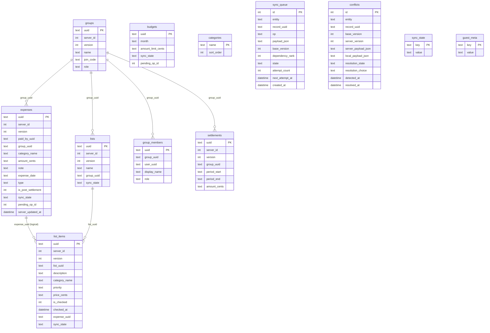
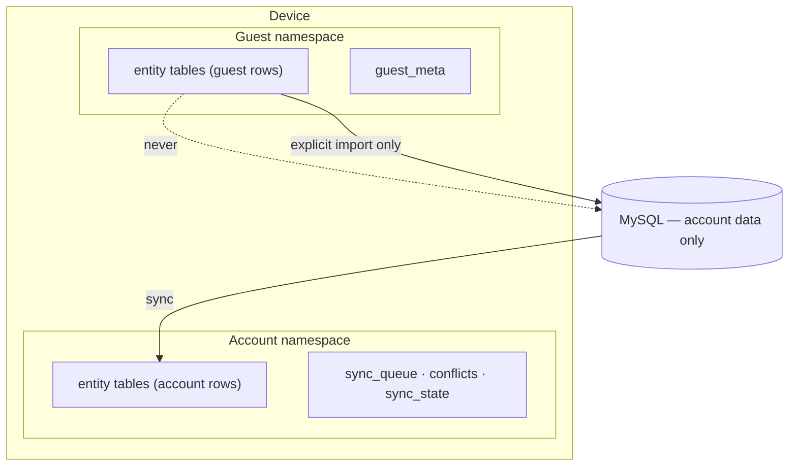
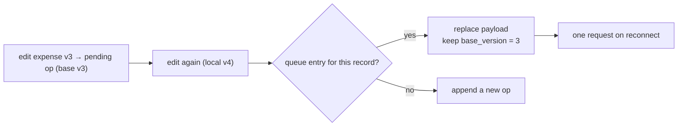

# Offline Data Management

| Field | Value |
|---|---|
| Status | Specification — Phase 2 |
| Date | 2026-11-15 |
| Purpose | Define the client's local store: what it holds, how it stays consistent with the server, how pending writes survive, and what happens to it across restarts, logouts, and account changes |
| Requirements | GM-04, SY-02, SY-03, SY-04, SY-05, PR-12, PR-13 |
| Decisions | D-14 (Drift/SQLite), D-16 (offline matrix), D-17 (online-only operations), D-19 (notifications), D-20 (deletes) |
| Rule | The local store is a cache plus a durable queue. It is never the source of truth for a registered user |

---

## 1. Scope

| Topic | Section |
|---|---|
| The local store's structure | §2 |
| Guest data isolation | §3 |
| Offline write capability and the queue | §4 |
| Persistence, clearing, and lifecycle | §5 |
| List ↔ expense link preservation | §6 |
| Local integrity and reconciliation | §7 |
| Growth and limits | §8 |

Server-side structures are in
[`../database/DATABASE_SCHEMA_SPECIFICATION.md`](../database/DATABASE_SCHEMA_SPECIFICATION.md); the
procedures that move data are in [`SYNC_WORKFLOWS.md`](SYNC_WORKFLOWS.md).

---

## 2. The local store

### 2.1 Technology (D-14)

| Aspect | Value |
|---|---|
| Engine | Drift over SQLite |
| Why | Relational domain, real migrations, typed queries, all six platforms including web via SQLite-WASM |
| Web caveat | Requires `sqlite3.wasm` + worker assets; no SQLCipher encryption in the browser (`../architecture/TECHNOLOGY_STACK.md` §4) |
| Alternative rejected | `sqflite` (mobile-only), Hive (key-value, no joins), Isar (uncertain maintenance/web) |

### 2.2 Local tables

| Table | Purpose | Notes |
|---|---|---|
| Entity tables | The cached records | Money as **integer cents** (D-21); dates as `YYYY-MM-DD` text so comparisons are lexicographic and stable |
| `sync_queue` | Durable pending operations | Survives restart; the only source of unsent work |
| `conflicts` | Unresolved conflicts with both sides | `../database/VERSIONING_AND_CONFLICT_RESOLUTION.md` §5.3 |
| `sync_state` | Cursor, device uuid, digest snapshots, last sync time, schema parameters | Key–value |
| `guest_meta` | Guest-mode metadata (inventory counters, warning acknowledged) | Only meaningful in guest mode |

### 2.3 Why money is stored as integer cents

| Reason | Detail |
|---|---|
| Exactness | `double` cannot represent all two-decimal values; summing hundreds of expenses accumulates drift |
| One type | `Money(int cents)`; every arithmetic path is integer |
| Wire conversion | The server sends `"24.50"`; the client parses to `2450` (D-21) |
| A `double` in a money path is a review defect | Enforced in review, not by the type system alone |

### 2.4 Why entity tables are keyed by UUID

A record created offline has no server `id`. Keying the local tables by `uuid` means the record's
identity never changes when the server assigns its surrogate id. `server_id` is stored only for
diagnostics and for building requests that the v1 surface might still need.

### 2.5 Local indexes (minimum set)

| Index | Serves |
|---|---|
| `expenses(expense_date)` | Month view, calendar, ranges |
| `expenses(group_uuid, expense_date)` | Group expense lists |
| `expenses(sync_state)` | "Show unsynced" diagnostics and the queue reconciler |
| `list_items(list_uuid, priority, created_at)` | Item ordering, mirroring the server's index |
| `sync_queue(state, dependency_rank, created_at)` | The push loop's read |
| `conflicts(resolution_state)` | The "needs attention" badge count |
| `budgets(month)` | The budget view |

### 2.6 Local schema versioning

| Rule | Statement |
|---|---|
| The local schema is versioned by Drift's migration system | Every change is a numbered migration with a forward path |
| Discarding the local database is a last resort | It would drop queued writes, which is data loss |
| A downgrade is not supported | An older app opening a newer database must refuse and instruct the user to update |
| The local schema does not mirror the server schema exactly | It stores what the UI needs plus sync bookkeeping; it is not a replica for its own sake |

---

## 3. Guest data isolation (GM-04)

**Requirement:** GM-04 "guest data is device-local and isolated from any account".

### 3.1 The isolation rule

| Rule | Statement |
|---|---|
| Guest rows live in the same tables but carry a **namespace discriminator** | `account_scope` = `'guest'` or the account's local identifier |
| The sync engine never reads a guest row | The `sync_queue` has no guest entries by construction (guest writes are never queued for the server) |
| The server never sees a guest row | Guest mode makes no API request (§`GUEST_DATA_MIGRATION.md` §3.1) |
| A guest row cannot be pulled into an account | Pulls write only rows with the account scope |
| Logging in does not merge guest rows | Import is explicit (`GUEST_DATA_MIGRATION.md` §5 or §7) |
| Deleting guest rows leaves account rows untouched, and vice versa | Scoped deletes only |

### 3.2 Why a namespace discriminator rather than a separate database

| Option | Assessment |
|---|---|
| A separate SQLite database for guest data | Isolation is total, but the import would need to attach or copy across databases, and Web/SQLite-WASM asset handling doubles |
| **One database, a scope column** | **Selected.** Isolation is enforced by a scoped repository layer; the import is a query, not a file operation |
| Two databases, one file each | More moving parts for no correctness gain |

| Rule | Statement |
|---|---|
| Every local repository query includes the scope predicate | Enforced by a single query-builder helper, so a missing predicate is a code-review defect with one location to check |
| A scope mismatch fails closed | If the scope is unknown, the query returns nothing rather than everything |

### 3.3 Guest-mode account switching

| Event | Behaviour |
|---|---|
| Guest → registered (new account) | Import, verify, then delete the guest scope (§`GUEST_DATA_MIGRATION.md` §6.5) |
| Guest → registered (existing account) | Same, subject to the open policy (§7 of that document) |
| Guest stays a guest | Nothing changes; the warning about no backup stands (§3.3 of that document) |
| User deletes guest data explicitly | A scoped delete with an explicit confirmation; no other data is touched |

### 3.4 What is never done with guest data

| Never | Reason |
|---|---|
| Upload it without an import | D-04 |
| Count it in a registered user's totals | It belongs to no account |
| Delete it because a login occurred | It is the user's data until they decide |
| Merge it silently | It would change the user's own analytics without consent, and is forbidden outright for anything group-related |

---

## 4. Offline write capability and the queue

### 4.1 What can be written offline (D-16, UQ-08)

The project owner approved expanding offline-write capabilities to **six entity types** across personal and group domains:

| Entity / operation | Offline write | Queue rank (see §`SYNC_WORKFLOWS.md` §4.2) |
|---|---|---|
| Budget set (upsert) | Yes | 1 |
| Personal list create / rename / delete | Yes | 1 |
| Group list create / rename (admin) / delete (admin) | Yes | 1 |
| Personal & group list item add / edit / remove | Yes | 2 |
| Personal expense create / edit / delete | Yes | 3 |
| Group expense create | Yes | 3 |
| Group expense edit / delete (claims admin; server re-validates on push) | Yes | 3 |
| List check / uncheck | **No** (online-only, D-17) | — |
| Group membership operations (create / join / leave / delete / remove member) | **No** (online-only) | — |
| Settlement calculate / confirm / settle / post_confirm | **No** (online-only, D-17) | — |
| Notification actions | **No** (server-backed, D-19) | — |
| Device registration / revocation | **No** (online-only) | — |

**Requirement links:** SY-02 (create offline), SY-03 (modify offline), SY-04 (delete offline — §4.4).

### 4.2 The change queue

| Column | Purpose |
|---|---|
| `id` | Monotonic local sequence; also the FIFO tiebreaker |
| `entity` | `expense`, `budget`, `list`, `list_item` |
| `record_uuid` | The record the operation targets |
| `op` | `create`, `update`, `delete`, `upsert` |
| `payload_json` | The fields to send (money as integer cents locally; converted to a decimal string on the wire) |
| `base_version` | The version the edit was based on — `0` for a create |
| `dependency_rank` | 1 / 2 / 3, from §4.1; the push loop orders by rank, then by `id` |
| `state` | `pending`, `inflight`, `applied`, `failed`, `conflict` |
| `attempt_count`, `next_attempt_at` | Backoff for transport failures |
| `created_at` | Diagnostics and the "oldest pending change" indicator |

#### 4.2.1 Queue rules

| Rule | Statement |
|---|---|
| One operation per record-and-op type | A second edit to the same record **coalesces** into the existing pending operation: the payload is replaced, `base_version` is preserved from the original entry. Editing a record five times offline sends **one** operation |
| A create followed by edits stays one `create` with the latest payload | Otherwise the server would receive a `create` and an `update` for a record it has never seen |
| A create followed by a delete removes the queue entry **and** the local row | Nothing is sent; the record never existed server-side |
| A synced record's update captures the current version as `base_version` | At enqueue time, from the local record |
| `inflight` is set immediately before the request and cleared on any terminal outcome | A crash between the two leaves an `inflight` entry that the reconciler returns to `pending` |
| The queue is the source of truth for "unsent" | The `sync_state` column on a record is derived from the queue, never the reverse |
| Queue size is bounded | See §8.2 |

#### 4.2.2 Coalescing

**Why keep the original `base_version`:** it is what the client's edit was based on. Re-basing on the
locally edited version would claim a version the server never issued and would hide a conflict with
another device.

### 4.3 Local record states

| State | Meaning | Shown as |
|---|---|---|
| `synced` | Matches the last known server version | Normal |
| `pending` | Has a queued operation | A subtle "not yet synced" marker |
| `inflight` | Currently being pushed | A progress indicator |
| `conflict` | The push was refused; the user must decide | "Needs attention" badge, per-record |
| `removed` | A tombstone was applied | Not shown |

| Rule | Statement |
|---|---|
| The state is per record, not per screen | A single conflicted record must not make an entire month look broken |
| `pending` records are fully usable | The user can read, edit, and delete them offline |
| A `conflict` record is still usable but flagged | Editing it is part of resolution |
| No state is silent | Every non-`synced` state is visible somewhere in the UI (SY-13) |

### 4.4 Offline delete (SY-04)

**Requirement:** SY-04 "records can be deleted offline".

| Aspect | Rule |
|---|---|
| Mechanism | A queued `delete` operation carrying the record's `base_version` |
| Local effect | The row is removed (or marked removed if it is referenced — see below) immediately; the UI hides it at once |
| Server effect | Applied on push, producing a tombstone and a change-log entry |
| Create-then-delete while offline | Both disappear; nothing is sent (`AGENTS.md`-style cleanliness: no phantom records) |
| Delete of a record with unsent edits | The edits are discarded with the record; the delete coalesces over them |
| Delete of a list that has items | The client sends the list delete; the **server** cascades the items and the parent tombstone purges the item subtree locally. The client does not send per-item deletes |
| Delete of an expense linked to a checked list item | The local item's `expense_uuid` link is cleared and the item's check state follows the server's outcome. List check state is not offline-writable, so this case arises only from a previously synced state |
| Conflict on delete | If the tombstone's `last_version` exceeds the client's `base_version`, the deletion still wins; if the record changed after the delete was queued, it becomes a conflict the user resolves (`DATA_FLOW.md` §9) |
| Delete of a record the server still considers locked | Refused with `409 PERIOD_SETTLED`; the local row is restored and flagged |
| Referenced-row handling | A record referenced by another local row is marked `removed` rather than physically deleted until the referencing row is resolved, so a foreign-key-like local constraint cannot be violated |

| Rule | Statement |
|---|---|
| A delete is never silently dropped | It either applies, conflicts, or is reported |
| Restoring a period-locked delete | The local row is restored with its previous content, and the queue entry becomes `failed` with the server's reason |
| The user is told before data is lost | The delete confirmation names the record; nothing is deleted by a swipe without feedback |

### 4.5 What cannot be written offline

| Operation | UI behaviour |
|---|---|
| Group create / join / leave / delete / remove member | Control disabled with "requires connection" |
| List check / uncheck | Control disabled; the item shows its server state |
| Settlement confirm / settle | Button disabled with reason "settlements require live server connection" |
| Notification actions | The bell is not populated from the local store (D-19) |
| Device register / revoke | Not reachable offline |

| Rule | Statement |
|---|---|
| Disable, do not queue | A queued operation that can never succeed is a data-loss trap (D-16) |
| State the reason | "Requires connection" is shown, not a silent failure |
| The disabled control is not a permission check | The server still enforces everything (`../security/ACCESS_CONTROL.md` AC-6) |

---

## 5. Persistence, clearing, and lifecycle (SY-05)

**Requirement:** SY-05 "pending changes persist across app restarts".

### 5.1 Durability guarantees

| Guarantee | Mechanism |
|---|---|
| Queued operations survive a restart | They are rows in `sync_queue`, written in the same local transaction as the record change |
| Queued operations survive a crash mid-push | `inflight` entries are returned to `pending` on the next start |
| Queued operations survive a logout | The queue belongs to the data owner, not the session (see §5.2) |
| The cursor survives a restart | Stored in `sync_state`, written **after** a page is applied |
| Conflict records survive a restart | Rows in `conflicts` |
| A partial page is never half-applied | A page is applied in one local transaction, which also advances the cursor |

**Atomicity rule:** the local record write and its queue entry are committed in **one** transaction.
A record that appears saved but has no queue entry would never be sent; a queue entry with no record
change would send a change the user cannot see.

### 5.2 Clearing rules

| Event | Local data | Queue | Cursor | Notes |
|---|---|---|---|---|
| App restart | Kept | Kept | Kept | — |
| Logout | **Kept** | **Kept** | Kept | The data belongs to the user, and the queue is unsent work (D-16 rationale) |
| Login as the same user | Reused | Flushed | Resumed | The normal case |
| Login as a **different** user | Wiped and rebuilt | Wiped | Reset | Data from one account must never be visible to another |
| Session expiry | Kept | Kept | Kept | Re-login resumes |
| Device revoked | Kept | Kept | Kept | Sync paused; the user may re-register (UQ-04) |
| User clears app data | Wiped | Wiped | Reset | Includes unsent work — the UI warns |
| Local schema upgrade | Migrated | Migrated | Preserved | Never discarded |
| Account deletion | Wiped | Wiped | Reset | After the policy in `../database/DATA_OWNERSHIP.md` §9 |

**Logout-warning rule:** because the queue survives a logout, the UI must warn when the user logs out
with unsent changes: *"3 changes have not been sent yet. They will be sent when you sign in again."*
Silently holding unsent work through a logout would surprise the user later.

**Account-switch rule:** switching to a different account is a destructive operation for local data.
It requires an explicit confirmation, and it wipes rather than merges — two accounts' data never
coexist in one namespace.

### 5.3 Notifications are not stored (D-19)

| Rule | Statement |
|---|---|
| No notification rows exist locally | Notifications are fetched live and held in memory |
| No notification queue entries exist | Every notification action is a direct call |
| Offline display | The bell shows "not available offline", never a stale count |
| Why | A seven-day server lifetime plus a polymorphic `reference_id` makes an offline copy
guaranteed-stale and useless |

### 5.4 Categories

| Rule | Statement |
|---|---|
| Seeded locally | The same nine names as the server, shipped with the app |
| Refreshed on bootstrap | The bootstrap response carries the current list |
| Referenced by **name** locally | Names are the stable, human-meaningful key across both sides; `category_id` is not known for a record created offline |
| Never written offline | Categories are shared and deployment-seeded |

### 5.5 Local storage security

| Aspect | Rule |
|---|---|
| Native platforms | Encrypted at rest where the platform allows (SQLCipher where available); documented per platform in `../security/SECURITY_ARCHITECTURE.md` §5 |
| Web | **Cannot** be encrypted with SQLCipher; the browser sandbox is the protection. Stated plainly, not glossed |
| Secrets | The session cookie lives in the cookie jar; the device secret lives in secure storage; **neither is in the local database** |
| The CSRF token | Memory only; never persisted |
| Money and notes | Are personal data; the local store is therefore sensitive and is wiped on an account switch |

---

## 6. List ↔ expense link preservation (PR-12, PR-13)

**Requirements:** PR-12 "a priced list item creates exactly one linked expense"; PR-13 "uncheck
deletes by exact `expense_id`, never by note/date/amount".

### 6.1 The rule on the server (preserved, unchanged)

| Rule | Statement |
|---|---|
| Checking a priced item creates **exactly one** expense and stores its id in `list_items.expense_id` immediately | The FK is the link |
| Unchecking deletes the expense **by `expense_id`** | Never by matching note, date, and amount — that matching was the v1.3 bug |
| `checked_at` is a datetime and must be converted with `date('Y-m-d', strtotime(...))` before use as `expense_date` | Using the raw datetime as a date breaks comparisons |
| Group items return `needs_confirm`; the caller then supplies `paid_by` | The two-step group flow |
| The 600-second uncheck window is measured by the server | The client's countdown is advisory |

### 6.2 How the local store preserves the link

| Local field | Meaning |
|---|---|
| `list_items.expense_uuid` | The UUID of the expense the item created. It mirrors `expense_id` on the server, expressed as a UUID because the client cannot know the server's surrogate id |
| `expenses.type` | `personal` or `group` |
| `list_items.is_checked`, `checked_at` | Mirrored from the server |

| Rule | Statement |
|---|---|
| The link is by UUID, never by heuristics | The same reason the server uses `expense_id` |
| A local row never fabricates a link | If the server has not reported an `expense_uuid`, the item shows no link |
| The check/uncheck path is never queued | D-17: it is an online operation. The local store therefore never has to reconcile a half-applied check |
| A pulled change to `list_items` updates the link atomically with the item row | A single local transaction |
| A pulled `expense` delete sets the item's `expense_uuid` to null rather than deleting the item | The item may still be checked; the server's `ON DELETE SET NULL` is the model |
| Group list items are read-only locally | Their `is_checked` state comes only from pulls |

### 6.3 Why this is a preservation requirement and not a sync feature

The list-to-expense conversion is one of the rules that a naive sync implementation would
re-implement (and get wrong) by matching a note and a date. Because check/uncheck is online-only
(D-17), the sync path never needs to perform it: the client **displays** the outcome of a server
operation. That is the whole point of excluding it from the offline matrix.

### 6.4 Related rules that stay on the server

| Rule | Where |
|---|---|
| Unpriced-item feed | Server query (`expenses/unpriced.php`); the client mirrors results |
| Pricing an unpriced item (`price_unpriced.php`) | Online; it creates the expense |
| The 10-minute window | Server-measured |
| Settlement-lock check before creating the expense | Server |

---

## 7. Local integrity and reconciliation

### 7.1 Integrity rules

| Rule | Statement |
|---|---|
| Foreign-key-like consistency | A local item always belongs to an existing local list; a detached item is either hidden or repaired by the next pull |
| Money totals are computed from integer cents | Never from parsed decimals |
| Dates are stored as `YYYY-MM-DD` | So ordering and range queries are stable across locales |
| No orphan queue entries | A queue entry whose record is gone is dropped during reconciliation, with a diagnostic log line |
| No orphan conflict records | A conflict whose record is gone is closed as dismissed |

### 7.2 Reconciliation (SY-18)

| Step | Action |
|---|---|
| 1 | At the end of a full pull cycle, compare per-entity digests with the server's |
| 2 | A mismatch triggers a **targeted bootstrap** for that entity |
| 3 | A targeted bootstrap replaces the entity's rows for the visible scope and re-applies pending operations if their `base_version` is still valid |
| 4 | A second mismatch is reported rather than looped |

**Digest definition:** one `SHA-256` per entity over the canonical `"{uuid}:{version}\n"` lines,
sorted by UUID byte order, computed over the client's **server-confirmed baseline state** in the active registered account partition
(`account_id = :user_uuid` and `server_version IS NOT NULL`, preserving `{uuid}:{server_version}` for locally edited or pending-delete rows;
new unconfirmed drafts with `server_version IS NULL` and guest-local records are strictly excluded) and over
the server's **visible scope** on the server side; deleted records and tombstones excluded; lowercase hex; empty set
= `e3b0c44298fc1c149afbf4c8996fb92427ae41e4649b934ca495991b7852b855`. It detects a missing record, a
stale version, and an extra record without transferring the dataset. The exact algorithm is
`../api/SYNC_API_SPECIFICATION.md` §6.5 — it is the only definition, and this paragraph is a summary
of it, not a second specification.

### 7.3 Local schema for the digest snapshot

`sync_state` holds the last known digest per entity, as opaque strings. They are compared, never
parsed.

---

## 8. Growth and limits

### 8.1 Expected sizes

| Data | Expected | Bounded by |
|---|---|---|
| Expenses | Thousands | The user's own history |
| List items | Hundreds | — |
| Groups / members | ≤ 5 groups, ≤ 10 members each | Server limits |
| Settlements | Hundreds | — |
| Queue | Tens, normally | §8.2 |
| Conflicts | 0–5 normally | §8.3 |

### 8.2 Queue bound

| Rule | Statement |
|---|---|
| Soft warning at 200 pending operations | The UI surfaces "large number of unsent changes" |
| Hard refusal at 1 000 | The app refuses new offline writes and asks the user to reconnect, rather than growing without bound |
| Why a hard bound exists | An unbounded queue on a device that never reconnects is a runaway store; 1 000 operations is far beyond normal usage |

### 8.3 Conflict bound and growth

| Rule | Statement |
|---|---|
| Conflicts are never auto-dismissed | Dismissing a financial conflict silently is data loss |
| Resolved conflicts are retained until the user clears them | Then removed |
| A conflict count above 20 shows a dedicated "review" screen rather than a badge | UX, not a limit |

### 8.4 Pruning

| Data | Pruning |
|---|---|
| Applied queue entries | Deleted immediately after the result is applied |
| Old `applied`/`failed` diagnostics | Retained 7 days for support, then removed |
| `sync_state` digests | Overwritten each cycle |
| Entity rows removed by tombstones | Deleted (or marked removed if referenced) |
| PDF exports and generated files | Not in the database; the user manages them |

---

## 9. Status of architectural questions

| UQ | Status | Decision & Policy |
|---|---|---|
| UQ-08 — offline capability matrix (D-16) | `APPROVED` | Six entity types offline; settlement confirmation and list check/uncheck are online-only |
| UQ-13 — notifications offline (D-19) | `APPROVED` | Notifications excluded from offline sync store; server-backed live fetch |
| UQ-14 — Flutter platform rollout sequencing | `APPROVED` | Release 1 Native (Android, iOS, Windows, macOS, Linux); Release 2 Flutter Web post A-WEB-1 |
| UQ-16 — guest feature package | `APPROVED` | Personal expenses, categories, budgets, lists, items, calendar, analytics. Theme customization disabled; export disabled with educational prompt |
| UQ-18 — unresolved offline issues | `APPROVED` | 24-hour reminder countdown reset account-wide upon receipt by any device (D-35) |

---

## 10. Verification

| Requirement | Method | Pass condition |
|---|---|---|
| GM-04 guest isolation | `MANUAL-SCENARIO` | Guest rows are never pulled, never pushed, and never visible in an account scope; a scope filter is present in every repository query |
| SY-02 create offline | `MANUAL-SCENARIO` | With the network off, a created expense is visible, survives a restart, and syncs on reconnect |
| SY-03 modify offline | `MANUAL-SCENARIO` | An edit is visible, coalesces with further edits, and syncs once |
| SY-04 delete offline | `MANUAL-SCENARIO` | A delete hides the row, coalesces over edits, and produces a tombstone server-side |
| SY-05 persistence | `MANUAL-SCENARIO` | 5 queued operations survive a kill; the queue count is unchanged |
| PR-12 one linked expense | `CONTRACT-TEST` | Checking a priced item online creates exactly one expense; the local link matches |
| PR-13 exact link deletion | `CONTRACT-TEST` | Unchecking deletes by the linked UUID; a note/date/amount match is never used |
| §4.2.1 coalescing | `UNIT-TEST` | Five offline edits to one record produce one queue entry with the original `base_version` |
| §5.2 clearing rules | `MANUAL-SCENARIO` | Logout keeps data and queue; account switch wipes; the logout warning appears with unsent changes |
| §7.2 reconciliation | `INTEGRATION-TEST` | An induced divergence is detected and repaired by a targeted bootstrap |
| §8.2 queue bound | `UNIT-TEST` | The 1 001st offline write is refused with a clear message |
| Money as integer cents | `UNIT-TEST` | A `double` never appears in a money path; sums of 1 000 two-decimal values are exact |
