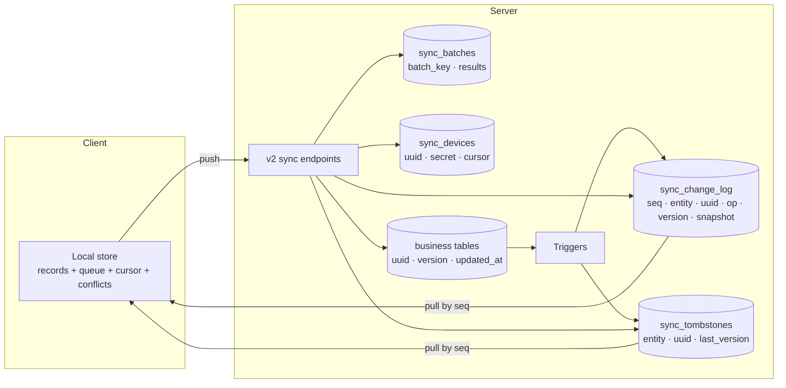
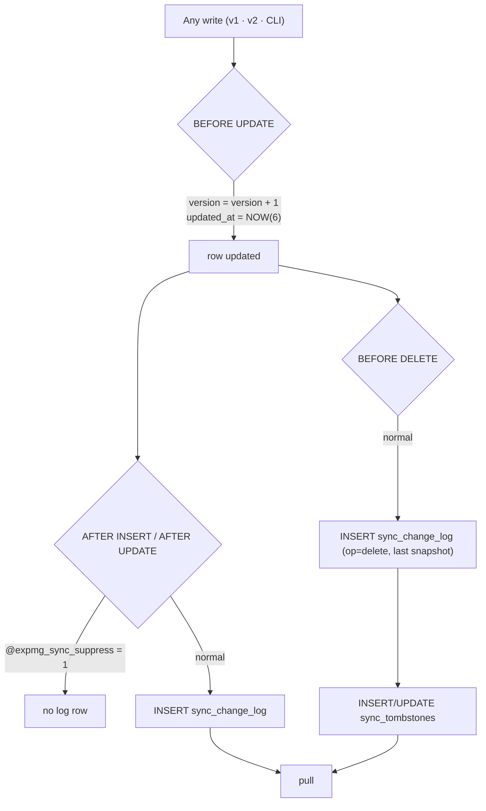
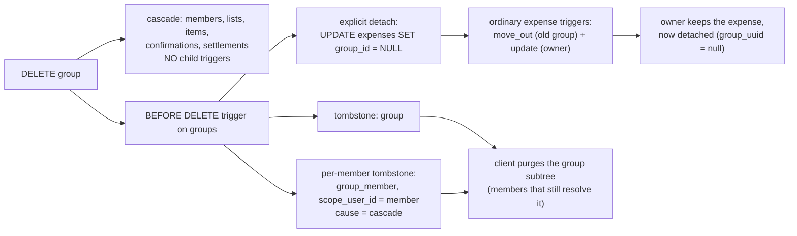

# Synchronisation Architecture

| Field | Value |
|---|---|
| Status | Specification — Phase 2 |
| Date | 2026-11-15 |
| Purpose | Define the synchronisation model end to end: what is synchronised, by which mechanisms, under whose authority, and how the parts fit together |
| Requirements | D-05, D-11, SY-01…SY-20 |
| Decisions | D-05 (`ACCEPTED`), D-11, D-12, D-13, D-16, D-17, D-19, D-20, D-27 |
| Rule | The server is authoritative. A client proposes; the server decides; the client mirrors |

---

## 1. Scope

| Topic | Section |
|---|---|
| The problem and the model | §2 |
| What a user can do across devices | §3 |
| The five mechanisms | §4 |
| The three flows | §5 |
| Change capture and cascade compensation | §6 |
| Trust boundaries and invariants | §7 |
| What sync never does | §8 |
| Failure model | §9 |

Companions:

| Document | Owns |
|---|---|
| [`OFFLINE_DATA_MANAGEMENT.md`](OFFLINE_DATA_MANAGEMENT.md) | The client's local store, queue, and per-entity rules |
| [`SYNC_WORKFLOWS.md`](SYNC_WORKFLOWS.md) | The operational procedures: bootstrap, pull, push, recovery, retry |
| [`CONFLICT_RESOLUTION.md`](CONFLICT_RESOLUTION.md) | The user-facing resolution workflow |
| [`../database/VERSIONING_AND_CONFLICT_RESOLUTION.md`](../database/VERSIONING_AND_CONFLICT_RESOLUTION.md) | The version model and per-entity policies |
| [`../database/DATABASE_SCHEMA_SPECIFICATION.md`](../database/DATABASE_SCHEMA_SPECIFICATION.md) | The tables, columns, and triggers |
| [`../api/SYNC_API_SPECIFICATION.md`](../api/SYNC_API_SPECIFICATION.md) | The endpoint contracts |

---

## 2. The problem and the model

### 2.1 What the current architecture cannot do

Verified in [`../DATABASE_AUDIT.md`](../DATABASE_AUDIT.md) §7.2: no client-generated IDs, no global
change cursor, no tombstones, `updated_at` missing on several tables and only second-precision where
it exists, no row version, no device identifier, and no conflict policy. A client cannot create a row
offline and reconcile it later, cannot learn that something was deleted, and cannot tell whether an
edit collided with another device.

### 2.2 The selected model (D-11, option C)

| Component | Mechanism | Where |
|---|---|---|
| Identity | Client-generated UUIDv7 per record | D-12, `DATABASE_SCHEMA_SPECIFICATION.md` §3.1 |
| Concurrency | Server-maintained integer `version` per row | D-06, §4 of the schema specification |
| Change detection | An ordered append-only change log, written by triggers | D-13, §5.2 |
| Deletion propagation | A durable tombstone per deleted entity | D-20, §5.4 |
| Incremental delivery | A monotonic cursor over `sync_change_log.seq` | D-11, D-27 |
| Durability of retries | A batch-per-push idempotency record | §5.7 |
| Device attribution | A registered device per installation | §5.1 |

**Rejected alternatives** (recorded in D-11 so they are not revisited): replaying v1 endpoint calls
from a queue (no conflict detection, no deltas, no deletions); per-record `updated_at` polling
(second-granularity ties, no deletion visibility, unbounded queries); CRDTs (unjustifiable
complexity for a small financial dataset with admin-gated group records).

### 2.3 Server authority

| Statement | Consequence |
|---|---|
| The server owns the truth | The client's local store is a cache plus a queue |
| The server validates every write | `paid_by`, membership, the settlement lock, limits, money, dates (`../architecture/BACKEND_COEXISTENCE.md` §6) |
| A client's version claim is a precondition, not an instruction | `base_version` is compared, never applied |
| A client's ownership claim is ignored | `user_id`, `type`, `is_post_settlement` are server-decided (`../security/ACCESS_CONTROL.md` §7.2) |
| A client's clock is advisory | Ordering comes from `seq`; conflict decisions come from `version` (SY-20) |

---

## 3. What a user can do across devices (SY-01)

**Requirement:** SY-01 "a user can read their data from multiple devices".

### 3.1 Capability matrix

| Capability | Requirement | Mechanism |
|---|---|---|
| Read the same data on any signed-in device | SY-01 | Sign in on each device; each bootstraps or resumes from its own cursor |
| Create, modify, delete while offline | SY-02, SY-03, SY-04 | Local store + change queue (D-16 matrix) |
| Pending changes survive an app restart | SY-05 | Durable queue in the local database |
| Upload on reconnect, in dependency order | SY-06 | Push ordering (§`SYNC_WORKFLOWS.md` §4.2) |
| Retrieve other devices' changes | SY-07 | Incremental pull by cursor |
| Detect concurrent modification | SY-08 | `base_version` precondition |
| Resolve conflicts by a defined policy | SY-09 | `CONFLICT_RESOLUTION.md` §3 |
| Propagate deletions | SY-10 | Tombstones |
| Recover from an interrupted sync | SY-11 | `batch_key` + the apply-then-advance rule |
| Retry safely | SY-12 | Idempotent push, idempotent apply |
| See sync status | SY-13 | Sync state in the UI (`FLUTTER_ARCHITECTURE.md` §8) |
| Never violate a settlement or ownership rule | SY-14 | Server validation on every push |
| Prevent cross-user access by ID manipulation | SY-15 | Session scoping (`../security/ACCESS_CONTROL.md` §7.3) |
| Recover from a stale cursor | SY-16 | `410 CURSOR_TOO_OLD` → bootstrap |
| Never advance past an unapplied change | SY-17 | Apply-in-a-transaction-then-advance |
| Reconcile local and server state periodically | SY-18 | Digests (D-27; canonical algorithm `../api/SYNC_API_SPECIFICATION.md` §6.5) |
| Handle membership change | SY-19 | Targeted purge/bootstrap |
| Ignore clock skew | SY-20 | Server ordering only |

### 3.2 The offline capability matrix (D-16, UQ-08)

| Entity / operation | Offline read | Offline write |
|---|---|---|
| Personal expense | Yes | Create, edit, delete |
| Group expense | Yes | Create, edit (admin), delete (admin) |
| Budget | Yes | Set |
| Personal list | Yes | Create, rename, delete |
| Group list | Yes | Create, rename (admin), delete (admin) |
| Personal & group list item | Yes | Add, edit, remove (check/uncheck excluded) |
| List check / uncheck | — | **No** (online-only, D-17) |
| Group create / join / leave / delete / remove member | Read | **No** |
| Settlement calculate / confirm / settle / post_confirm | Read | **No** (online-only, D-17) |
| Notification | Not stored | **No** (server-backed, D-19) |
| Categories | Yes (seeded) | **No** |
| Device register / revoke | — | **No** (online-only) |

**The matrix is the contract.** A queued operation that can never succeed is a data-loss trap; the UI
therefore disables rather than queues excluded operations.

### 3.3 Why some things cannot be offline

| Operation | Why not | Requirement |
|---|---|---|
| Settlement confirm | The period is computed server-side from the latest expense date; a queued confirmation could be counted against the wrong period | D-17, PR-04 |
| List check / uncheck | Creates or deletes an expense inside a transaction with a server-measured 600-second window and a settlement-lock check | D-17 |
| Group membership | Requires a server-generated join code and a capacity check | D-16 |
| Group delete | Financial consequences and settle-history questions | D-16, D-26 |
| Notifications | Seven-day server lifetime; not an offline action | D-19 |

---

## 4. The five mechanisms



| # | Mechanism | Written by | Read by | Failure if absent |
|---|---|---|---|---|
| 1 | `uuid` identity | The client (new records), the server (legacy/backfill) | Both | Client cannot reference a record it created offline |
| 2 | `version` | The `BEFORE UPDATE` trigger | Both | Conflicts are undetectable; last write silently wins |
| 3 | Change log | `AFTER INSERT/UPDATE`, `BEFORE DELETE` triggers | The pull endpoint | No deltas; every sync is a full download |
| 4 | Tombstones | The `BEFORE DELETE` trigger | The pull endpoint, conflict tests | Deletions are invisible to an offline device |
| 5 | Cursor | The server (`seq`), advanced by the client | Both | No incremental pull; a stale cursor is undetectable |

### 4.1 Why triggers rather than application code (D-13)

| Reason | Detail |
|---|---|
| Coverage | Every writer: v1 endpoints, v2 endpoints, CLI workers, a future Laravel module |
| The failure mode avoided | A forgotten write path produces a change that no client ever sees — the worst sync bug, because it is silent and permanent |
| Cost | ~28 triggers and invisible logic; accepted, and mitigated by keeping trigger bodies small and version-controlled |
| Fallback | Application-level capture is documented as a decision change, not an implementation choice |

### 4.2 Why UUIDs are not the primary key (D-12)

`id` remains the clustered primary key; `uuid` is a unique secondary identity. Inserting a
time-ordered UUIDv7 into a secondary index does not fragment the clustered index, and `id` keeps
every existing foreign key and query unchanged (DB-11).

---

## 5. The three flows

### 5.1 Bootstrap (a new or reset device)

| Step | Action |
|---|---|
| 1 | Authenticate; register the device |
| 2 | `GET /api/v2/sync/bootstrap.php` — the full visible dataset, paged |
| 3 | Apply each page locally in a transaction |
| 4 | Set the cursor to the highest `seq` in the final page **after** the last page is committed |
| 5 | Store the per-entity digests from the response for later reconciliation |

**Rule:** a bootstrap is not "sync everything forever"; it returns the visible scope
(`DATABASE_SCHEMA_SPECIFICATION.md` §5.2.1) within a bounded page size.

### 5.2 Incremental pull

| Step | Action |
|---|---|
| 1 | `GET /api/v2/sync/pull.php?since=<cursor>` |
| 2 | The server applies the watermark (D-27): only changes with `seq <= watermark` |
| 3 | The client applies the page in one local transaction |
| 4 | **Then** advances the cursor to `next_cursor` |
| 5 | Repeats while `has_more` is true |

`410 CURSOR_TOO_OLD` → bootstrap, for a cursor below the retained floor **or above the watermark**
(canonical table: `SYNC_API_SPECIFICATION.md` §6.4; workflow: `SYNC_WORKFLOWS.md` §7.3). A malformed
cursor is `400 INVALID_CURSOR`.

### 5.3 Push

| Step | Action |
|---|---|
| 1 | The client takes queued operations in dependency order |
| 2 | `POST /api/v2/sync/push.php` with a `batch_key` and up to 500 operations |
| 3 | The server validates and applies each operation, recording per-operation outcomes |
| 4 | The client applies the results locally and clears the applied queue entries |
| 5 | `409` outcomes become conflict records; they are **not** retried automatically |

**Push before pull.** Safe because every push carries `base_version`; a push cannot overwrite newer
server state — it fails with a conflict instead (`DATA_FLOW.md` §3).

```mermaid
sequenceDiagram
    autonumber
    participant C as Client
    participant S as Server
    C->>S: push(batch_key, ops[base_version])
    S->>S: per-op: resolve → authorise → version check → apply
    S-->>C: results[applied | conflict | rejected]
    C->>C: apply results; queue conflict records
    C->>S: pull(since=cursor)
    S-->>C: changes + next_cursor + digests
    C->>C: apply page; advance cursor
```

---

## 6. Change capture and cascade compensation

### 6.1 The write path



**Rules.**

| Rule | Statement |
|---|---|
| One write produces exactly one log row per affected row | Verified by the trigger smoke test (`DATABASE_MIGRATION_STRATEGY.md` §7.4) |
| `BEFORE DELETE`, not `AFTER DELETE` | `AFTER` cannot read the deleted row, so it could not record `last_version` or the snapshot |
| Migrations set `@expmg_sync_suppress = 1` | Otherwise a backfill floods every client |
| Suppression does **not** suppress the version bump | A suppressed write is still a real write |
| The scope columns are computed from the row | A buggy endpoint cannot produce an invisible change |

### 6.2 The cascade gap and its compensation (F-03)

InnoDB referential actions do not fire triggers. A cascade delete therefore produces **no** log row
and **no** tombstone for the cascaded children.

| Compensation | Statement |
|---|---|
| Every cascade in this schema has one identifiable parent | `groups` (members, lists, items, confirmations, settlements) or `users` (F-02, F-04) |
| The parent's tombstone purges the child subtree on the client | `SYNC_WORKFLOWS.md` §7.5 |
| A parent tombstone alone is **insufficient** when the deletion removes the visibility key | Group deletion deletes every `group_members` row, so a `scope_group_id`-scoped tombstone resolves to nobody. `trg_groups_bd` therefore emits **one personally-scoped `group_member` tombstone per current member** (`scope_user_id = member.user_id`, `cause='cascade'`). `DATABASE_SCHEMA_SPECIFICATION.md` §5.4.3 |
| This works only while the one-parent property holds | A future cascade from a second parent must emit its own tombstone |
| Group deletion detaches surviving expenses **explicitly** | `ON DELETE SET NULL` is a referential action and fires **no** trigger, so it would be an unlogged mutation. The trigger runs `UPDATE expenses SET group_id = NULL WHERE group_id = OLD.id` first, which fires the ordinary expense triggers; InnoDB's later `SET NULL` is then a no-op. §5.4.4 |
| The detach is what lets the owner keep the expense | The `update` is scoped to `expenses.user_id`, so the owner receives it before the purge; the row's local `group_uuid` becomes null and is not selected by the subtree purge. The `type`/`group_id` question is UQ-11 |



---

## 7. Trust boundaries and invariants

### 7.1 Trust table

| Party | Trusted for | Never trusted for |
|---|---|---|
| Server | Everything | — |
| Authenticated client | Its intent: "set this expense to 42.00" | Ownership, roles, versions, totals, `is_post_settlement`, cursor position |
| Client clock | Nothing beyond display | Ordering, conflict decisions, `created_at` |
| Device identifier | Attribution | Access |
| Local database | Its own consistency | Being the source of truth |

### 7.2 Invariants

| # | Invariant |
|---|---|
| SI-1 | A record's `version` changes only on the server, only upward |
| SI-2 | A change-log row is never updated or deleted except by retention pruning |
| SI-3 | The client applies a page before advancing the cursor |
| SI-4 | `paid_by` is validated against membership on every applicable write |
| SI-5 | No settlement aggregate ever omits `is_post_settlement = 0` |
| SI-6 | A settled period is immutable; the sync path cannot unlock it |
| SI-7 | A confirmation is counted only against the period computed at that moment |
| SI-8 | The client never computes a settlement result for display; it displays the server's |
| SI-9 | A deletion reaches the client as a tombstone, never as an absence |
| SI-10 | A member who has left receives no further changes for that group |
| SI-11 | Retrying a push never applies an operation twice |
| SI-12 | `0.00` marker settlements are applied like any other settlement |

---

## 8. What sync never does

| Never | Reason |
|---|---|
| Invent a merge for a financial record | `CONFLICT_RESOLUTION.md` §5 |
| Silently discard a queued write | `CONFLICT_RESOLUTION.md` §5.2 |
| Trust a client timestamp for ordering | SY-20 |
| Let the client widen its own visibility | Scoping is computed server-side from ownership |
| Queue an online-only operation (D-17) | It would be computed against stale state |
| Store notifications offline (D-19) | Guaranteed-stale data with a seven-day lifetime |
| Use the dormant outbox as a transport | `DATABASE_AUDIT.md` §7.3, KD-11 |
| Delete business data because a sync failed | Failure handling is additive: retry, conflict, or report |
| Read the change log as a permission source | Scope decides delivery; ownership decides permission |
| Require an external service | D-29 — no broker, no extra process |

---

## 9. Failure model

| Failure | Detection | Consequence | Recovery |
|---|---|---|---|
| No connectivity | The client's connectivity provider | Writes queue locally | Automatic on reconnect |
| Push partially applied | Per-operation results, `state = 'partial'` | Some operations applied | The client applies results and requeues the rest |
| Version conflict | `409 VERSION_CONFLICT` | The record is marked conflicted | User decision (`CONFLICT_RESOLUTION.md`) |
| Record deleted remotely | `404` + a tombstone | The queued write is refused | User decision (accept the deletion or re-create) |
| Permission revoked | Refusal on push | The write can never succeed | The client purges the affected subtree and tells the user |
| Settlement lock | `409 PERIOD_SETTLED` | The write is refused with the period | The user retargets or discards the write |
| Cursor out of range | `410 CURSOR_TOO_OLD` — the cursor is below the retained floor **or above the watermark** | Incremental pull impossible | Full bootstrap |
| Cursor malformed | `400 INVALID_CURSOR` | The stored cursor is unusable | Full bootstrap |
| Cursor advanced wrongly | Digests differ during reconciliation (`../api/SYNC_API_SPECIFICATION.md` §6.5) | Local divergence | Targeted bootstrap of the affected entity |
| A trigger failed | The write fails | Nothing applied | The write is retried; the fault is a server bug |
| The change log was pruned | Cursor older than `MIN(seq)` | `410` | Bootstrap |
| The session expired | `401` | Sync paused | Re-login; the queue persists |
| The device was revoked | `403 DEVICE_REVOKED` | Sync refused | Re-register (policy open, UQ-04) |
| The server half-completed a push and crashed | `sync_batches.state = 'received'` older than the abandonment window | Nothing applied (rolled back) | Retry with the same `batch_key` |
| The client crashed mid-pull | The cursor was not advanced | The page is re-pulled | Idempotent apply |
| Two devices created the same UUID | `409 DUPLICATE_ID` | One record exists | The client adopts the server's record |

---

## 10. Status of architectural questions

| UQ | Status | Decision & Policy |
|---|---|---|
| UQ-04 — device revocation | `APPROVED` | Option B: Full revocation via `app_sessions` table terminates sync and session immediately |
| UQ-05 — sync rate limits and batch size | `APPROVED` | 120 req/min user, 240 burst device; max 100 records / 1MB payload per batch |
| UQ-08 — offline capability matrix | `APPROVED` | Six entity types offline (D-16); settlements and list check/uncheck online-only (D-17) |
| UQ-09 — change-log/tombstone retention | `APPROVED WITH PROVISIONAL POLICY` | 90 days sync log, indefinite tombstones, 45 days batches, account-life guest import audit |
| UQ-12 — conflict notification UX | `APPROVED` | Dedicated "Needs Attention" area; safe auto-merge for metadata; no auto-merge for financial fields |
| UQ-13 — notifications offline | `APPROVED` | Excluded from offline sync store (D-19); server-backed |
| UQ-17 — must a device register before syncing | `APPROVED` | Mandatory registration before sync push/pull (D-34) |
| UQ-18 — permanently rejected writes | `APPROVED` | Surfaced in Needs Attention; 24h reminder countdown reset account-wide upon receipt (D-35) |

---

## 11. Verification

| Requirement | Method | Pass condition |
|---|---|---|
| D-05 / SY-01 multi-device | `CONTRACT-TEST` | Two devices converge on the same dataset |
| SY-02…SY-04 offline writes | `MANUAL-SCENARIO` | Create, edit, delete with the network disabled; all three survive a restart |
| SY-05 queue persistence | `MANUAL-SCENARIO` | Kill the app with 5 queued operations; all 5 still queued |
| SY-06 dependency order | `CONTRACT-TEST` | A push containing a list, its item, and an expense applies in the specified order |
| SY-07 incremental pull | `CONTRACT-TEST` | A second pull with the returned cursor returns only new changes |
| SY-08/SY-09 conflict detection and policy | `CONTRACT-TEST` | Concurrent edits produce `409`; the configured policy governs the outcome |
| SY-10 deletion propagation | `CONTRACT-TEST` | An offline device receives the deletion as a tombstone |
| SY-11 interrupted recovery | `INTEGRATION-TEST` | Kill the process between pull pages; no loss, no duplication |
| SY-14 settlement and ownership rules | `CONTRACT-TEST` | A push inside a settled period is refused; a non-admin group edit is refused |
| SY-16 stale cursor | `CONTRACT-TEST` | A cursor older than retention returns `410` and the client bootstraps |
| SY-17 cursor discipline | `UNIT-TEST` | No code path advances the cursor before the page commits |
| SY-18 reconciliation | `INTEGRATION-TEST` | An induced local divergence is detected by digest comparison |
| SY-19 membership change | `CONTRACT-TEST` | A removed member's device purges the group subtree |
| SY-20 clock skew | `UNIT-TEST` | Setting a device clock far in the future or past changes nothing |
| §6 cascade compensation | `MIGRATION-TEST` | Deleting a group produces one tombstone and the client purges the subtree |
| §7.2 invariants | `DOC-REVIEW` + tests | Each SI-n maps to at least one test |
