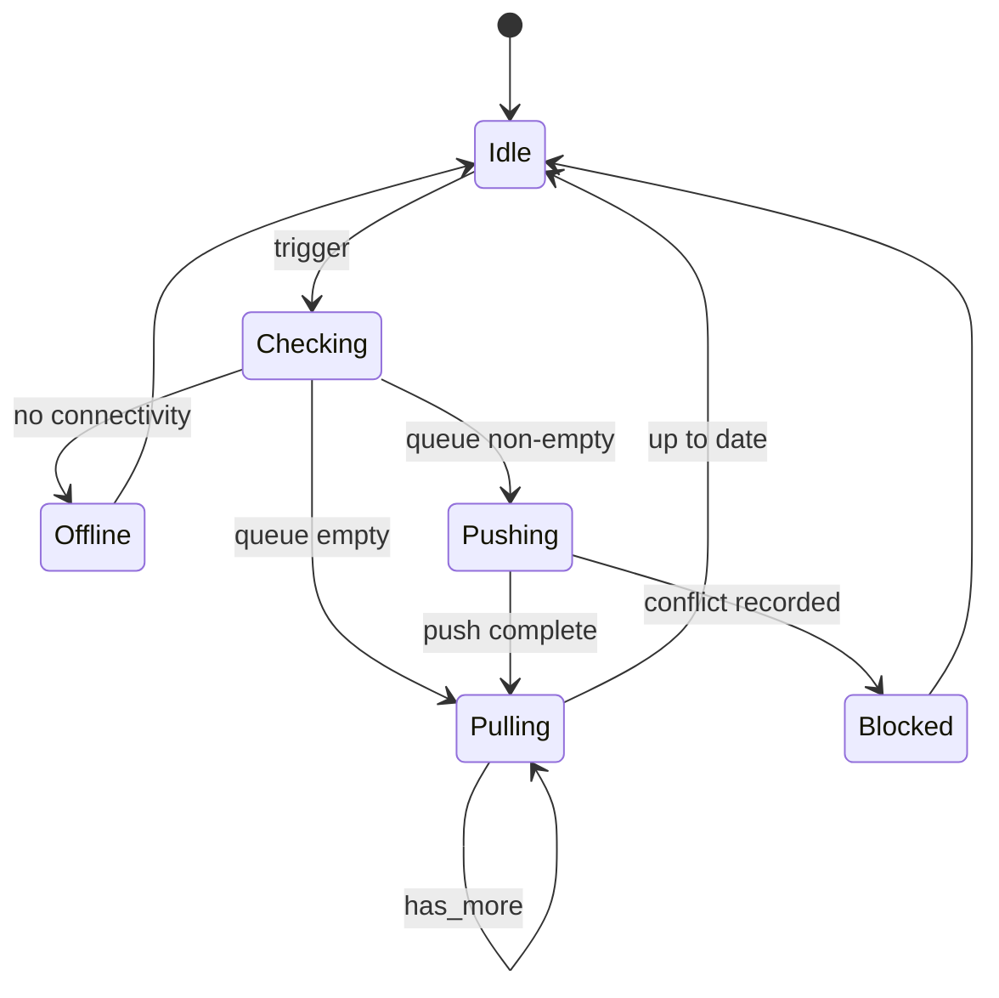
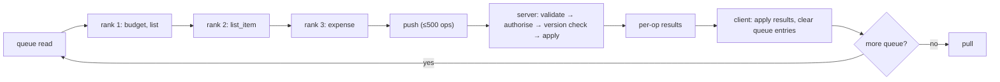
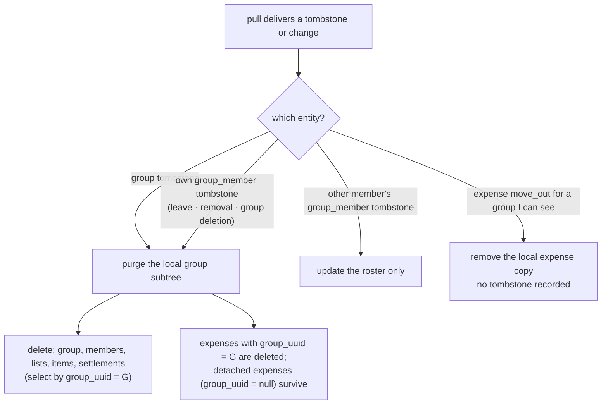
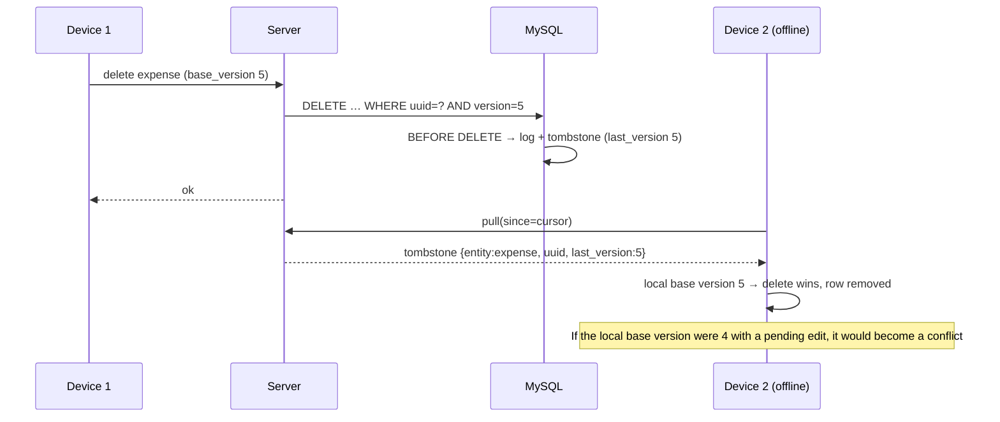

# Sync Workflows

| Field | Value |
|---|---|
| Status | Specification — Phase 2 |
| Date | 2026-11-15 |
| Purpose | The operational procedures: when sync runs, how pending changes are uploaded, how changes are retrieved, how membership changes and deletions propagate, and how every interruption is recovered |
| Requirements | SY-06, SY-11, SY-12, SY-17, SY-19, VC-09 |
| Decisions | D-16, D-17, D-19, D-27 |
| Rule | The client applies, then advances. It never advances first |

---

## 1. Scope

| Topic | Section |
|---|---|
| When sync runs | §2 |
| Handling operations that are offline-capable or not | §3 |
| Push: uploading pending changes | §4 |
| Bootstrap: the first full sync | §5 |
| Membership changes and cascades | §6 |
| Pull: incremental retrieval and the cursor | §7 |
| Interrupted sync and recovery | §8 |
| Retry policy | §9 |
| Sync status | §10 |

Endpoint contracts are in [`../api/SYNC_API_SPECIFICATION.md`](../api/SYNC_API_SPECIFICATION.md); the
local store is in [`OFFLINE_DATA_MANAGEMENT.md`](OFFLINE_DATA_MANAGEMENT.md); the data mechanics are
in [`SYNCHRONIZATION_ARCHITECTURE.md`](SYNCHRONIZATION_ARCHITECTURE.md).

---

## 2. When sync runs

| Trigger | Behaviour |
|---|---|
| App start (authenticated) | Session check → device check → push if the queue is non-empty → pull |
| Connectivity restored | Same, after a short debounce (2 s) to avoid a burst on a flapping connection |
| A write is committed locally while online | Push is scheduled immediately (Debounced 1 s so a burst of edits batches) |
| Foreground resume | Pull if the last successful pull is older than the staleness threshold |
| A pull returns `has_more` | Continue immediately |
| A push returns a conflict | Stop pushing that record; continue with the rest |
| Manual "Sync now" | The same cycle, with visible progress |
| Periodic (while the app is foregrounded) | A pull every 5 minutes if online and idle |



| Rule | Statement |
|---|---|
| Push before pull | Every push carries `base_version`, so it cannot overwrite newer state; pushing first shortens the window in which the user's own work is unsent |
| One cycle at a time | A mutex in the sync engine prevents two cycles from overlapping |
| No background sync when signed out | The engine is not constructed |
| No sync in guest mode | Guest mode has no server contact (D-04) |
| Sync does not run on a metered connection without consent | A user setting; the default is to sync |
| Sync is interruptible | Every step is resumable by construction (§8) |

---

## 3. Operations: offline-capable versus online-only

**Decision:** D-16 (matrix), D-17 (online-only operations).

| Operation | If the device is offline | If it is online |
|---|---|---|
| Offline-capable write (personal/group expense, budget, personal/group list, personal/group list item) | Committed locally, enqueued | Committed locally, enqueued, pushed immediately |
| Online-only operation (group membership mutations, check/uncheck, settlement confirm/settle, device register/revoke) | **Control disabled** with "requires connection" | Performed directly against v1 or v2; never queued |
| Notification action | Not available offline (server-backed, D-19) | Direct call |
| Read | Always served from the local store | Local store, refreshed by pull |

### 3.1 The rule that makes this safe

| Rule | Statement |
|---|---|
| Never queue an operation whose precondition is server-computed | A queued confirmation could be counted against the wrong period (PR-04); a queued check could create an expense in a period that has since closed |
| Disable, do not fail later | A queue entry that can never succeed is a data-loss trap (D-16's own wording) |
| Explain the state | "Requires connection" is shown on the disabled control |
| Never route an online-only operation through the queue "for later" | There is no later for it — its precondition is computed at the moment of the call |

### 3.2 The two-step group list check (online)

| Step | Action |
|---|---|
| 1 | The user checks a priced group item → `check_item.php` returns `needs_confirm: true` and does **not** create the expense |
| 2 | The client asks who paid → posts the item with `paid_by` → the expense is created |

| Rule | Statement |
|---|---|
| Both steps are online | The transaction and the lock check happen on the server |
| The client never creates the expense locally in this flow | It displays the outcome |
| An aborted step 2 leaves the item unchecked | No half-state exists |

---

## 4. Push: uploading pending changes (SY-06)

**Requirement:** SY-06 "pending changes upload on reconnect, in dependency order".

### 4.1 The batch (D-28, UQ-05)

| Aspect | Rule |
|---|---|
| Batch key | A client-generated UUID, **reused on every retry** of the same batch |
| Maximum operations | Max 100 records or 1MB payload per request (D-28); larger queues are split into successive batches |
| Ordering | By dependency rank, then by local queue id (§4.2) |
| Atomicity | Per operation; the server reports each outcome. There is no all-or-nothing requirement, because a single refused operation must not block others |
| Payload | Entity, `uuid`, `op`, `base_version` (except create), and the fields |
| Money | A decimal string with two decimals (D-21) |
| Client-supplied ownership | Never sent for `user_id`, `type`, `is_post_settlement`, `created_by` (`../security/ACCESS_CONTROL.md` §7.2) |
| Idempotency | `batch_key` at the logical layer, `Idempotency-Key` at the HTTP layer |

### 4.2 Dependency order (authoritative)

The order is fixed and must be implemented exactly:

```
rank 1:  budget  ·  list
rank 2:  list_item
rank 3:  expense
```

| Rule | Statement |
|---|---|
| Lower rank first | A `list_item` needs its parent list; a link from an item to an expense is resolved by the server after both exist |
| Within a rank | FIFO by the local queue id, so the user's actions apply in the order performed |
| A create of a parent precedes any child operation | Guaranteed by the ranks |
| The order is **not** configurable and **not** derived at runtime | A dynamic topological sort would be a second implementation of the same rule |
| Why expense is last | An expense may be *generated by* a list check, and an item may be linked to an expense; both are resolved when the expense exists |
| A batch may contain several ranks | If so, every rank-1 operation precedes every rank-2 operation, and so on |



### 4.3 Per-operation outcomes

| Outcome | Client action |
|---|---|
| `applied` | Update the local record's `version` and `updated_at`; delete the queue entry |
| `duplicate` | Adopt the server's record (the same UUID already exists); delete the queue entry |
| `conflict` | Create a conflict record; mark the row `conflict`; **do not retry** |
| `rejected` (validation / business rule) | Mark `failed` with the reason; surface it; do not retry automatically (§9.4) |
| `forbidden` | The operation can never succeed (permission/ lock / membership). Purge or flag per §6.3 |

### 4.4 After the push

| Step | Action |
|---|---|
| 1 | Apply every result locally **before** the next batch |
| 2 | If any operation conflicted, continue with the remaining operations — one conflict does not block the queue |
| 3 | When the queue has no `pending` entries left, run a pull (§7) so the client sees the effects of its own writes together with other devices' changes |

**Why pull after push:** the server's change log contains the client's own writes. Two options exist:
filter them out (`actor_device_uuid`), or apply them and let the version comparison make them
idempotent. The design applies them — filtering is an optimisation that hides a class of
desynchronisation, and applying a change the client already made is a no-op.

---

## 5. Bootstrap: the first full sync

| Trigger | Condition |
|---|---|
| First login on a device | No cursor in `sync_state` |
| `410 CURSOR_TOO_OLD` | §7.3 |
| A targeted entity bootstrap | A digest mismatch (§7.2 of `OFFLINE_DATA_MANAGEMENT.md`) |
| The user clears local data | Cursor reset |

### 5.1 Procedure

| Step | Action |
|---|---|
| 1 | `GET /api/v2/sync/bootstrap.php?entity=&page=` — paged |
| 2 | For each page: apply in one local transaction (insert or replace by UUID) |
| 3 | On the final page, set the cursor to the response's `cursor` and store the per-entity digests |
| 4 | Do **not** apply pending queue entries during the bootstrap; they are pushed afterwards |
| 5 | If the device has pending operations, they are pushed after the bootstrap completes |

### 5.2 Rules

| Rule | Statement |
|---|---|
| A bootstrap replaces the local dataset for the visible scope | Rows no longer returned are removed (they were deleted or are no longer visible) |
| A bootstrap never deletes queued operations | Unsent work survives (`OFFLINE_DATA_MANAGEMENT.md` §5.1) |
| A bootstrap does not resolve conflicts | It changes the **server** side of an unresolved conflict; the user still decides |
| A member who left during the bootstrap | Their group's data is absent from the response, so the local purge happens naturally |
| Paging | Bounded by a page size; the client must not buffer the whole dataset in memory |
| Interruption | The cursor is not set until the final page; a restart re-runs the bootstrap, which is idempotent by UUID |

---

## 6. Membership changes and cascades (SY-19)

**Requirement:** SY-19 "group membership change triggers targeted bootstrap or purge".

### 6.1 What the client observes

| Trigger | How it appears |
|---|---|
| The user joins a group | A `group`, `group_member`, and related changes appear in the pull stream |
| The user leaves | Their own `group_member` row is deleted → a tombstone with `entity = 'group_member'` |
| The user is removed | The same tombstone, caused by another user's action |
| The group is deleted | A `group` tombstone **and** the member's own `group_member` tombstone (personally scoped, `cause='cascade'`) — the latter is what reaches them, because membership is gone |
| A member is added or removed (not the local user) | A `group_member` insert/delete; the client updates the roster |
| An expense moves to another group or to personal | `move_out` for the old group, then `update` for the new scope (§6.4) |

### 6.2 The targeted purge rule



| Rule | Statement |
|---|---|
| The subtree purge list is fixed | `group`, its `group_member` rows, its `list` rows, their `list_item` rows, its `settlement` rows |
| The purge selects by **current** `group_uuid` | A row the server has already detached has `group_uuid = null` locally (the detach `update` arrives first, §7.5), so it is **not** selected and the owner keeps it |
| Group **expenses** owned by the caller survive group deletion | The server detaches them (`group_id = NULL`) as an ordinary logged update scoped to the owner; locally they become personal rows. `type` is not rewritten (UQ-11) |
| Group **expenses** owned by anyone else are purged | The caller is no longer entitled to them; they are never delivered to the caller's scope again |
| When the user **leaves or is removed**, the whole group scope is purged | They are no longer entitled to any of it (`../database/DATA_OWNERSHIP.md` §7.4) |
| **Group deletion reaches every member through a personal tombstone** | The server writes one `group_member` tombstone per current member with `scope_user_id = member.user_id` (`../database/DATABASE_SCHEMA_SPECIFICATION.md` §5.4.3), because the group-scoped tombstone is invisible once membership is gone |
| A purge is one local transaction | A half-purged subtree cannot exist |
| A purge cancels queued operations for the purged scope | They can never succeed; the user is warned before they are discarded (`../database/VERSIONING_AND_CONFLICT_RESOLUTION.md` §7.5) |
| A purge is never silent about the user's own data | The UI reports "You are no longer a member of X" |

### 6.3 The permission-revoked path

| Situation | On push | Client action |
|---|---|---|
| The user is no longer a member | `403` / `forbidden` outcome | Purge the group subtree; discard queued group operations; warn once |
| The user is no longer an admin | `403` on an edit/delete | Keep the record as the server has it; mark the queue entry `failed` with the reason; the user may retry after asking an admin |
| The group was deleted | The caller's own `group_member` tombstone (`cause='cascade'`) and/or `404` on the operation | Purge; if the queued operation was a create of an expense for that group, discard it with a warning |
| The record was deleted by another device | `404` + tombstone | Offer the user: accept the deletion, or re-create as a new record |

### 6.4 Cascades on the server and their local effect

| Server action | Emitted log rows / tombstones | Local effect |
|---|---|---|
| Delete group → members, lists, items, confirmations, settlements (InnoDB cascade, **no child triggers**) | `group` tombstone **and** one `group_member` tombstone per current member, `scope_user_id = member.user_id`, `cause='cascade'` (`../database/DATABASE_SCHEMA_SPECIFICATION.md` §5.4.3) | Purge the subtree on the caller's own member tombstone (§6.2) |
| Delete group → surviving expenses detached (`group_id = NULL`) | Ordinary `move_out` (old group scope) + `update` (owner scope) per expense, because the trigger performs an **explicit** `UPDATE` before the delete (§5.4.4) | The owner keeps the expense, now detached; other members' copies are purged |
| Expense moves scope: Group A → Personal, Group A → Group B, or Personal → Group A | NULL-safe `trg_expenses_au` (§5.6.4): emits `move_out` (old group scope, no payload) whenever `OLD.group_id IS NOT NULL AND NOT (OLD.group_id <=> NEW.group_id)`, followed by `update` for the new scope | The old group removes its copy without recording a tombstone; the new scope upserts |
| Delete list → items | `list` (parent) | Purge the list's items |
| Delete user (policy open) | §`../database/DATA_OWNERSHIP.md` §9 | Other devices simply stop receiving that user's changes |
| Delete expense → `list_items.expense_id = NULL` | `expense` tombstone | Clear the item's `expense_uuid`; the item itself remains |

**Why the parent tombstone is not enough on its own for group deletion.** Every cascade originates
from one identifiable parent (`../database/ENTITY_RELATIONSHIP_DIAGRAM.md` §7.1), but a parent
tombstone only reaches users who can still *resolve* the parent. Group deletion destroys the
membership rows that resolve it, so the design adds personally-scoped child tombstones. For every
other cascade the parent tombstone remains sufficient.

**After offline periods, interrupted sync, and restore.** All three cases are covered without a
special path: tombstones are durable and never pruned, so a device that was offline receives them on
its next pull; an interrupted page is re-fetched because the cursor only advances with the applied
page; and a restore that loses the tombstones is detected by the reconciliation digest, which forces
a targeted bootstrap of the affected entity (§7.2, `../api/SYNC_API_SPECIFICATION.md` §6.5).

---

## 7. Pull: incremental retrieval and the cursor

### 7.1 The watermark (D-27)

`AUTO_INCREMENT` values are allocated before commit, so a reader can observe `seq = 101` without
`seq = 100` having committed. The pull endpoint therefore returns only:

```
seq <= watermark, where watermark = max(seq) among rows with changed_at <= now() - 2 s
```

| Rule | Statement |
|---|---|
| The 2-second lag is mandatory | Two seconds exceeds the longest expected write transaction in this application |
| The server computes the watermark | The client never guesses it |
| The client obeys `next_cursor` | It never advances to a value it computed itself |
| The residual race is covered by digests | The workflow is §7.2 below; the only definition of the digest is `../api/SYNC_API_SPECIFICATION.md` §6.5; the client-side summary is in `OFFLINE_DATA_MANAGEMENT.md` §7.2 |

### 7.2 Applying a page

| Step | Action |
|---|---|
| 1 | `GET /api/v2/sync/pull.php?since=<cursor>` |
| 2 | The response contains `changes[]`, `tombstones[]`, `next_cursor`, `has_more`, and per-entity `digests` |
| 3 | Apply the whole page in **one local transaction**: upserts by UUID, tombstone application, and — in the same transaction — the cursor update to `next_cursor` |
| 4 | If `has_more`, repeat from step 1 |

| Rule | Statement |
|---|---|
| The cursor update is part of the apply transaction | This is the single mechanism that guarantees SY-17 |
| A change with `version <= local version` is a no-op | Idempotent apply |
| A tombstone is applied to the local record | Or recorded if the record is absent (it may arrive first) |
| The digests are stored for reconciliation | Not used for anything else |

**The digest, in one paragraph (canonical: `../api/SYNC_API_SPECIFICATION.md` §6.5).** One `SHA-256`
per entity, never concatenated. Canonical line `"{uuid}:{version}\n"` — lowercase hyphenated UUID,
decimal version, LF after every line including the last. Sorted ascending by UUID byte order. The
server hashes the caller's **visible scope**; the client hashes **all its local rows** of that entity.
Deleted records are excluded from both sides. Lowercase hex; the empty set hashes to
`e3b0c44298fc1c149afbf4c8996fb92427ae41e4649b934ca495991b7852b855`. The comparison is meaningful only
after a full pull cycle.

| Digest outcome | Client action |
|---|---|
| Equal | Converged for that entity |
| Different (first time) | Targeted bootstrap of that entity only; pending operations preserved and re-applied if their `base_version` is still valid |
| Different again (second consecutive) | Report, do not loop; a third marks sync unhealthy for that entity until the next app start |

### 7.3 Cursor discipline and the stale cursor (SY-17)

**Requirement:** SY-17 "the cursor cannot advance past a change the client has not applied".

| # | Rule |
|---|---|
| 1 | The cursor advances **only** in the transaction that applies a page |
| 2 | The cursor never advances to a value the server did not supply |
| 3 | The cursor never advances past `next_cursor`, even if the response contains a higher `seq` |
| 4 | A page that fails to apply leaves the cursor untouched; the page is re-fetched |
| 5 | The cursor is not advanced by a push result — pushes and pulls have separate bookkeeping |
| 6 | No code path may write the cursor outside the apply function |

| Condition | Response | Client action |
|---|---|---|
| The cursor is **malformed / unparseable** | `400 INVALID_CURSOR` | Full bootstrap (an unparseable stored cursor is unusable) |
| The cursor is well-formed but **below the retained floor** (`since < oldest_retained_seq`) | `410 CURSOR_TOO_OLD` | Full bootstrap (§5) |
| The cursor is in the **valid range** (`oldest_retained_seq <= since <= watermark`) | `200 OK` (changes up to `page_size`, or empty array with `next_cursor = watermark` if up to date) | Apply changes; advance cursor to `next_cursor` |
| The cursor is well-formed but **greater than the server watermark** (`since > watermark`) | `410 CURSOR_TOO_OLD` | Full bootstrap (§5) |
| The cursor is unknown or absent | Normal first sync | Full bootstrap |

The canonical table for every cursor state and boundary definition is `SYNC_API_SPECIFICATION.md` §6.4. In-flight records on the server (`watermark < seq <= max_allocated_seq`) remain buffered on the server and are withheld from clients; when a client with a valid cursor pulls, it receives changes only up to `watermark` (or an empty page with `next_cursor = watermark` if none exist). A client cursor above the watermark is treated exactly like one below the retained floor: both are unrecoverable incrementally, so both force a bootstrap rather than returning an empty page that would silently hide a database restore or sequence rewind (`DEPLOYMENT_ARCHITECTURE.md` §8.6).

**Why rule 3 matters:** the pull response's `next_cursor` is always `<= watermark`.
A client never advances its cursor past `next_cursor`. Using the maximum observed `seq`
would reintroduce exactly the race D-27 closes.

### 7.4 Out-of-order and duplicate changes (VC-09)

**Requirement:** VC-09 "out-of-order changes are applied idempotently".

| Situation | Rule |
|---|---|
| Two changes to the same row in one page | Applied in `seq` order (the response is ordered by `seq`); the higher version wins locally, matching the server |
| A change that arrives after the client already applied the same version | A no-op |
| A tombstone for a record the client has never seen | Recorded; applied when or if the record appears |
| A change for a record with an unknown parent | The change is applied; the UI treats the row as unattached until the parent arrives. The digest comparison detects a persistent inconsistency |
| A page re-fetched after a crash between fetch and apply | Re-applied idempotently; the cursor was not advanced |
| A change arriving for a purged scope | Ignored (a stale local scope marker) — but only for a scope purged by an authoritative tombstone |

### 7.5 Deletion propagation and subtree purge

**Requirements:** SY-10 (deletions propagate), and the cascade rule from §6.

| Event | Local effect | Queue effect |
|---|---|---|
| `expense` tombstone | The row is removed (or marked removed if referenced by an item); the item's `expense_uuid` is cleared | A queued edit/delete for it becomes a conflict or is dropped with a warning |
| `budget` tombstone | Removed | Same |
| `list` tombstone | The list and its items are purged | Queued item operations are discarded with a warning |
| `list_item` tombstone | Removed | Queued operations discarded |
| `group` tombstone | The group subtree is purged (§6.2) | Group-scoped queue entries discarded with a warning |
| `group_member` tombstone for the local user | The group subtree is purged — this is the row that reaches a former member of a **deleted** group, because the group-scoped tombstone no longer resolves to them | Same |
| `move_out` for a group the client can see | The local expense copy is removed **without** recording a tombstone (the record still exists in another scope) | A queued edit for that expense is dropped with a warning; the new-scope `update` re-creates it if the client is entitled |
| `settlement` tombstone | Removed | No queue entries exist for settlements |

**Tombstone-versus-pending-edit rule:** the tombstone wins only if its `last_version` exceeds the
local record's base version. Otherwise the client surfaces a conflict, because both intents are real
(`DATA_FLOW.md` §9).



---

## 8. Interrupted sync and recovery (SY-11)

**Requirement:** SY-11 "interrupted sync recovers without loss or duplication".

| Interruption | State at crash | Recovery | Guarantee |
|---|---|---|---|
| App killed while queueing | The record write and queue entry are in one transaction: both or neither | Restart reads the queue | No lost write, no orphan queue entry |
| App killed while pushing | Some batches may be applied; queue entries are `inflight` | `inflight` → `pending` on restart; the same `batch_key` is reused | The server replays from `sync_batches` or re-applies idempotently |
| App killed after the server applied but before the client read the response | The batch is `applied` server-side | The retry returns the stored result | No duplication |
| App killed while pulling | The cursor was not advanced if the page did not commit | The page is re-fetched | No loss, no duplication |
| App killed after commit but before the cursor write | Impossible: same transaction | — | — |
| Network drop mid-response | Same as above | Retry with the same key | Idempotent |
| Server restart mid-push | The transaction rolled back; the batch row is `received` | After the abandonment window (10 min), retry with the same key | Nothing applied twice |
| Server restart mid-pull | The client re-fetches | — | Idempotent |
| Device clock change | Irrelevant | — | Ordering comes from `seq`/version |
| Local database corrupted | Queue and cursor unreadable | Wipe local data and bootstrap; warn that unsent changes were lost | The only lossy path, and it is explicit |

### 8.1 The abandonment window

| Rule | Statement |
|---|---|
| A `received` batch older than 10 minutes is abandoned | Its transaction cannot still be open |
| A retry with the same key after the window re-executes | Safe because every operation is idempotent by UUID + `base_version` |
| A retry **within** the window returns "in progress" | Prevents two concurrent applications of the same batch |

### 8.2 What recovery must never do

| Never | Reason |
|---|---|
| Generate a new `batch_key` for a retry of the same work | It would re-apply everything |
| Advance the cursor to "catch up" | It would skip changes |
| Delete the queue to clear an error | It would discard the user's work |
| Re-send an operation already reported `applied` | Duplicate work at best, a conflict at worst |

---

## 9. Retry policy (SY-12)

**Requirement:** SY-12 "failed operations retry safely".

### 9.1 Classification

| Class | Examples | Retry? |
|---|---|---|
| Transport | Timeout, connection reset, DNS | Yes, with backoff |
| Server transient | `500`, `502`, `503`, `504` | Yes, with backoff, bounded |
| Rate limited | `429` | Yes, after `Retry-After` |
| Session | `401` | Not automatically: re-authenticate first, then retry the batch |
| Device | `403 DEVICE_REVOKED` | No: surface to the user |
| Conflict | `409 VERSION_CONFLICT`, `409 RECORD_DELETED`, `409 DUPLICATE_ID` | No: create a conflict record |
| Business refusal | `409 PERIOD_SETTLED`, `409 PERIOD_CHANGED`, validation errors | No: mark `failed`, surface, await the user (§9.4) |
| Permission | `403` | No: §6.3 |
| Malformed | `400` | No: it is a client bug; log it with the batch and surface it |

### 9.2 Backoff

| Attempt | Delay |
|---|---|
| 1 | 1 s |
| 2 | 2 s |
| 3 | 4 s |
| 4 | 8 s |
| 5 | 16 s |
| 6 | 32 s |
| 7+ | 60 s (capped) |

| Rule | Statement |
|---|---|
| Jitter of ±20% | Prevents a synchronised retry storm after an outage |
| The delay is per queue entry, not per batch | One failing operation must not delay the others |
| `next_attempt_at` is persisted | So a restart does not reset the backoff |
| `Retry-After` overrides the computed delay when it is longer | The server's instruction wins |

### 9.3 Attempt ceiling and visibility

| Rule | Statement |
|---|---|
| Transport/server retries are unlimited but capped at 60 s apart | A long outage should heal automatically |
| After 10 failed attempts, the entry is surfaced in the sync status | The user can see something is wrong rather than assuming it will resolve |
| The sync status shows the oldest pending change and the last error | Transparency, not log spelunking |

### 9.4 Permanently failing operations (UQ-18)

| Aspect | Rule |
|---|---|
| A business refusal is terminal | It becomes `failed` with the server's exact reason |
| The user chooses | Discard, duplicate as a new record, or edit and retry |
| The record stays visible locally | In a "not saved" state with the reason; it is **never** deleted automatically |
| The write is never silently dropped | UQ-18 governs the exact presentation; the no-silent-loss rule does not depend on it |

### 9.5 Idempotency guarantees that make retry safe

| Level | Mechanism |
|---|---|
| HTTP | `Idempotency-Key` (`config/idempotency.php`) — wired to 11 v1 POSTs and required for v2 pushes |
| Batch | `sync_batches.batch_key` + `request_hash` |
| Operation | `uuid` for create (a duplicate is `409`/`duplicate`), `uuid` + `base_version` for update/delete |
| Local | `sync_queue` entries are removed only after a terminal outcome |

---

## 10. Sync status surface (SY-13)

| Indicator | States |
|---|---|
| Global | `up to date` · `syncing` · `offline` · `N changes waiting` · `needs attention (N)` |
| Per record | A subtle marker for `pending`; a badge for `conflict` |
| Last sync | Relative time |
| Errors | The last error, in plain language, with a "Try now" action |

| Rule | Statement |
|---|---|
| Every indicator has a source it can name | The queue count, the conflict count, the connectivity state, and the last sync time |
| "Up to date" is only claimed when the queue is empty and the last pull succeeded | An optimistic claim destroys trust the first time it is wrong |
| No infinite spinners | A sync attempt that cannot succeed must end in a visible state |

---

## 11. Status of architectural questions

| UQ | Status | Decision & Policy |
|---|---|---|
| UQ-04 — device revocation | `APPROVED` | Option B: Full revocation via `app_sessions` table terminates sync and session immediately |
| UQ-05 — sync rate limits and batch size | `APPROVED` | 120 req/min user, 240 burst device; max 100 records / 1MB payload per batch |
| UQ-08 — offline capability matrix | `APPROVED` | Six entity types offline (D-16); settlements and list check/uncheck online-only |
| UQ-09 — retention | `APPROVED WITH PROVISIONAL POLICY` | 90 days sync log, indefinite tombstones, 45 days batches, account-life guest import audit |
| UQ-12 — conflict notification UX | `APPROVED` | Dedicated "Needs Attention" area; safe auto-merge for metadata; no auto-merge for financial fields |
| UQ-17 — device registration requirement | `APPROVED` | Mandatory registration before sync push/pull (D-34) |
| UQ-18 — permanently rejected writes | `APPROVED` | Surfaced in Needs Attention; 24h reminder countdown reset account-wide upon receipt (D-35) |

---

## 12. Verification

| Requirement | Method | Pass condition |
|---|---|---|
| SY-06 dependency order | `CONTRACT-TEST` | A queue containing a list, its item, and an expense is pushed and applied in rank order; no foreign-key failure occurs |
| SY-10 deletion propagation | `CONTRACT-TEST` | A tombstone removes the local row on another device |
| SY-11 interrupted sync | `INTEGRATION-TEST` | Kill the app during push and during pull; totals match afterwards, no duplicates |
| SY-12 retry safety | `CONTRACT-TEST` | Retrying a batch with the same key applies nothing twice |
| SY-13 status | `MANUAL-SCENARIO` | Each state in §10 is reachable and accurate |
| SY-17 cursor discipline | `UNIT-TEST` + `INTEGRATION-TEST` | A forced failure during page application leaves the cursor unchanged; a grep finds exactly one cursor-writing call site |
| SY-19 membership change | `CONTRACT-TEST` | Removal purges the group subtree and cancels scoped queue entries |
| VC-09 idempotent apply | `UNIT-TEST` | Applying the same page twice yields an identical local state |
| §4.2 order is enforced by code, not convention | `UNIT-TEST` | The queue read orders by `dependency_rank, id` |
| §6.2 purge list | `CONTRACT-TEST` | A group tombstone purges exactly the listed entities and no others |
| §7.1 watermark | `CONTRACT-TEST` | A change committed inside the 2-second window is not returned until the watermark passes it |
| §8.1 abandonment window | `CONTRACT-TEST` | A retry within 10 minutes returns "in progress"; after it, the batch re-executes without duplication |
| §9.2 backoff | `UNIT-TEST` | Delays follow the table with jitter inside ±20% and honour `Retry-After` |
